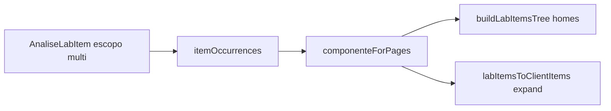

# Lista multi-componente + balão página 1 no flipbook

## 1. Lista: ocorrência virtual por componente

Um `AnaliseLabItem` tem um único `componente` persistido; páginas do escopo podem atravessar Capa e Miolo (`itemOccurrences` + `componenteForPages` em [`analiseLabComponente.ts`](apps/web/src/features/analise-lab/analiseLabComponente.ts)). A árvore e o preview cliente filtram só por `item.componente`.

**Abordagem (somente display):** include o item em todo slot cujo componente tenha ≥1 página do escopo.

### Inspeção — [`analiseLabItemsTree.ts`](apps/web/src/features/analise-lab/analiseLabItemsTree.ts)

- Estender `buildLabItemsTree` com `pages` (manifesto) e `modo` da sessão.
- Novo helper `itemHomesForComponents(item, pages, modo)` → conjunto de labels via `itemOccurrences` + `componenteForPages`; se sem páginas resolvíveis, cair no `componente` armazenado.
- Em `buildOsVersionNode` / órfãos: colocar o item em cada slot do conjunto (mesmo objeto/`id`).
- Garantir que labels extras (ex.: Capa+Miolo) entrem em `componentLabels` quando houver home virtual sem PDF slot ainda — estender labels com homes derivados dos itens, além do classify clássico.
- Passar `pages` + `session.modo` de [`AnaliseLabPage.tsx`](apps/web/src/features/analise-lab/AnaliseLabPage.tsx) → `itemListProps` → [`AnaliseLabItemList.tsx`](apps/web/src/features/analise-lab/AnaliseLabItemList.tsx).
- Ações espelhadas nas duas linhas (pedido do usuário): ambas selecionam/arrastam/toggle/excluem pelo mesmo `id`. Keys React já são por `ul` de componente (`key={item.id}`), sem colisão entre Capa e Miolo.
- Testes em [`analiseLabItemsTree.test.ts`](apps/web/src/features/analise-lab/analiseLabItemsTree.test.ts): item com `paginas` em capa+miolo aparece nos dois nós; item só capa só em Capa.

### Folhear — [`analiseLabClientPreview.ts`](apps/web/src/features/analise-lab/analiseLabClientPreview.ts) + painel

- Expandir `labItemsToClientItems` (ou wrapper usado pela página) para emitir **uma** `ClientAnalysisItem` por home, com o **mesmo** `uniqueId`/`originalId` e `componenteOrigem` = home; `resolver`/upload com base nesse home.
- Em [`AnaliseLabClientPortalPanel.tsx`](apps/web/src/features/analise-lab/AnaliseLabClientPortalPanel.tsx), key da linha: `` `${item.uniqueId}::${item.componenteOrigem}` `` para evitar colisão React.
- Passar `pages` + `modo` na chamada em `AnaliseLabPage`.
- Atualizar [`analiseLabClientPreview.test.ts`](apps/web/src/features/analise-lab/analiseLabClientPreview.test.ts).

**Fora de escopo:** registro/API, balões (`AnaliseLabBalloonLayer` occurrences), split no backend.

## 2. Balão página 1 no flipbook

**Causa:** no Folhear flipbook, [`AnaliseLabBalloonLayer.tsx`](apps/web/src/features/analise-lab/AnaliseLabBalloonLayer.tsx) ancora a capa na **metade direita** do slot 2p (`left: slotWidth - pageSize.width`), mas [`ProvaWebFlipbook.tsx`](apps/web/src/features/prova-web/ProvaWebFlipbook.tsx) reduz o livro a 1p fechado e `.prova-web-book { margin: 0 auto }` + `marginLeft: auto` **centralizam** o livro — âncoras e página desalinhadas. Spread aberto ocupa o slot inteiro e parece certo.

**Correção:** forçar o livro fechado **flush à direita** do slot 2p (mantém PageFlip 1p e a intenção “capa na metade direita”):

- Em `ProvaWebFlipbook`, estilo do book + effect de resize: quando `!isSpread`, `margin: "0 0 0 auto"` (ou `marginLeft: "auto"` + `marginRight: 0`), anulando o `margin: 0 auto` do CSS só nesse estado; quando spread, `margin: 0`.
- Não mudar folhas (já usa `pageRectsOverride` medido).
- Não alterar lógica de balões/ocorrências.

Se após o flush a capa ainda falhar em algum caso edge (contracapa sozinha à esquerda), tratar à parte; o alvo desta correção é a **página 1 / capa**.

## Critérios de aceite

- Problema com páginas em Capa e Miolo aparece nas duas seções em **Problemas registrados** e no Folhear; um balão por marca (sem duplicar).
- Registro e payload do item inalterados.
- Ações nas duas linhas operam o mesmo item.
- No flipbook Folhear, balão da página 1 alinha na capa fechada; abrir o miolo continua alinhado.
