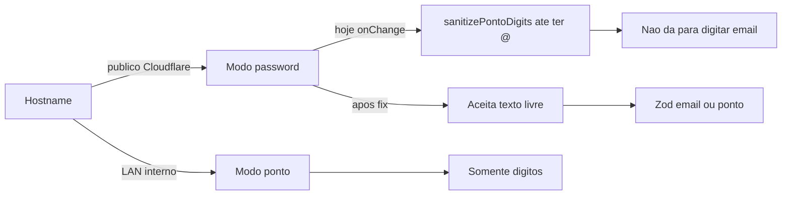

# Aceitar e-mail no login externo

## Causa

No acesso externo (hostname público / Cloudflare), o formulário já é o modo **password** (“E-mail ou ponto”). Schema ([`passwordLoginSchema.ts`](apps/web/src/features/auth/passwordLoginSchema.ts)) e backend (`POST /api/auth/login` + `_lookup_password_user`) já aceitam e-mail.

O bloqueio está no `onChange` de [`login.index.tsx`](apps/web/src/routes/login.index.tsx):

```189:193:apps/web/src/routes/login.index.tsx
onChange={(e) => {
  const raw = e.target.value;
  e.target.value = raw.includes("@") ? raw : sanitizePontoDigits(raw);
  void loginField.onChange(e);
}}
```

Enquanto o usuário digita `user@...`, as letras são removidas antes do `@` aparecer. Colar um e-mail completo funciona; digitar não.

O modo interno (**ponto**) continua com `inputMode="numeric"`, `pattern="[0-9]*"` e `sanitizePontoDigits` — sem alteração.



## Alteração (só frontend)

Arquivo: [`apps/web/src/routes/login.index.tsx`](apps/web/src/routes/login.index.tsx)

1. **Remover** o `onChange` customizado do campo `login` no modo password; usar o `register` do react-hook-form sem filtrar caracteres.
2. **Manter** no submit a normalização já existente: se não tiver `@`, aplicar `sanitizePontoDigits` antes de chamar a API (ponto ainda válido no externo).
3. **Ajustar hint/label** do modo password: trocar `PONTO_HINT` por texto adequado (ex.: “Use o e-mail cadastrado ou o ponto numérico”) para não sugerir “somente números”.
4. **Não alterar** o formulário de ponto (interno), nem backend, nem detecção de host público.

## Verificação

- Digitar e-mail caractere a caractere no host externo (ou forçando modo password).
- Login por ponto numérico ainda funciona no modo password.
- Na LAN, campo ponto continua só dígitos.
- `pnpm typecheck` / teste manual da página de login.