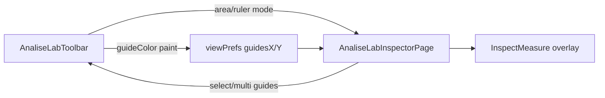

# Medidas e guias na Inspeção

## Escopo

Só **Inspeção** (`hideViewAids=false`). Folhear sem mudança. Medidas efêmeras **não** viram marcas. Persistência de guias continua em [`analiseLabViewPrefs.ts`](apps/web/src/features/analise-lab/analiseLabViewPrefs.ts) (localStorage).

A marca permanente «Medir» (`medida` na paleta) **permanece**; as novas ferramentas são auxiliares da barra.

## 1. Dimensões da página na toolbar

Em [`AnaliseLabToolbar.tsx`](apps/web/src/features/analise-lab/AnaliseLabToolbar.tsx):

- Remover `{zoom}% · {sizeLabel}` do bloco de zoom (ficar só `{zoom}%`).
- À **direita** da barra (`ml-auto`), exibir `Pág. {W} × {H}` usando `sizeLabel` já calculado em [`AnaliseLabInspector.tsx`](apps/web/src/features/analise-lab/AnaliseLabInspector.tsx) via `pageSizeMm` + `formatMm`.
- Oculto quando `hideViewAids` (Folhear).

## 2. Ferramentas efêmeras Área e Régua

Estado local na Inspeção (não em `AnaliseLabTool` de marcas), p.ex. em Inspector/Page:

```ts
type InspectMeasureMode = "off" | "area" | "ruler";
```

Na toolbar (ao lado Guia/Grade), dois botões: **Área** (retângulo) e **Régua** (2 pontos). Ativar um desliga o outro; ativar pode forçar `tool=select` nas marcas para não conflitar.

Interação no canvas ([`AnaliseLabInspectorPage.tsx`](apps/web/src/features/analise-lab/AnaliseLabInspectorPage.tsx)), espelhando o draft de 2 cliques atual:

| Modo | Gestos | Overlay |
|------|--------|---------|
| `area` | 2 clicks (ou pointer drag) → retângulo | stroke + label `W × H mm` no centro/canto |
| `ruler` | 2 clicks → segmento | linha + label distância `√(Δx²+Δy²)` em mm (e opcional Δx/Δy) |

Limpar draft ao trocar de página/modo/Escape. Sem `addMark`. Labels via `formatMm`.

Helpers puros em módulo novo `analiseLabInspectMeasure.ts` (+ testes: distância, dims do retângulo).

## 3. Guias: cor por linha + multi-seleção

### Modelo de dados

Trocar listas numéricas por objetos (com migração em `normalizeViewPrefs`):

```ts
type GuideLine = { id: string; posMm: number; color: string };
// prefs.guidesX / prefs.guidesY
// prefs.guideColor = cor de pintura para NOVAS guias
```

Aceitar formato antigo `number[]` na carga → atribuir `guideColor`/default e ids estáveis.

Atualizar `addGuideMm` / `moveGuideMm` / `removeGuideMm` para operar em `GuideLine`; nova guia usa `prefs.guideColor` atual.

### Cor

- Color picker da toolbar: altera só `guideColor` (pintura futura). **Não** recolorir linhas existentes.
- Com **uma** guia selecionada: o mesmo (ou segundo) color input altera `color` dessa guia.
- SVG: `stroke={guide.color}` por linha.

### Seleção e distância

- Clique na guia (modo select / guias ligadas): seleciona.
- Ctrl/Cmd+clique: multi-seleção; máximo prático **2**.
- Se 2 guias **paralelas** (ambas X ou ambas Y): badge/overlay `Δ = |posA−posB| mm`.
- Se eixos mistos: não mostrar distância única (só seleção).

### Excluir selecionada

- Botão «Excluir guia» (visível com 1+ selecionadas) e tecla Delete/Backspace → remove só as selecionadas.
- «Limpar» continua apagando todas.

Estado de seleção: React state no Inspector (não precisa persistir).

## 4. Wiring



- Folhear: `hideViewAids` esconde medidas, botões e dimà direita.
- Testes: normalize migração de guias; distância paralela; helpers de área/régua.

## Critérios de aceite

- Inspeção: dimensões da página ativa à direita da toolbar, em mm.
- Área e Régua medem em mm e somem ao sair do modo; nada no banco.
- Novas guias herdam a cor do picker; antigas não mudam; selecionada pode mudar de cor; excluir só a(s) selecionada(s).
- Duas guias paralelas selecionadas mostram distância em mm.
- Folhear inalterado.
