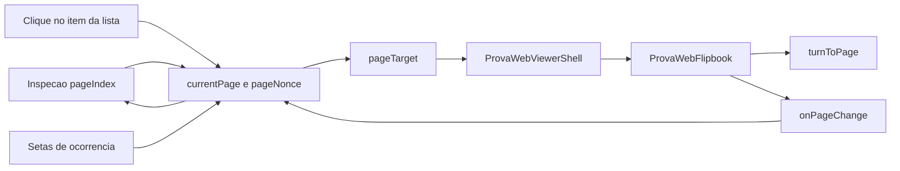
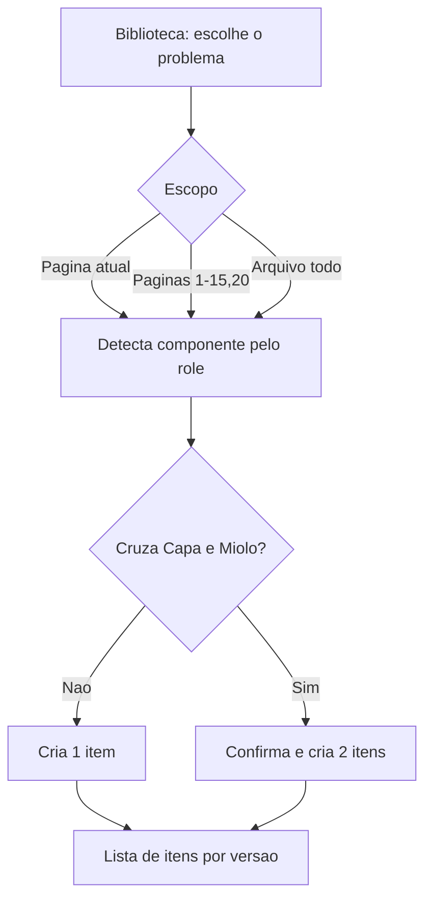

# Merge da Análise dentro do Análise Lab

Todo o trabalho acontece na feature `analise-lab` e em arquivos novos. A página `/analise`, seus componentes e suas rotas continuam intactos.

## Decisões que guiam o plano

- Itens registrados no Lab ficam em tabelas próprias (`tabAnaliseLabItem`), separadas de `tabAnaliseItens`.
- A biblioteca continua sendo a mesma (`tabProblemasPadrao`), consumida pelos endpoints que já existem.
- O fechamento (Concluir, relatório, PDF, portal) passa a existir também no Lab.
- Como o portal do cliente lê itens de `tabAnaliseItens` e o relatório de `tabAnalises`, ao concluir pelo Lab os itens são espelhados nessas tabelas. Entrada isolada, saída compartilhada. Se preferir não espelhar, basta remover a etapa de espelho da rota de conclusão; o portal então mostra só o relatório, sem interação item a item.
- Escopo que cruza Capa e Miolo vira dois itens, um por componente, com confirmação antes.

## 1. Modelo de dados

Em [app/backend/analise_lab_schema.py](app/backend/analise_lab_schema.py), nova tabela criada junto das existentes e evoluída pelo `_ensure_column` que já está lá:

```sql
CREATE TABLE IF NOT EXISTS tabAnaliseLabItem (
    ID INT AUTO_INCREMENT PRIMARY KEY,
    SessaoID INT NOT NULL,
    ID_ProblemaPadrao INT NULL,
    Titulo VARCHAR(255) NOT NULL,
    HtmlSnapshot LONGTEXT NOT NULL,
    Obs TEXT NULL,
    Componente VARCHAR(24) NOT NULL,        -- Capa | Miolo | Arq. Único
    Escopo VARCHAR(16) NOT NULL,            -- pagina | paginas | arquivo
    Pagina INT NOT NULL DEFAULT 0,
    Paginas VARCHAR(255) NULL,
    VersaoLabel VARCHAR(128) NOT NULL DEFAULT '',
    Ordem INT NOT NULL DEFAULT 0,
    ResolucaoObrigatoria TINYINT(1) NOT NULL DEFAULT 0,
    ItemAnaliseID INT NULL,                 -- espelho em tabAnaliseItens
    PontoRegistro INT NULL,
    DataRegistro DATETIME DEFAULT CURRENT_TIMESTAMP,
    DataAtualizacao DATETIME DEFAULT CURRENT_TIMESTAMP ON UPDATE CURRENT_TIMESTAMP,
    KEY idx_lab_item_sessao (SessaoID, VersaoLabel, Componente),
    CONSTRAINT fk_lab_item_sessao FOREIGN KEY (SessaoID)
        REFERENCES tabAnaliseLabSessao(ID) ON DELETE CASCADE
) ENGINE=InnoDB DEFAULT CHARSET=utf8mb4
```

`Pagina`/`Paginas` seguem exatamente a convenção já implementada para marcas, reaproveitando `parse_page_spec` e `format_page_spec` de [app/backend/services/analise_lab_service.py](app/backend/services/analise_lab_service.py). `Escopo = "arquivo"` grava `Pagina = 0` e `Paginas = NULL`.

Coluna adicional em `tabAnaliseLabMarca` via `_ensure_column`: `ItemID INT NULL`, permitindo amarrar marcas técnicas ao problema registrado e destacá-las quando o item é selecionado.

## 2. Detecção automática do componente

O manifesto já traz `role` por página (`cover-front`, `cover-front-inside`, `page`, `cover-back-inside`, `cover-back`). A regra:

- Sessão em modo `unico`: sempre `Arq. Único`.
- Sessão em modo `capa_miolo`: `role` começando com `cover` vira `Capa`; o resto vira `Miolo`.

Implementado em dois lugares espelhados, porque a validação precisa existir no servidor e o preview no cliente:

- `app/backend/services/analise_lab_items_service.py` — lê o manifesto em disco pelo mesmo caminho usado por [app/backend/routers/analise_lab_routes.py](app/backend/routers/analise_lab_routes.py) e expõe `componente_for_pages(session, manifest, pages) -> dict[str, list[int]]`.
- `apps/web/src/features/analise-lab/analiseLabComponente.ts` — `roleToComponente`, `componenteForPages`, `splitScopeByComponente`.

Quando `componente_for_pages` devolve mais de uma chave, a rota de registro cria um item por componente, cada um com as suas páginas, e devolve os dois na resposta. O front confirma antes: "Este escopo atinge Capa e Miolo. Registrar dois problemas?".

## 3. Backend novo

Arquivo `app/backend/services/analise_lab_items_service.py`:

- `list_items(sessao_id)`, `get_item`, `add_item`, `update_item`, `delete_item`, `reorder_items`
- `register_from_library(sessao_id, id_problema, escopo, pagina, paginas, versao_label, ponto)` — copia `TituloPT`/`ProbTecHTML` de `tabProblemasPadrao`, resolve componente, divide por componente quando necessário
- `item_occurrences(item, manifest)` — expande o escopo na lista ordenada de páginas reais, base do navegador de ocorrências

Arquivo `app/backend/services/analise_lab_report_service.py`:

- `build_lab_consolidated_html(ano, os_id, sessao, versao_label)` — mesma estrutura visual do relatório atual (cabeçalho vermelho, seções Capa e Miolo, renumeração), reaproveitando `normalize_item_snapshot_for_report` e `renumber_first_h2` de [app/backend/services/pt_report_html_service.py](app/backend/services/pt_report_html_service.py). É um espelho de `build_consolidated_pt_inner_html` (linha 1418 de [app/backend/routers/analise_routes.py](app/backend/routers/analise_routes.py)) lendo a tabela do Lab, deliberadamente duplicado para não tocar no caminho da `/analise`.
- `mirror_items_to_analise(ano, os_id, sessao)` — garante o cabeçalho em `tabAnalises`, insere/atualiza `tabAnaliseItens` pelos `ItemAnaliseID` e remove os órfãos.
- `conclude(ano, os_id, versao, usuario)` — chama o espelho, grava `RelatorioHTML`/`RelatorioEmail`, faz upsert do token em `tabClientTokens`, atualiza `tabProtocolos.email_pt_html/email_pt_versao/email_pt_data` e gera o PDF por `refresh_pt_analysis_pdf`.

Rotas novas em [app/backend/routers/analise_lab_routes.py](app/backend/routers/analise_lab_routes.py), todas sob `_require_analise`:

- `GET /os/{ano}/{os_id}/analise-lab/itens`
- `POST /os/{ano}/{os_id}/analise-lab/itens` — registro a partir da biblioteca ou item livre
- `PATCH /os/{ano}/{os_id}/analise-lab/itens/{item_id}` — título, html, obs, escopo, páginas, componente manual, ordem
- `DELETE /os/{ano}/{os_id}/analise-lab/itens/{item_id}`
- `GET /os/{ano}/{os_id}/analise-lab/relatorio` — preview do consolidado
- `POST /os/{ano}/{os_id}/analise-lab/concluir` — devolve a URL do portal

O payload de `GET .../analise-lab` (info) passa a incluir `itens`, junto de `session` e `marks`.

## 4. Frontend: novos módulos

Em `apps/web/src/features/analise-lab/`:

- `AnaliseLabLibrary.tsx` — busca por título e lista compacta (linhas de uma só linha, `text-xs`, sem preview embutido). Consome `fetchProblemasPadrao` de [apps/web/src/api/analise.ts](apps/web/src/api/analise.ts).
- `AnaliseLabItemList.tsx` — árvore Versão, depois Componente, depois itens; badge com o escopo (`todas`, `p12`, `p3-8,20`); versões anteriores em somente leitura, igual à `/analise`.
- `AnaliseLabItemPanel.tsx` — título, editor de HTML, observação, seletor de escopo e componente detectado.
- `AnaliseLabProblemBox.tsx` — box do modo Folhear: título, conteúdo e navegação entre ocorrências.
- `AnaliseLabConcluir.tsx` — diálogo de conclusão com preview do consolidado e o link do portal.
- `FloatingPanel.tsx` — painel flutuante arrastável e não modal, reutilizável (seção 7).
- `analiseLabComponente.ts` e `analiseLabItens.ts` (cliente HTTP).

Editor e formatação são reaproveitados por import direto, sem alterar os arquivos: [AnaliseHtmlEditor.tsx](apps/web/src/features/analise/components/AnaliseHtmlEditor.tsx), [AnaliseFormattingToolbar.tsx](apps/web/src/features/analise/components/AnaliseFormattingToolbar.tsx) e [AnaliseHtmlViewer.tsx](apps/web/src/features/analise/components/AnaliseHtmlViewer.tsx).

## 5. Layout

Hoje a Inspeção é visualizador mais um `aside` fixo de 288px em [AnaliseLabMarkTools.tsx](apps/web/src/features/analise-lab/AnaliseLabMarkTools.tsx). Esse `aside` deixa de existir: as ferramentas migram para a paleta flutuante da seção 7, liberando a largura para os painéis que vêm da `/analise`, que por sua vez ficam bem mais enxutos do que são lá.

Aba Inspeção:

- Coluna esquerda, `w-64` com abas internas Biblioteca, Itens e Marcas. A biblioteca vira uma lista densa com busca no topo; o preview do template deixa de ocupar coluna inteira e aparece só em hover/expansão. Marcas recebe a lista de marcas e o `AnaliseLabMarkEditor` que hoje vivem no painel lateral.
- Centro, `flex-1`: o `AnaliseLabInspector` atual, sem mudanças de comportamento.
- Coluna direita, `w-80`: `AnaliseLabItemPanel`, com o editor em altura limitada (`max-h-[45vh] overflow-auto`) no lugar da coluna cheia da `/analise`. Só aparece quando há item selecionado.

Aba Folhear:

- Coluna esquerda, `w-64`: `AnaliseLabItemList` com os problemas registrados.
- Centro, `flex-1`: `ProvaWebViewerShell` como hoje, com o overlay de marcas já existente.
- Coluna direita, `w-80`: `AnaliseLabProblemBox` com o problema selecionado. Aparece apenas quando há item selecionado, senão o flipbook usa a largura toda.

Botões de topo em [AnaliseLabPage.tsx](apps/web/src/features/analise-lab/AnaliseLabPage.tsx) ganham "Concluir e salvar" ao lado de "Trocar arquivo".

## 6. Navegação e sincronia de página

Três movimentos usam o mesmo mecanismo: clicar num item da lista, trocar de Inspeção para Folhear e trocar de Folhear para Inspeção.

### Estado único de página

`AnaliseLabPage` já tem `pageIndex` levantado para a Inspeção. Ele passa a ser a página corrente das duas abas, guardada como número de página real (`pages[i].page`, não índice), mais um `pageNonce` que força a reaplicação quando o alvo é o mesmo valor:

```ts
const [currentPage, setCurrentPage] = useState(1);
const [pageNonce, setPageNonce] = useState(0);
const goToPage = (page: number) => {
  setCurrentPage(page);
  setPageNonce((n) => n + 1);
};
```

- Inspeção → Folhear: ao montar, o flipbook recebe `pageTarget = { page: currentPage, nonce: pageNonce }` e abre direto na página que estava na inspeção, inclusive quando é uma página do meio do arquivo.
- Folhear → Inspeção: o flipbook reporta a página visível por `onPageChange`, que alimenta `currentPage`; ao voltar para a Inspeção, o `pageIndex` é recalculado por `pages.findIndex((p) => p.page === currentPage)`.
- Clique num item: `goToPage(ocorrencias[0])`, valendo nas duas abas.

### Props novas no flipbook

O flipbook não expõe API imperativa hoje; `flipRef` e o `pageIndex` são internos a `ProvaWebFlipbookHorizontal` (linha 106 de [ProvaWebFlipbook.tsx](apps/web/src/features/prova-web/ProvaWebFlipbook.tsx)). Duas props opcionais atravessam [ProvaWebViewerShell.tsx](apps/web/src/features/prova-web/ProvaWebViewerShell.tsx), no mesmo padrão já usado por `renderPageOverlay`, então nada muda para a Prova WEB quando não são passadas:

- `pageTarget?: { page: number; nonce: number }` — um `useEffect` disparado pelo `nonce` chama o `turnToPage` que já existe dentro de `goToPageNumber` (linha 295). O alvo também é aplicado logo após a criação da instância `PageFlip` (linha 216), porque o componente é desmontado ao trocar de aba e voltaria à capa sem isso.
- `onPageChange?: (page: number) => void` — chamado no handler `flip.on("flip", ...)` (linha 212) e na aplicação de `pageTarget`, reportando `resolveVisiblePages(pages, idx)[0].page` para que, num spread de duas páginas, a esquerda seja a referência.

Para evitar laço entre pai e filho, o efeito de `pageTarget` compara com a página visível atual e sai cedo se já estiver nela.



O box da direita mostra "Ocorrência 2 de 4 · página 14" com setas quando o escopo tem mais de uma página; para escopo de arquivo inteiro, as ocorrências são todas as páginas do componente do item.

## 7. Paleta flutuante de ferramentas

Novo `apps/web/src/features/analise-lab/FloatingPanel.tsx`, genérico e sem dependência nova:

- Não modal: sem overlay ou backdrop, apenas um `div` com `position: fixed` e `z-30`. O restante da tela continua clicável, então dá para arrastar na régua, clicar na página e trocar de aba com a paleta aberta.
- Arrastável pela barra de título: `onPointerDown` com `setPointerCapture`, guardando o deslocamento entre o ponteiro e o canto do painel; `onPointerMove` atualiza `{ x, y }`, sempre limitado à viewport para o painel não sumir. `touch-action: none` no cabeçalho evita o scroll durante o arrasto no trackpad ou toque.
- Cabeçalho com título, botão de recolher (mantém só a barra) e botão de fechar.
- Posição, tamanho recolhido e estado aberto guardados em `localStorage` sob `analise-lab:tools-panel`, com validação contra a viewport ao restaurar, para o caso de a janela ter diminuído.
- `role="dialog"` com `aria-label`, sem `aria-modal`, e sem armadilha de foco, já que a interação com a página precisa continuar livre.

O gatilho é um botão flutuante redondo no canto inferior esquerdo (`fixed bottom-4 left-4 z-30`), com o ícone de régua que já vem do `lucide-react`, visível apenas na aba Inspeção e quando o render está pronto. Clicar alterna aberto e fechado.

Dentro da paleta vai o conteúdo atual de [AnaliseLabMarkTools.tsx](apps/web/src/features/analise-lab/AnaliseLabMarkTools.tsx), reorganizado para caber em cerca de 320px de largura: seletor de ferramenta, cor, rótulo, escopo de páginas, borda, campos De/Até e passo da grade. A lista de marcas e o `AnaliseLabMarkEditor` saem do painel de ferramentas e passam a ocupar uma aba Marcas na coluna esquerda, ao lado de Biblioteca e Itens, porque são listas de leitura frequente e ficariam apertadas dentro da paleta.

O componente muda de assinatura: deixa de renderizar o próprio `aside` e passa a receber apenas os controles, com a lista e o `editorSlot` movidos para a coluna esquerda.

## 8. Fluxo de registro



## 9. Testes

- pytest em [app/backend/tests/test_analise_lab.py](app/backend/tests/test_analise_lab.py): `componente_for_pages` para modo único e capa+miolo; divisão quando o escopo cruza componentes; escopo `arquivo` gravando `Pagina = 0`; `build_lab_consolidated_html` com itens de Capa e Miolo produzindo as duas seções numeradas.
- vitest `analiseLabComponente.test.ts`: `roleToComponente` para os cinco papéis e `splitScopeByComponente`.
- vitest `analiseLabItens.test.ts`: cálculo de ocorrências para escopo de página única, lista e arquivo inteiro.
- vitest `analiseLabPageSync.test.ts`: função pura que converte página em índice e resolve a página visível de um spread, cobrindo capa sozinha, miolo em par e contracapa.
- vitest `floatingPanel.test.ts`: função pura de posicionamento que limita `{ x, y }` à viewport e restaura a posição salva quando a janela encolheu.
- Regressão: `test_prova_web_*`, os testes atuais do Lab e o contrato do flipbook (as props novas são opcionais).

## 10. Riscos e mitigações

- OS que já tenha itens na `/analise`: banner no Lab avisando que concluir por ali vai sobrescrever o relatório consolidado, com confirmação explícita.
- Espelho na conclusão: os itens espelhados carregam `ItemAnaliseID`, então concluir duas vezes atualiza em vez de duplicar.
- Marcas já ficam presas ao `CropVersao`; itens não dependem de crop, então trocar o arquivo mantém os itens e só invalida marcas, como já acontece hoje.
- A duplicação do gerador de HTML é intencional; qualquer ajuste visual do relatório precisará ser aplicado nos dois serviços.
- Laço de sincronia entre `pageTarget` e `onPageChange`: evitado pela comparação com a página visível antes de chamar `turnToPage`.
- Paleta flutuante cobrindo a régua ou o canto da página: posição é livre e persistida, e o botão de recolher deixa só a barra de título na tela.

## Verificação manual

Abrir `/analise-lab/{ano}/{os}` numa OS em modo capa+miolo, registrar um problema na página 1 e conferir que o componente sai como Capa; registrar outro com escopo `2-9` e conferir Miolo; registrar um com escopo `1-5` num livro cuja capa termina na página 2 e confirmar a criação dos dois itens. Na Inspeção, ir até uma página do meio, trocar para Folhear e conferir que abre nela; virar algumas páginas, voltar para Inspeção e conferir que continua na mesma. Clicar num item de várias páginas e checar que o flipbook vai para a primeira ocorrência e que as setas do box percorrem as demais. Abrir a paleta pelo botão do canto inferior esquerdo, arrastá-la para outro canto, criar uma faixa arrastando na régua com ela aberta, recarregar a página e conferir que a posição foi mantida. Concluir e abrir o link do portal para conferir relatório e itens.