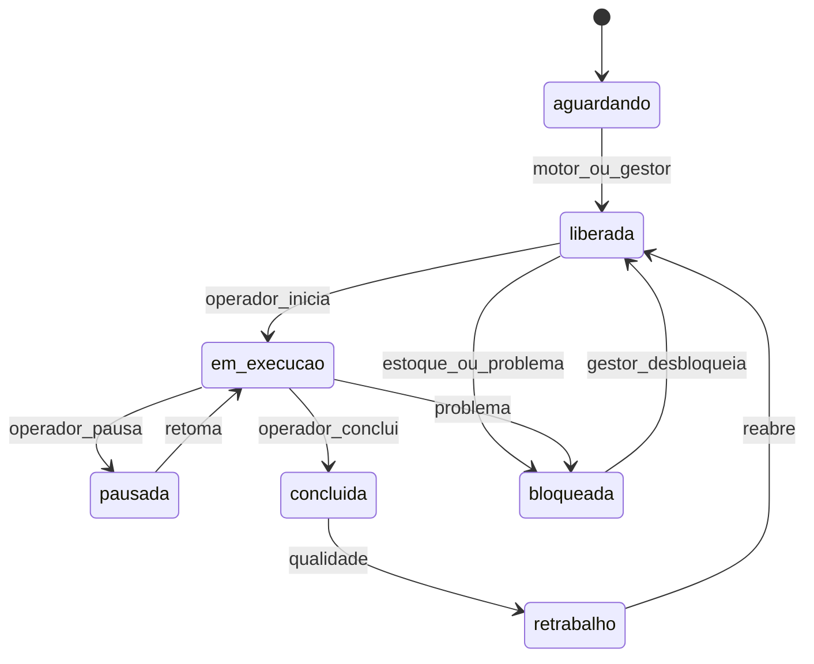

# Plano detalhado: SAGRA como MES de Produção Gráfica

## Visão do produto

Transformar o SAGRA de um sistema de **ordens de serviço com fila PCP e andamentos manuais** em um **MES (Manufacturing Execution System) de gráfica**: cada OS vira um plano de produção com operações tipadas (corte, offset, digital, laminação, acabamento…), executáveis no chão de fábrica, priorizáveis pelo gestor, com estoque, prazo interno e **despacho sincronizado** para que componentes paralelos (ex.: capa e miolo) cheguem juntos ao acabamento.

Nada do fluxo legado de OS/andamento/PCP é descartado. O MES **soma uma camada** por cima e, onde fizer sentido, **espelha** progresso no andamento atual para não quebrar busca, painéis, portal do cliente e integrações.

---

## O que existe hoje (base de construção)

| Capacidade | Como funciona hoje | Limite |
|------------|--------------------|--------|
| OS + detalhes | Protocolo + `tabDetalhesServico`; acabamento em texto livre (`DescAcabamento`) | Não descreve passos executáveis |
| TechSpec | Componentes (capa/miolo…) com lotes: páginas, máquina, papel, cores | Spec técnica, não roteiro de chão |
| Sub OS | Andamento independente por componente | Ainda é “situação + setor”, não operação |
| Andamento | Histórico append-only; situações de vocabulário aberto | Sem máquina de estados; sem pred/succ |
| PCP (`/pcp`) | Kanban por setor; drag reorder em `tab_pcp_fila`; WS `pcp_queue_update` | Ordena “OS no setor”, não ops tipadas |
| Gravação / Papelaria | Filas e workers especializados | Pré-impressão / chapas, não MES completo |
| Estoque | Inexistente (só cotas e lookups de papel) | Sem reserva/baixa física |
| Prazo | `EntregData` do cliente + predição KNN no PCP | Sem lead time interno de produção |

**Âncoras de código:** [`os_routes.py`](app/backend/routers/os_routes.py), [`pcp_routes.py`](app/backend/routers/pcp_routes.py), [`pcp_queue_service.py`](app/backend/pcp_queue_service.py), [`os_componentes_service.py`](app/backend/services/os_componentes_service.py), [`realtime.py`](app/backend/routers/realtime.py), [`deploy/sql/create_tab_os_sub_os.sql`](deploy/sql/create_tab_os_sub_os.sql), feature [`apps/web/src/features/pcp/`](apps/web/src/features/pcp/).

---

## Decisões de arquitetura (fixadas)

1. **MySQL-only** para tabelas MES (igual Sub OS/gravação). Access MDB não recebe essas tabelas.
2. **Feature flag** `SAGRA_MES_ENABLED` (e depois flags por setor) — rollout sem big-bang.
3. **Andamento legado permanece**; MES escreve espelhos pontuais (ex.: “Em Laminação”) sem apagar histórico.
4. **RBAC:** nova flag `sb_gestor_producao` + reuso de `sb_pcp` / permissões por setor; operadores usam permissão de centro de trabalho.
5. **Scheduler no processo da API** (timer + eventos), padrão claim/heartbeat inspirado no Papelaria — sem Celery/Redis na v1.
6. **Otimização v1 = por OS** (sincronizar ramos da mesma OS) + filas por centro; otimização global multi-OS só depois da calibração de tempos.


---

## Personas e como cada uma usa o sistema

| Persona | Papel | Telas principais |
|---------|-------|------------------|
| **Analista / Gerência** | Cadastra OS, TechSpec, acabamentos tipados; vê preview do roteiro | `/gerencia`, detalhe da OS |
| **Gestor de produção** | Prioriza filas, confirma liberações (modo semi-auto), resolve bloqueios de estoque/SLA | `/pcp`, `/producao/gestao`, alertas |
| **Operador de setor** | Vê só o que está liberado no seu centro; inicia/pausa/conclui ops | `/producao/setor` (ou painel setor enriquecido) |
| **Almoxarifado** | Entradas, ajustes, saldos, pontos de reposição | `/estoque` |
| **Admin** | Catálogos MES, tempos padrão, máquinas, permissões, flags | Configurações / Usuários |
| **Cliente / gabinete** | Continua vendo andamentos/espelhos; sem exposição do MES interno | Portal existente |

---

## Ordem das fases e por quê

Implementar fora de ordem quebra o sistema: sem catálogo não há roteiro; sem roteiro não há WIP; sem WIP o motor não tem o que sincronizar; sem estoque o despacho libera trabalho impossível de executar.

| Fase | Nome | Pré-requisito | Marco |
|------|------|---------------|-------|
| 0 | Fundamentos de domínio | — | M1 |
| 1 | Roteiro a partir do TechSpec | 0 | M2 |
| 2 | WIP / execução no chão | 1 | M3 (parte) |
| 3 | Fila PCP + gestor | 1–2 | M3 **MVP operacional** |
| 4 | SLA e lead time | 1–2 | M4 |
| 5 | Estoque | 1 | M4 |
| 6 | Motor de sincronização | 2–5 | M5 |
| 7 | Despacho automático | 6 | M5 |
| 8 | Painéis e governança | 3–7 | M6 |
| 9 | Calibração contínua | 4, 7–8 | contínuo |

**MVP de valor (M3):** roteiro visível + operadores executando ops + gestor reordenando fila com reflexo nas OS. A “sincronia perfeita capa/miolo” é M5 (Fases 6–7).

---

# Fase 0 — Fundamentos de domínio

## Objetivo

Criar o **vocabulário mestre** da gráfica (centros, operações, máquinas, materiais, permissões) sem alterar o dia a dia de quem abre OS ou usa o PCP.

## Como funciona

### Centros de trabalho
Cada centro é um posto lógico da gráfica: Corte, Gravação, Offset, Digital, Laminação, Acabamento, Expedição, etc.

- Campo de mapeamento opcional para `SetorLink` legado (ex.: centro “Digital” ↔ setor “SEFOC” ou o setor real usado no andamento).
- Isso permite que painéis e buscas atuais continuem fazendo sentido quando o MES espelhar andamentos.

### Catálogo de operações
Cada operação tipada (“Cortar papel”, “Imprimir offset”, “Laminar fosco”, “Encadernar grampo”) define:

- centro responsável
- tempo-padrão base (minutos setup + minutos por unidade/folha/página)
- insumos típicos (papel, película, chapa) — referência; consumo real na Fase 5
- se exige máquina específica ou qualquer máquina do centro

### Máquinas
Cadastro com centro, capacidade nominal (ex.: folhas/hora), ativa/inativa. Usadas depois para capacidade e escolha de recurso no scheduler.

### Materiais (cadastro mínimo)
SKU espelhando papéis/películas já usados no lookup da OS (`papel_link`). Nesta fase **não** há saldo nem reserva — só o dicionário para o TechSpec e o roteiro apontarem para o mesmo item.

### Permissões
- `sb_gestor_producao`: reordenar filas MES, confirmar despachos, desbloquear ops, ver plano de sincronização.
- Permissão por centro (ou reuso de setor do usuário): operador só age no seu centro.
- Admin MES: editar catálogos.

### Feature flag
Com `SAGRA_MES_ENABLED=false` (default até M2), nenhum botão novo aparece no fluxo operacional. Cadastros ficam em Configurações para preparação dos dados mestres.

## Como o usuário usa

1. **Admin** abre Configurações → “Produção / MES”.
2. Cadastra centros e associa aos setores existentes.
3. Cadastra operações e amarra cada uma a um centro.
4. Cadastra máquinas e (opcional) materiais SKU ligados aos papéis do sistema.
5. Em Usuários, marca quem é gestor de produção e quais operadores atuam em quais centros.
6. Equipe de chão **não muda nada** no trabalho diário nesta fase.

## Impacto

| Área | Impacto |
|------|---------|
| Banco | Novas tabelas MySQL; scripts em `deploy/sql/` + `ensure_*` no startup |
| API | Routers CRUD admin; zero mudança em `os_routes` / `pcp_routes` de comportamento |
| Front | Telas de config; menu só para admin |
| Operação diária | **Nenhum** — flag desligada |
| Risco | Baixo; se o seed estiver errado, corrige-se no cadastro antes de ligar o MES |

## Critério de aceite

CRUD completo; permissões gravadas; seed SEFOC carregado; OS/PCP idênticos ao comportamento atual com flag off.

---

# Fase 1 — Roteiro de produção a partir do TechSpec

## Objetivo

Toda OS “pronta para produção” ganha um **grafo de operações**: o que fazer, em que ordem, o que pode rodar em paralelo, e onde os ramos se encontram (acabamento).

## Como funciona

### TechSpec v2 (retrocompatível)
Hoje o TechSpec tem componentes → lotes (`paginas`, `maquina_link`, `papel_link`, `cores_*`).

Na v2, por componente/lote, a Gerência informa também:

- **processo gráfico:** `offset` | `digital` | `hibrido` | outros do catálogo
- **acabamentos tipados:** lista (`laminacao_fosca`, `verniz`, `dobra`, `grampo`…) em vez de só `DescAcabamento` livre (o texto livre permanece como observação)
- **formato / folhas estimadas** (para tempo e estoque depois)

OS antigas sem v2 continuam válidas: não geram roteiro MES (ou geram roteiro mínimo “manual” se o admin optar).

### Geração do roteiro
Serviço `mes_roteiro_service` (disparado no mesmo fluxo de `sync_componentes_from_techspec`):

1. Lê TechSpec v2 + catálogo de operações (Fase 0).
2. Para cada componente (Sub OS), monta a cadeia típica:
   - **Capa offset + laminação:** Corte papel → (Gravação se aplicável) → Impressão offset → Laminação
   - **Miolo digital:** Impressão digital (e corte se necessário)
3. Cria nó de **convergência** na OS: Acabamento (e Expedição) com predecessoras = fim de cada ramo de componente.
4. Grava em `tab_mes_roteiro` + `tab_mes_roteiro_ops` (ops com ordem, centro, pred_ids, tempo estimado preliminar, material previsto).
5. Status inicial de cada op: `aguardando` (ainda não liberada para o chão).

### Exemplo concreto — revista capa+miolo

```text
OS 4521/2026
├── Sub OS Capa
│   ├── Op1 Corte papel capa        [Corte]
│   ├── Op2 Impressão offset capa   [Offset]   ← depende Op1
│   └── Op3 Laminação capa          [Laminação]← depende Op2
├── Sub OS Miolo
│   └── Op4 Impressão digital miolo [Digital]  ← paralelo a Op1–Op3
└── OS (convergência)
    └── Op5 Acabamento / encadernação [Acabamento] ← depende Op3 E Op4
```

### Recálculo
Se a Gerência editar TechSpec (mudar miolo de digital para offset, tirar laminação), o sistema:

- regenera o roteiro **somente se** nenhuma op estiver `em_execucao` / `concluida`; ou
- em modo restrito: marca divergência e exige confirmação do gestor (“invalidar progresso e regenerar”).

## Como o usuário usa

1. Usuário com `sb_gerencia` abre `/gerencia` e cria/edita a OS.
2. Monta componentes (capa, miolo) como hoje.
3. Em cada componente escolhe processo e acabamentos em campos tipados (não só texto).
4. Painel lateral **“Preview do roteiro”** mostra timeline/Gantt simplificado dos ramos e do ponto de encontro.
5. Ao salvar, se MES habilitado, o roteiro é gerado/atualizado.
6. No detalhe da OS (Início / histórico), nova aba **“Produção”** lista as ops e dependências (ainda sem execução nesta fase isolada — execução é Fase 2).

## Impacto

| Área | Impacto |
|------|---------|
| Gerência | Novos campos; `DescAcabamento` deixa de ser a única fonte de verdade do acabamento |
| Banco | `tab_mes_roteiro*` ligadas a protocolo + `sub_os_id` |
| Sub OS | Cada componente ganha roteiro; andamento Sub OS ainda pode existir em paralelo |
| PCP | Ainda não muda a ordenação (até Fase 3) |
| Treinamento | Analistas precisam aprender a tipar acabamentos — migração gradual (texto livre + tipado) |
| Risco | Médio: regras de geração erradas geram roteiros absurdos — mitigar com templates por tipo de produto e preview obrigatório |

## Critério de aceite

OS capa offset + miolo digital gera o grafo do exemplo; preview bate com o salvo; OS só com TechSpec v1 não quebra; regeneração bloqueada com ops já iniciadas.

---

# Fase 2 — WIP e execução no chão de fábrica

## Objetivo

Cada operação do roteiro passa a ter **ciclo de vida real**: alguém a inicia, pausa, conclui ou bloqueia. O chão de fábrica trabalha sobre **ordens de operação**, não só mudando situação livre da OS.

## Como funciona

### Estados da operação



Transições inválidas são rejeitadas pela API (diferente do andamento atual, que aceita qualquer situação).

### Claim (evitar dois operadores na mesma op)
Padrão igual Papelaria: ao “Iniciar”, a op fica claimada pelo ponto/usuário; heartbeat; se o operador cair, outro pode assumir após timeout (ou gestor força).

### Espelho no andamento (legado)
Ao mudar status relevante, um serviço de espelho cria andamento/Sub OS andamento com situação configurável, por exemplo:

- Início impressão digital → situação “Em Impressão” / setor Digital
- Conclusão laminação → “Saída p/ Acabamento” ou situação equivalente do catálogo SEFOC

Regras de espelho são **configuráveis** por centro (admin), para não inventar situações que o time não usa.

### Bloqueio por predecessoras
Op só pode ir para `liberada` se todas as predecessoras estiverem `concluida` (ou política especial do motor na Fase 6). O operador **nunca** vê no “próximo trabalho” uma op ainda dependente.

## Como o usuário usa

### Operador (Digital)
1. Abre `/producao/setor` (centro Digital) ou painel TV do setor.
2. Vê lista ordenada: ops `liberada` / `em_execucao` do seu centro (ex.: “OS 4521 — Impressão digital miolo — 80 pág.”).
3. Clica **Iniciar** → status `em_execucao`; cronômetro sobe; card some da fila “aguardando ação” dos outros.
4. Se a máquina trava: **Pausar** + motivo.
5. Ao terminar: **Concluir** (informa qty boa / refugo se exigido).
6. A próxima op dependente (acabamento) **ainda não aparece** se a capa não terminou.

### Gestor
- Vê ops bloqueadas e pode desbloquear / reatribuir máquina.
- Pode forçar conclusão excepcional com auditoria (motivo obrigatório).

### Analista
- Na aba Produção da OS, acompanha checks verdes por op; não precisa mais perguntar “cadê a capa?” por telefone.

## Impacto

| Área | Impacto |
|------|---------|
| Cultura operacional | Maior: operadores passam a “bater ponto” na op — exigir disciplina e terminais/tablets no setor |
| Andamento | Continua existindo; volume de registros pode aumentar (espelhos) |
| PCP atual | Cards ainda por OS no setor; detalhe passa a mostrar ops (preparação p/ Fase 3) |
| Performance | Mais writes + WS `mes_op_update`; indexes em status/centro |
| Painéis TV | Passam a poder listar ops liberadas além de OS |
| Risco | Resistência a apontamento; mitigar com UI mínima (3 botões) e piloto em 1 setor |

## Critério de aceite

Miolo concluído + capa ainda em laminação ⇒ Acabamento permanece `aguardando`; ao concluir capa, Acabamento fica elegível a liberação; histórico MES e andamento espelhado coerentes.

---

# Fase 3 — Fila de produção profissional e gestor

## Objetivo

O **gestor de produção** controla a ordem de trabalho. Reordenar a fila **reflete imediatamente** nas OS/ops que os setores veem — evolução do PCP atual (`tab_pcp_fila` + drag-and-drop em [`PcpColumn.tsx`](apps/web/src/features/pcp/components/PcpColumn.tsx)).

## Como funciona

### O que a fila passa a representar
- **Antes:** “OS cujo último andamento está neste setor”, ordenadas manualmente.
- **Depois:** “Operações liberadas (ou em execução) deste centro”, agrupadas visualmente por OS.

O card continua mostrando **número da OS**, produto, prazo, prioridade (Prometido/Solicitado). Expandir o card mostra as ops ativas daquele centro para aquela OS.

### Reordenação pelo gestor
1. Gestor com `sb_pcp` / `sb_gestor_producao` arrasta um card para cima na coluna do centro (ex.: Digital).
2. Front chama API de reorder (evolução de `ReorderRequest` atual).
3. Backend:
   - valida que os itens pertencem ao centro
   - grava ordem em `tab_mes_fila_centro` (e mantém/espelha `tab_pcp_fila` na transição)
   - atualiza `prioridade_efetiva` das ops
   - invalida cache PCP
   - broadcast WS `pcp_queue_update` + `mes_fila_update`
4. Telas de operador e painéis TV **reordenam sozinhas** em tempo real.

### Prioridade efetiva (camadas)
Ordem de desempate quando o gestor não fixou posição manual recente:

1. Ordem manual do gestor (drag)
2. Prioridade da OS (`Prometido` > `Solicitado` > demais) — já usada em [`pcpUtils.ts`](apps/web/src/features/pcp/pcpUtils.ts)
3. `EntregData` do cliente
4. ETA / caminho crítico (Fase 4)
5. Chegada na fila

### Reflexo nas OS
- Campo/posição “# na fila do setor X” visível no card e no detalhe da OS.
- Se o gestor sobe a OS 4521 na Digital, o operador Digital vê 4521 no topo da lista de “próximas”.
- Ops de outros centros **não** mudam de ordem por esse drag (cada centro tem sua fila), mas o motor (Fase 6) pode reagir a prioridade global da OS.

## Como o usuário usa

1. Gestor abre `/pcp` (kanban multi-coluna por centro/setor, evolução da tela atual).
2. Filtra centro “Offset”, vê gargalo.
3. Arrasta OS urgente para o topo.
4. Em segundos, o painel da Offset e a tela do operador mostram a nova ordem.
5. Opcional: gestor fixa “não deixar o motor alterar esta ordem” (pin) até desmarcar.

## Impacto

| Área | Impacto |
|------|---------|
| PCP atual | Evolução, não substituição; período de convivência OS-only vs ops |
| Operadores | Sentem o efeito direto da priorização do gestor |
| WebSocket | Mais eventos; clientes já escutam `pcp_queue_update` |
| Conflito | Dois gestores reordenando: last-write-wins + toast de conflito se versão divergir (optimistic lock) |
| Risco | Médio — mudança de mentalidade de “OS no setor” para “ops no centro”; UI deve manter card de OS como unidade visual |

## Critério de aceite

Drag no PCP altera ordem da lista do operador no mesmo centro via WS; posição aparece na OS; pin impede reordenação automática posterior.

---

# Fase 4 — Tempo-alvo e SLA desde a criação

## Objetivo

Responder com dados: **“desde que essa OS entrou, quanto deveria demorar e quanto falta no caminho crítico?”** — além do prazo de entrega ao cliente (`EntregData`).

## Como funciona

### Tempos padrão
Tabela `tab_mes_tempos_padrao`: por tipo de produto / operação / faixa de tiragem (ou fórmula `setup + (qtd * unitario)`).

Na geração do roteiro (Fase 1), cada op recebe `tempo_estimado_min`. O **caminho crítico** (maior soma entre criação e sink de acabamento/expedição) vira o **lead time interno** da OS.

### Relógio
- `inicio_producao_em`: quando a produção é liberada (primeiro despacho ou status acordado), não necessariamente a criação do protocolo.
- `prazo_producao_estimado`: início + caminho crítico (+ buffer %).
- `sla_status`: `no_prazo` | `risco` (entrou no buffer) | `atrasado`.

Recalcula quando: op atrasa vs estimado, gestor muda prioridade, roteiro regenera, ou calibração (Fase 9) atualiza padrões.

### Visibilidade
- Card PCP: badge “3h restantes” / “atrasada 1h”.
- Aba Produção: Gantt com previsto vs real.
- Alertas: notificação in-app + Web Push para gestor quando OS entra em `risco`/`atrasado` (reusa [`os_notificacao_dispatch_service`](app/backend/services/os_notificacao_dispatch_service.py)).

### Relação com prazo do cliente
SLA interno ≠ `EntregData`. O sistema mostra os dois: “entrega cliente 30/07” e “produção deveria concluir 28/07 16:00”. Se o interno estoura mas o cliente ainda cabe, o alerta é operacional; se ambos estouram, alerta crítico.

## Como o usuário usa

1. Admin cadastra tempos padrão iniciais (mesmo grosseiros) na config MES.
2. Ao gerar roteiro, a OS já nasce com ETA interno.
3. Gestor no PCP ordena também pelo risco de atraso (filtro “só atrasadas”).
4. Operador vê no card se o trabalho é urgente por SLA (cor/badge) — sem precisar calcular de cabeça.
5. Relatório semanal: % OS no prazo interno; tempo médio por centro.

## Impacto

| Área | Impacto |
|------|---------|
| Predição KNN atual | Continua; depois (Fase 9) absorve features MES |
| Expectativa gerencial | Tempos padrão ruins geram alerta falso — precisa revisão humana inicial |
| Carga | Job leve de recálculo SLA (periódico) |
| Risco | Baixo-médio; valor alto mesmo com precisão imperfeita |

## Critério de aceite

OS nova com roteiro exibe ETA; atraso simulado em uma op move `sla_status` e dispara alerta; card PCP mostra tempo restante do caminho crítico.

---

# Fase 5 — Controle de estoque

## Objetivo

Garantir que a gráfica **não libera impressão sem material**; reservar na liberação e baixar na conclusão; dar ao almoxarifado saldos e movimentação.

## Como funciona

### Entidades
- **SKU** (`tab_estoque_sku`): papel 90g 66×96, película fosca, chapa, etc. Ligação com `papel_link` / materiais da Fase 0.
- **Saldo** por SKU (e opcionalmente depósito).
- **Movimentos:** entrada (compra/devolução), saída avulsa, ajuste inventário, **reserva**, **consumo**, estorno.
- **Reserva por op/OS:** quantidade prometida ao trabalho enquanto a op não conclui.

### Fluxo feliz
1. Roteiro estima: miolo precisa de N folhas do SKU X; capa precisa de M folhas + película.
2. Na **liberação** da op (manual ou motor): sistema tenta reservar.
3. Se saldo disponível ≥ necessidade: cria reserva; op segue `liberada`.
4. Se insuficiente: op vai `bloqueada` motivo `estoque`; gestor e almoxarifado são alertados; fila do setor **não** mostra como “próxima trabalhável” (ou mostra com badge bloqueada).
5. Almoxarifado lança **entrada**; gestor (ou automático) tenta liberar de novo; reserva ok.
6. Operador **conclui** op: reserva vira **consumo**; saldo definitivo cai.
7. Cancelamento da OS / exclusão da op: **estorna** reserva.

### Inventário e reposição
- Tela `/estoque`: saldo, reservado, disponível (= saldo − reservado), mínimo.
- Abaixo do mínimo → alerta reposição (não é compras completo na v1 — só sinalização).

## Como o usuário usa

### Almoxarifado
1. Entra em `/estoque`, registra NF/entrada de 10 resmas.
2. Vê lista de bloqueios por falta (link para OS).
3. Após entrada, bloqueios somem quando o sistema reprocessa reservas.

### Gestor
- No PCP, filtra “bloqueadas por estoque”.
- Decide comprar / substituir papel no TechSpec (edição Gerência) e regenerar necessidade.

### Operador
- Não precisa digitar estoque no dia a dia; só vê badge “bloqueada — sem papel X” se a op aparecer assim.

## Impacto

| Área | Impacto |
|------|---------|
| Processo | Exige disciplina de lançar entradas — senão tudo bloqueia |
| Liberação | Acoplamento forte com Fases 6–7: motor não libera sem material |
| Cotas gráficas | Continuam separadas (direito do gabinete ≠ estoque físico) |
| Risco | Alto na adoção; mitigar com modo “estoque informativo” (alerta sem bloquear) no piloto, depois “bloqueante” |

## Critério de aceite

Sem saldo ⇒ op de impressão não libera (modo bloqueante); entrada + reprocessamento libera; conclusão baixa saldo; cancelamento estorna reserva.

---

# Fase 6 — Motor de sincronização e otimização

## Objetivo

O coração do pedido: **otimizar a produção de uma OS** liberando e segurando operações para que ramos paralelos **cheguem juntos** ao acabamento, reduzindo fila ociosa e lead time.

## Como funciona (detalhe do algoritmo v1)

### Entrada
- Roteiros ativos (ops + predecessoras + tempos)
- Filas/prioridades por centro (Fase 3)
- Capacidade simples das máquinas (Fase 0)
- Reservas/estoque (Fase 5)
- SLA / caminho crítico (Fase 4)

### Ideia: backward + forward

1. **Backward a partir do sink** (Acabamento/Expedição): calcula a data/hora em que cada op **deveria terminar** para o sink começar no melhor momento (respeitando prazo interno/cliente).
2. **Forward com capacidade:** encaixa ops nas filas dos centros sem ultrapassar capacidade; respeita predecessoras.
3. **Política de liberação:**
   - Liberar agora se: predecessoras ok + estoque ok + (início planejado ≤ agora + folga) + prioridade permite.
   - **Segurar** ramo curto se liberar cedo só encheria o centro e faria o material esperar dias no carrinho (exceção: gestor pinou “liberar tudo”).
4. Para o exemplo capa (8h de cadeia) + miolo (8h digital): ambos liberam no início; se miolo fosse 2h e capa 8h, o motor pode **atrasar o início do miolo** para ambos terminarem ~juntos — desde que isso não estoure SLA (se estourar, prioriza prazo e aceita espera no acabamento).

### Snapshot do plano
Cada ciclo grava `tab_mes_plano_execucao`: quais ops liberar/segurar e o **motivo** (“aguardando sync com capa”, “estoque”, “capacidade Offset”).

UI do gestor: “Por que a digital da 4521 ainda não liberou?” → resposta auditável.

### Escopo v1 vs depois
- **v1:** otimiza **dentro da OS** + respeita filas locais; não resolve “qual das 50 OS deve furar a Offset” além da prioridade do gestor.
- **Depois (Fase 9+):** scoring global multi-OS.

## Como o usuário usa

1. Gestor deixa o modo **semi-auto** no piloto: vê sugestões “liberar Op1, Op2, Op4; segurar Op_miolo por 4h”.
2. Confirma o lote (um clique).
3. Em produção estável, liga **auto**: o motor aplica sozinho a cada evento (conclusão de op, reorder, entrada de estoque) e a cada tick (ex.: 30–60s).
4. Sempre pode pin/override na fila (Fase 3).

## Impacto

| Área | Impacto |
|------|---------|
| Lead time | Queda de espera ociosa no acabamento |
| WIP no chão | Menos material semi-acabado parado (se política de hold for usada) |
| Complexidade | Alta — bugs de scheduling confundem o chão; por isso semi-auto primeiro |
| CPU | Ciclos de planeamento no API process; limitar a OS ativas |
| Risco | Alto; testes de simulação obrigatórios antes do auto |

## Critério de aceite

Cenário capa+miolo: enquanto digital imprime, corte/offset/laminação da capa já foram despachados; acabamento só libera com ambos concluídos; tempo de espera do acabamento &lt; limiar configurável no cenário de teste; UI explica holds.

---

# Fase 7 — Despacho automático de comandos aos setores

## Objetivo

Transformar a decisão do motor em **comando concreto** que cada setor recebe: item na fila, notificação, atualização de painel — e integrações com Gravação/Papelaria quando a op for daquele tipo.

## Como funciona

### Ao “liberar” uma op
1. Status → `liberada`.
2. Insert/update na fila do centro (`tab_mes_fila_centro`) na posição calculada pela prioridade.
3. Evento WS para clientes do setor + PCP + painéis.
4. Notificação in-app para usuários do centro (opcional Web Push).
5. Efeitos colaterais por tipo de op:
   - **Gravação:** alinha/cria fluxo com módulos existentes (`Gravação` / pendente / externa) sem duplicar regra de negócio.
   - **Papelaria / arte:** enfileira job Corel como hoje, ligado ao `roteiro_op_id`.
   - **Impressão/acabamento:** só fila + ticket digital (impressão de ordem de produção opcional).
6. **Idempotência:** chave única `roteiro_op_id`; reprocessar não duplica comando.

### Cadeia no exemplo
```text
t0  Motor libera Op4 (digital miolo) + Op1 (corte capa)
t1  Corte conclui → motor libera Op2 (offset)
t2  Offset conclui → motor libera Op3 (laminação)
t3  Digital conclui (em paralelo)
t4  Laminação conclui → motor libera Op5 (acabamento)
```
Cada liberação “aparece” na TV/lista do setor correspondente automaticamente.

### Modos
- **Automático:** Fases 6+7 sem confirmação.
- **Semi-auto:** motor só sugere; gestor confirma (recomendado no go-live).
- **Manual:** gestor libera ops na aba Produção / PCP (sempre disponível como escape).

## Como o usuário usa

### Setor Laminação
- Não precisa que o PCP telefone: quando a capa sai do offset, a op de laminação **aparece sozinha** no topo/área liberada.
- Operador inicia/conclui (Fase 2).

### Gestor
- Monitora o painel “Despachos da última hora”.
- Se algo travar, usa override manual.

## Impacto

| Área | Impacto |
|------|---------|
| Comunicação interna | Reduz “corre de um setor ao outro” |
| Gravação/Papelaria | Precisa contrato claro op ↔ módulo legado |
| Falhas | Comando perdido é grave — outbox + reprocessamento |
| Risco | Médio-alto na integração; baixo se só fila MES no piloto |

## Critério de aceite

Log ponta a ponta da OS 4521 com timestamps de cada despacho; nenhum duplicado; painel do setor atualiza sem F5; semi-auto e auto testados.

---

# Fase 8 — Visibilidade, governança e fechamento

## Objetivo

Dar à chefia **visão de fábrica** e fechar o ciclo de vida (entrega/cancelamento) sem deixar ops/reservas órfãs.

## Como funciona

### Painéis
- Carga por máquina/centro (% ocupação do dia).
- Gargalo atual (centro com maior fila em tempo estimado).
- Lista OS em risco/atraso SLA.
- Gantt por OS (ramos paralelos).
- Evolução dos painéis existentes [`/painel/setor`](apps/web/src/features/dashboard-setor/) e global.

### Relatórios
- Lead time real vs padrão por produto.
- Tempo médio por operação.
- Refugo %.
- OEE simples: tempo em execução / tempo disponível do centro.

### Fechamento
Quando andamento vai para `Entregue` ou `Cancelada` (já congela Sub OS):

- cancela ops não concluídas
- estorna reservas de estoque
- remove da fila PCP/MES
- arquiva plano de execução

### Rollout
Flags por centro: Digital on, Offset still off — permite piloto real.

## Como o usuário usa

- Direção: TV no corredor com gargalo e atrasos.
- Gestor: manhã abre “risco de SLA” e reordena.
- Admin: liga MES só no centro piloto.

## Impacto

Baixo risco técnico; alto valor de adesão (pessoas veem benefício). Depende de dados boas das fases anteriores.

## Critério de aceite

Cancelar OS zera reservas e limpa filas; painel piloto mostra fila real de ops; relatório exportável de lead time.

---

# Fase 9 — Calibração contínua

## Objetivo

O sistema **aprender com a execução real** para que ETA e sincronização melhorem com o tempo.

## Como funciona

1. Cada op concluída grava duração real (descontando pausas).
2. Job diário atualiza média móvel em `tab_mes_tempos_padrao` (com proteção: não sobrescrever se N amostral &lt; limiar).
3. Se atraso de uma op &gt; limiar: re-planeja a OS (novo snapshot Fase 6) e re-despacha se necessário.
4. Predição KNN do PCP ganha features: tempo restante de roteiro, centro gargalo, % caminho crítico.

## Como o usuário usa

- Admin revisa “tempos sugeridos vs atuais” e aprova atualização em lote (no início com aprovação humana).
- Depois, auto-update com auditoria.

## Impacto

Melhora M5 sem mudar UX; risco de drift se houver outliers (mitigar com mediana e exclusão de retrabalho).

---

# Jornada ponta a ponta (após M5)

Cenário: **revista, capa offset+laminação, miolo digital**.

1. **Gerência** cadastra OS 4521 com TechSpec v2 → preview do roteiro → salvar.
2. Sistema gera 5 ops + ETA interno; estima papel capa/miolo + película.
3. **Gestor** (ou motor auto) libera produção; estoque reserva materiais; Op1 (corte) e Op4 (digital) entram nas filas.
4. **Corte** inicia/conclui → despacha Offset; **Digital** imprime em paralelo.
5. Offset conclui → despacha Laminação.
6. Digital e Laminação concluem → despacha Acabamento (ambos prontos “juntos”).
7. Acabamento conclui → espelho andamento → Expedição/entrega.
8. Consumos baixados; SLA registrado; tempos reais alimentam calibração.

Durante tudo, gestor pode furar a fila no PCP e o reflexo é imediato nos setores.

---

# Impacto transversal por camada

| Camada | O que muda | O que NÃO muda (de propósito) |
|--------|------------|-------------------------------|
| MySQL | Muitas tabelas `tab_mes_*` / `tab_estoque_*` | Protocolo/detalhes principais; andamento append-only |
| MDB | Nada do MES | Dual-write legado intacto |
| API | Novos routers `mes_*`, `estoque_*`; hooks em create/update OS e andamento terminal | Contratos atuais de busca OS continuam |
| Front | Gerência, PCP, nova `/producao/*`, `/estoque`, config | Home/busca OS; portal cliente (só vê espelhos) |
| Auth | Novas flags | Modelo IP + user overlay |
| Realtime | Novos eventos | Hub atual |
| Workers | Papelaria/gravação como efeitos de op | Corel COM inalterado na essência |

---

# Riscos, mitigação e rollout

| Risco | Mitigação |
|-------|-----------|
| Operadores não apontam | UI de 3 botões; piloto 1 setor; gestor vê “op parada demais” |
| Tempos padrão errados | Começar grosseiro; Fase 9 + aprovação |
| Estoque desatualizado | Modo informativo → bloqueante |
| Scheduler “inteligente demais” | Semi-auto → auto; pin manual |
| Confusão andamento vs MES | Documentar espelhos; aba Produção como fonte operacional |
| Big-bang | Flag global + por centro; M3 antes de M5 |

**Rollout sugerido:** M1 dados mestres → M2 preview roteiro → piloto Digital (M3) → estoque informativo → SLA → estoque bloqueante → semi-auto sync → auto em todos os centros.

---

# Marcos e estimativa

| Marco | Conteúdo | Estimativa indicativa |
|-------|----------|------------------------|
| M1 | Fase 0 | 3–5 semanas |
| M2 | Fase 1 | +4–6 semanas |
| M3 | Fases 2–3 (MVP operacional) | +6–8 semanas → **~3–4 meses total** |
| M4 | Fases 4–5 | +6–8 semanas |
| M5 | Fases 6–7 (sincronia + despacho) | +8–10 semanas → **~6–9 meses total** |
| M6 | Fases 8–9 | contínuo pós go-live |

Estimativa para equipe pequena full-stack já familiar com o monorepo; paralelizar front/back encurta o calendário.

---

# Princípio de implementação

Cada fase deve entregar **valor usável isolado** com flag, testes de regressão em OS/PCP/andamento, e script SQL em [`deploy/sql/`](deploy/sql/). Não iniciar Fase 6 antes de haver roteiro + WIP + (no mínimo) estoque informativo e tempos iniciais — senão o motor otimiza dados fantasmas.
