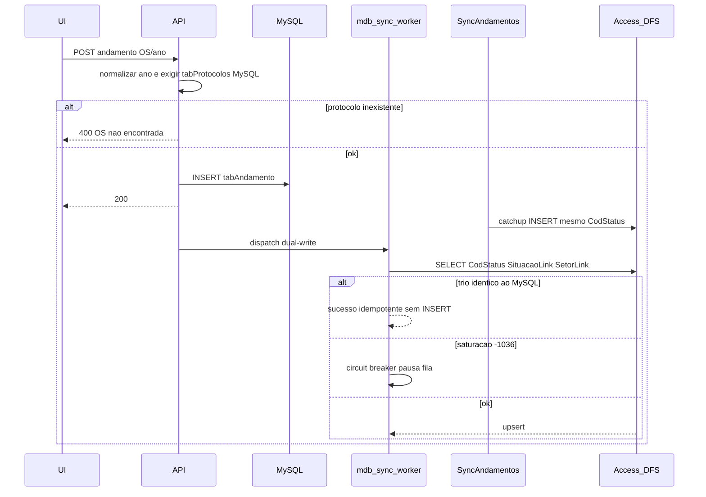

# Mitigar falhas Access/MDB em produção

Três frentes independentes: **conexão ACE/ODBC** (erros 1–3), **corrida com o sincronizador Windows** (insert/update que o catchup já fez), e **dado inválido na UI/API** (erro 4). MySQL continua sendo a fonte da verdade; o dual-write assíncrono não muda. **O serviço `SAGRA-SyncAndamentos` não é alterado.**



## Diagnóstico

| Erro | Causa raiz | Por que aparece hoje |
|------|------------|----------------------|
| **2 e 3** `08004` Too many client tasks (-1036) + `Invalid connection string attribute Mode (8)` | Atributo **DAO/OLEDB** `Mode=Share Deny None` foi colocado na string **ODBC** em [`config_manager.get_mdb_connection_string`](app/backend/config_manager.py) (plano anterior [falha_access_mdb](.cursor/plans/falha_access_mdb_afe169dc.plan.md)). O driver ACE de produção **não aceita `Mode=`**. `SQLSetConnectAttr` falha e as sessões Jet acumulam até `-1036`. | [`sync_access_mysql.access_conn_str`](app/services/sync_tables/sync_access_mysql.py) já documenta: *não incluir Mode*. O writer da API e o teste [`test_connection_string_shared_mode`](app/backend/tests/test_mdb_writer.py) exigem o atributo inválido. |
| **1** `HY000` *The driver did not supply an error!* (10 tentativas) | Duas causas possíveis, ambas no writer da API: (a) saturação ACE/DFS após `-1036` — o driver devolve HY000 vazio e `"hy000"` em `_RETRIABLE_MARKERS` martela `SQLDriverConnect` ~4 min; (b) **corrida com o sincronizador** — o catchup MySQL→MDB em [`sync_andamentos_service.py`](sync_andamentos_service.py) (`novos_no_mysql` → `insert_mdb`) grava o mesmo `CodStatus` enquanto o dual-write ainda está na fila. ACE costuma reportar PK duplicada como HY000 vazio. | [`_upsert_andamento_row`](app/backend/routers/mdb_writer.py) só testa existência por `CodStatus` e, se a linha aparecer no meio, o INSERT perde a corrida; se já existir, ainda faz UPDATE + zera `UltimoStatus` da OS inteira, competindo com o sync. |
| **4** Protocolo `1396/216` ausente (1 tentativa) | Ano **216** (3 dígitos) não é expandido (`< 100` → `+2000`). `CodStatus` `01396216-01` = 1396 / 216 / 01. [`POST /email/andamento`](app/backend/routers/email_routes.py) grava no MySQL **sem** checar `tabProtocolos`; o MDB só falha depois. | Campos livres em [`EmailInboxDetail.tsx`](apps/web/src/features/email/components/EmailInboxDetail.tsx); parser [`parseOsAno`](apps/web/src/features/email/utils.ts). O hook [`usePendenciaProtocolo`](apps/web/src/api/hooks/useEmailQueries.ts) existe mas **não** é usado nesse painel. |

`history_delete` e `gravacao_concluir` não têm bug próprio de negócio: ambos passam por `dispatch_mdb_sync` → `_execute_mdb_transaction`. Delete já é idempotente se a linha sumiu; `gravacao_concluir` é o mesmo upsert de andamento e sofre a corrida com o sync.

Manter: `pyodbc.pooling = False`, `timeout=30`, worker FIFO único, `Exclusive=0` (atributo ODBC válido), volume geral de retry (não aumentar).

---

## 1. String ODBC sem `Mode` (erros 1–3)

Em [`app/backend/config_manager.py`](app/backend/config_manager.py) `get_mdb_connection_string`:

```text
DRIVER={Microsoft Access Driver (*.mdb, *.accdb)};DBQ={path};Exclusive=0;
```

Remover `Mode=Share Deny None`. Atualizar [`app/backend/tests/test_mdb_writer.py`](app/backend/tests/test_mdb_writer.py) para **proibir** `Mode=` na string (inverter o assert atual).

Isso também cobre [`lookup_sync._mdb_connection`](app/backend/lookup_sync.py), que reutiliza a mesma string.

Não alterar o serviço `SAGRA-SyncAndamentos` ([`sync_andamentos_service.py`](sync_andamentos_service.py) já usa `DRIVER+DBQ` limpo). Scripts `sync_tables` com Mode ficam fora deste corte (não são o caminho da API em produção); se um batch ainda rodar no mesmo servidor, vale o mesmo critério depois.

**Operação:** reiniciar a API após o deploy para o ACE soltar sessões vazadas.

---

## 2. Classificar erro e circuit breaker (erros 1–3)

Em [`mdb_writer.py`](app/backend/routers/mdb_writer.py):

- **Não retentar** `invalid connection string attribute` (bug de config, não lock).
- Tratar **-1036 / too many client tasks** como saturação: no máximo **2** tentativas com espera longa (~60s), depois alerta. Não usar as 10 tentativas de 15s (cada `SQLDriverConnect` compete por slot Jet).
- Circuit breaker no worker: após `-1036` (ou HY000 vazio em `SQLDriverConnect` **sem** evidência de linha já gravada — ver seção 3), **pausar a fila inteira** ~60–120s antes do próximo connect. Evita que `history_delete` + `gravacao_concluir` + andamentos martelam o mesmo ACE esgotado.
- Incluir `-1036` nos markers; **não** usar `"hy000"` sozinho como motivo para 10 retries de connect — HY000 genérico em `SQLDriverConnect` segue o mesmo backoff de saturação, **exceto** quando a seção 3 classificar o caso como já replicado.
- Texto do alerta: distinguir “MDB saturado / driver sem detalhe” vs “protocolo ausente” vs não alertar se o sync já gravou o andamento.

Testes em `test_mdb_writer.py`: Mode inválido não retenta; `-1036` respeita o teto curto; circuit breaker impede connect imediato da próxima tarefa.

---

## 3. Já gravado pelo sincronizador (idempotência no writer da API)

O Windows service `SAGRA-SyncAndamentos` **não será modificado**. Ele faz catchup `MySQL − MDB` (`insert_mdb` para `CodStatus` novos no MySQL). A API também enfileira o mesmo andamento. Ordem típica:

1. Rota grava MySQL e responde 200.
2. O sync (ciclo ~segundos) vê o `CodStatus` só no MySQL e faz INSERT no Access.
3. O worker da API tenta o dual-write: `_andamento_exists` falso → INSERT (PK duplicada / HY000 vazio) **ou** existe → UPDATE + `UPDATE UltimoStatus=0` em **toda** a OS, brigando com o Jet já usado pelo sync.

Critério pedido: a linha no MDB com o **mesmo** `CodStatus`, `SituacaoLink` e `SetorLink` do MySQL indica que o sincronizador (ou um dual-write anterior) já concluiu. Isso é sucesso, não falha.

Só no [`mdb_writer.py`](app/backend/routers/mdb_writer.py) (upsert de andamento, usado por `history_add`, `email_andamento`, `gravacao_concluir`, etc.):

1. **Antes de escrever:** `SELECT CodStatus, SituacaoLink, SetorLink FROM tabAndamento WHERE CodStatus = ?`. Se os três campos batem com o payload MySQL (comparação normalizada, trim/case como o Access devolve), **não** INSERT, **não** UPDATE da linha, **não** zerar `UltimoStatus` da OS. Log info (`já presente no MDB, skip dual-write`) e commit vazio / return sucesso.
2. **Se `CodStatus` existe mas Situacao ou Setor diferem:** manter o UPDATE atual (dado da API/MySQL é o desejado).
3. **Se não existe:** INSERT como hoje.
4. **Após falha de escrita** (HY000, lock, duplicate, “driver did not supply an error”) e **antes** de retentar até o fim ou abrir alerta: reler o trio. Se agora bate com o MySQL, tratar como **sucesso idempotente** (o sync ganhou a corrida). Não disparar `Falha Access/MDB`. Se `CodStatus` existe com Situacao/Setor diferentes, não mascarar — seguir retry/alerta das seções 1–2.
5. **`history_delete`:** se o DELETE falhar mas a linha já não existe (sync ou delete anterior), manter o comportamento idempotente atual; não exigir o trio (não há linha).

Não pular `_ensure_protocolo_in_mdb` quando a OS realmente não existe no Access (erro 4 continua falhando). O skip só vale quando o **andamento** já está lá com o mesmo trio.

Testes em `test_mdb_writer.py`:

- Trio igual → nenhum INSERT/UPDATE em `tabAndamento`.
- Só `CodStatus` igual, Situacao diferente → UPDATE.
- INSERT simulado falha com HY000, SELECT seguinte devolve o trio igual → não propaga `MdbSyncError` / não chama alerta.

---

## 4. OS/ano só com protocolo existente (erro 4)

Regra única (frontend + backend):

- 2 dígitos (`26`) → `2026`
- 3 dígitos (`216`) → **rejeitar**
- 4 dígitos só na faixa `2000–2100`
- Depois: **o par Nr OS + Ano deve existir em `tabProtocolos` do MySQL** antes de inserir andamento

Não consultar o MDB na requisição HTTP (manteria o usuário preso no Access). Se a OS existe no MySQL e ainda não no MDB, o catchup do sync continua sendo a rede de segurança.

### Backend

Helper compartilhado (ex. `services/os_protocolo_guard.py`): `normalize_ano` + `require_protocolo_mysql(nro, ano)` → `HTTP 400` com mensagem clara (“OS 1396/216 não encontrada”).

Aplicar **antes** do INSERT em:

- [`create_andamento`](app/backend/routers/email_routes.py) (`AndamentoRequest`: `ano` com `ge=2000, le=2100` após normalizar)
- [`add_os_history`](app/backend/routers/os_routes.py) (defesa; o tablet/home já navega OS existente)
- parsers [`parseOsAno`](apps/web/src/features/email/utils.ts) e [`parse_os_ano_from_subject`](app/backend/services/email_apogee_pendencias_service.py): não promover `216` a ano válido; testes `1396/216` → inválido; `1396/26` → `2026`

### Frontend (só valores existentes)

Painel **Enviar para Execução** em [`EmailInboxDetail.tsx`](apps/web/src/features/email/components/EmailInboxDetail.tsx):

- Ano: `min=2000 max=2100`; 2 dígitos expandem no blur
- Reusar `usePendenciaProtocolo` / `GET /aux/protocolo/buscar`
- Submit **desabilitado** até o lookup confirmar a OS; mostrar título/solicitante ou “OS não encontrada”
- Não enviar `216` nem OS inventada

Mesmo tratamento nos outros campos livres de escrita: [`OsVincularModal.tsx`](apps/web/src/features/os/components/OsVincularModal.tsx) e ano em gravação juntada (já tem `min={2000}` no HTML; alinhar JS + lookup). Gerência permanece read-only.

Filtros de busca (home/relatório) **não** bloqueiam: não gravam MDB.

### Dado já gravado

O alerta 4 indica que `01396216-01` **já está no MySQL**. Fora deste código: localizar andamentos com `AnoProtocoloLink` fora de `2000–2100` e decidir exclusão/correção operacional. Não inserir à mão no Access.

---

## 5. Verificação

- `python -m pytest app/backend/tests/test_mdb_writer.py app/backend/tests/test_email_pendencias.py` + testes novos do guard de protocolo e do skip idempotente
- Vitest: `parseOsAno` + fluxo EmailInbox (lookup bloqueia submit)
- Após deploy: confirmar nos logs da API que a string ODBC **não** contém `Mode=`; um andamento real deve conectar sem `Mode (8)`
- Browser: e-mail “Enviar para Execução” com `1396/216` recusado; `1396/2026` (OS real) aceito
- Log: dual-write após catchup do sync deve registrar skip, sem ticket `Falha Access/MDB`

## Fora de escopo

- Alterar o sincronizador Windows (`sync_andamentos_service.py` / `SAGRA-SyncAndamentos`)
- Aumentar retries globais ou segunda fila de reenvio
- Abrir o `.mdb` exclusivo
- Mudar dual-write / `MYSQL_ONLY`
- Scripts `sync_tables` com `Mode=`
- Limpeza SQL dos registros `216` já persistidos (operação, não feature)
