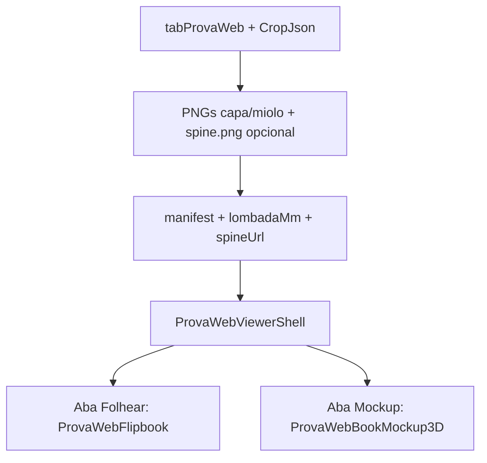

# Mockup 3D com lombada (aba ao lado do flipbook)

## Premissas fechadas

- **Onde:** abas **Folhear** | **Mockup 3D** (default = Folhear).
- **Portal:** mesmo seletor no cliente.
- **Espessura:** só `cropJson.capa.lombadaMm` do assistente de crop (não calcula gramatura/OS).
- **Quando aparece:** `modo === capa_miolo` **e** `lombadaMm > 0` **e** **não** papelaria (`isPapelaria` continua exclusivo no mockup de produto atual).
- **Stack:** CSS `preserve-3d` + drag do mouse (igual família da papelaria). **Sem** three.js / R3F.
- **Não regressão:** flipbook, render de páginas do livro, portal flipbook e `PapelariaProofMockup3D` ficam intactos.



## Princípio de isolamento

| Fluxo atual | Mudança |
|-------------|---------|
| `isPapelaria` → `ClienteProofMockupPanel` | **Nenhuma** |
| Flipbook `page-flip` + gutter CSS | **Nenhuma** na montagem de páginas |
| Papelaria `mockup/` / `mockup3d/` orphans | **Não** consolidar nem acoplar; livro é componente novo em `prova-web/` |
| Versões antigas sem `CropJson` / `lombadaMm=0` | Só Folhear (como hoje) |

## 1. Backend: asset de lombada sem entrar na sequência do flipbook

Em [`prova_web_render_service.py`](app/backend/services/prova_web_render_service.py):

- Quando `capa.layout == spread` e `lombadaMm > 0`, além das meias-páginas, rasterizar a **faixa central** da 1ª página da capa (largura = `lombadaMm` pt, altura = face) e gravar `spine.png` na pasta `ProvaN`.
- Inclusão no `manifest.json` (campo à parte, **fora** de `pages[]`):

```json
"bookMockup": {
  "lombadaMm": 8,
  "spineFile": "spine.png",
  "pageWidthMm": 148,
  "pageHeightMm": 210
}
```

Dimensões da face: MediaBox da capa após crop externo − lombada (iguais às faces renderizadas). Assim a proporção capa/espessura/altura fica fiel.

- **`cacheKey`:** já inclui `CropJson`; regenerar spine junto com o resto.
- **`_LAYOUT_VERSION`:** bump (ex. 4) só se o formato do manifest mudar de forma que caches antigos sem `bookMockup` devam re-renderizar de qualquer modo ao abrir Mockup — recomendado.

Endpoint de página existente serve PNG por número; adicionar serve estático seguro:

- Staff: `GET .../prova-web/assets/{name}` com allowlist `spine.png` (mesmo guard de pasta da OS).
- Portal: espelho em `proof_portal_routes` sob o token da prova WEB.

Flipbook **ignora** `bookMockup` / `spine.png`.

## 2. Frontend: viewer dedicado do livro

Novo módulo sob [`apps/web/src/features/prova-web/`](apps/web/src/features/prova-web/):

| Peça | Função |
|------|--------|
| `ProvaWebBookMockup3D.tsx` | Caixa 3D: frente (`cover-front`), fundo (`cover-back`), lombada (`spine`), topo/base procedurais |
| `prova-web-book-mockup.css` | `perspective`, faces, sombra; sem mexer em `prova-web.css` do flipbook |
| `ProvaWebViewerShell.tsx` | Tabs Folhear / Mockup 3D; monta o flipbook **sempre montado ou sob demanda** com default Folhear |

**Geometria (proporcional):**

- Escala mm → px a partir da altura útil da viewport (mesma ideia de `sceneDimensionsPx`).
- Largura da lombada em px = `lombadaMm / pageHeightMm * heightPx` (ou via `pageWidthMm`).
- Bloco do miolo: face estreita no espelho da lombada (cor papel `#f5f5f0`) para dar volume sem rasterizar o miolo inteiro.

**Interação:**

- Pointer drag horizontal → `rotateY`; vertical → `rotateX` limitado (±25°).
- `pointer-events` + `touch-action: none` na cena.
- Botão “Resetar vista”.
- Sem autoplay agressivo (não compete com o flipbook).

**Texturas:**

- Frente/fundo = URLs já existentes das páginas `cover-front` / `cover-back` do manifest.
- Lombada = `spineUrl` do manifesto; se ausente (cache antigo), faixa sólida com leve vinco — Mockup ainda funciona.

## 3. Integração UI (staff + portal)

[`ProvaWebPage.tsx`](apps/web/src/features/prova-web/ProvaWebPage.tsx):

```
info.isPapelaria ? PapelariaMockupStage
  : ProvaWebViewerShell(manifest)  // tabs se bookMockup.lombadaMm > 0
```

[`ClienteProofFlipbookPanel.tsx`](apps/web/src/features/cliente/components/proof/ClienteProofFlipbookPanel.tsx) (e tipagem do manifest do portal):

- Envolver o flipbook no mesmo shell quando `bookMockup?.lombadaMm > 0`.
- `ClienteProofPage` **não** muda a regra `showFlipbook` / `showMockup` da papelaria.

Tipos em [`provaWeb.ts`](apps/web/src/api/provaWeb.ts) + espelho no proof-portal: `bookMockup?: { lombadaMm; spineUrl?; pageWidthMm; pageHeightMm }`.

## 4. Robustez

- Validar `lombadaMm < pageWidthMm / 2` (já implícito no crop); se spine clip falhar, log + manifesto sem `spineFile`, mockup degradado.
- Lazy: montar `ProvaWebBookMockup3D` só na aba ativa (evita custo com imagens/CSS 3D no Folhear).
- Acessibilidade: instrução “Arraste para girar”; teclado setas opcional leve.
- Não reutilizar `PapelariaProofMockup3D` (hover/fold de cartão) — comportamento e geometria diferentes.

## 5. Verificação

- Capa+miolo com `lombadaMm = 0` / layout `pages`: só Folhear.
- `lombadaMm = 8` vs `20`: espessura visualmente diferente; cacheKey distinto ao gerar Prova N+1.
- Staff e portal: abas idênticas; Folhear continua com sombra de gutter e page-flip.
- OS papelaria: continua só o mockup de produto (sem abas de livro).
- Cache antigo sem `bookMockup`: Folhear OK; se meta ausente mas `cropJson.lombadaMm > 0`, regenerar via `_render_for_record` (já ocorre ao pedir manifest) para popular spine.

## Fora de escopo (de propósito)

- Ligar ao calculador `lombadaCalc` / `DescAcabamento`.
- Abrir miolo página a página no 3D (Folhear cobre isso).
- Introduzir WebGL.
- Alterar presets da papelaria.