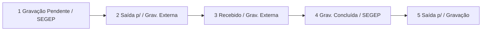

# Nova sequência de andamentos — Gravação Externa

Fonte canônica (seções detalhadas, não o resumo do final do doc — o resumo ainda cita textos antigos): [`docs/gravacao-externa-andamentos.md`](docs/gravacao-externa-andamentos.md).

## Decisões fechadas

- Status da sessão permanece `pendente` / `iniciada` / `concluida` (não renomear para `Recebido`).
- Lista **OPs em andamento** passa a ser por **setor `Grav. Externa`** (último operacional), com sessão ativa `pendente`/`iniciada`.
- Reparo one-shot **somente** OSs já em OPs em andamento (`Gravação Externa` + sessão ativa → `Saída p/` ou `Recebido`).
- **Não** migrar OSs já em Aguardando retirada.
- Interceptação de andamento manual: modal → concluir (`Grav. Concluída`) → depois o andamento escolhido.
- Observações conforme seções 2–5 do doc (não o resumo): chapas no envio; `Arquivos baixados:` no Recebido; texto atual de conclusão; `Chapas recebidas:` na saída.
- **Toda edição de andamento no MySQL deve ser replicada no MDB** (insert e update), usando o mesmo padrão já existente (`dispatch_mdb_sync` + `sync_andamento_from_mysql_to_mdb`).

## Replicação MySQL → MDB (obrigatório)

Qualquer mudança em `tabAndamento` feita por este trabalho no MySQL precisa espelhar no Access/MDB:

- **Inserts** novos (enviar, iniciar/Recebido, concluir, entrega, interceptação): enfileirar sync com `operation="insert"` após commit MySQL (padrão de `_notify_concluir_gravacao` / `_notify_enviar_gravacao_externa` / history add).
- **Updates** do reparo one-shot (alterar `SituacaoLink` / `SetorLink` / `Observaçao` do `UltimoStatus` legado): enfileirar sync com `operation="update"` para o mesmo `CodStatus`, para o MDB não ficar com o texto antigo.
- Não considerar “concluído” um passo de andamento sem evidência de enqueue/sync MDB (ou teste que mocke/verifique a chamada).
- Falha de enqueue deve seguir o padrão atual (log/warning + alerta admin quando aplicável), sem deixar o MySQL “órfão” sem tentativa de réplica.



## Constantes e catálogo

Em [`gravacao_externa_service.py`](app/backend/services/gravacao_externa_service.py) e [`gravacao_pendente_service.py`](app/backend/services/gravacao_pendente_service.py) / helpers:

| Passo | Situacao | Setor | Obs (corpo; com prefixo `HHhMM`) |
|-------|----------|-------|----------------------------------|
| Enviar | `Saída p/` | `Grav. Externa` | `Chapas por máquina:` … |
| Iniciar | `Recebido` | `Grav. Externa` | `Arquivos baixados:` + chapas |
| Concluir | `Grav. Concluída` | `SEGEP` | `Gravação concluída. Aguardando retirada de:` + chapas |
| Entrega | `Saída p/` | `Gravação` | `Chapas recebidas:` + chapas |

- Substituir `SITUACAO_GRAVACAO_EXTERNA` / `SITUACAO_AGUARD_RETIRADA` / setores SEFOC de conclusão-entrega pelos valores novos.
- Seed em [`gravacao_externa_schema.py`](app/backend/services/gravacao_externa_schema.py): situacoes `Saída p/`, `Recebido`, `Grav. Concluída` (manter seed legado `Gravação Externa` inativo ou só legado para leitura).
- Helpers de formatação em [`andamento_helpers.py`](app/backend/routers/andamento_helpers.py): ajustar `format_gravacao_concluida_obs`, `format_gravacao_entrega_obs`; novo helper para obs de envio (chapas) e de Recebido (`Arquivos baixados:`).

**Critério “ainda na externa”** (cancela sessão / UI / concluir sem sessão):

```python
def is_em_gravacao_externa_operacional(situacao, setor) -> bool:
    return (setor or "").strip() == "Grav. Externa" and (situacao or "").strip() in {"Saída p/", "Recebido"}
```

Manter aceitação legado `situacao == "Gravação Externa"` só no reparo e em checks de cancelamento até limpar a fila atual.

## Backend — pontos de criação

1. **Enviar** — [`_enviar_uma_pendente_para_externa_cursor`](app/backend/services/gravacao_pendente_service.py): situacao/setor novos; obs = chapas da pendente (não mais `Enviado para Gravação Externa.`); default `DEFAULT_SETOR_ENVIO_EXTERNA = "Grav. Externa"`. Route default em [`gravacao_pendente_routes.py`](app/backend/routers/gravacao_pendente_routes.py).
2. **Iniciar** — [`iniciar_gravacao`](app/backend/services/gravacao_externa_service.py): além de `Status='iniciada'`, inserir andamento `Recebido` / `Grav. Externa` (chapas da origem pendente), audit + `after_andamento_changed` + sync MDB (mesmo padrão de concluir). Idempotente se já `iniciada` **e** último operacional já for Recebido/Grav. Externa.
3. **Concluir** (com/sem sessão): `Grav. Concluída` / `SEGEP`; validar “em operacional externa” (novo helper + legado). Lista aguardando continua por sessão `concluida` + `EntregaLancadaEm IS NULL`; response passa a exibir situacao `Grav. Concluída` / setor `SEGEP`.
4. **Entrega chapas** — [`lancar_entrega_chapas`](app/backend/services/gravacao_externa_service.py): `Saída p/` / `Gravação` + nova obs.
5. **Lista OPs em andamento** — [`list_os_gravacao_externa`](app/backend/services/gravacao_externa_service.py): filtro por `SetorLink = 'Grav. Externa'` no último operacional (e sessão ativa quando houver); deixar de exigir `SituacaoLink = 'Gravação Externa'`.
6. **Cancelamento de sessão** após history em [`os_routes.py`](app/backend/routers/os_routes.py): usar helper situacao+setor (não cancelar em `Saída p/`/`Recebido` + `Grav. Externa`).
7. **Gravação Pendente / SEGEP**: ao lançar situacao `Gravação Pendente` em history add, forçar `setor = SEGEP` no backend (além do form).

## Guarda + interceptação de andamento manual

**Backend (seguro):** em `POST` history, se último operacional está em setor `Grav. Externa` e a nova situacao **não** é o fluxo de conclusão via API de gravação, responder `409` com código claro (`gravacao_externa_pendente_conclusao`) — evita bypass do front.

Exceção: o próprio `POST /gravacao-externa/.../concluir` continua sendo o caminho canônico para `Grav. Concluída`.

**Frontend:** em [`OsHistoryPanel.tsx`](apps/web/src/features/os/components/OsHistoryPanel.tsx) (e tablet se o mesmo submit existir): se último andamento da OS tem setor `Grav. Externa`, ao confirmar andamento manual abrir modal de confirmação (chapas read-only, espelhando o espírito do concluir / lista), chamar `concluir`, depois submeter o andamento que o usuário escolheu.

## Frontend constants / clients

- [`constants.ts`](apps/web/src/features/gravacao-externa/constants.ts), realtime hook, textos em [`GravacaoExternaTab.tsx`](apps/web/src/features/gravacao-externa/components/GravacaoExternaTab.tsx).
- [`enviarGravacaoPendenteParaExterna`](apps/web/src/api/gravacaoPendente.ts): `setor: "Grav. Externa"`.
- Badges/status de sessão: UI continua `pendente`/`iniciada`/`concluida`; andamento Recebido é independente.

## Reparo one-shot (só em andamento)

Função idempotente (padrão `repair_*` existente), chamada sob demanda ou startup controlado:

- Sessão `pendente` + último `Gravação Externa` → UPDATE UltimoStatus para `Saída p/` / `Grav. Externa` + obs de chapas (quando disponíveis) + sync MDB.
- Sessão `iniciada` + último `Gravação Externa` → UPDATE para `Recebido` / `Grav. Externa` + obs `Arquivos baixados:` + chapas + sync MDB.

Não tocar em `concluida` / Aguardando retirada.

## Testes

Atualizar/estender:

- [`test_gravacao_externa_service.py`](app/backend/tests/test_gravacao_externa_service.py) — constantes, iniciar com andamento, concluir/entrega, filtro lista por setor, helper operacional, reparo.
- [`test_gravacao_pendente_service.py`](app/backend/tests/test_gravacao_pendente_service.py) — envio com Saída p/ + Grav. Externa + obs chapas.
- Vitest de constants / enviar payload.
- Caso de history add bloqueado com setor Grav. Externa.

## Critérios de aceite

1. Enviar registra `Saída p/` + `Grav. Externa` + chapas; OS aparece em OPs em andamento.
2. Iniciar registra `Recebido` + `Grav. Externa` + `Arquivos baixados:`; sessão continua `iniciada`.
3. Concluir registra `Grav. Concluída` + `SEGEP`; OS vai para Aguardando retirada.
4. Entrega registra `Saída p/` + `Gravação` + `Chapas recebidas:`; OS some da lista.
5. Andamento manual com setor Grav. Externa exige concluir antes (modal → dois andamentos na ordem).
6. OSs já na lista em andamento passam pelo reparo para o novo padrão; Aguardando retirada antigas intactas.
7. Todo insert/update de andamento no MySQL desta mudança dispara réplica no MDB (`insert` ou `update` conforme o caso).
8. Testes focados passando.

## Fora de escopo

- Renomear status de sessão DB para `Recebido`.
- Migrar OSs já em Aguardando retirada.
- Alterar colunas do controle histórico de chapas (“Saída p/ Birô”, etc.) — já usam esses rótulos de UI.
