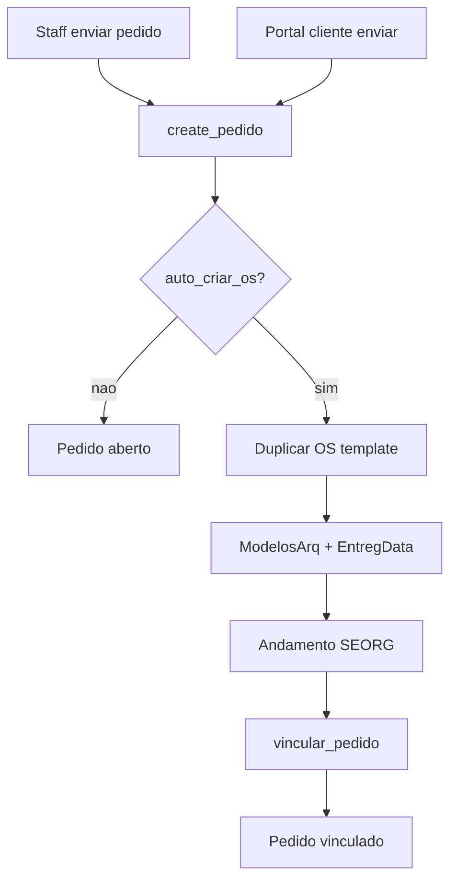

# OS automática no envio do pedido DEPOL

## Contexto

- Envio do pedido: [`create_pedido`](app/backend/services/credenciais_depol_service.py) — **staff** ([`credenciais_depol_routes`](app/backend/routers/credenciais_depol_routes.py)) e **portal cliente** ([`cliente_gabinete_routes` POST `/api/cliente/credenciais-depol/pedidos`](app/backend/routers/cliente_gabinete_routes.py)) chamam o **mesmo serviço**. Hoje **não** cria OS (só `aberto`); vínculo é passo separado na aba Execução.
- Menu “Duplicar OS” da home **não** chama `/duplicate`: abre [`/gerencia?action=duplicate`](apps/web/src/features/os/components/OsContextMenu.tsx) e grava com [`POST /os/save`](app/backend/routers/os_routes.py) (insert). Zera `EntregData`/prioridade/processo/CS; andamento novo = `Entrada Inicial` / **SEFOC** / ponto da sessão.
- Endpoint SQL [`POST /os/{ano}/{id}/duplicate`](app/backend/routers/os_routes.py) existe e copia `tabProtocolos` + `tabDetalhesServico` (inclui `ModelosArq` e `EntregData`), mas o React atual **não o usa**. Para automação DEPOL, **extrair/reusar essa lógica SQL** (não a Gerência) e aplicar overrides — é o caminho atômico server-side.
- Quantidade de modelos = **`ModelosArq`**. Data de entrega = **`EntregData`**. Sem referência no código a OS 20/26 como template (será config).
- Config DEPOL hoje só tem paths em [`config/config.example.json`](config/config.example.json); a aba admin é [`CredenciaisDepolModelosSection`](apps/web/src/features/configuracoes/components/CredenciaisDepolModelosSection.tsx).

**Decisões deste plano:**
- Template padrão **20 / 2026** (interpretando “20/26”), editável na admin.
- Com a flag **ativa**: criar OS + **vincular** o pedido à OS nova (status `vinculado`).
- **Mesmo fluxo no staff e no portal do cliente** (flag única; não há toggle separado por canal).
- Andamento: `Entrada Inicial` / **SEORG** / ponto do criador / obs `"{n} Credenciais DEPOL"`.

## Portal do cliente (requisito explícito)

| Capacidade | Staff | Portal cliente |
|---|---|---|
| Flag `auto_criar_os` (admin) | Sim | Sim (mesma config) |
| Duplicar template + ModelosArq / EntregData+1d | Via `create_pedido` | Idem (`cliente_create_depol_pedido` → `svc.create_pedido`) |
| Andamento SEORG + obs | `criado_por` = ponto staff | `criado_por` = `C{clienteId}` (já usado hoje); gravar no andamento de forma legível — se `format_ponto` zerar letras, usar fallback do valor bruto / só dígitos documentado nos testes |
| Vincular pedido à OS | Sim | Sim |
| Mensagem de sucesso com OS | Sim | Sim ([`CredenciaisDepolPedidoPanel`](apps/web/src/features/credenciais-depol/components/CredenciaisDepolPedidoPanel.tsx) compartilhado) |

Não criar endpoint paralelo no cliente: a lógica fica só no serviço compartilhado.

## Rascunho pré-envio (já implementado — verificar)

Persistência de itens antes do “Enviar pedido” (localStorage):

- Staff: `DEPOL_DRAFT_STORAGE_STAFF` em [`CredenciaisDepolPage`](apps/web/src/features/credenciais-depol/components/CredenciaisDepolPage.tsx)
- Cliente: `DEPOL_DRAFT_STORAGE_CLIENTE` em [`credencial-depol.tsx`](apps/web/src/routes/cliente/credencial-depol.tsx) — **já passado** em `draftStorageKey`

Na implementação desta feature: **confirmar** que o painel do cliente restaura a lista após F5/sair e limpa o rascunho só após envio com sucesso. Sem redesign; só smoke/regressão se algo estiver faltando.

## 1. Config + UI admin

Em `credenciais_depol` no `config.json` / example:

- `auto_criar_os`: `false` (default)
- `os_template_nro`: `20`
- `os_template_ano`: `2026`

Backend: endpoints GET/PATCH de settings DEPOL via `config_manager`.

Admin ([`CredenciaisDepolModelosSection`](apps/web/src/features/configuracoes/components/CredenciaisDepolModelosSection.tsx)):
- Checkbox “Criar OS automaticamente ao enviar pedido” (vale para **interno e portal cliente**)
- Campos Nro/Ano da OS-template (quando ativo)
- Salvar no config

## 2. Extrair duplicação reutilizável

Refatorar o handler SQL [`duplicate_os`](app/backend/routers/os_routes.py) (~L944–1049) para serviço (ex. `services/os_duplicate_service.py`), mantendo o endpoint `/duplicate` como wrapper fino. **Não** passar pela Gerência/`/os/save`.

- Parâmetros: `source_nro`, `source_ano`, `usuario`
- Overrides: `setor_andamento` (default `SEFOC` para compat do endpoint), `obs_andamento`, `modelos_arq`, `entreg_data`
- Após o `INSERT…SELECT`: `UPDATE` de `ModelosArq` / `EntregData` quando houver override (SQL copy traria os valores da template)
- Andamento: `Entrada Inicial` + setor override (**SEORG** no DEPOL) + ponto + obs formatada (`"{n} Credenciais DEPOL"`)
- Manter sync MDB / audit
- Nota: UI “Duplicar” zera entrega; no DEPOL **forçamos** entrega = hoje+1d via override

## 3. Integrar em `create_pedido`

1. Inserir pedido + itens.
2. Flag off → pedido `aberto` (fluxo atual staff e cliente).
3. Flag on → validar template → duplicar com overrides → `vincular_pedido` → resposta já com OS.
4. Falha na OS: não deixar estado inconsistente (rollback / compensar pedido).

## 4. Frontend pedido (staff + cliente)

- Sucesso com OS: `Pedido #X criado e vinculado à OS N/AAAA`.
- Painel único; ambos os adapters já usam o mesmo componente.

## 5. Testes

- Duplicate com overrides (modelos, data, SEORG, obs).
- `create_pedido` flag off / on.
- Garantir que o caminho cliente (mesmo serviço) herda o comportamento; teste de `criado_por` no andamento.
- Smoke: draft storage key cliente presente e parse ok.

## Fora de escopo

- Alterar o menu “Duplicar OS” da Gerência.
- Alterar o conteúdo da OS-template 20/2026 em si.
- Toggle separado staff vs cliente (uma flag cobre os dois).
