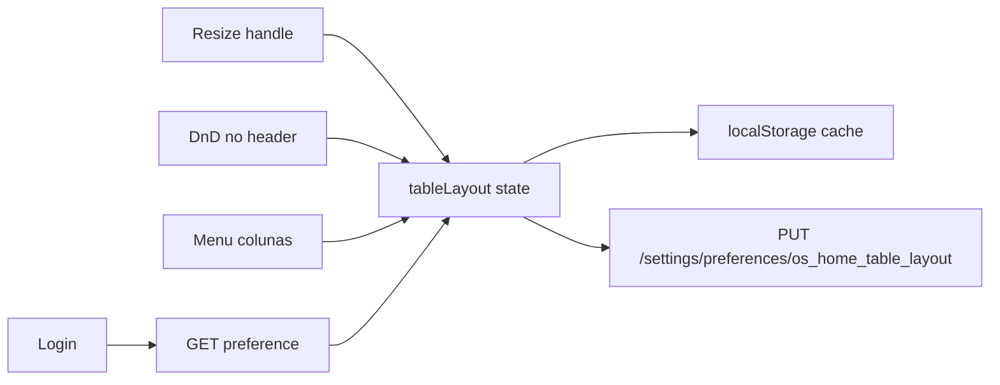

# Layout customizável das colunas da lista de OS

## Contexto

A lista da home é renderizada por [`OsOrdersTable.tsx`](apps/web/src/features/os/components/OsOrdersTable.tsx), com colunas hardcoded em `buildColumns()` e larguras via `size` + `style={{ width: column.getSize() }}`. Hoje a tabela é `table-fixed` + `overflow-x-hidden` (sem resize, sem ordem/visibilidade customizáveis). Preferências por usuário já existem em `tabUserPreferences` (`GET/PUT /settings/preferences/{key}`). O projeto já usa `@dnd-kit` (ex.: PCP, análise).

## Abordagem

Uma única preferência `os_home_table_layout` guarda o layout completo. No desktop:

- **Resize:** TanStack Table `columnSizing` + handle na borda direita do header
- **Reordenação:** drag-and-drop horizontal dos cabeçalhos com `@dnd-kit/sortable` (já no `package.json`)
- **Mostrar/ocultar:** menu de colunas com checkboxes; `nr_os` permanece sempre visível (identidade + expand de Sub OS)



Payload persistido:

```ts
{
  order: string[];              // ids na ordem desejada
  visibility: Record<string, boolean>;
  widths: Record<string, number>;
}
```

Colunas disponíveis (ids atuais): `nr_os`, `ano`, `data_entrada`, `produto`, `solicitante`, `titulo`, `situacao`, `setor`, `prioridade`, `data_entrega`.

## Interações no cabeçalho (sem conflito)

- **Clique curto** no header → sort (comportamento atual)
- **Arrastar o header** (ativação com distância mínima ~8px via `PointerSensor`) → reordenar coluna
- **Arrastar a borda direita** (handle dedicado) → redimensionar; `stopPropagation` para não sortar/reordenar

## 1. Backend — liberar a nova chave

Em [`app/backend/routers/settings_routes.py`](app/backend/routers/settings_routes.py), incluir `os_home_table_layout` em `VALID_PREFERENCE_KEYS`. O schema JSON genérico de `tabUserPreferences` já aceita qualquer payload; não precisa migração de tabela.

Estender o teste de validação em [`app/backend/tests/test_modern_panel_preferences.py`](app/backend/tests/test_modern_panel_preferences.py) para aceitar a nova chave.

## 2. Frontend — API e bridge de preferências

- Em [`apps/web/src/api/userPreferences.ts`](apps/web/src/api/userPreferences.ts): adicionar `os_home_table_layout` a `USER_PREFERENCE_KEYS`.
- Em [`apps/web/src/lib/userPreferences.ts`](apps/web/src/lib/userPreferences.ts): mapear para `localStorage` key `sagra-os-home-table-layout`.

## 3. Helper de layout

Criar [`apps/web/src/features/os/osHomeTableLayout.ts`](apps/web/src/features/os/osHomeTableLayout.ts) com:

- defaults de `order`, `visibility` (todas `true`) e `widths` iguais aos `size` atuais de `buildColumns`
- `minSize` por coluna (~40–80px)
- `nr_os` marcado como obrigatório (`visibility` forçada `true` no merge)
- `readLocalTableLayout()` / `mergeTableLayout(remote)` para cache rápido e saneamento (ids desconhecidos ignorados; ids novos do código entram no fim com default)

## 4. `OsOrdersTable` — resize, ordem e wiring

Em [`OsOrdersTable.tsx`](apps/web/src/features/os/components/OsOrdersTable.tsx):

- Estado controlado inicializado do localStorage/defaults: `columnSizing`, `columnVisibility`, `columnOrder`.
- `useUserPreferenceSync({ key: "os_home_table_layout", enabled: isAuthenticated, watchValue: layout, onRemoteLoaded })` — serializar os três estados num único payload.
- Em `useReactTable`:
  - `enableColumnResizing: true`, `columnResizeMode: "onChange"`
  - `state: { sorting, columnSizing, columnVisibility, columnOrder }`
  - handlers `onColumnSizingChange`, `onColumnVisibilityChange`, `onColumnOrderChange`
- Headers com `@dnd-kit`: `DndContext` + `SortableContext` (`horizontalListSortingStrategy`) nos `<th>`; `onDragEnd` recalcula `columnOrder`.
- Handle de resize absoluto na borda direita (`header.getResizeHandler()`).
- Larguras reais: `style={{ width: table.getTotalSize() }}` na `<table>`; container com `overflow-x-auto` (em vez de `overflow-x-hidden`); manter truncamento nas células.
- Aplicar `minSize` nas `ColumnDef`.

Mobile (cards) permanece sem customização de colunas — só a tabela `md:table`.

## 5. Menu mostrar/ocultar colunas

No toolbar da tabela (área do contador / topo da section), adicionar botão “Colunas” que abre um popover/menu com checkbox por coluna (labels iguais aos headers). `nr_os` aparece desabilitado/sempre marcado. Alterações atualizam `columnVisibility` e disparam o mesmo sync de preferência.

Reusar padrões visuais existentes do `@sagra/ui` / Lucide (`Columns3` ou similar), sem inventar design system novo.

## 6. Testes

Atualizar [`OsOrdersTable.test.tsx`](apps/web/src/features/os/components/OsOrdersTable.test.tsx) e adicionar teste do helper:

- Ajustar o caso `column overflow` para `overflow-x-auto` + largura total.
- Cobrir handle de resize (presença; drag não dispara sort).
- Cobrir menu de colunas (ocultar uma coluna remove o header; `nr_os` não ocultável).
- Cobrir merge/defaults/saneamento de `osHomeTableLayout`.
- Para DnD, cobrir pelo menos que a ordem controlada renderiza headers na sequência de `columnOrder` (simular mudança de estado/ordem sem depender de pointer flaky, se necessário).

## Critérios de aceite

- Desktop: resize pela borda da coluna; reorder arrastando o cabeçalho; mostrar/ocultar via menu.
- Clique curto no header continua ordenando; resize/DnD não disparam sort indevido.
- `nr_os` não pode ser removida.
- Após refresh/login, order + visibility + widths do usuário voltam (cache local imediato + sync servidor).
- Usuário/navegador limpo carrega defaults (todas visíveis, ordem e larguras atuais).
