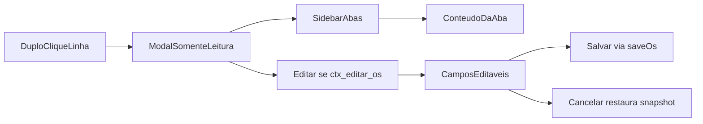
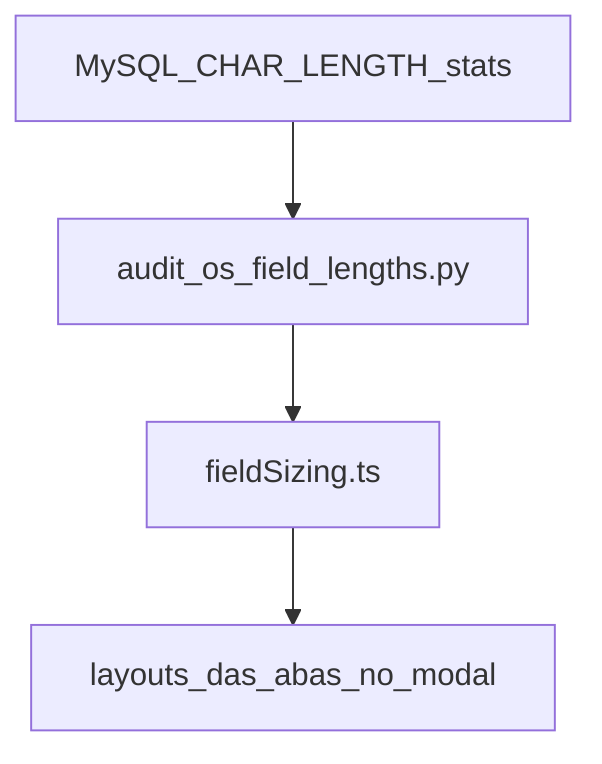

# Modal de detalhes da OS (duplo clique + abas laterais)

## Contexto atual

- Lista: [`OsOrdersTable.tsx`](apps/web/src/features/os/components/OsOrdersTable.tsx) — clique só seleciona; sem `onDoubleClick`.
- Gerência: [`GerenciaPage.tsx`](apps/web/src/features/gerencia/components/GerenciaPage.tsx) + [`GerenciaFormGrid.tsx`](apps/web/src/features/gerencia/components/GerenciaFormGrid.tsx) — 6 painéis em scroll único; load/save via `fetchOsDetails` / `saveOs`.
- Permissões de menu: ver = `ctx_detalhes_os`, editar = `ctx_editar_os` ([`contextMenuActions.ts`](apps/web/src/features/os/contextMenuActions.ts)).
- Shell de modal canônico na feature OS: overlay `fixed inset-0` + card (ex.: [`OsAuditLogModal.tsx`](apps/web/src/features/os/components/OsAuditLogModal.tsx)).

## Decisões fechadas

| Decisão | Escolha |
|---------|---------|
| Abertura | Duplo clique na linha (desktop e cards mobile) |
| Modo inicial | Somente leitura |
| Edição | Botão «Editar» no modal se `can('ctx_editar_os')`; salvar/cancelar no próprio modal |
| Conteúdo | Mesmos campos/lógica da Gerência (não o painel compacto `OsDetailsPanel`) |
| Navegação | Menu de contexto «Editar/Detalhes» continua indo para `/gerencia`; modal é atalho na lista |
| Abertura sem `ctx_detalhes_os` | Só abre se `ctx_detalhes_os` **ou** `ctx_editar_os` |

## UX do modal

- Shell grande (`max-w-6xl` / ~90vh), header com `OS {nr}/{ano}` + título + badge «Somente leitura» / «Editando».
- **Sidebar esquerda** com as 6 abas (uma ativa por vez):
  1. Solicitante  
  2. Ordem de Produção  
  3. Detalhes Técnicos  
  4. Material Entregue  
  5. Elementos Gráficos  
  6. Cálculos e Custos  
- Conteúdo da aba à direita com scroll; footer com Fechar | (Editar) | (Cancelar + Salvar em modo edição).
- Esc / overlay fecha; se dirty em edição, confirmar descarte.
- Após salvar com sucesso: voltar a somente leitura, atualizar snapshot e invalidar busca da lista.

## Arquitetura de código

### 1. Extrair seções compartilhadas da Gerência

Refatorar [`GerenciaFormGrid.tsx`](apps/web/src/features/gerencia/components/GerenciaFormGrid.tsx) para expor as 6 seções como componentes (ou um `GerenciaFormSections` com `sectionId`), reutilizando already-existing `Field` / `Row` / `CalculosCustosPanel` / `TrabalhoComponentes`.

- **Página `/gerencia`**: continua compondo as seções no grid atual (comportamento visual da página preservado).
- **Modal**: renderiza só a seção ativa, com grid de campos calibrado (ver sizing).

Evita duplicar bindings `form`/`update`/`readOnly`.

### 2. Hook de estado compartilhado (load/save)

Extrair de `GerenciaPage` um hook `useGerenciaOsEditor({ ano, id })` com: load (`fetchOsDetails` + componentes + coef A4), `form`/`techSpec`/`update`, `dirty`, `save`, `resetToSnapshot`, foto deputado. A página e o modal consomem o mesmo hook; o modal adiciona toggle `editing` (inicia `false`).

### 3. Novo modal + wiring na lista

- Novo: `apps/web/src/features/os/components/OsGerenciaDetailModal.tsx` (feature OS, porque abre da home; importa seções/hook de `features/gerencia`).
- Estado em [`OsHomePage.tsx`](apps/web/src/features/os/components/OsHomePage.tsx): `gerenciaModalRow` + open/close (como os outros modais).
- [`OsOrdersTable.tsx`](apps/web/src/features/os/components/OsOrdersTable.tsx): `onDoubleClick` na `<tr>` / card → seleciona linha + `onOpenGerenciaDetail(row)` (respeitar `selectionLocked`).

### 4. Sizing por conteúdo real no banco

Colunas de texto em MySQL são `text` sem max útil → o tamanho de UI vem de estatísticas, não do DDL.

**Script one-shot** (padrão de [`tools/audit_previsao_prazo_data.py`](tools/audit_previsao_prazo_data.py)): `tools/audit_os_field_lengths.py`

- `SELECT` only: `AVG`, `percentile approx` (via ordenação/`SUBSTRING_INDEX` ou buckets), `MAX(CHAR_LENGTH(...))` em `tabProtocolos` / `tabDetalhesServico` (filtro recente, ex. `AnoProtocolo >= 2024`).
- Campos alvo alinhados ao form: `NomeUsuario`, `OrgaoInteressado`, `Titulo`, `ProcessoSolicit`, `ContatoTrab`, `Andar`, `LocalTrab`, `PapelDescricao`, `CoresDescricao`, `DescAcabamento`, `Observ`, `InsumosFornecidos`, etc.

**Artefato estático** (sem query em runtime): `apps/web/src/features/gerencia/fieldSizing.ts`

- Regras derivadas dos percentis (ex. p90):
  - numéricos / datas / flags → largura estreita fixa
  - p90 ≤ ~25 → `max-w-[12rem]` / span curto
  - p90 ~26–60 → span médio
  - p90 > 60 → full width
  - textareas: `rows` ≈ `ceil(p90 / 50)` (com mínimo 2–3, teto ~6–8)
- Aplicar no layout das seções **no modal** (e nos `Field` compartilhados via prop `size`/`className` quando a seção for usada no modal). Página Gerência mantém layout atual para não regressar aquela tela.

## Escopo explícito fora

- Não alterar rota `/gerencia` nem o menu de contexto.
- Não redesenhar `OsDetailsPanel` da home.
- Sem endpoint novo de API (reusa `GET /api/os/{ano}/{id}/details` e `POST /api/os/save`).

## Critérios de aceite

1. Duplo clique na linha da lista (com permissão de detalhes ou editar) abre o modal com dados da OS.
2. Sidebar navega entre as 6 seções; todos os campos da Gerência estão cobertos.
3. Inicialmente somente leitura; «Editar» só com `ctx_editar_os`; salvar persiste e mantém o usuário na lista.
4. Campos longos/curtos refletem o mapa de sizing gerado da análise de banco (documentar no commit o comando do script e amostra de stats).
5. Página `/gerencia` continua funcional após a extração de seções.
