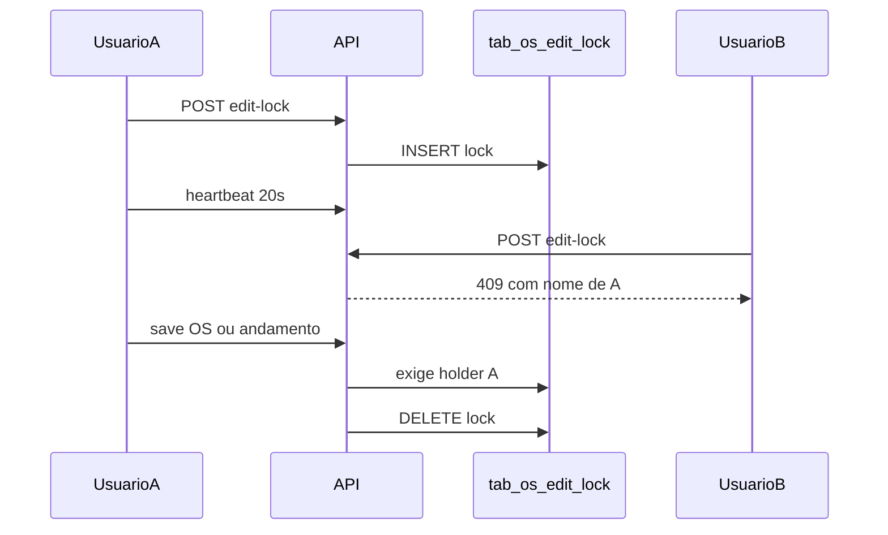

# Bloqueio de edição simultânea de OS

## Por que tabela MySQL (não só WebSocket)

Hoje edição de OS (`POST /api/os/save`) e andamentos (`POST`/`PUT /api/os/{ano}/{id}/history`) são **last-write-wins**: dois usuários podem abrir o mesmo registro e o último save sobrescreve. Presença online já existe em memória ([`app/backend/routers/realtime.py`](app/backend/routers/realtime.py)), mas lock só em RAM some no restart da API e não vale para tablet/outros clientes.

A forma mais eficiente neste projeto é **uma linha por OS** em MySQL (InnoDB), com heartbeat e TTL:

- PK `(nro_protocolo, ano_protocolo)` garante atomicidade (`SELECT … FOR UPDATE` / insert único).
- Sobrevive a restart da API e vale para Gerência, modal, histórico e tablet.
- Tabela **somente web** — não dual-write para Access MDB.

Uma OS em edição (formulário **ou** andamento) bloqueia as duas operações. Mensagem: *“O usuário {nome} (ponto {ponto}) está editando esta OS no momento. Não é possível editá-la.”*

## Schema (dev + produção)

Nova tabela `tab_os_edit_lock` (padrão snake_case web, como `tab_os_sub_os`):

- `nro_protocolo`, `ano_protocolo` — PK
- `ponto`, `nome` — holder (da sessão, nunca do body do cliente)
- `origem` — `os_edit` | `andamento`
- `token` — UUID da aba, para heartbeat/release e disputa entre abas do mesmo ponto
- `acquired_at`, `heartbeat_at`

Arquivos no padrão existente:

- [`app/backend/os_edit_lock_schema.py`](app/backend/os_edit_lock_schema.py) — `ensure_os_edit_lock_schema()` + `CREATE TABLE IF NOT EXISTS`
- Chamada no startup de [`app/backend/routers/api.py`](app/backend/routers/api.py)
- [`deploy/sql/create_tab_os_edit_lock.sql`](deploy/sql/create_tab_os_edit_lock.sql) — DDL documentado

**Aplicar nos dois MySQL** (`sagrafulldb`):

1. **Dev (127.0.0.1):** restart da API com `ENV=development` (ou `ensure_*` via script) — [`config/config.development.json`](config/config.development.json).
2. **Produção (10.1.1.73):** o mesmo `CREATE TABLE IF NOT EXISTS` contra o host de produção (credenciais já existentes em `config/`, sem hardcode). Confirmar com `SHOW TABLES LIKE 'tab_os_edit_lock'`.

Não entra no MDB.

## Regras do lock

Serviço [`app/backend/services/os_edit_lock_service.py`](app/backend/services/os_edit_lock_service.py):

- **TTL 90s** sem heartbeat (aba fechada / crash). Heartbeat a cada ~20s só com a aba visível (`document.visibilityState`).
- **Mesmo ponto:** pode reassumir (outra aba rouba o token; a aba antiga perde o heartbeat).
- **Outro ponto com lock fresco:** 409 com `holder_nome` / `holder_ponto`.
- **Lock expirado:** o próximo `acquire` toma o lugar.
- Identidade **sempre da sessão** (`request.state.sagra_session`), não de `PontoUsuario` no body.

Endpoints em [`app/backend/routers/os_routes.py`](app/backend/routers/os_routes.py):

| Método | Path | Função |
|--------|------|--------|
| POST | `/api/os/{ano}/{id}/edit-lock` | acquire |
| POST | `/api/os/{ano}/{id}/edit-lock/heartbeat` | renovar |
| POST | `/api/os/{ano}/{id}/edit-lock/release` | soltar (POST, não DELETE — WAF Cloudflare) |
| GET | `/api/os/{ano}/{id}/edit-lock` | status (opcional para a UI) |

409 com `detail` objeto (`code`, `message`, `holder_nome`, `holder_ponto`) — [`apps/web/src/lib/api.ts`](apps/web/src/lib/api.ts) já lê `detail.message`.

**Enforcement no servidor** (senão a UI sozinha não impede conflito):

- `save_os` em **UPDATE** de OS existente: exige lock do ponto da sessão (ou adquire se estiver livre); recusa se outro holder; **libera após save ok**.
- `POST`/`PUT` andamento da OS principal e `POST` Sub OS: mesma regra; libera ao salvar/cancelar no cliente.
- **Não bloquear** andamentos automáticos (e-mail, análise, papelaria, jobs) — só fluxos interativos (painel + tablet em `/history`).
- Nova OS / duplicar: sem lock (ainda não há registro a disputar).

## Frontend

Hook `useOsEditLock` + client em [`apps/web/src/api/os.ts`](apps/web/src/api/os.ts):

- `acquire` ao clicar **Editar** / **Novo** andamento, ou ao montar [`GerenciaPage`](apps/web/src/features/gerencia/components/GerenciaPage.tsx) em modo edição (`ano`+`id`, não `modo=detalhes`, não `new`/`duplicate`).
- Se 409: `alert` com a mensagem e **não entra em edição**.
- Heartbeat 20s enquanto o lock está ativo e a aba visível.
- `release` em Cancelar, save ok, fechar modal, unmount, `pagehide` (`fetch` + `keepalive`).
- Pontos de amarração:
  - [`OsGerenciaDetailModal.tsx`](apps/web/src/features/os/components/OsGerenciaDetailModal.tsx) — `handleStartEdit` / cancel / close
  - [`GerenciaPage.tsx`](apps/web/src/features/gerencia/components/GerenciaPage.tsx) — mount edição / cancel / save
  - [`OsHistoryPanel.tsx`](apps/web/src/features/os/components/OsHistoryPanel.tsx) — `startNew` / `startEdit` / `cancelEdit` / save / unmount

Consulta/somente leitura permanece livre.

## Testes

- Backend: [`app/backend/tests/test_os_edit_lock_service.py`](app/backend/tests/test_os_edit_lock_service.py) — acquire, 409 outro usuário, steal por TTL, reassumir mesmo ponto, release, `assert_holder` no save/history (mocks de cursor).
- Frontend: teste do hook ou da mensagem 409 no modal/painel, no padrão Vitest existente.

## Fora de escopo (v1)

- Badge na lista de OS / broadcast WebSocket de lock (o aviso no clique já atende).
- Desbloqueio administrativo manual (TTL + mesmo ponto bastam).
- Versão otimista (`updated_at`) em paralelo — redundante com lock pessimista.
