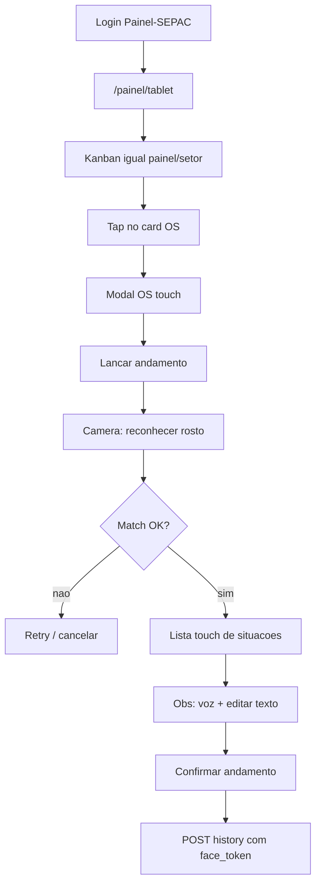

# Painel Tablet (`/painel/tablet`)

## Decisões travadas

- **Facial (1A):** cadastro de foto por usuário no admin; matching no **backend** (imagem capturada → embedding → similaridade); andamento usa o ponto do match via token de curta duração (cliente não escolhe o ponto).
- **Voz (2C):** Web Speech API (`pt-BR`) + campo de observação **sempre editável** no touch antes de confirmar.
- **Acesso:** sessão autenticada + `sb_dashboard_tablet` (sem acesso só por IP, diferente do TV `/painel/setor`). Sem item no sidebar.
- **Config de colunas/setor:** mesmo modelo do painel setor — defaults em [SetorPainelDefaultsSection.tsx](apps/web/src/features/usuarios/components/SetorPainelDefaultsSection.tsx) + preferência/localStorage no tablet; setor efetivo = `user.setor` / `painel_setores` do usuário genérico.

## Fluxo UX

## 1. Permissão, rota e redirect

**Backend**
- Adicionar `sb_dashboard_tablet` em [user_auth_schema.py](app/backend/user_auth_schema.py) (`_USER_PERMISSIONS_EXTRA_COLUMNS`), [schemas/permissions.py](app/backend/schemas/permissions.py) e merge em [user_permissions.py](app/backend/security/user_permissions.py).

**Frontend**
- Chave em [types.ts](apps/web/src/features/auth/types.ts) / [permissions.ts](apps/web/src/features/auth/permissions.ts).
- Rota [apps/web/src/routes/painel/tablet.tsx](apps/web/src/routes/painel/tablet.tsx) sob layout [painel.tsx](apps/web/src/routes/painel.tsx).
- Incluir `/painel/tablet` em [painel-standalone.ts](apps/web/src/lib/painel-standalone.ts).
- Guard dedicado: exige sessão + `sb_dashboard_tablet` (não reutilizar IP do `PainelAccessGuard` de TV).
- **Não** adicionar em `NAV_ITEMS` ([nav-config.ts](apps/web/src/components/layout/nav-config.ts)).
- Em `resolveDefaultAppRoute`: se `sb_dashboard_tablet`, ir direto para `/painel/tablet` (usuários genéricos do tablet tipicamente só terão essa permissão + `painel_setores`).
- Em [UserAdminPanel.tsx](apps/web/src/features/usuarios/components/UserAdminPanel.tsx): checkbox “Painel tablet” + setores (`painel_setores`) como no painel setor; setor do perfil (`tabUsuarios.Setor`) define o painel aberto no login.

## 2. Página tablet (reuso do painel setor)

- Nova feature `dashboard-tablet` (ou extensão fina de `dashboard-setor`) que reutiliza:
  - hooks/dados: [useDashboardSetorData.ts](apps/web/src/features/dashboard-setor/hooks/useDashboardSetorData.ts), [api.ts](apps/web/src/features/dashboard-setor/api.ts), matching de colunas em [utils.ts](apps/web/src/features/dashboard-setor/utils.ts)
  - settings de colunas (mesmo modal/padrão)
  - CSS base de [dashboard-setor.css](apps/web/src/features/dashboard-setor/dashboard-setor.css) + overrides touch/PWA (`dashboard-tablet.css`): alvos ≥44px, tipografia legível em landscape/portrait, safe-areas, `touch-action`, wake lock já existente
- Diferença: cards com `onClick`/`onPointerUp` abrindo o modal (painel setor permanece display-only).
- Setor fixo ao permitido do usuário (sem “passear” em setores sem `painel_setores`).

## 3. Modal profissional da OS + andamento touch

- Componente `TabletOsModal`: resumo da OS (número/SP, situação, prioridade, dados essenciais já disponíveis no item do board; fetch detalhe sob demanda se necessário via APIs OS existentes).
- CTA “Lançar andamento” → pipeline facial → lista grande de situações (`GET /api/aux/andamentos` ou `/aux/situacoes`, mesmo catálogo do [OsHistoryPanel](apps/web/src/features/os/components/OsHistoryPanel.tsx)).
- Setor do andamento: setor do painel/config (não digitar).
- Situações especiais (`Entregue`, `Gravação Pendente`, OS congelada): bloquear no tablet com mensagem clara (“use o desktop”) na v1 — evita reimplementar protocolos/complexidade no touch.
- POST andamento via `/api/os/{ano}/{id}/history` com `usuario` = ponto do face_token (validado no backend); `obs` do campo editável.

## 4. Reconhecimento facial (cadastro + verify)

**Schema**
- Tabela `tabUsuarioFace` (Ponto PK/FK, Embedding BLOB/JSON, ImagePath, UpdatedAt, Active) — ensure schema no boot, padrão dos outros schemas.

**Admin (Usuários)**
- Upload/troca/remoção de foto facial por usuário (MASTER/`sb_usuarios`).
- Backend extrai embedding na inscrição; rejeita se não houver rosto detectável.

**Matching (tablet)**
- Liberar mídia em [api.py](app/backend/routers/api.py): `Permissions-Policy: camera=(self), microphone=(self)` (hoje está `camera=(), microphone=()`).
- UI fullscreen de câmera frontal, guia de enquadramento, captura automática/manual, feedback de qualidade.
- `POST /api/tablet/face/verify` (auth + `sb_dashboard_tablet`): imagem → embedding → cosine similarity contra faces ativas (escopo: usuários com foto; opcionalmente filtrar por mesmo setor organizacional se fizer sentido operacional).
- Resposta: `{ ponto, nome, score }` + **`face_token`** assinado (TTL ~90s, one-time ou single-OS bound).
- Histórico: endpoint de history (ou wrapper tablet) **exige** `face_token` válido quando a sessão for de painel tablet / flag no body; ponto do token sobrescreve o `usuario` enviado.

**Stack facial (concreta)**
- Reusar `opencv-python-headless` + `numpy` + `onnxruntime` com modelo leve FaceNet/MobileFaceNet versionado em `app/backend/assets/face/` (download documentado no ensure/setup). Evitar dlib no Windows.

## 5. Voz para observações

- Hook `useSpeechToText` com `webkitSpeechRecognition` / `SpeechRecognition`, `lang: "pt-BR"`, botão hold/tap “Falar”.
- Sempre mostrar textarea/input grande editável; voz só preenche/anexa texto.
- Fallback amigável se o browser não suportar STT (só teclado touch).
- Mic liberado pelo mesmo ajuste de `Permissions-Policy`.

## 6. PWA / tablet

- Rota standalone já favorece kiosk; validar manifest/`display: standalone` existente em [vite.config.ts](apps/web/vite.config.ts).
- Manter wake lock; evitar hover-only; testar orientação landscape (prioritária) e portrait.
- Não cachear APIs de face/history no SW (já `NetworkOnly` para `/api`).

## 7. Testes e aceite

- Unit: matching de permissão/rota default; parse `sb_dashboard_tablet`; guard nega sem permissão.
- Backend: schema face ensure; verify rejeita sem rosto / score baixo; history rejeita token inválido/expirado; token força ponto correto.
- Manual: login `Painel-SEPAC` → `/painel/tablet` do setor; colunas iguais ao default do setor; tap → modal → face → situação → voz/editar → andamento com ponto da pessoa reconhecida.

## Arquivos principais

| Área | Arquivos |
|------|----------|
| Rota/UI | `routes/painel/tablet.tsx`, `features/dashboard-tablet/*`, CSS touch |
| Auth/nav | `permissions.ts`, `types.ts`, `nav-config.ts`, `painel-standalone.ts`, `UserAdminPanel.tsx` |
| Face/voz | `features/dashboard-tablet/face/*`, `hooks/useSpeechToText.ts`, admin upload na UI de usuários |
| API | `routers/tablet_face_routes.py`, `services/face_identity_service.py`, schema face, ajuste history + `Permissions-Policy` |
