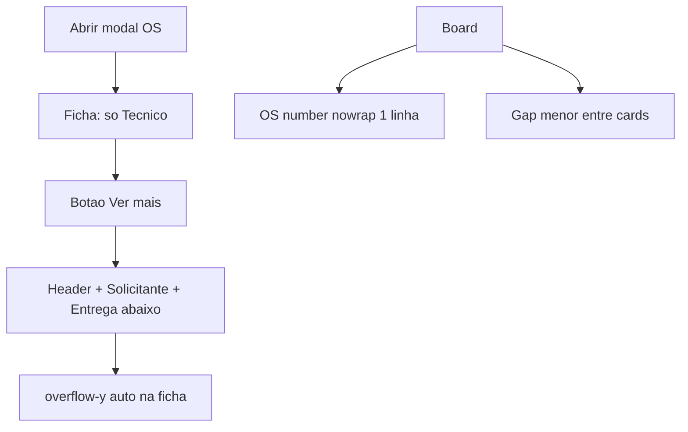

# Responsividade do painel tablet (painel/sagra)

## Escopo

A rota real é [`apps/web/src/routes/painel/tablet.tsx`](apps/web/src/routes/painel/tablet.tsx) → [`DashboardTabletPage`](apps/web/src/features/dashboard-tablet/components/DashboardTabletPage.tsx). Em produção fica sob base `/sagra/` (ex.: `/sagra/painel/tablet`).

Arquivos principais:
- [`TabletOsSummary.tsx`](apps/web/src/features/dashboard-tablet/components/TabletOsSummary.tsx) — conteúdo do resumo
- [`dashboard-tablet.css`](apps/web/src/features/dashboard-tablet/dashboard-tablet.css) — overrides do tablet + modal
- [`dashboard-setor.css`](apps/web/src/features/dashboard-setor/dashboard-setor.css) — tipografia compartilhada dos cards (só overrides sob `.dashboard-tablet-page`)

Fora de escopo: comportamento de negócio, face ID, andamentos, painel TV (`/painel/setor`), PWA separado.

## Estado atual (já implementado na v1)

- Obs/insumos removido; seções com `is-priority` / `is-compact`
- Ficha com scroll; grids do launch fluidos
- OS number com `28cqw` e **wrap permitido** — isso gerou o problema do screenshot (texto em 2 linhas)

## Feedback do screenshot (v2 — pendente)

1. **Número da OS em 2 linhas no card:** indesejado. Deve ocupar **apenas 1 linha** (encolher fonte e/ou ellipsis; nunca wrap).
2. **Espaço entre cards grande demais:** reduzir gap/margin no board tablet.
3. **Ficha embolada:** header + Solicitante + Técnico + Entrega todos visíveis com tipografia miúda. Reorganizar: **só Técnico visível por padrão**, legível e organizado; botão **Ver mais** revela o restante **abaixo** e ativa scrollbar na ficha.



## Decisões fechadas (v2 sobrescreve v1 onde conflita)

| Tema | Decisão |
|------|---------|
| Número da OS | **Uma linha só:** `white-space: nowrap`; `text-overflow: ellipsis`; `font-size` via `cqw` que caiba na largura do card sem quebrar |
| Espaçamento cards | Gap/margin reduzidos sob `.dashboard-tablet-page` (ex. column-content `gap: 0.35–0.5rem`; `margin-top` do card ~0) |
| Ficha default | Apenas seção **Técnico** (+ id da OS no topo do modal já existe no header do modal — evitar duplicar header denso da ficha) |
| Ver mais | Botão tocável (≥44px); ao expandir, mostra bloco extra **abaixo** de Técnico (meta: Entrada/Processo/…, Solicitante, Entrega); ficha com `overflow-y: auto` |
| Ver menos | Mesmo botão alterna para “Ver menos” e recolhe o bloco extra |
| Tipografia Técnico | Valores maiores e grid mais respirado (2 cols com gap maior; labels legíveis); Acabamento/títulos longos com clamp generoso mas sem esmagar o restante |
| Obs / insumos | Continua removido |

## Implementação v2

### A. Cards — uma linha + menos espaço

Em [`dashboard-tablet.css`](apps/web/src/features/dashboard-tablet/dashboard-tablet.css):

```css
.dashboard-tablet-page .dashboard-setor-os-number {
  white-space: nowrap !important;
  overflow: hidden;
  text-overflow: ellipsis;
  overflow-wrap: normal;
  font-size: clamp(0.85rem, 22cqw, 2.25rem) !important;
  line-height: 1.1;
}

.dashboard-tablet-page .dashboard-setor-column-content {
  gap: 0.4rem; /* menor que o gap herdado do setor */
}

.dashboard-tablet-page .dashboard-setor-card {
  margin-top: 0;
  min-height: unset; /* ou clamp baixo; card compacto em 1 linha de OS + situação */
  padding: clamp(0.25rem, 1cqw, 0.55rem);
}
```

Garantir que o override ≤768px do setor (`nowrap` + ellipsis) continue alinhado — sem `white-space: normal`.

### B. Ficha — só Técnico + Ver mais

Em [`TabletOsSummary.tsx`](apps/web/src/features/dashboard-tablet/components/TabletOsSummary.tsx):

1. Estado local `showMore` (default `false`).
2. Layout default:
   - Linha mínima: label da OS (compacta) opcional — o modal já mostra `OS xx/yy` no header; **remover ou enxugar** o `tablet-summary-header` denso (grid Entrada/Processo/…) do default.
   - Seção **Técnico** em destaque (única seção sempre visível).
   - Botão `Ver mais` / `Ver menos` abaixo de Técnico.
3. Quando `showMore === true`, renderizar **abaixo** do botão:
   - Bloco meta (Entrada, Processo, CS, Prioridade, Prazo, Situação)
   - Seção Solicitante
   - Seção Entrega
4. CSS:
   - `.tablet-summary` mantém `overflow-y: auto` (scrollbar só quando expandido ou conteúdo Técnico longo).
   - Default sem scroll desnecessário: Técnico cabe na altura da ficha landscape.
   - Tipografia Técnico: valor ~`0.9–1rem`, labels ~`0.7rem`, gap do grid maior; campos wide (Produto, Título, Cor, Papel, Acabamento) com hierarquia clara.
   - Botão: estilo secundário touch (`min-height: 44px`, full width da ficha).

### C. Validação v2

- Landscape tablet (~1024×768): ficha esquerda só Técnico legível; sem “embolamento”.
- Cards: OS nunca em 2 linhas; espaçamento visualmente mais denso.
- Tap em Ver mais → conteúdo extra abaixo + scrollbar; Ver menos recolhe.
- Portrait: mesmo comportamento; Técnico continua prioridade.

Checks: testes tablet existentes + inspeção visual no dispositivo/DevTools.
