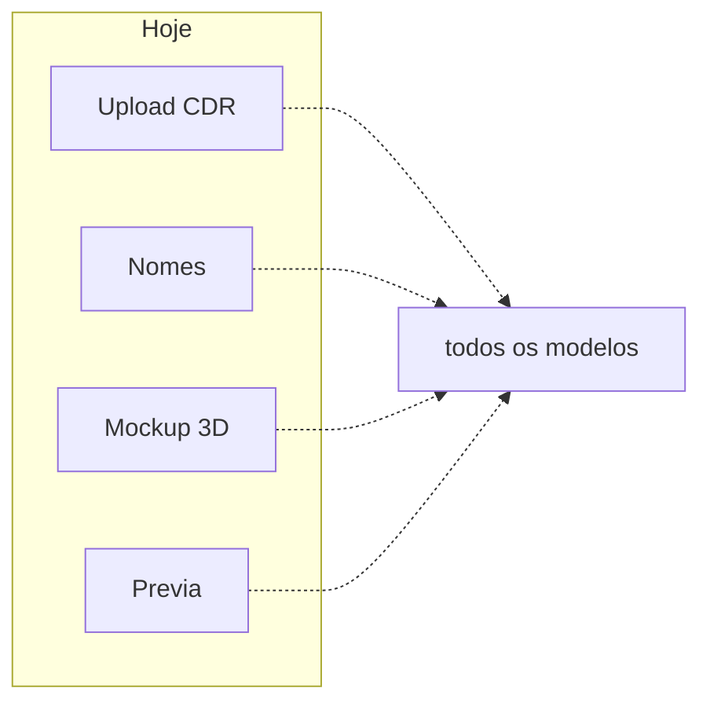
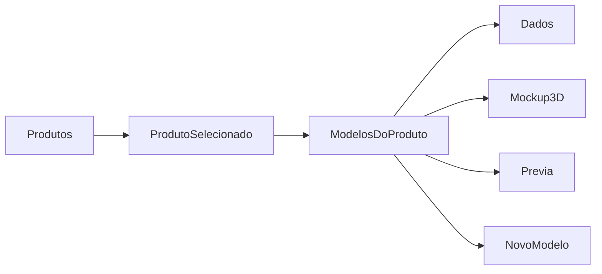

# Hub de produtos na aba Papelaria

## Situação atual

A aba Papelaria em [`ConfiguracoesPage.tsx`](apps/web/src/features/configuracoes/components/ConfiguracoesPage.tsx) empilha **quatro listas independentes de modelos** (upload, nomes, mockup 3D, prévia) + a fila do worker. Cada editor busca `GET /papelaria/admin/modelos` e o operador precisa achar o mesmo `.cdr` em telas diferentes.

No banco, produto é só um campo de [`tabPapelariaModelos`](app/backend/services/papelaria_models_service.py). Mockup (`MockupConfigJson`) e prévia (`PreviewConfigJson`) já são **por modelo** — alinhado à escolha de não centralizar o 3D no produto. Resolução em runtime (`getPapelariaMockupConfig`, prova WEB, portal) não muda.

## UX alvo

Um único painel de configuração de produtos + a fila do worker abaixo (operação, não cadastro).

Layout (mesmo padrão visual de e-mail/DEPOL: lista + detalhe):

- **Esquerda:** produtos derivados dos modelos ativos (nome, quantidade de modelos, indicadores de mockup/prévia configurados). Ações: *Novo produto*.
- **Direita:** cabeçalho do produto + faixa de **modelos daquele produto** (chips) + *Novo modelo*.
- **Abas internas do modelo selecionado:** Dados | Mockup 3D | Prévia.
- Sem modelo selecionado / fluxo de criação: formulário de upload `.cdr` (produto pré-preenchido se veio de um produto existente).

Trocar de modelo **mantém a aba** (ex.: continuar em Prévia ao comparar dois layouts do mesmo produto).

## Persistência e APIs (sem mudança de contrato)

Reusar [`apps/web/src/api/adminSystem.ts`](apps/web/src/api/adminSystem.ts):

- `fetchPapelariaAdminModelos` — única query da tela; agrupar no cliente por `produto`
- `savePapelariaAdminNomeExibicao` / `deletePapelariaAdminModelo`
- `savePapelariaAdminMockupConfig` / `validatePapelariaAdminMockupConfig`
- `savePapelariaAdminPreviewConfig` / upload de PNG base
- `createPapelariaModeloFromCdr` + inspect do worker

Não alterar routers, schema MySQL, resolução de mockup/prévia, jobs nem o worker. `GET /papelaria/admin/produtos` pode deixar de ser chamado nesta tela (continua válido).

## Componentes

Substituir as quatro seções em [`ConfiguracoesPage.tsx`](apps/web/src/features/configuracoes/components/ConfiguracoesPage.tsx) por um hub. Extrair editores existentes (não reescrever a lógica pesada de JSON/tuning):

| Novo arquivo | Origem | Papel |
|---|---|---|
| [`PapelariaProdutosAdminSection.tsx`](apps/web/src/features/configuracoes/components/PapelariaProdutosAdminSection.tsx) | — | Shell: lista de produtos, seleção, abas, agrupamento |
| [`PapelariaNovoModeloForm.tsx`](apps/web/src/features/configuracoes/components/PapelariaNovoModeloForm.tsx) | `PapelariaNovoModeloSection` | Upload `.cdr`; produto travado ou “novo produto” |
| [`PapelariaModeloDadosPanel.tsx`](apps/web/src/features/configuracoes/components/PapelariaModeloDadosPanel.tsx) | `PapelariaModelosNomesSection` | Nome de exibição, metadados (arquivo, frente/verso, cores), excluir |
| [`PapelariaModeloMockupPanel.tsx`](apps/web/src/features/configuracoes/components/PapelariaModeloMockupPanel.tsx) | `PapelariaModelosMockupSection` | JSON + preset + prévia 3D **sem** lista de modelos |
| [`PapelariaModeloPreviewPanel.tsx`](apps/web/src/features/configuracoes/components/PapelariaModeloPreviewPanel.tsx) | `PapelariaModelosLivePreviewSection` | JSON + tuning + PNG + live preview **sem** lista de modelos |

Helper pequeno (ex. `groupPapelariaModelosByProduto` em `features/configuracoes/`) para ordenar produtos e modelos; teste unitário do agrupamento.

[`PapelariaWorkerQueueSection.tsx`](apps/web/src/features/configuracoes/components/PapelariaWorkerQueueSection.tsx) permanece **abaixo** do hub, inalterado.

Remover as quatro `*Section` antigas depois de migrar (só são usadas nesta página). Atualizar a descrição da aba Papelaria no `TAB_META`.

## CSS

Em [`configuracoesPage.css`](apps/web/src/features/configuracoes/components/configuracoesPage.css):

- Layout produto: sidebar ~14rem + detalhe, altura única (`papelaria-admin-section`), no lugar de quatro blocos `max-height`.
- Variante **3 colunas** para mockup/prévia (JSON | controles | canvas), reusando `.papelaria-admin-col`, JSON editor e preview panel.
- Chips de modelo e abas internas no mesmo estilo das tabs da página (`configuracoes-tab-list` / botões atuais).

## Critérios de aceite

- A aba mostra **uma** lista de produtos; mockup e prévia só após escolher produto **e** modelo.
- Produto com vários modelos (ex. Frente e Frente/Verso) expõe **uma prévia e um mockup por modelo**, com saves independentes como hoje.
- Upload de `.cdr` continua criando modelo com mockup/prévia iniciais; depois disso o operador cai no produto/modelo novos.
- Excluir modelo e editar nome de exibição continuam disponíveis.
- Fila do worker segue visível e funcional.
- Papelaria operacional, prova WEB e portal **não** mudam de contrato.

## Verificação

- `pnpm test:frontend` focado no helper de agrupamento.
- `pnpm typecheck` em `apps/web`.
- No browser: aba Papelaria — listar produtos, abrir um com ≥2 modelos, salvar nome, aplicar preset de mockup, ajustar prévia, criar modelo em produto existente e “novo produto”; conferir que a fila do worker ainda atualiza.
