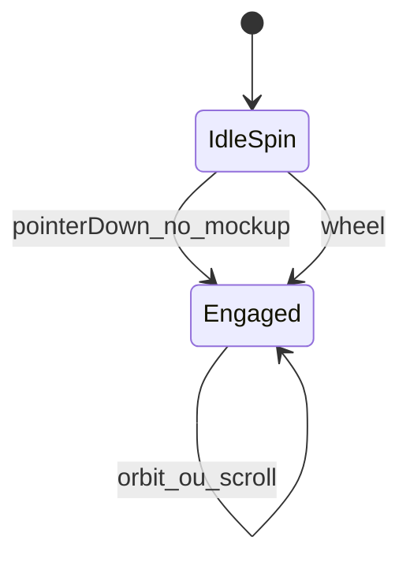

# Aba PDF + auto-giro do mockup

## 1. Terceiro modo: PDF original

### Comportamento
- Aba **PDF** junto de Folhear / Mockup, staff e portal.
- Viewer embutido (iframe via blob), reusando [`ClienteProofViewer`](apps/web/src/features/cliente/components/proof/ClienteProofViewer.tsx).
- Fontes = arquivos da prova (`arquivoUnico` / `arquivoCapa`+`arquivoMiolo` / folheto).
- **capa_miolo**: seletor interno **Capa | Miolo**.

### Staff
- Estender [`ProvaWebViewerShell.tsx`](apps/web/src/features/prova-web/ProvaWebViewerShell.tsx): `ViewerTab = "folhear" | "mockup" | "pdf"`.
- Sempre exibir barra de abas quando houver fonte PDF (mesmo OS “só Folhear” hoje).
- Props novas: paths/labels das fontes (de `info.record` em [`ProvaWebPage.tsx`](apps/web/src/features/prova-web/ProvaWebPage.tsx)).
- Painel [`ProvaWebPdfPanel.tsx`](apps/web/src/features/prova-web/ProvaWebPdfPanel.tsx): seletor se 2 arquivos + `ClienteProofViewer` com `provaWebSourcePdfUrl(ano, osId, path)` ([`provaWeb.ts`](apps/web/src/api/provaWeb.ts)) — endpoint existente `GET /os/.../prova-web/pdf?path=`.

### Portal
- Em [`serve_proof_pdf`](app/backend/routers/proof_portal_routes.py): query opcional `parte=unico|capa|miolo` (só token `prova_web`), resolve paths do `get_prova_web_record`; default = comportamento atual (miolo / único).
- Flipbook/info (ou manifest) devolve `pdfSources: [{ id, label }]` sem expor path UNC.
- FE: `proofPdfUrl(..., { parte })` + mesma aba PDF no shell via [`ClienteProofFlipbookPanel`](apps/web/src/features/cliente/components/proof/ClienteProofFlipbookPanel.tsx).

### Defaults de aba
- Fold → Mockup; book → Folhear; senão → Folhear. PDF nunca é default inicial.

---

## 2. Auto-giro idle (folha + livro)

Preferências: **ambos** mockups; no **primeiro scroll** → **parar na pose atual** (sem reset) e scroll controla desdobrar como hoje.

### Folheto — [`ProvaWebFoldMockup3D.tsx`](apps/web/src/features/prova-web/ProvaWebFoldMockup3D.tsx)
- Estado `idleSpin` (inicia `true`).
- `requestAnimationFrame`: incrementar `rotY` (~0.15–0.35 °/frame ou rad equivalente) + `kickRender` enquanto idle.
- `pointerdown` no stage → `idleSpin=false` (órbita manual existente).
- `onWheel`: se ainda idle, só `idleSpin=false` (mantém pose); em seguida (ou no mesmo evento) aplicar `deltaY * UNFOLD_WHEEL_SENS` como hoje.
- Botão reset view: opcionalmente `idleSpin=true` de novo; se complicar, só restaura pose sem religar spin (preferir **não** religar auto após reset — evita surpresa).

### Livro — [`ProvaWebBookMockup3D.tsx`](apps/web/src/features/prova-web/ProvaWebBookMockup3D.tsx)
- Mesma máquina: rAF em `rotY` (graus), parar no pointerdown / wheel.
- Book **não** tem unfold por scroll hoje — wheel só desarma o giro (e `preventDefault` se necessário para não scrollar a página). Sem inventar unfold no livro.

### Extração leve
- Hook ou helper `useIdleYawSpin({ enabled, onTick })` compartilhado para não duplicar rAF/cleanup; parâmetros: velocidade yaw, `engaged` setter.

---

## Fora de escopo
- Animação de transição capa→miolo no Folhear.
- pdf.js page-a-page no modo PDF (usar viewer nativo do browser).
- Religar auto-giro após interação (exceto se no futuro pedirem “Reset”).

## Verificação
- Staff/portal: abas Folhear | Mockup | PDF; capa/miolo com seletor.
- Abrir Mockup: gira sozinho; clique → para e orbitável; scroll no fold → para + desdobra a 2%; no book → só para.
- Modos existentes intactos.
