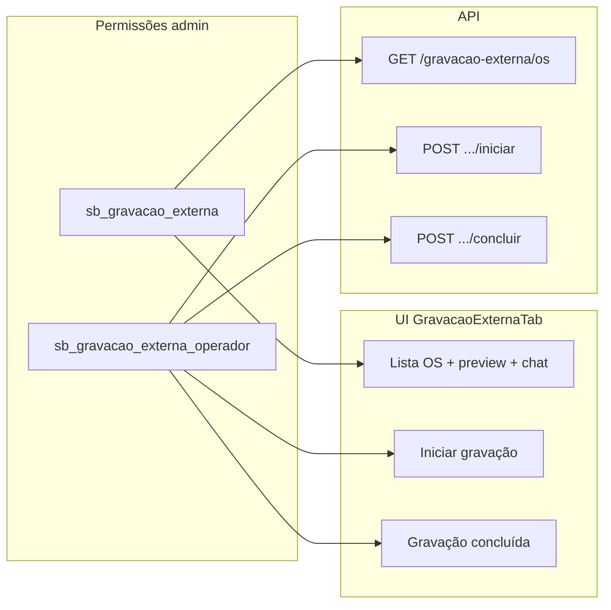

# Permissão operador — Iniciar / Concluir gravação

## Decisão confirmada

- Nova permissão: **`sb_gravacao_externa_operador`**
- Compartilhada pelos botões **Iniciar gravação** e **Gravação concluída**
- **`sb_gravacao_externa`** continua controlando acesso à aba/página (lista, preview, chat como viewer)
- **`sb_gravacao_externa_operador`** controla ações de operador (iniciar, concluir, papel "operador" no chat, acesso amplo à sessão)



---

## Parte 1 — Schema e RBAC (backend)

Adicionar coluna `sb_gravacao_externa_operador TINYINT(1) DEFAULT 0` em:

- [`app/backend/ip_permissions_schema.py`](app/backend/ip_permissions_schema.py) — `_EXTRA_COLUMNS` + `CREATE TABLE`
- [`app/backend/user_auth_schema.py`](app/backend/user_auth_schema.py) — migração idempotente (mesmo padrão de `sb_gravacao_pendente`)

Propagar a chave em toda a stack RBAC (copiar padrão de `sb_gravacao_externa`):

| Arquivo | Alteração |
|---------|-----------|
| [`app/backend/schemas/permissions.py`](app/backend/schemas/permissions.py) | campo bool no modelo |
| [`app/backend/security/user_permissions.py`](app/backend/security/user_permissions.py) | `_PERMISSION_BOOL_KEYS` |
| [`app/backend/security/painel_access.py`](app/backend/security/painel_access.py) | default `False` |
| [`app/backend/routers/ip_admin_routes.py`](app/backend/routers/ip_admin_routes.py) | Pydantic + SELECT/INSERT/UPDATE |
| [`app/backend/routers/user_admin_routes.py`](app/backend/routers/user_admin_routes.py) | lista de campos editáveis |

**Defaults:** `false` em painel e em [`apps/web/src/features/admin-ips/constants.ts`](apps/web/src/features/admin-ips/constants.ts) (`buildDefaultNewIpPayload`).

**Compatibilidade:** após deploy do schema, rodar migração de dados one-shot (script SQL ou extensão do [`deploy/scripts/apply_gravacao_externa_schema.py`](deploy/scripts/apply_gravacao_externa_schema.py)):

```sql
UPDATE ip_permissions SET sb_gravacao_externa_operador = 1 WHERE sb_gravacao_externa = 1;
UPDATE user_permissions SET sb_gravacao_externa_operador = 1 WHERE sb_gravacao_externa = 1;
```

Isso preserva operadores atuais sem exigir reconfiguração manual imediata.

---

## Parte 2 — API Gravação Externa

Arquivo: [`app/backend/routers/gravacao_externa_routes.py`](app/backend/routers/gravacao_externa_routes.py)

Separar helpers:

```python
def _has_view_permission(request) -> bool:
    return bool(perms.get("sb_gravacao_externa"))

def _has_operator_permission(request) -> bool:
    return bool(perms.get("sb_gravacao_externa_operador"))
```

| Endpoint | Permissão exigida |
|----------|-------------------|
| `GET /gravacao-externa/os` | **view** (`sb_gravacao_externa`) — hoje usa operador; corrigir |
| `POST .../iniciar` | **operador** |
| `POST .../concluir` | **operador** |
| Demais (detail, mensagens, download, preview) | view **ou** lançador; `is_operator` = flag **operador** |

Mensagem 403 sugerida: `"Permissão de operador de Gravação Externa necessária."`

---

## Parte 3 — Frontend

### Tipos e admin

- [`apps/web/src/features/auth/types.ts`](apps/web/src/features/auth/types.ts) — `PermissionKey`, `PERMISSION_KEYS`, payload API
- [`apps/web/src/features/admin-ips/constants.ts`](apps/web/src/features/admin-ips/constants.ts) — coluna sidebar: label **"OpG"**, title **"Operador Grv. Externa"**
- [`apps/web/src/features/admin-ips/types.ts`](apps/web/src/features/admin-ips/types.ts)
- [`apps/web/src/features/usuarios/components/UserAdminPanel.tsx`](apps/web/src/features/usuarios/components/UserAdminPanel.tsx) — label legível

### Botões

[`GravacaoExternaActions.tsx`](apps/web/src/features/gravacao-externa/components/GravacaoExternaActions.tsx):

- Nova prop `canOperate: boolean` (default `false`)
- Renderizar bloco dos dois botões **somente se** `canOperate === true`
- Manter `GravacaoExternaStatusBadge` visível para todos

[`GravacaoExternaTab.tsx`](apps/web/src/features/gravacao-externa/components/GravacaoExternaTab.tsx):

```tsx
const { can } = useAccessControl();
const canOperate = can("sb_gravacao_externa_operador");
// ...
<GravacaoExternaActions canOperate={canOperate} ... />
```

Sem alteração em [`GravacaoExternaLauncherChat.tsx`](apps/web/src/features/os/components/GravacaoExternaLauncherChat.tsx) — lançador nunca vê esses botões.

---

## Parte 4 — Testes

1. **Backend** [`app/backend/tests/test_gravacao_externa_routes.py`](app/backend/tests/test_gravacao_externa_routes.py):
   - `POST .../iniciar` e `POST .../concluir` retornam **403** sem `sb_gravacao_externa_operador`
   - `GET /gravacao-externa/os` aceita só `sb_gravacao_externa` (sem operador)

2. **Frontend** (opcional, leve): teste de `GravacaoExternaActions` — `canOperate=false` não renderiza botões

3. [`apps/web/src/features/auth/permissions.test.ts`](apps/web/src/features/auth/permissions.test.ts) — parse da nova chave

---

## Verificação manual

1. Rodar `python deploy/scripts/apply_gravacao_externa_schema.py` (ou `ensure_*` via servidor)
2. Admin IPs/Usuários: conferir checkbox **Operador Grv. Externa**
3. Usuário com `GEx` sem `OpG`: vê lista/preview, **não** vê botões; API iniciar/concluir = 403
4. Usuário com `OpG`: vê botões e consegue iniciar/concluir
