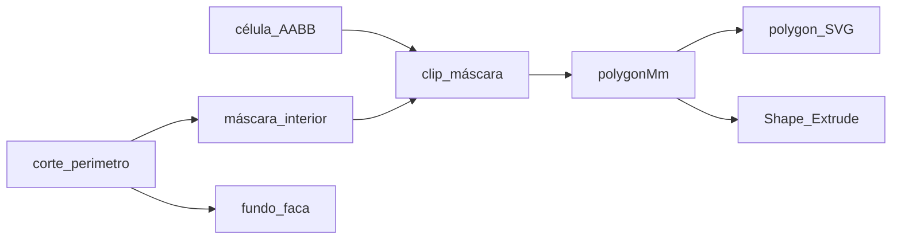

# Polígonos no corte + dobras simultâneas

## Formato de importação (decisão)

**Manter SVG como formato principal** — não migrar para CF2/DXF neste ciclo.

| Formato | Prós | Contras no Sagra |
|--------|------|------------------|
| **SVG (Corel)** | Já no fluxo; XML simples; cores/camadas/ids; zero CAD caro | Sem tipo nativo cut/crease → precisa contrato |
| CF2 / CFF2 | Cut/crease nativos (indústria) | Exige ArtiosCAD/Esko; parser pesado; fora do Corel |
| DXF | Camadas CAD | Semântica cut/fold ambígua; pesado; UX pior no Admin |
| PDF | Legado OS | Dash/cor inconsistente (já comprovado) |

O caminho mais eficiente com o que vocês já exportam: **SVG + contrato Sagra** (metadados no próprio arquivo). O parser ganha *fast-paths* e deixa de depender só de heurística/máscara.

### Contrato SVG Sagra (obrigatório no Admin)

Documentar na UI de upload e validar no parse:

1. **Unidades:** `width`/`height` em `mm` (ou 1 user unit = 1 mm) + `viewBox`.
2. **Camada `corte`** (`id` / `inkscape:label` / `data-name`): stroke `#ED3237`, contínuo.
3. **Camada `dobras`:** stroke `#00AFEF` (pontilhado opcional).
4. **Contorno fechado canônico:** um path (ou compound) com `id="corte_perimetro"` (ou `data-sagra="cut-outline"`) — silhueta da peça **incluindo curvas**. Preferir um único path fechado (`Z`) em vez de dezenas de segmentos soltos.
5. **Dobras nomeadas e só no material:** cada vinco com `id` (`dobra_v_1`, `dobra_h_tampa`…); **não** atravessar vão entre flaps.
6. **Opcional (máxima fidelidade):** camada `paineis` com fills fechados (`data-sagra="panel"` + `data-panel-id`), um polígono por face — quando presente, o sistema **usa esses polígonos** e pula o clip por máscara.

```mermaid
flowchart TD
  corel[Export_Corel_SVG]
  contract[Contrato_Sagra]
  parse[parse_dieline_svg]
  outline[netOutlineMm]
  folds[foldSegmentsMm]
  panelsOpt[paineis_opcionais]
  graph[build_panel_graph]
  corel --> contract --> parse
  parse --> outline
  parse --> folds
  parse --> panelsOpt
  outline --> graph
  folds --> graph
  panelsOpt -->|"se existir"| graph
```

### Fast-path no parser ([`prova_web_dieline_svg.py`](app/backend/services/prova_web_dieline_svg.py))

- Se achar `corte_perimetro` / `data-sagra="cut-outline"`: tessellar curvas → `netOutlineMm` direto; máscara/flood-fill só como fallback.
- Se achar camada `paineis`: montar `panels[].polygonMm` a partir dos fills; grade de vincos só para hinges.
- Sem camada `paineis`: manter grade V/H + **clip célula ∩ interior** (abaixo) — robusto para SVG “só corte+dobra”.

Não inventar sidecar `.json` agora (dobra manutenção). Tudo no SVG que o Corel já gera.

## Causa raiz (preview)

Hoje o grafo em [`prova_web_box_panel_graph.py`](app/backend/services/prova_web_box_panel_graph.py) cria **células retangulares** da grade de vincos V/H. O corte curvo só decide se o **centro** da célula entra; `polygonMm` é sempre o retângulo. No Admin, [`BoxModelDielineEditor.tsx`](apps/web/src/features/configuracoes/components/BoxModelDielineEditor.tsx) pinta o fundo cinza com `cutBboxMm` (AABB) e cada painel com `<rect>`. No 3D, [`boxGraphScene.ts`](apps/web/src/features/prova-web/box-engine/boxGraphScene.ts) usa `BoxGeometry(w,h)`. Por isso a curva aparece só no traço preto e o cinza/painel “corta” o canto — e painéis vizinhos parecem sobrepostos.

## Abordagem definitiva (geometria)

1. Preferir outline do contrato (`corte_perimetro`).
2. Manter grade de vincos para hinges (dobras eixo-alinhadas).
3. Sem painéis explícitos: `polygonMm = contorno(célula ∩ interior do corte)` via máscara + marching-squares no ROI da célula.
4. `netOutlineMm` alimenta o cinza do preview; painéis usam `polygonMm` no 2D e Shape no 3D.



## 1. Backend — contrato + polígono + outline

- Parser: reconhecer `data-sagra`, `corte_perimetro`, camada `paineis`; popular `netOutlineMm` / panels quando houver.
- [`prova_web_box_panel_graph.py`](app/backend/services/prova_web_box_panel_graph.py): `_contour_from_mask_roi` → `polygonMm`; área mínima vs AABB; fallback retângulo.
- Config: `netOutlineMm` + `panels[].polygonMm` reais.
- Reimport SVG necessário para modelos já salvos.
- Fixture: SVG no contrato (perímetro com C/A + dobras nomeadas) → outline curvo + painel com &gt;4 vértices.

## 2. Contrato mockup + 2D Admin

- Tipos: `netOutlineMm?: number[][]` em [`boxModels.ts`](apps/web/src/api/boxModels.ts).
- Propagar em mockup FE/BE.
- [`BoxModelDielineEditor.tsx`](apps/web/src/features/configuracoes/components/BoxModelDielineEditor.tsx): fundo = outline; painéis = `polygonMm`.
- Texto de upload: checklist do contrato Sagra (camadas, cores, `corte_perimetro`, ids de dobra, opcional `paineis`).

## 3. Preview 3D

- [`boxGraphScene.ts`](apps/web/src/features/prova-web/box-engine/boxGraphScene.ts): `Shape`/`ExtrudeGeometry` de `polygonMm`; UV pelo AABB; offset Z por profundidade BFS anti z-fight.

## 4. Dobras no mesmo passo

Motor já agrupa por `order` em [`resolveFlapProgress`](apps/web/src/features/prova-web/box-engine/boxTypes.ts). Ajustar UI:

- Default novo passo = `max+1`; **“Mesmo passo”** reutiliza order selecionado/último.
- Delete sem renumerar; “Renumerar 1…N” opcional.
- ↑↓ por nível distinto; lista agrupada por passo.
- Teste: duas ops `order: 1` → mesmo progresso.

## Critérios de aceite

- SVG no contrato Sagra importa outline curvo sem “caixa cinza” retangular sob o canto.
- Painéis 2D/3D seguem o corte; sem sobreposição visual a plano aberto.
- SVG legado (só camadas corte/dobras) ainda funciona via clip máscara.
- Camada `paineis` opcional, se presente, manda nos polígonos.
- Várias dobras no mesmo passo fecham juntas.
- Pytest + vitest verdes; guia no Admin atualizado.
