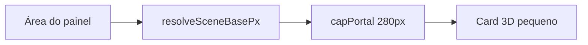

# Mockup do portal: ocupar a área sem cortar

## Causa

Em [`ClienteProofMockupPanel.tsx`](apps/web/src/features/cliente/components/proof/ClienteProofMockupPanel.tsx), o `ResizeObserver` já calcula um `fitted` via `resolveSceneBasePx` (até 960px), mas em seguida aplica `capPortalMockupSceneBasePx`, que limita a **280px** (220px em viewport estreito):

```71:80:apps/web/src/features/cliente/components/proof/ClienteProofMockupPanel.tsx
    const updateSize = () => {
      const rect = stage.getBoundingClientRect();
      const fitted = resolveSceneBasePx(...);
      setSceneBasePx(capPortalMockupSceneBasePx(fitted, isNarrowViewport));
    };
```

O painel cresce; o card 3D permanece pequeno e centralizado.



## Abordagem

No portal com `fillHeight` (rotas `/portal/aprovacao/...` e `/cliente/...`), **usar o valor fitted direto**, sem teto da Papelaria. A página interna da Papelaria continua com `PAPELARIA_MOCKUP_SCENE_BASE_PX` (280/220) em [`PapelariaProofPanel.tsx`](apps/web/src/features/papelaria/components/PapelariaProofPanel.tsx).

Garantia de “nada fora da visualização”:
- Manter `resolveSceneBasePx` (proporção mm + `escalaBase`)
- Manter fator de segurança (~0.82) para margem da rotação 3D (`rotateX`/`rotateY`) e `overflow: hidden` em `.proof-mockup-root--portal-fit`
- Continuar descontando o padding do root ao medir a área

## Alterações

1. **[`ClienteProofMockupPanel.tsx`](apps/web/src/features/cliente/components/proof/ClienteProofMockupPanel.tsx)**
   - Com `fillHeight`: `setSceneBasePx(fitted)` (sem `capPortalMockupSceneBasePx`)
   - Sem `fillHeight`: manter base 280/220 (comportamento compacto legado)
   - Remover import/uso de `capPortalMockupSceneBasePx` se não for mais necessário
   - Alinhar `MOCKUP_ROOT_PAD_Y` ao padding real de `.proof-mockup-root--portal-fit` (`1.25rem 1rem` → ~40px vertical, não 48px do root padrão)

2. **[`mockupEngine.ts`](apps/web/src/features/papelaria/mockup/mockupEngine.ts)** + **[`index.ts`](apps/web/src/features/papelaria/mockup/index.ts)**
   - Remover `capPortalMockupSceneBasePx` (deixou de ser a política desejada) e atualizar o comentário de `PAPELARIA_MOCKUP_SCENE_BASE_PX` para indicar que é só o tamanho fixo da página Papelaria

3. **[`PapelariaProofMockup3D.css`](apps/web/src/features/papelaria/components/PapelariaProofMockup3D.css)**
   - Atualizar o comentário de `--portal-fit` (deixar de dizer “tamanho da Papelaria”)

4. **Testes** — [`mockupEngine.test.ts`](apps/web/src/features/papelaria/mockup/mockupEngine.test.ts)
   - Remover testes de `capPortalMockupSceneBasePx`
   - Se ainda não houver cobertura útil de `resolveSceneBasePx`, acrescentar 1–2 casos (cabe na área; respeita teto 960 / piso 160)

## Critérios de aceite

- No portal com `fillHeight`, o mockup escala com o painel (bem maior que ~280px em desktop)
- O produto inteiro permanece visível (sem cantos cortados pelo overflow)
- Página Papelaria (staff) permanece no tamanho fixo 280/220
- `pnpm --filter @sagra/web test` passa nos testes do mockup engine
