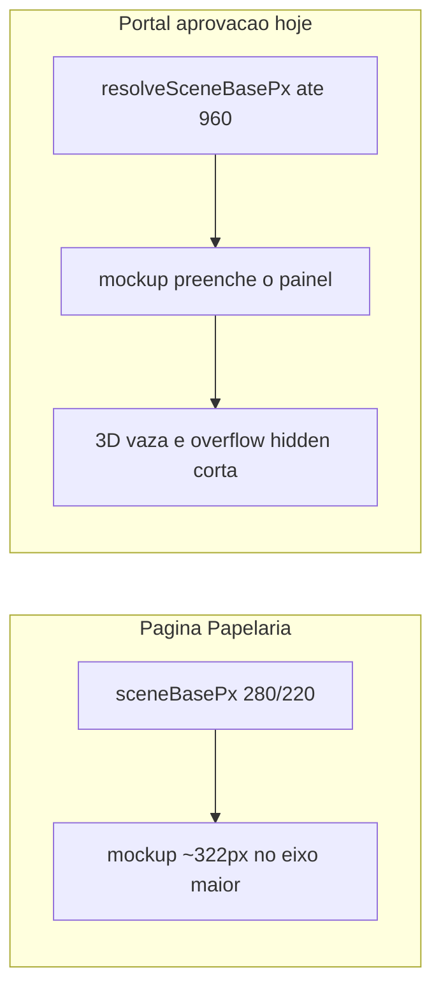

# Igualar mockup 3D do portal ao da Papelaria

## Causa

A página **Papelaria** renderiza o mockup com tamanho fixo:

```317:322:apps/web/src/features/papelaria/components/PapelariaProofPanel.tsx
                  <PapelariaProofMockup3D
                    pages={pageUrls}
                    config={mockupResolved.config}
                    isFallback={mockupResolved.isFallback}
                    sceneBasePx={isNarrowViewport ? 220 : 280}
                  />
```

O portal (`PortalAprovacaoPage` → `ClienteProofPage` com `fillHeight`) usa [`ClienteProofMockupPanel`](apps/web/src/features/cliente/components/proof/ClienteProofMockupPanel.tsx), que chama `resolveSceneBasePx` e **escala o produto até caber no painel** (teto 960px, fator 0.82). O card 3D fica quase do tamanho da área; `rotateY`/`rotateX` e faces dobradas saem da caixa CSS e são cortados por `overflow: hidden` (`.proof-mockup-root--portal-fit` e o stage).



Escopo: só produtos de papelaria em `/portal/aprovacao` (e o mesmo painel no bridge autenticado, que reutiliza `ClienteProofMockupPanel`). PDF, flipbook e não-papelaria não mudam.

## Abordagem

Usar o **mesmo teto** da Papelaria e só reduzir se o painel for menor (mobile / janela estreita), para não voltar a cortar em telas pequenas.

1. Extrair constantes compartilhadas em [`apps/web/src/features/papelaria/mockup/mockupEngine.ts`](apps/web/src/features/papelaria/mockup/mockupEngine.ts) e reexportar em [`mockup/index.ts`](apps/web/src/features/papelaria/mockup/index.ts):
   - `PAPELARIA_MOCKUP_SCENE_BASE_PX = 280`
   - `PAPELARIA_MOCKUP_SCENE_BASE_PX_NARROW = 220`
2. Helper pequeno (testável) no mesmo módulo, por exemplo `capPortalMockupSceneBasePx(fitted, isNarrow)` → `Math.min(cap, fitted)`.
3. Em [`ClienteProofMockupPanel.tsx`](apps/web/src/features/cliente/components/proof/ClienteProofMockupPanel.tsx):
   - Continuar medindo o stage com `ResizeObserver` quando `fillHeight`.
   - Passar `sceneBasePx = min(280|220, resolveSceneBasePx(...))` em vez de só o valor que preenche o painel.
   - Manter `proof-mockup-root--portal-fit` (altura 100% / centralização); o recorte some porque o card volta ao tamanho da Papelaria e sobra margem para a perspectiva.
4. Em [`PapelariaProofPanel.tsx`](apps/web/src/features/papelaria/components/PapelariaProofPanel.tsx), trocar os literais `220`/`280` pelas constantes, para as duas telas não divergirem.

## Testes

- Novo teste unitário em `apps/web/src/features/papelaria/mockup/mockupEngine.test.ts`: o teto do portal é 280 (220 no viewport estreito) e nunca ultrapassa o `fitted` menor.
- Rodar o teste focado: `pnpm exec vitest run apps/web/src/features/papelaria/mockup/mockupEngine.test.ts` (a partir de `apps/web` se o workspace exigir).

## Aceite

- Na Papelaria, o mockup 3D permanece visualmente igual.
- Em `/portal/aprovacao`, produtos de papelaria (cartão, folha A4, dobrados) têm o mesmo tamanho de cena da Papelaria e as extremidades 3D não são cortadas.
- Em painel menor que 280px, o mockup reduz o suficiente para continuar inteiro.
