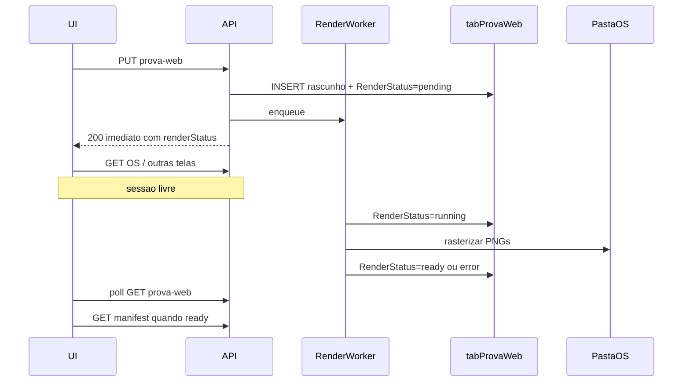

# Prova WEB em background (API)

## Diagnóstico

Hoje o [`PUT /api/os/{ano}/{os_id}/prova-web`](app/backend/routers/prova_web_routes.py) grava o rascunho em `tabProvaWeb` e **só então** chama `_render_for_record` → `ensure_prova_web_pages` (PyMuPDF + escrita de PNGs na pasta UNC). O HTTP fica aberto até o fim.

Isso explica o sintoma: enquanto o `PUT` longo está ativo, outras chamadas do mesmo usuário (ex.: carregar OS na tela principal) ficam sem resposta prática — não é o sistema inteiro para todos, é contenção na sessão/requests desse usuário.

O portal cliente e a aprovação **não** são o gargalo; o custo está na geração. Worker Corel/papelaria é outro fluxo e não deve ser misturado.

## Abordagem escolhida

**Fila leve dentro da API** (preferência confirmada): `ThreadPoolExecutor` dedicado (`max_workers=1`, configurável) + colunas de status de render em `tabProvaWeb`. Sem worker Windows externo e sem Celery.

Motivo: PyMuPDF já roda no processo Python; o padrão de warmup em thread ([`gravacao_preview_cache_service.enqueue_preview_warmup`](app/backend/services/gravacao_preview_cache_service.py)) já existe; o que falta é **estado persistente, exclusão mútua, recuperação e UI de progresso** — mais perto do claim de papelaria do que de um `daemon=True` solto.

## Contrato de estado

Estender schema em [`app/backend/prova_web_schema.py`](app/backend/prova_web_schema.py) (migração idempotente, como hoje):

| Coluna | Uso |
|--------|-----|
| `RenderStatus` | `pending` \| `running` \| `ready` \| `error` \| `cancelled` |
| `RenderError` | mensagem curta (sem stack completa no cliente) |
| `RenderStartedAt` / `RenderFinishedAt` | auditoria e stale detection |
| `RenderProgress` | JSON opcional `{done,total}` para UX |

Manter `Status` de negócio (`rascunho` / `publicado`) intacto. `isDraft` continua baseado só em `Status`. Novos campos vão no `_row_to_record` de [`prova_web_record_service.py`](app/backend/services/prova_web_record_service.py).

Regras:

- Só **aprovar** se `RenderStatus=ready` e arquivos existem.
- `manifest` / `pages` / portal flipbook: se `pending|running` → **não** re-renderizar no request; responder `409`/`202` com `{ renderStatus }` (staff) ou mensagem estável (portal). Se `ready` → servir cache; se cache ausente após `ready` → reenfileirar 1x ou marcar `error` (nunca travar request longo).
- Troca de rascunho (`replace_draft`): cancelar job anterior da versão, limpar pasta, resetar para `pending`, reenfileirar.
- Descartar: marcar `cancelled`, tentar cancelar job, apagar pasta/linha como hoje.
- Uma versão `(ano,os,versao)` só pode ter um job ativo (update atômico `WHERE RenderStatus IN ('pending','running')` falha → 409).

## Backend — serviços novos / alterações

1. **Novo** [`app/backend/services/prova_web_job_service.py`](app/backend/services/prova_web_job_service.py)
   - Executor singleton + fila; `enqueue_prova_web_render(ano, os_id, versao)`.
   - Worker: claim atômico (`pending`→`running`), revalida paths sob pasta da OS (mesmas regras de hoje), chama `ensure_prova_web_pages`, atualiza `ready`/`error` + progresso.
   - Semáforo global (default 1 render simultâneo) para não saturar CPU/rede/UNC nem o pool MySQL ([`database.py`](app/backend/database.py) max ~10).
   - Job **não segura** conexão MySQL durante o raster: só abre DB no claim, nos checkpoints de progresso e no finalize.
   - Cancelamento cooperativo: flag in-memory por chave + checagem entre páginas (exige pequeno ajuste em `ensure_prova_web_pages` para callback/`should_abort`, sem mudar o resultado final do render).
   - Startup hook (lifespan/startup da API em [`api.py`](app/backend/routers/api.py)): jobs `running` órfãos → `pending` e reenqueue; `pending` sem worker → reenqueue. Evita rascunhos eternamente “gerando” após restart.

2. **Rotas** [`prova_web_routes.py`](app/backend/routers/prova_web_routes.py)
   - `save_prova_web`: após INSERT/UPDATE, **não** chamar `_render_for_record`; set `RenderStatus=pending` + `enqueue`; retornar `{ ok, record, renderStatus, versionCount }` imediatamente.
   - `GET .../prova-web`: incluir campos de render (polling natural).
   - Opcional fino: `GET .../prova-web/{versao}/render-status` só se o payload do GET ficar pesado — preferir enriquecer o GET existente.
   - `aprovar_prova_web`: gate `ready`.
   - `_render_for_record` deixa de ser caminho feliz do save; manifest/pages usam “serve if ready / sync only for legacy ready-with-cold-cache”.

3. **Portal** [`proof_portal_routes.py`](app/backend/routers/proof_portal_routes.py)
   - Flipbook só se versão publicada **e** `ready`. Publicação já exige ready, então o portal continua seguro; ainda assim tratar `ensure` para não bloquear em cache miss longo (reenfileirar lado staff ou 503 curto).

## Frontend

Arquivos principais: [`ProvaWebFilePicker.tsx`](apps/web/src/features/prova-web/ProvaWebFilePicker.tsx), [`ProvaWebPage.tsx`](apps/web/src/features/prova-web/ProvaWebPage.tsx), [`provaWeb.ts`](apps/web/src/api/provaWeb.ts).

- Após `saveProvaWebRecord`, fechar o wizard e ir para a página da prova em estado “Gerando páginas…”.
- `refetchInterval` no `fetchProvaWebInfo` enquanto `renderStatus` é `pending|running` (ex.: 1.5–2s); parar em `ready|error|cancelled`.
- Só disparar query de manifest/páginas quando `ready`.
- Erro: mensagem + ação “Tentar novamente” (POST pequeno de reenqueue ou `PUT` com mesmos dados — preferir `POST .../reprocessar` autenticado com `ctx_prova_web` para não duplicar lógica de validação).
- Aprovar desabilitado até `ready`.
- **Não** introduzir loading global na home/OS: o trabalho fica só na aba Prova WEB.

## Integridade e segurança

- Auth/RBAC inalterados (`ctx_prova_web`); token de portal inalterado.
- Validação de PDF/path **antes** do enqueue (mesmo `_validated` atual); worker revalida sob folder da OS (fail closed).
- Não expor stack traces ao cliente; log server-side com `exc_info`.
- Limite de páginas já existente (`_MAX_PAGES`) preservado.
- Cancelamento + exclusão de pasta evita PNGs órfãos de rascunhos abortados.
- Idempotência: cache key de `ensure_prova_web_pages` permanece; reexecução com mesmos inputs é safe.
- Concorrência: lock por versão + limite global evita corruption de `ProvaN/` e thrashing.
- Sem mudar permissões de filesystem UNC além do fluxo já usado.

## Testes (critérios de aceite)

Backend (pytest, padrões em `app/backend/tests/test_prova_web_*.py`):

- Save não chama render sync; marca `pending` e agenda job (mock executor).
- Worker: sucesso → `ready`; falha → `error` + mensagem.
- Aprovar com `pending` → 409; com `ready` → ok.
- Manifest durante `running` → não chama raster longo.
- Restart recovery: `running` órfão volta a `pending`.
- Cancel/descartar durante job não deixa status inconsistente.

Frontend (smoke/vitest se já houver padrão): poll para quando `ready`.

Manual: gerar prova grande → clicar OSs na home enquanto gera → home responde; ao terminar, flipbook abre; aprovar e portal intactos.

## Fora de escopo (de propósito)

- Worker externo estilo papelaria / novo serviço Windows.
- Mudança de escala PyMuPDF, crop UI, modos de dobra.
- Multi-worker uvicorn clustering (o status no MySQL já permite evoluir depois).

## Ordem de implementação

1. Schema + record mapping + testes de status.
2. `prova_web_job_service` + cancel cooperativo mínimo no render.
3. Alterar `save` / approve / manifest / discard + startup recovery.
4. Frontend poll + UX gerando/erro/retry.
5. Rodar testes focados `prova_web` + verificação manual do cenário “usar home durante geração”.
