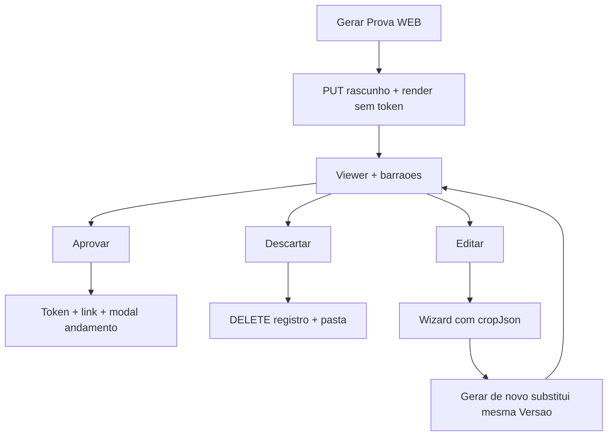

# Preview staff: Aprovar / Descartar / Editar

## Fluxo desejado

- **Gerar**: grava `tabProvaWeb` + PNGs; **não** cria `tabProofTokens` / link.
- **Aprovar**: publica + gera link; pergunta andamento (texto com **número da versão**, ex. Prova 2).
- **Descartar**: remove registro + pasta `Prova{N}` (+ token se houver) — como se não tivesse existido.
- **Editar**: volta ao assistente **com** `cropJson`/arquivos; próximo Gerar **re-renderiza a mesma Versao** (substitui arquivos), continua rascunho até Aprovar.
- Versão nova (já existe Prova 1 publicada): Gerar cria **Prova 2** como rascunho; andamento, se houver, menciona Prova 2.

## Modelo de dados

Coluna nova em `tabProvaWeb` via [`prova_web_schema.py`](app/backend/prova_web_schema.py):

- `Status` `VARCHAR` — `'rascunho' | 'publicado'` (default migração: linhas existentes → `'publicado'`).

API/`info` e `record` passam a expor `status` / `isDraft`. `portalUrl` só quando `publicado` (e token open).

## Backend

### 1. `PUT /prova-web` ([`prova_web_routes.py`](app/backend/routers/prova_web_routes.py))

- Continua criando/atualizando versão e render.
- Novo/alterado: gravar `Status='rascunho'`.
- **Remover** `ensure_prova_web_token` + audit de link deste PUT.
- Suportar regeneração de rascunho da **mesma** versão: se a última versão da OS já é `rascunho` e `nova=false` (ou flag `replaceDraft=true`), **UPDATE** row + re-render pasta em vez de 409 / nova versão.
- Se última é `publicado` e staff pede nova: `nova=true` → INSERT Versao N+1 como `rascunho` (como hoje + status).

### 2. Endpoints novos

- `POST /os/{ano}/{os}/prova-web/{versao}/aprovar`  
  - Só se `rascunho`.  
  - `Status=publicado`; `ensure_prova_web_token` + audit link; retorna `portalUrl` + `versao`.

- `DELETE /os/{ano}/{os}/prova-web/{versao}`  
  - Preferir só `rascunho` (seguro).  
  - DELETE row; apagar pasta render; expirar/remover tokens daquela versão; sem andamento.

### 3. `GET /prova-web`

- Não chamar `ensure_token` se status for rascunho.
- `portalUrl` null em rascunho.
- Incluir `status`, `versao`, cropJson/arquivos (já usados no picker).

### 4. Portal cliente

- Token só após Aprovar → link inexistente até lá (já garantido).

## Frontend

### [`ProvaWebPage.tsx`](apps/web/src/features/prova-web/ProvaWebPage.tsx)

- Após save: fechar picker, abrir viewer (como hoje), **sem** `ProvaWebGeneratedModal` imediato.
- Se `record.status === 'rascunho'`: barra fixa **Aprovar | Descartar | Editar**; ocultar “Copiar link”.
- **Aprovar** → POST aprovar → modal andamento (reusar/adaptar [`ProvaWebGeneratedModal.tsx`](apps/web/src/features/prova-web/ProvaWebGeneratedModal.tsx) com texto da versão).
- **Descartar** → confirmação → DELETE → limpar queries → volta ao picker vazio (ou lista de versões se ainda houver publicada).
- **Editar** → `pickerOpen=true` com seeds: arquivos + `cropJson` do record.

### Wizard / picker

- Passar `initialFolheto` / crop inicial a partir de `record.cropJson` ([`ProvaWebFilePicker`](apps/web/src/features/prova-web/ProvaWebFilePicker.tsx) → [`ProvaWebCropAssistant`](apps/web/src/features/prova-web/ProvaWebCropAssistant.tsx) → Fold/Cover wizards).
- Hidratar [`ProvaWebFoldWizard`](apps/web/src/features/prova-web/ProvaWebFoldWizard.tsx) state a partir de `initialFolheto` (hoje só banner legado).
- Save com rascunho existente: `nova: false` + replace draft (API acima).

### Cliente API ([`provaWeb.ts`](apps/web/src/api/provaWeb.ts))

- `approveProvaWeb(ano, os, versao)`, `discardProvaWeb(ano, os, versao)`.
- Tipos: `status` no info/record.

## Andamento

No modal pós-aprovar: obs/contexto com versão explícita (ex.: “Enviar Prova 2” / mensagem clara), mantendo `situacao`/`setor` atuais; usuário ainda escolhe Sim/Não.

## Testes

- PUT cria rascunho sem token.
- Aprovar → status publicado + token.
- DELETE rascunho remove row/pasta.
- Replace draft mesma versão não cria Versao+1.
- Linhas antigas migradas = `publicado`.
- Frontend: hidratação fold a partir de cropJson (teste unitário leve).

## Fora de escopo

- Aprovar/descartar prova já publicada.
- Mudar fluxo do portal cliente após publicado.
- E-mail automático (continua opt-in no modal).