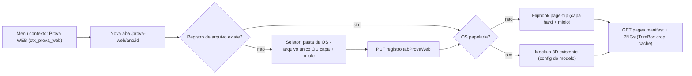

# Prova WEB — Visualizador 3D de prova com folheamento

## Decisões de arquitetura

- **Render server-side com PyMuPDF (já instalado)**: páginas viram PNGs com crop no **TrimBox** (fallback: CropBox/MediaBox se TrimBox ausente), DPI ~150, **cache em disco** keyed por caminho+mtime do PDF (corrige os defeitos do viewer de referência: re-render a cada request e 72 DPI). Segue o padrão já existente de `papelaria_preview_service.py`.
- **Flipbook com `page-flip@2.0.7` (StPageFlip) instalado via pnpm** (não CDN), com wrapper React fino próprio (compatível React 19). Melhorias sobre a referência: `showCover: true` com capa/contracapa `hard`, dimensões do book derivadas da proporção real do TrimBox (manifest da API), lazy-load de imagens, navegação por teclado/botões, zoom simples.
- **Papelaria**: reutiliza o mockup CSS 3D existente (`PapelariaProofMockup3D` + configs de modelo), alimentado pelas mesmas páginas PNG do novo endpoint.
- **Tudo aditivo**: novos arquivos + edições pontuais em listas/registries existentes. Nenhum endpoint ou componente atual é alterado em comportamento.

## Backend (FastAPI)

### 1. Schema — novo arquivo `app/backend/prova_web_schema.py`
- Tabela `tabProvaWeb` (padrão `CREATE TABLE IF NOT EXISTS`, chamada no startup de [api.py](app/backend/routers/api.py)): `NroProtocolo`, `AnoProtocolo` (unique juntos), `Modo` (`unico` | `capa_miolo`), `ArquivoUnico`, `ArquivoCapa`, `ArquivoMiolo` (paths relativos à pasta da OS), `PontoRegistro`, `DataRegistro`, `DataAtualizacao`.
- Nova flag `ctx_prova_web` nas tabelas `user_permissions` e `ip_permissions` via `ALTER TABLE ... ADD COLUMN` idempotente em [user_auth_schema.py](app/backend/user_auth_schema.py) e [ip_permissions_schema.py](app/backend/ip_permissions_schema.py) (espelhando o padrão das flags existentes). Default **0** (desligada para todos).

### 2. Permissão — arquivos existentes (edições aditivas)
- `ctx_prova_web` em [schemas/permissions.py](app/backend/schemas/permissions.py) (`ClientPermissionsResponse`), [security/user_permissions.py](app/backend/security/user_permissions.py) (upsert), payload do PUT em [user_admin_routes.py](app/backend/routers/user_admin_routes.py).
- Entrada em [security/spa_access.py](app/backend/security/spa_access.py): rota `/prova-web` → `ctx_prova_web`.

### 3. Novo router `app/backend/routers/prova_web_routes.py` (montado em api.py)
Todos os endpoints exigem sessão + flag `ctx_prova_web` (`request.state.sagra_permissions`):
- `GET /api/os/{ano}/{id}/prova-web` — retorna registro (ou `null`) + se a OS é papelaria (regra existente: `id >= 5000` ou produto no catálogo via `is_papelaria_os_by_product`).
- `GET /api/os/{ano}/{id}/prova-web/files` — lista recursiva de PDFs da pasta da OS (reusa `_get_os_folder_path` / `os_folder_structure`), retornando árvore relativa (nome, subpasta, tamanho, mtime). Validação: só dentro da pasta da OS.
- `PUT /api/os/{ano}/{id}/prova-web` — grava/atualiza registro (modo + arquivos); valida que os paths resolvem dentro da pasta da OS e são `.pdf`.
- `GET /api/os/{ano}/{id}/prova-web/manifest` — dispara render (com cache) e retorna: lista de páginas com dimensões (px e pts do TrimBox), contagem capa/miolo, proporção.
- `GET /api/os/{ano}/{id}/prova-web/pages/{n}.png` — `FileResponse` do PNG cacheado.

### 4. Novo serviço `app/backend/services/prova_web_render_service.py`
- PyMuPDF: `page.set_cropbox(trimbox)` com fallback seguro (se TrimBox vazio/igual ao MediaBox, usa CropBox), `get_pixmap(matrix=~150dpi)`.
- **Capa + miolo**: se página da capa tiver largura ≈ 2× a do miolo (capa aberta com lombada), divide ao meio → capa4/capa1 (e capa2/capa3 se houver 2ª página); senão, mapeia páginas na ordem capa1..capa4. Sequência final do livro: capa1 → [capa2] → miolo → [capa3] → capa4.
- Cache em pasta local do servidor (ex.: `app/backend/cache/prova_web/{ano}/{id}/{hash}/page_N.png`), hash = paths+mtimes; invalida sozinho quando o PDF muda.

## Frontend (apps/web)

### 5. Permissão e admin
- `ctx_prova_web` em [features/auth/types.ts](apps/web/src/features/auth/types.ts) (`PermissionKey` + `PERMISSION_KEYS`) e parse em `permissions.ts`.
- Label "Prova WEB" em `CONTEXT_PERMISSIONS` do [UserAdminPanel.tsx](apps/web/src/features/usuarios/components/UserAdminPanel.tsx) e espelho em [admin-ips/constants.ts](apps/web/src/features/admin-ips/constants.ts).

### 6. Menu de contexto
- Item `{ id: "provaWeb", label: "Prova WEB", permission: "ctx_prova_web", requiresRow: true }` em [contextMenuActions.ts](apps/web/src/features/os/contextMenuActions.ts).
- Handler em [OsContextMenu.tsx](apps/web/src/features/os/components/OsContextMenu.tsx): `window.open('/prova-web/{ano}/{id}')` (nova aba, mesmo padrão dos painéis).

### 7. Nova rota e página
- File route `apps/web/src/routes/_authenticated/prova-web.$ano.$id.tsx` com `AuthGuard requiredPermission="ctx_prova_web"`, layout limpo (sem sidebar, tela cheia).
- Página `apps/web/src/features/prova-web/ProvaWebPage.tsx`:
  - Busca `GET .../prova-web`; se sem registro → **seletor de arquivos**; se com registro → viewer (com botão discreto "Trocar arquivo" que reabre o seletor).
  - **Papelaria** → renderiza `PapelariaProofMockup3D` com config do modelo (mesmo caminho do portal de aprovação), páginas vindas do manifest novo.
  - **Demais produtos** → flipbook.

### 8. Seletor de arquivos `ProvaWebFilePicker.tsx`
- Árvore da pasta da OS (endpoint `files`), toggle "Arquivo único" / "Capa + Miolo" com dois slots de seleção, preview do nome/tamanho, botão confirmar → `PUT` → carrega viewer.

### 9. Flipbook `ProvaWebFlipbook.tsx`
- Dependência nova: `page-flip@2.0.7` (pnpm, em apps/web).
- Wrapper React próprio: init/destroy no lifecycle, `showCover: true`, capa/contracapa `data-density="hard"`, miolo `soft`, dimensões e proporção vindas do manifest (nunca hardcoded), `size: 'stretch'` responsivo.
- Imagens com `loading="lazy"`, botões anterior/próxima com estado desabilitado nas pontas, setas do teclado, indicador "Página X–Y de N", zoom (abrir página em overlay).
- Visual profissional: fundo neutro escuro, sombra da lib, transição ~600ms.

## Segurança / não regressão

- Flag nova default 0 → ninguém vê a opção até o admin liberar na página Usuários.
- Endpoints novos fora de `/api/client/*` (sessão obrigatória via middleware existente) + checagem explícita da flag.
- Nenhuma alteração em endpoints, tabelas ou componentes existentes além de inserções em listas/registries.
- Validação: `pnpm test` (pytest + vitest) e lints nos arquivos tocados ao final.