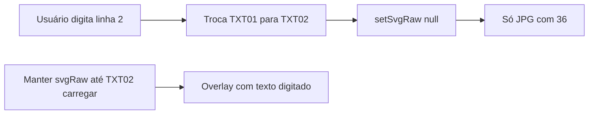

# Prévia DEPOL: fonte do SVG + bug do “36”

## Diagnóstico

### Bug do “36” (multilinha)
No [`TXT02.svg`](file://redecamara/DfsData/CGraf/Sefoc/Deputados/_Temp/2025/Credenciais%20Depol/TXT02.svg) o placeholder da Linha 1 é literalmente **`36 `**. O JPG do modelo também costuma ter esse número impresso.

Em [`CredenciaisDepolLivePreview.tsx`](apps/web/src/features/credenciais-depol/components/CredenciaisDepolLivePreview.tsx), ao passar de 1 para 2 linhas:

1. `numLinhas` muda → `svgName` de `TXT01.svg` para `TXT02.svg`
2. O `useEffect` faz **`setSvgRaw(null)` imediatamente** antes do fetch
3. O overlay de texto some → fica só o JPG de fundo → o usuário vê **“36”**
4. Se o fetch de `TXT02.svg` atrasar ou falhar, o “36” permanece

Isso é independente do portal cliente vs interno.

### Fonte diferente do SVG
Em `applyLinhasToSvgMarkup` o código **força Arial** e **remove as classes `fnt*`**:

```400:408:apps/web/src/features/credenciais-depol/components/CredenciaisDepolLivePreview.tsx
    el.setAttribute(
      "style",
      `${el.getAttribute("style") || ""};font-family:Arial,Helvetica,sans-serif`,
    );
    // ...
    classList.filter((c) => !c.startsWith("fnt"))
```

As classes `.fnt0/.fnt1/.fnt2` no SVG trazem `font-family:'Humnst777 Cn BT'` / `Humnst777 Blk BT` e o `font-size` correto.

**Decisão de fonte:** preservar `font-family` + `font-size` das regras `.fntN` no elemento; **não** forçar Arial como primário. Desativar os `@font-face` embutidos do Corel (só têm glifos do placeholder — ex. “36”, “6517”); o browser usa a fonte instalada no Windows (estações Câmara) e, se faltar, faz fallback para `Arial, sans-serif`. Worker Corel **não muda**.



## Alterações (somente prévia web)

Arquivo principal: [`apps/web/src/features/credenciais-depol/components/CredenciaisDepolLivePreview.tsx`](apps/web/src/features/credenciais-depol/components/CredenciaisDepolLivePreview.tsx)

### 1. Não limpar o SVG enquanto o próximo carrega
No `useEffect` de fetch:
- Remover `setSvgRaw(null)` no início
- Ao sucesso: `setSvgRaw(text)` do novo arquivo
- Ao erro: manter o SVG anterior e setar `svgError`
- Opcional leve: flag `svgLoading` só se quiser indicador; sem spinner obrigatório

Assim, na transição 1→2 linhas, o overlay antigo permanece até `TXT02` chegar — sem flash do “36” do JPG.

### 2. Preservar tipografia do SVG em `applyLinhasToSvgMarkup`
- Extrair de `.fntN` no `<style>`: **`font-size`** e **`font-family`** (estender `fontSizeFromSvgClass` ou criar `fontStyleFromSvgClass`)
- Aplicar no `<text>` como atributos/`style` **antes** de mexer nas classes
- **Não** sobrescrever com `font-family:Arial` como único valor; usar  
  `font-family: '<familia do SVG>', Arial, Helvetica, sans-serif`
- Remover ou esvaziar regras `@font-face { ... src:url("#FontID…") }` do markup clonado da prévia (evita subset de glifos do Corel esconder caracteres novos)
- Manter lógica de `tspan` 32/38 pt na Linha 1 (só nos ranges especiais)
- Manter: ordem TXT01→TXT02→TXT03, sem realinhar Y na web, `expandViewBoxToTexts`

### 3. Testes
Em [`CredenciaisDepolLivePreview.test.ts`](apps/web/src/features/credenciais-depol/components/CredenciaisDepolLivePreview.test.ts):
- Ao aplicar texto, `font-family` do CSS `.fnt0` aparece no `<text>` (não só Arial puro)
- Markup de prévia não mantém `src:url("#FontID` ativo (ou `@font-face` removido)
- Caso TXT02 com placeholders `"36 "` / `"6517"` → após `applyLinhasToSvgMarkup(["ABC","XYZ"])` o resultado **não** contém `"36"` nem `"6517"`

## Fora de escopo
- Worker Corel / realinhamento COM / regras 32–38 pt no CDR
- Hospedar arquivos WOFF das Humnst777 (só se a fonte local não existir na máquina do usuário — fallback Arial)
- Alterar JPGs dos modelos

## Validação manual
1. 1 linha: digitar texto → prévia atualiza na tipografia do SVG (ou fallback legível)
2. Digitar Enter + 2ª linha → **não** aparecer “36” durante/após a troca
3. 3 linhas → idem com TXT03
4. Portal cliente e página interna Credenciais
