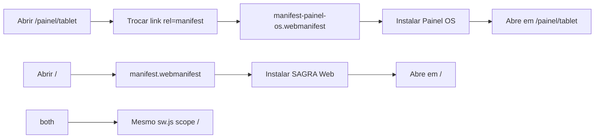

# PWA separado “Painel OS” para `/painel/tablet`

## Resposta curta

**Sim.** No mesmo domínio dá para ter dois apps instaláveis: o navegador diferencia pela identidade do Web App Manifest (`id` + `start_url` + ícones/nome), não exige um segundo domínio. O service worker atual (`sw.js`, scope `/`) continua único e cobre ambas as instalações.

## Decisão de arquitetura



| Campo | SAGRA Web (atual) | Painel OS (novo) |
|-------|-------------------|------------------|
| `id` | `/` | `/painel/tablet/` |
| `name` / `short_name` | SAGRA Web / SAGRA | **Painel OS** / **Painel OS** |
| `start_url` | `/` | `/painel/tablet` |
| `scope` | `/` | `/` |
| Ícones | `icons/icon-*.png` | `icons/painel-os-*.png` (novos) |
| SW | `sw.js` | **mesmo** `sw.js` |

**Por que `scope: "/"` no Painel OS:** o [`TabletAccessGuard`](apps/web/src/components/auth/TabletAccessGuard.tsx) redireciona para `/login` sem sessão. Com scope só em `/painel/tablet/`, o login sairia do app standalone. Com scope `/` + `start_url` no tablet, o login permanece dentro do PWA; a UI do tablet não tem sidebar, então o usuário típico não “passeia” pelo SAGRA.

**Fora de escopo:** segundo Workbox/SW aninhado, segundo build Vite, alterar o PWA principal além do necessário.

## Implementação

### 1. Manifest estático “Painel OS”

Criar [`apps/web/public/manifest-painel-os.webmanifest`](apps/web/public/manifest-painel-os.webmanifest) (copiado para `dist/` pelo Vite):

```json
{
  "id": "/painel/tablet/",
  "name": "Painel OS",
  "short_name": "Painel OS",
  "description": "Painel de Ordens de Serviço — tablet",
  "lang": "pt-BR",
  "display": "standalone",
  "orientation": "any",
  "theme_color": "#0f172a",
  "background_color": "#0f172a",
  "scope": "/",
  "start_url": "/painel/tablet",
  "icons": [
    { "src": "/icons/painel-os-192.png", "sizes": "192x192", "type": "image/png", "purpose": "any" },
    { "src": "/icons/painel-os-512.png", "sizes": "512x512", "type": "image/png", "purpose": "any" },
    { "src": "/icons/painel-os-maskable-512.png", "sizes": "512x512", "type": "image/png", "purpose": "maskable" }
  ]
}
```

Incluir o ficheiro em `includeAssets` do [`VitePWA`](apps/web/vite.config.ts) (e os ícones novos) para precache.

### 2. Ícones distintos

Gerar e versionar em [`apps/web/public/icons/`](apps/web/public/icons/):

- `painel-os-192.png`
- `painel-os-512.png`
- `painel-os-maskable-512.png` (safe zone ~80%)

Visual: fundo escuro slate (`#0f172a`), marca “OS” / kanban em accent verde-esmeralda (alinhado ao tablet), **claramente diferente** dos ícones atuais do SAGRA. Na implementação, gerar os PNGs (script/canvas ou asset desenhado) e commitá-los.

### 3. Troca dinâmica do manifest na rota tablet

Criar um helper/hook (ex. [`apps/web/src/components/pwa/usePainelOsManifest.ts`](apps/web/src/components/pwa/usePainelOsManifest.ts)) usado em:

- layout/página [`painel/tablet`](apps/web/src/routes/painel/tablet.tsx) (sempre), e
- rota de login **quando** `search.redirect === "/painel/tablet"` (para o prompt de instalação refletir “Painel OS” também no fluxo de auth).

Comportamento:

1. Localizar ou criar `<link rel="manifest">`.
2. Em modo Painel OS: `href` → `/manifest-painel-os.webmanifest` (respeitar `import.meta.env.BASE_URL` se algum dia o base não for `/`).
3. Atualizar `document.title`, `apple-mobile-web-app-title` → `Painel OS`, `theme-color` → `#0f172a`, `apple-touch-icon` → ícone Painel OS.
4. No cleanup (sair da rota): restaurar manifest principal (`/manifest.webmanifest`), título SAGRA e ícones originais.

Montar o efeito no [`PwaProvider`](apps/web/src/components/pwa/PwaUpdatePrompt.tsx) ou num wrapper leve em `main`/`painel` — preferência: componente `PainelOsPwaHead` dentro do layout tablet + no login condicional, para não acoplar ao update prompt.

### 4. CTA de instalação no tablet (Android/Chrome)

Em [`DashboardTabletPage`](apps/web/src/features/dashboard-tablet/components/DashboardTabletPage.tsx) (header compacto):

- Escutar `beforeinstallprompt`, guardar o evento.
- Botão “Instalar app” (só se o evento existir e `display-mode` não for já `standalone`).
- Em iOS: tip curto (“Compartilhar → Adicionar à Tela de Início”) quando não houver `beforeinstallprompt`.

Não bloquear o board se o evento não disparar.

### 5. Deploy / docs

- [`deploy/scripts/deploy-common.ps1`](deploy/scripts/deploy-common.ps1) e [`deploy-producao.ps1`](deploy/scripts/deploy-producao.ps1): validar presença de `manifest-painel-os.webmanifest` + `icons/painel-os-192.png`.
- Nota em [`deploy/templates/LEIA-ME-DEPLOY.md`](deploy/templates/LEIA-ME-DEPLOY.md): dois PWAs no mesmo host; instalar Painel OS a partir de `/painel/tablet`; abrir o atalho leva ao board, não à home.

### 6. Validação

- Chrome (Android ou desktop): em `/painel/tablet`, Application → Manifest mostra **Painel OS** e `start_url` correto; instalar → ícone/nome distintos; reabrir → `/painel/tablet`.
- Em `/`, manifest continua **SAGRA Web**; as duas instalações podem coexistir.
- Sem sessão: Painel OS instalado abre tablet → login → volta ao tablet (ainda standalone).
- Build: `pnpm build` em `apps/web` inclui o novo manifest/ícones no output.

## Limitações a documentar (não bloqueiam)

- **iOS Safari** historicamente trata Add to Home Screen com menos suporte a multi-id; o título/ícone no momento do “Adicionar” ainda devem refletir Painel OS graças ao head swap.
- Quem já instalou só o SAGRA Web e abre o atalho antigo continua na home — esperado; instalar de novo a partir de `/painel/tablet` cria o segundo ícone.
- Continua a existir **um** SW; “independente” = identidade de instalação + `start_url`, não processo offline separado.
