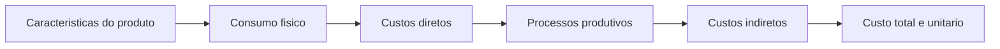
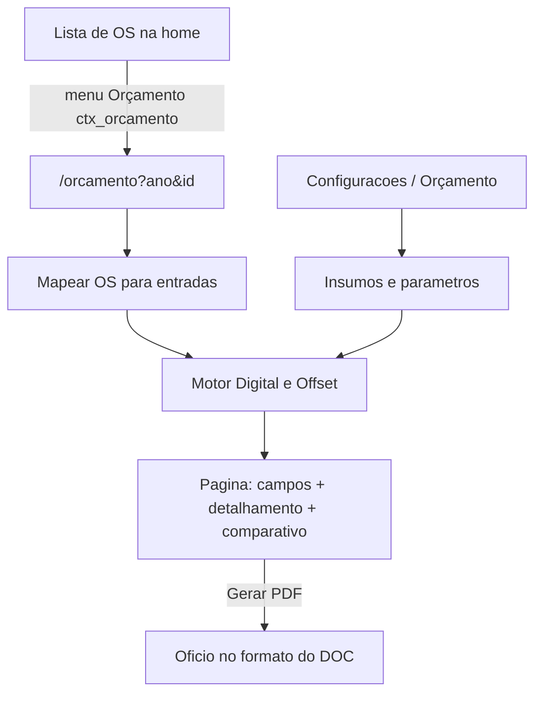

# Página de Orçamento gráfico

## O que as planilhas fazem hoje

O valor final **não é uma tabela de preço**. É uma cadeia:

Módulos equivalentes às abas:

- **Entrada** — dimensões, formato sugerido, tiragem, cores, páginas, papel, laminação F/V, espiral, capa PVC, verniz, faca/clichê (capa + miolo no Offset).
- **Papel** — tiragem × páginas → folhas → equivalência A4 → aproveitamento da folha matriz + acerto → preço do cadastro.
- **Digital** — clique P&B / colorido × equivalentes A4 + papel + acabamento + indiretos.
- **Offset** — papel + pré-impressão (chapas) + tinta + acabamento + indiretos por faixa de tiragem.
- **PDF ofício** — número próprio de orçamento, processo, OS, especificação, totais, validade, prazo, assinaturas.

Exemplo reproduzido no relatório (OS 1365/2026, marcador 55×200 mm, 100 un., CF 300 g, digital): papel R$ 44,75 + clique colorido R$ 28,00 + laminação R$ 7,07 + indiretos R$ 45,08 = **R$ 124,90**.

O motor **não copiará bugs das planilhas** (referência BOPP/PVC deslocada, rendimento A4 fixo em 8, faixa de pessoal ≥ 5.000). Implementará a metodologia pretendida, com busca por código de insumo.

`tab_custo_funcao` (custo/hora) permanece separado: nas planilhas, pessoal é **alíquota sobre a base direta por faixa de tiragem**, não hora trabalhada.

## Fluxo no sistema

Ao clicar em **Orçamento**, o sistema abre a página, preenche os campos pela OS (detalhes + componentes) e **já calcula e exibe** o orçamento completo. O usuário pode ajustar campos (papel não casado, laminação, etc.); o recálculo é imediato.

## 1. Permissão e menu

Nova flag **`ctx_orcamento`** (default **0**, como `ctx_prova_web`).

Arquivos a estender (mesmo padrão de `ctx_prova_web` / `ctx_imprimir_ficha`):

- Backend: [app/backend/ip_permissions_schema.py](app/backend/ip_permissions_schema.py), [app/backend/user_auth_schema.py](app/backend/user_auth_schema.py), [app/backend/security/user_permissions.py](app/backend/security/user_permissions.py), [app/backend/schemas/permissions.py](app/backend/schemas/permissions.py), [app/backend/routers/ip_admin_routes.py](app/backend/routers/ip_admin_routes.py), [app/backend/routers/user_admin_routes.py](app/backend/routers/user_admin_routes.py), [app/backend/security/spa_access.py](app/backend/security/spa_access.py) (`/orcamento` → `ctx_orcamento`)
- Frontend: [apps/web/src/features/auth/types.ts](apps/web/src/features/auth/types.ts), [apps/web/src/features/admin-ips/constants.ts](apps/web/src/features/admin-ips/constants.ts) (`CONTEXT_PERMISSION_COLUMNS`), [apps/web/src/features/usuarios/components/UserAdminPanel.tsx](apps/web/src/features/usuarios/components/UserAdminPanel.tsx)
- Menu: [apps/web/src/features/os/contextMenuActions.ts](apps/web/src/features/os/contextMenuActions.ts) item `{ id: "orcamento", label: "Orçamento", permission: "ctx_orcamento", requiresRow: true }` após “Imprimir Ficha”
- Ação: [apps/web/src/features/os/components/OsContextMenu.tsx](apps/web/src/features/os/components/OsContextMenu.tsx) navega para `/orcamento?ano=&id=`
- SQL espelho: [deploy/sql/migrate_ip_permissions_columns.sql](deploy/sql/migrate_ip_permissions_columns.sql)

Administrador liga/desliga em **Admin IPs** e **Usuários → Permissões**. Sem a flag, o item não aparece.

## 2. Cadastro administrativo (todas as variáveis)

Nova aba **Orçamento** em [apps/web/src/features/configuracoes/components/ConfiguracoesPage.tsx](apps/web/src/features/configuracoes/components/ConfiguracoesPage.tsx) (ao lado de Custos), gated por `sb_admin_ips` como o resto de Configurações.

Tabelas MySQL-only, criadas no startup (`ensure_*_schema`, padrão de [app/backend/custo_funcao_schema.py](app/backend/custo_funcao_schema.py)):

**`tab_orcamento_insumo`** — banco mestre (substitui `_Insumos diretos Atualizados`):

- `codigo` (p0, c4, t5, b0, g1, e1…), `categoria` (papel, chapa, tinta, bopp, cola, grampo, espiral, capa_pvc, wire_o, outro)
- `especificacao`, `unidade`, `qtd_embalagem`, `preco_bruto`, `preco_unitario` (derivado), `atualizado_em`
- Para papel: `rendimento_a4` (8 ou 10), `formato_folha` (66×96 / 76×112)
- `aliases` (JSON) para casar com `PapelLink` da OS (`Couché fosco 300g` → `p26`)
- `ativo`

**`tab_orcamento_parametro`** — chave/valor com os números das planilhas (admin edita todos):

| Chave | Valor atual nas planilhas |
|---|---|
| Clique digital P&B / colorido | 0,073 / 0,28 |
| Tinta: kg por 10.000 impressões | 0,3 / 10.000 |
| Folhas de acerto Offset | 50 |
| Cotação prova / fotolito | 5 / 16 |
| Energia / depreciação / perdas / manutenção | 7% / 10% / 3% / 5% |
| Diagramação | 20% (quando aplicável) |
| Indiretos lump Digital (papel+acabamento) | 87% |
| Bobina BOPP comprimento | 1500 m |
| Cola: 25 kg / 10.000 ex. / 180–200 pág. | regras atuais |
| Grampos: 1 kg = 3.000; 2 por exemplar se pág. ≤ 80 | |
| Validade do orçamento / prazo entrega | 180 dias / 7 dias úteis |
| Textos do ofício | signatário, cargo, endereço, telefone, cláusulas |

**`tab_orcamento_formato`** — limites de sugestão (A6 115×160 … A1 520×730) e fator equivalente A4 (A6=4 … A1=0,125).

**`tab_orcamento_faixa_pessoal`** — 1–999 → 80%; 1.000–4.999 → 51,5%; ≥ 5.000 → 22% (faixa superior corrigida).

Seed inicial com os preços da planilha Offset de junho/2026 (mais recente). APIs CRUD em [app/backend/routers/admin_system_routes.py](app/backend/routers/admin_system_routes.py), no mesmo estilo de `custo_funcao`.

## 3. Motor de cálculo

Serviço puro em `app/backend/services/orcamento_engine.py` (sem I/O de OS): entradas + cadastros → resultado.

**Por componente** (capa, miolo, encarte — 1 ou N, vindo de `tab_os_componentes` ou fallback capa/miolo da OS):

1. Formato sugerido pelas dimensões (menor × maior mm).
2. Total de páginas = tiragem × páginas; folhas = páginas / (F/V ? 2 : 1).
3. Equivalentes A4 pelo fator do formato.
4. Folhas matriz = equivalentes A4 / rendimento do papel + acerto (Offset).
5. Custo papel = folhas × preço unitário da folha.
6. Digital: equivalentes A4 × clique P&B ou cor.
7. Offset: chapas (1 / 4 / 5 / 8 conforme cores e F/V) × preço da chapa cadastrada; tinta = impressões × (custo carga / 10.000).
8. Acabamento: BOPP proporcional (×2 se F/V); cola/grampo/espiral/PVC só se marcados.

**Consolidação:**

- Digital: papel + cliques + acabamento + 87% sobre (papel + acabamento), parâmetro admin.
- Offset: CD = papel + pré + tinta + acabamento; indiretos = CD × (pessoal da faixa + energia + depreciação + perdas + manutenção [+ diagramação]); total = CD + indiretos.

A página mostra **os dois totais** e destaca a tecnologia da OS (`MaquinaLink`) e a mais econômica. O ofício PDF usa a tecnologia escolhida (default: máquina da OS).

Testes de regressão em `app/backend/tests/test_orcamento_engine.py` com o caso do marcador (R$ 124,90 ± arredondamento) e um caso Offset 2 componentes.

## 4. Mapeamento OS → campos

Endpoint `GET /api/orcamento/os/{ano}/{id}` (permissão `ctx_orcamento`):

Fontes: `GET details` + `GET componentes` já existentes.

| Campo do orçamento | Origem OS |
|---|---|
| Título, solicitante, processo, OS, data | `Titulo`, `NomeUsuario`/`OrgInteressado`, `ProcessoSolicit`, `NroProtocolo`/`AnoProtocolo`, `DataEntrada` |
| Dimensões | `FormatoLink` via [app/backend/formato_dimensions.py](app/backend/formato_dimensions.py) (`55x200`, `A4`, …) |
| Tiragem, páginas, F/V | `Tiragem`, `Pags` / lotes, `FrenteVerso` |
| Cor vs preto | `Cores` / `cores_link` (`4x4`/`4x0` → cor; `1x1` → preto) |
| Papel | `PapelLink` + aliases do insumo; se não casar, campo vazio + alerta |
| Laminação / F/V / espiral / grampo | parse de `DescAcabamento` + flags; usuário confirma |
| Tecnologia | `MaquinaLink` contém Digital ou Offset |
| Componentes | lotes de capa/miolo/encarte; senão um componente único com `Pags`/`Papel`/`Cores` |

A página já devolve o **resultado detalhado** nesse GET (não espera o usuário clicar em calcular).

## 5. Página `/orcamento`

Rota nova `apps/web/src/routes/_authenticated/orcamento.tsx` com `AuthGuard` `ctx_orcamento`, search `ano` + `id` (padrão de [apps/web/src/routes/_authenticated/gerencia.tsx](apps/web/src/routes/_authenticated/gerencia.tsx)).

Layout:

- **Cabeçalho** — OS, solicitante, título.
- **Campos de entrada** (editáveis) — iguais em espírito à aba Orçamento: formato mm, tiragem, páginas, cores, papel (select do cadastro), laminação, acabamentos, tecnologia.
- **Detalhamento** — linhas de papel, pré-impressão, tinta/cliques, acabamento, indiretos, total, unitário, valor/100 páginas; comparativo Digital × Offset.
- **Ofício** — prévia do documento oficial.
- **Gerar PDF** — baixa o ofício.

Recálculo: `POST /api/orcamento/calcular` com o payload editado (não grava OS).

## 6. Número de orçamento e PDF

O DOC usa **ORÇAMENTO 132/2026**, distinto da OS 1365/2026.

- Tabela `tab_orcamento`: `numero`, `ano`, FK da OS, snapshot JSON de entradas + parâmetros usados + resultado, `tecnologia`, totais, `criado_em`/`criado_por`.
- Ao gerar o PDF, grava o snapshot e incrementa o número do ano.

PDF no layout do ofício (não o detalhamento interno):

- Título ORÇAMENTO n/ano; processo; OS; data por extenso; solicitante; título.
- Especificação solicitada / orçada (texto montado: publicação, formato, papel, cores, páginas, tiragem, acabamento).
- Nº de páginas, tiragem, valor total.
- Validade 180 dias; “Impressão em equipamento Digital/Offset. Entrega em 7 dias úteis…”
- Duas colunas: diretor (nome/cargo cadastrados) | Autorizo / Responsável / Assinatura e carimbo.
- Rodapé: endereço e telefone cadastrados.

Implementação: template HTML em `app/backend/templates/orcamento.html` (mesmo padrão da ficha) + download `application/pdf` com **fpdf2** (já usado em [app/backend/routers/analise_routes.py](app/backend/routers/analise_routes.py)). Rota `GET /api/reports/orcamento/{id}.pdf`.

## 7. Fora de escopo

- Não alterar Gerência, cotas A4 nem `tab_custo_funcao`.
- Não importar .xlsm em runtime.
- Sem item de sidebar (só menu de contexto + URL direta).
- Sem envio automático por e-mail nesta entrega.
