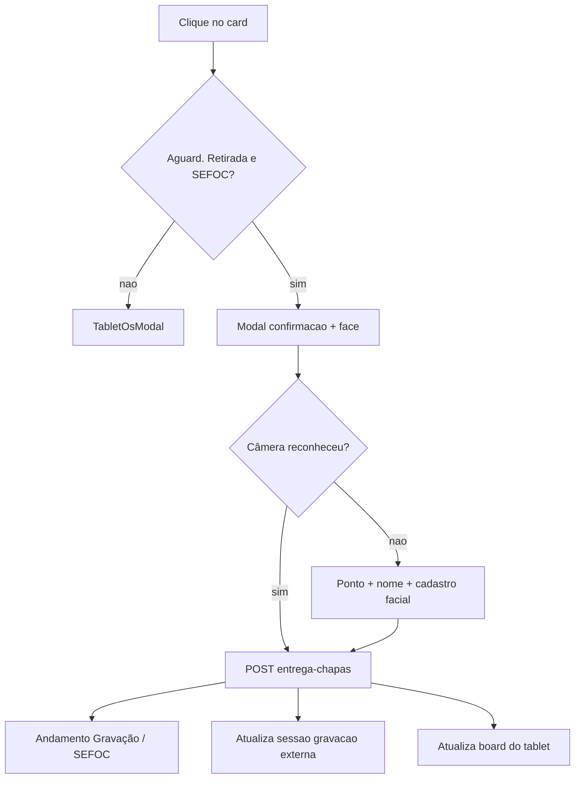

# Recebimento de chapas no painel tablet

## Comportamento

Quando o card tiver `situacao === "Aguard. Retirada"` e `setor === "SEFOC"`:

1. **Não** abrir o [`TabletOsModal`](apps/web/src/features/dashboard-tablet/components/TabletOsModal.tsx) normal.
2. Abrir um modal de confirmação enxuto com:
   - identidade do operador pela **mesma lógica dos outros andamentos**: reconhecimento facial em background; se falhar, overlay de ponto + nome + cadastro facial ([`TabletOsModal`](apps/web/src/features/dashboard-tablet/components/TabletOsModal.tsx));
   - texto **“Confirma o recebimento de”** + quantidade de chapas por máquina;
   - preview da observação que será gravada (mesmo conteúdo que o backend já monta).
3. Ao confirmar, chamar `POST /gravacao-externa/{ano}/{id}/entrega-chapas` via [`lancarEntregaChapas`](apps/web/src/api/gravacaoExterna.ts) / [`useLancarEntregaChapasMutation`](apps/web/src/api/hooks/useGravacaoExterna.ts) — o mesmo fluxo do botão “Lançar recebimento das chapas”, usando **ponto e nome do operador identificado** (não o usuário logado da sessão).
4. O backend já lança andamento **Gravação** no setor **SEFOC**, preenche `obs` com `format_gravacao_entrega_obs`, marca `EntregaLancadaEm` / receptor e invalida as queries de controle de chapas.



## Detecção do card

Em helper puro (ex.: [`apps/web/src/features/dashboard-tablet/recebimentoChapas.ts`](apps/web/src/features/dashboard-tablet/recebimentoChapas.ts)):

```ts
export function isRecebimentoChapasTabletCard(item: {
  situacao?: string | null;
  setor?: string | null;
}): boolean {
  return (
    (item.situacao ?? "").trim() === "Aguard. Retirada" &&
    (item.setor ?? "").trim() === "SEFOC"
  );
}
```

Em [`DashboardTabletPage.tsx`](apps/web/src/features/dashboard-tablet/components/DashboardTabletPage.tsx), no `onClick` do card: se o helper for true, abrir o modal de recebimento; senão, o fluxo atual.

## Modal de confirmação

Novo componente `TabletRecebimentoChapasModal`:

- Ao abrir, carregar chapas com [`fetchGravacaoExternaAguardandoEntrega`](apps/web/src/api/gravacaoExterna.ts) filtrando `ano` + `search` do `nr_os`, e achar o item correspondente (`nr_os`/`ano`). Essa lista já traz `chapas_por_maquina` / `total_chapas` (mesma fonte do modal desktop).
- Identidade: reutilizar o fluxo de [`TabletOsModal`](apps/web/src/features/dashboard-tablet/components/TabletOsModal.tsx) (`verifyTabletFace` / `lookupTabletPonto` / `registerTabletPonto`, chip de status, overlay “Confirmar operador”, teclado de ponto + câmera de cadastro). Respeitar `identityMode` da página quando for `session` (atalho sem face).
- Exibir confirmação montada no front no mesmo formato do backend ([`format_gravacao_entrega_obs`](app/backend/routers/andamento_helpers.py)):

```
Confirma o recebimento de:

Chapas por máquina:
- {maquina}: {quantidade}
```

Mais o bloco de observação previsto (`Entrega de chapas.` + lista), para o usuário ver o que vai para o campo observação.
- Botões Cancelar / Confirmar.
- Confirmar usa `recebidoPorPonto` / `recebidoPorNome` do operador identificado; em sucesso fecha o modal e chama `fetchData()` do board.
- Erros da API (403 sem `sb_gravacao_externa_entrega`, sessão inexistente, já lançado) aparecem inline no modal.

Estilo alinhado ao modal tablet existente ([`dashboard-tablet.css`](apps/web/src/features/dashboard-tablet/dashboard-tablet.css)).

## Reuso do backend (sem alteração de contrato)

Não mudar o serviço: [`lancar_entrega_chapas`](app/backend/services/gravacao_externa_service.py) já faz o trabalho certo (`SITUACAO_GRAVACAO` + `SETOR_ENTREGA_CHAPAS = "SEFOC"` + obs + controle). A mutation do front já invalida `gravacaoExterna` e `gravacaoPendente`.

Pré-requisito operacional: o usuário do tablet precisa da permissão `sb_gravacao_externa_entrega` (igual à página Gravação Externa). Sem isso a API responde 403.

## Testes

- Unitário do helper `isRecebimentoChapasTabletCard` e do formatador do texto de confirmação/obs.
- Rodar `pnpm --filter @sagra/web test -- src/features/dashboard-tablet`.

## Fora de escopo

- Alterar o modal desktop de entrega.
- Liberar “Gravação Pendente” no tablet.
