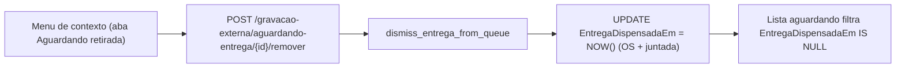

# Remover OS da lista "Aguardando retirada"

## Situação atual

- Em [GravacaoExternaTab.tsx](apps/web/src/features/gravacao-externa/components/GravacaoExternaTab.tsx), o `GravacaoQueueItemContextMenu` fica desabilitado de propósito na aba "Aguardando retirada" (`enabled={!isAguardando && canManagePendingQueue && ...}`).
- A remoção que já existe (`remove_externa_from_queue` em [gravacao_externa_service.py](app/backend/services/gravacao_externa_service.py)) só aceita sessões `pendente`/`iniciada` e muda o status para `cancelada`.
- A lista "Aguardando retirada" (`list_os_gravacao_aguardando_entrega`) é filtrada por `Status = 'concluida' AND EntregaLancadaEm IS NULL`.

## Decisão de modelagem

Uma sessão concluída **não** deve virar `cancelada`. Se virasse, ela sairia do total de chapas gravadas do controle de cotas (`_chapas_gravadas_concluidas_base_sql` em [gravacao_pendente_service.py](app/backend/services/gravacao_pendente_service.py) filtra por `ge.Status = 'concluida'`). Também não vou preencher `EntregaLancadaEm`, porque isso apareceria no histórico como um recebimento falso.

A solução é criar uma marca própria: as colunas novas `EntregaDispensadaEm DATETIME NULL` e `EntregaDispensadaPorPonto VARCHAR(32) NULL` em `tab_os_gravacao_externa`.

## Backend

- **[gravacao_externa_schema.py](app/backend/services/gravacao_externa_schema.py)**: adicionar as duas colunas em `_apply_externa_migrations`. É uma migração aditiva e idempotente, no mesmo padrão das outras.
- **[gravacao_externa_service.py](app/backend/services/gravacao_externa_service.py)**:
  - Criar `dismiss_entrega_from_queue(gravacao_externa_id, ponto)`, espelhando `remove_externa_from_queue`: transação com `SELECT ... FOR UPDATE`. A sessão precisa estar com `Status = 'concluida'`, `EntregaLancadaEm IS NULL` e `EntregaDispensadaEm IS NULL`; caso contrário, retorna 409. Se houver juntada, marca também as irmãs concluídas pendentes de entrega. Retorna `{removed, gravacao_externa_id, removed_ids, juntada_grupo_id}`. Não toca em `tabAndamento` nem no MDB.
  - Adicionar `AND EntregaDispensadaEm IS NULL` em `list_os_gravacao_aguardando_entrega` (nas duas consultas, a de contagem e a de listagem) e em `list_concluida_aguardando_entrega_by_juntada`.
  - Em `lancar_entrega_chapas`, rejeitar com 409 a sessão já dispensada. `get_concluida_session` passa a expor `entrega_dispensada_em` via `_map_session_row`.
- **[gravacao_externa_routes.py](app/backend/routers/gravacao_externa_routes.py)**: criar a rota `POST /gravacao-externa/aguardando-entrega/{gravacao_externa_id}/remover`. Ela reaproveita `_require_pending_queue_management_permission` (exige `sb_gravacao_pendente` e bloqueia fornecedor, igual às outras listas) e `GravacaoExternaQueueRemovalResponse`, e grava log `logger.info`.

## Frontend

- **[gravacaoExterna.ts](apps/web/src/api/gravacaoExterna.ts)**: criar `removerOsAguardandoEntrega(id)`, que faz POST na nova rota.
- **[useGravacaoExterna.ts](apps/web/src/api/hooks/useGravacaoExterna.ts)**: criar `useRemoverOsAguardandoEntregaMutation`, que invalida `queryKeys.gravacaoExterna.prefix`.
- **[GravacaoExternaTab.tsx](apps/web/src/features/gravacao-externa/components/GravacaoExternaTab.tsx)**:
  - Remover `!isAguardando` da condição `enabled` do menu de contexto.
  - Fazer `handleRemoveFromQueue` usar a mutação correta conforme o segmento (`isAguardando`). O texto de confirmação também muda conforme o segmento, por exemplo: "Remover a OS X da lista Aguardando retirada? Nenhum andamento será lançado; histórico e arquivos serão preservados." O `removing` passado ao menu vem da mutação ativa.

## Testes

- **[test_gravacao_externa_service.py](app/backend/tests/test_gravacao_externa_service.py)**: um teste de `dismiss_entrega_from_queue` com juntada, no mesmo estilo do teste existente. Ele verifica `removed_ids`, a ausência de UPDATE em `Status`, a ausência de `tabAndamento` e o 409 quando a entrega já foi lançada. Também um teste confirmando que a consulta da lista contém `EntregaDispensadaEm IS NULL`.
- **[GravacaoExternaTab.grouping.test.tsx](apps/web/src/features/gravacao-externa/components/GravacaoExternaTab.grouping.test.tsx)**: na aba "Aguardando retirada", o clique direito mostra "Remover da lista" e chama a nova mutação com todos os `gravacao_externa_id` do card.
- Rodar `pnpm test`.