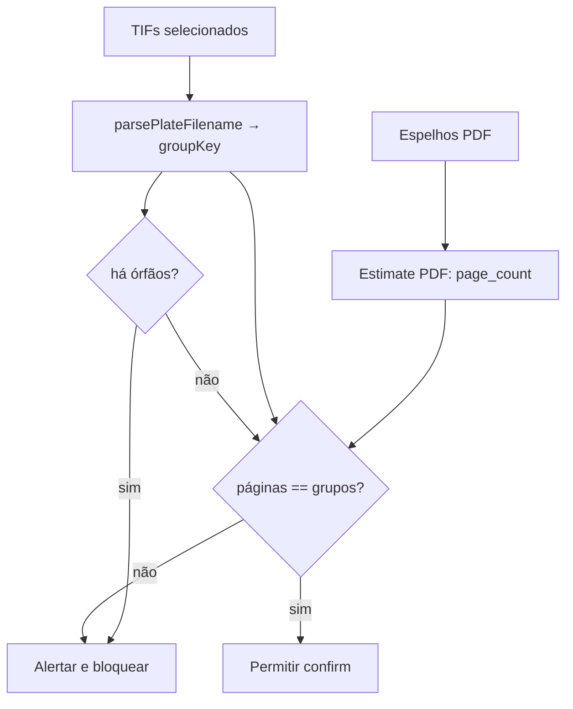

# Validação correta TIF × espelhos PDF

## Problema da regra atual

`page_count` do PDF **não** é o número de TIFs. Cada página do espelho corresponde a **um conjunto de separações** (1 TIF por tinta: C/M/Y/K e spots/PANTONE). Uma página pode exigir 1, 2, 4, 5+ arquivos.

Contar tintas reais no PDF (Separation/DeviceN) **não é seguro** com PyMuPDF no stack atual (API Python não expõe `fz_page_separations`). Não implementar heurística frágil de content stream.

## Regra correta e segura (adotada)

Usar o que o sistema já modela com nomenclatura de chapas:

- Páginas dos PDFs de espelho (soma) = nº esperado de **conjuntos** (cadernos/chapas)
- TIFs agrupados por `groupKey` ([`plateFilenameUtils.ts`](apps/web/src/features/gravacao-externa/utils/plateFilenameUtils.ts)) = conjuntos reais (CMYK + PANTONE no mesmo grupo)
- Contagem de arquivos TIF = só informativa (ex.: “4 conjuntos, 17 arquivos”)

**Bloquear confirm** quando houver espelho PDF e:

1. `pdfPageCount` conhecido e `tifGroupCount !== pdfPageCount`, **ou**
2. Existirem TIFs **órfãos** (nome sem sufixo `(C|M|Y|K|Pantone…)` → `groupKey` nulo), porque a integridade do conjunto não pode ser verificada

Se a leitura de páginas do PDF falhar: **não bloquear** por essa regra; mostrar aviso de que a checagem de espelhos foi ignorada.

## Fluxo

## Implementação

### 1. Backend — resposta explícita de páginas

Em [`app/backend/routers/gravacao_pendente_routes.py`](app/backend/routers/gravacao_pendente_routes.py) + [`estimate_chapas_from_validated_arquivos`](app/backend/services/gravacao_pendente_service.py) / tipos em [`apps/web/src/api/gravacaoPendente.ts`](apps/web/src/api/gravacaoPendente.ts):

- Manter `total_chapas` / `fonte` para compatibilidade
- Quando `fonte === "pdf"`, `total_chapas` continua sendo **soma de páginas** (= conjuntos esperados, não arquivos TIF) — documentar na docstring
- Acrescentar `pdf_page_count: int | null` na response (igual a `total_chapas` quando fonte pdf; `null` caso contrário) para o frontend não reinterpretar mal

Sem Ghostscript, sem walker Separation/DeviceN.

### 2. Frontend — agrupamento e comparação

Em [`GravacaoPendenteLaunchModal.tsx`](apps/web/src/features/gravacao-externa/components/GravacaoPendenteLaunchModal.tsx):

- Continuar chamando `fetchGravacaoPendenteChapasEstimate` **só com os PDFs** de espelho
- Usar `parsePlateFilename` nos TIFs de todas as máquinas; agregar por `groupKey`
- Derivar `pdfPageCount`, `tifGroupCount`, `orphanTifCount`, `tifFileCount`
- UI na seção de espelhos com texto preciso, por exemplo:
  - `Espelhos: 4 páginas → 4 conjuntos de separação esperados`
  - `TIFs: 4 conjuntos (17 arquivos: CMYK + PANTONE)`
  - Se divergir: destaque em âmbar/vermelho antes do confirm
- Em `handleConfirm`: `window.alert` com números (páginas vs conjuntos / órfãos) e **return** (bloqueia)

### 3. O que não fazer

- Não comparar `totalTifs === page_count`
- Não afirmar “esperado N TIFs” a partir do PDF
- Não adicionar dependência Ghostscript/MuPDF C neste ciclo

## Verificação

- PDF 2 páginas + 2 grupos TIF (ex. 8 arquivos CMYK) → confirma
- PDF 2 páginas + 1 grupo → alerta e bloqueia
- Grupo com PANTONE (5 arquivos no mesmo `groupKey`) conta como **1** conjunto
- TIF sem `(cor)` → alerta de órfão e bloqueia
- Falha na estimate de PDF → aviso na UI, confirm permitido
- Testes existentes de `plateFilenameUtils` já cobrem Pantone no mesmo grupo
