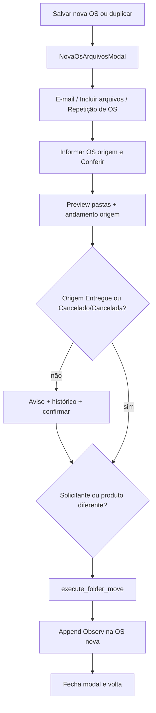

# Repetição de OS no modal de arquivos

## Contexto

Após salvar uma OS nova ou duplicada (`osId < 5000`), [NovaOsArquivosModal](apps/web/src/features/gerencia/components/NovaOsArquivosModal.tsx) oferece e-mail ou upload interno. A transferência de pastas já existe em [OsMoverPastasModal](apps/web/src/features/os/components/OsMoverPastasModal.tsx) via `POST /os/{destAno}/{destId}/folder-move` ([os_folder_move_service.py](app/backend/services/os_folder_move_service.py)): cria a pasta destino se faltar, move subpastas (prefixo `YY NNNNN` em Original/Sefoc) e marca a origem com `(Transf CS …)`.

Não há checagem de andamento nem gravação em `Observ` nesse fluxo hoje.

## Fluxo proposto



## Backend — reutilizar Mover Pastas com flags extras

Arquivos: [os_folder_move_service.py](app/backend/services/os_folder_move_service.py), [schemas/os.py](app/backend/schemas/os.py), [os_routes.py](app/backend/routers/os_routes.py), [test_os_folder_move_service.py](app/backend/tests/test_os_folder_move_service.py).

- Helper do texto (quebras `\n`, 6 espaços na 2ª linha, OS origem como `{nr}/{yy}` — ex. `2282/25`):

```
---- Repetição da OS {nr}/{yy} ----
      Arquivos movidos pra pasta
----------------------------------
```

- Situação concluída: `Entregue`, `Cancelado` e `Cancelada` (mesmo conjunto já usado em `_FROZEN_SITUACOES`). Andamento atual = linha com `UltimoStatus = 1` (como `is_os_frozen`).
- **Preview**: incluir `origem_situacao`, `origem_concluida` e `origem_andamentos` (lista compacta: data, situação, setor, ponto, observação). [OsMoverPastasModal](apps/web/src/features/os/components/OsMoverPastasModal.tsx) ignora esses campos.
- **Execute**: novos campos opcionais em `OsFolderMoveExecuteRequest`:
  - `append_repeticao_observ: bool = False`
  - `confirm_origem_nao_concluida: bool = False`
- Se `append_repeticao_observ` e origem não concluída sem confirmação → `400`.
- Após o `shutil.move` com sucesso: `UPDATE tabDetalhesServico.Observ` da **OS destino**, concatenando o bloco (se já houver texto, separar com `\n`). Depois `sync_os_from_mysql_to_mdb` (mesmo padrão do save da OS) para o Access não ficar desatualizado.
- `Mover Pastas` da home **não muda** (flags default false).

## Frontend — botão no modal de arquivos

Arquivos: [NovaOsArquivosModal.tsx](apps/web/src/features/gerencia/components/NovaOsArquivosModal.tsx), [GerenciaPage.tsx](apps/web/src/features/gerencia/components/GerenciaPage.tsx), [OsGerenciaDetailModal.tsx](apps/web/src/features/os/components/OsGerenciaDetailModal.tsx), [api/os.ts](apps/web/src/api/os.ts).

- Novo modo `repeticao` no modal (visível na tela de escolha **e** quando o e-mail ao cliente está desligado).
- Botão **Repetição de OS**: mesmos campos de origem (nº + ano), **Conferir**, lista de subpastas, aviso de solicitante/produto e conflitos — copiar o comportamento de [OsMoverPastasModal](apps/web/src/features/os/components/OsMoverPastasModal.tsx). Preferir extrair um formulário compartilhado (`OsFolderMoveForm`) para não duplicar Conferir/preview; se o extrair arriscar o menu da home, o modo fica só no modal de arquivos e chama as mesmas APIs.
- Se `origem_concluida === false`: alerta “Esta OS ainda não foi concluída”, tabela do histórico retornado no preview, e checkbox/confirmação explícita antes de mover.
- Execute com `append_repeticao_observ: true` e `confirm_origem_nao_concluida` quando o usuário confirmou.
- Sucesso: alerta das pastas movidas (como Mover Pastas) e `onDone()` (fecha e volta).
- **Pré-preencher origem** quando a ação for duplicar (`search.id` / `search.ano`), editável. Na OS nova, campos vazios.
- Sem nova permissão: quem já salvou a OS no fluxo de gerência usa o botão; `ctx_mover_pastas` continua só no menu de contexto.

## Testes

- Backend: texto de `Observ` (linhas e espaços), OS `2282/25`, recusa sem confirmação se origem não concluída, execute com confirmação + append em Observ vazio e com texto prévio, `Cancelada` tratada como concluída.
- Frontend: helper do rótulo `{nr}/{yy}` se extraído; smoke do botão se já houver padrão de teste de modal.

## Critérios de aceite

- Após salvar nova OS ou duplicar (`< 5000`), o modal tem **Repetição de OS**.
- Informar origem e conferir comporta-se como Mover Pastas (criar pasta destino, mover subpastas, sufixo na origem).
- Origem não Entregue/Cancelado/Cancelada: mostra histórico e pede confirmação; sem confirmar, não move.
- Após mover, `Observ` da OS nova contém exatamente o bloco de 3 linhas acima, com a OS de origem em `xxxx/xx`.
- Mover Pastas da lista inicial permanece igual (sem aviso de andamento e sem gravar Observ).
