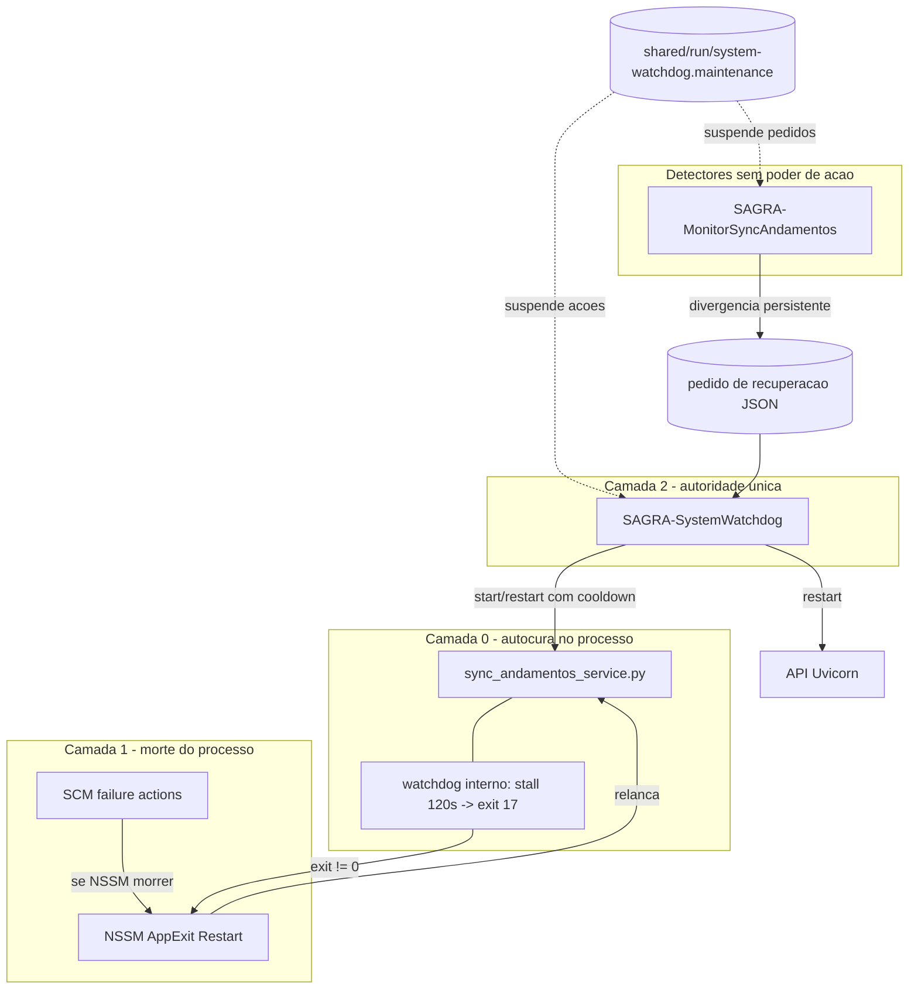

# Plano: serviços SAGRA 24/7 com uma única autoridade de recuperação

## Diagnóstico (evidência de 04–05/10/2026)

| Quando | O que aconteceu | Fonte |
|---|---|---|
| 04/10 05:38–05:46 | MDB Papelaria passa a falhar com `HY001 -1812` a cada ciclo; heartbeat para de avançar | `sync_andamentos.log.1` |
| 04/10 05:48 | Tarefa `SAGRA-SyncAndamentos-Watchdog` faz `nssm restart` (heartbeat 250 s) | `watchdog_external.log` |
| 04/10 05:48 | Sync recebe Ctrl+C, trava em "Aguardando finalizacao do thread de segundo plano" (thread presa em ODBC) e termina `Stopped` | `sync_andamentos.log` |
| 04/10 05:50 → 05/10 12:30 | Tarefa registra a cada 2 min `Stopped - sem auto-start (inicio manual)` e **nunca religa** | `watchdog-sync.ps1` linhas 75–79 |
| 05/10 00:16, 00:24, 07:05, 07:09 | Monitor detecta divergência, `nssm restart` sobe o sync mas retorna exit 1 ("not started"); fallback `sc stop` **mata a instância recém-iniciada**; `sc start` falha com 1056 | `monitor_sync_andamentos.log` |

Configuração do serviço está correta (`AUTO_START`, NSSM `AppExit Restart`, `sc failure` restart 5/10/30 s, conta `REDECAMARA\usr_sefoc`). Essas proteções só agem quando o processo morre sozinho; uma parada **solicitada** é considerada legítima e o serviço fica parado.

Disco do servidor (C: 149 GB livres) e tamanho dos MDBs (72–152 MB) descartam limite de 2 GB / disco cheio como causa do `-1812`.

`SAGRA-SystemWatchdog` (cooldown, circuit breaker, grace, lock de manutenção) **existe no código mas não está instalado** (`shared\run` vazio). A API roda via `iniciar-api-detached.ps1`, sem supervisor.

## Arquitetura alvo



### Matriz de responsabilidades (regra anti-conflito)

| Ator | Pode iniciar/parar Sync? | Quando age |
|---|---|---|
| Watchdog interno do sync | Só encerra o **próprio** processo | stall > 120 s, falha MDB persistente |
| NSSM / SCM | Relança o processo | processo saiu sozinho |
| **SAGRA-SystemWatchdog** | **Sim — único** | Stopped/Paused, transição presa, heartbeat velho, pedido do monitor |
| Monitor de divergência | **Não** (após Fase 2) | grava pedido; nunca `nssm`/`sc` |
| Tarefa `SAGRA-SyncAndamentos-Watchdog` | — | **desativada** pelo instalador do SystemWatchdog |
| Deploy | Sim, dentro do lock de manutenção | troca de release |

Princípios: um único ator decide ações sobre o serviço; toda ação respeita cooldown (180 s), orçamento (3 ações/15 min → circuit breaker 15 min) e grace (90 s) persistidos em disco; nenhum ator para um serviço sem verificar o estado antes e depois.

## Fase 1 — Contenção (mesmo dia, baixo risco)

**1a. Hotfix do monitor** — [`monitor_sync_andamentos_service.py`](monitor_sync_andamentos_service.py), função `restart_sync_andamentos` (linhas ~555–612) e `MonitorLoop.run_once`:

- Consultar estado do serviço (reutilizar a lógica de `query_windows_service` de [`system_watchdog_service.py`](system_watchdog_service.py)) antes de agir.
- `Stopped` → `nssm start`; `Running` → `nssm restart`; estados de transição → não agir neste ciclo.
- **Remover o fallback `sc stop` / `sc start`.** Se o `nssm` falhar, reconsultar o estado; se ficou `Running`, considerar sucesso.
- Não contar divergência enquanto o Sync não estiver `Running` há pelo menos 90 s (lê `started_at` do `sync_heartbeat.json`). Evita falso positivo "MDB tem 1 a mais" causado pelo próprio sync parado.
- Respeitar `shared\run\system-watchdog.maintenance` (mesma regra de validade de `maintenance_status`).
- Testes em [`app/backend/tests/test_monitor_sync_andamentos.py`](app/backend/tests/test_monitor_sync_andamentos.py): restart com serviço Stopped usa start; nenhum `sc stop` é chamado; grace pós-start; lock de manutenção.

**1b. Instalar o SystemWatchdog** (no servidor, Administrador, a partir de `current`):

```powershell
.\instalar-servico-watchdog-sistema.ps1 -Root "C:\Sistemas CGraf\Sagra Web" -Start
nssm edit SAGRA-SystemWatchdog   # aba Log on = REDECAMARA\usr_sefoc
.\conceder-controle-servico.ps1 -Account "REDECAMARA\usr_sefoc"
.\status-watchdog-sistema.ps1 -Root "C:\Sistemas CGraf\Sagra Web"
```

- A conta precisa ser `usr_sefoc`: a API relançada herda a conta do watchdog e precisa acessar o DFS dos MDBs.
- O instalador já desativa a tarefa legada após o primeiro status válido; confirmar com `Get-ScheduledTask SAGRA-SyncAndamentos-Watchdog` (State = Disabled).
- Ajustar `conceder-controle-servico.ps1` para incluir `SAGRA-SystemWatchdog` na lista padrão, se necessário.

Resultado da Fase 1: o sync parado volta sozinho em ~60 s (3 confirmações × 20 s) e o monitor deixa de derrubá-lo.

## Fase 2 — Autoridade única

- Monitor: em vez de chamar `restart_sync_andamentos`, grava `restart_requested_at` + `reason` + `episode_id` no seu status JSON (ou `shared\run\sync_recovery_request.json`, escrita atômica como o `StatusWriter` atual).
- SystemWatchdog (`run_once`, bloco do sync): se Sync `Running`, heartbeat saudável **e** existe pedido novo não atendido → tratar como falha do componente `sync` via `_recover` (mesmo cooldown/circuit breaker). Registrar `episode_id` atendido no estado persistido para não repetir.
- Remover o código de controle de serviço do monitor (`_find_nssm`, `restart_sync_andamentos`); manter a máquina de estados e o alerta.
- Testes em [`app/backend/tests/test_system_watchdog_service.py`](app/backend/tests/test_system_watchdog_service.py): pedido atendido uma vez; pedido ignorado em cooldown/manutenção/circuit aberto; pedido ignorado se Sync não Running (o ramo Stopped já cobre).

## Fase 3 — Causas raiz do travamento

**3a. Shutdown com prazo** — [`sync_andamentos_service.py`](sync_andamentos_service.py) linhas ~2212–2221:

- Após o sinal de parada, iniciar um temporizador: se o encerramento não concluir em ~6 s (abaixo de `AppStopMethodConsole 8000`), `os._exit(0)`. `conn_mgr.close_all()` com thread presa em ODBC pode bloquear indefinidamente.
- No SystemWatchdog, depois de `control_windows_service`, reconsultar o estado após alguns segundos; se `Stopped`, aplicar `start_only` uma vez.

**3b. Erro `-1812` persistente:**

- Contar erros `HY001`/`-1812` consecutivos por MDB; após N (ex.: 5) descartar a conexão daquele MDB; se persistir por M ciclos (ex.: 60 s), sair com código ≠ 0 (NSSM relança processo limpo — o driver ACE às vezes só se recupera em processo novo).
- Investigação no servidor, como `usr_sefoc`: espaço e permissão em `%TEMP%` da conta, arquivos `.ldb` órfãos no share, horário de backup/antivírus/replicação DFS por volta de 05:30, integridade do `Sagra Base - Papelaria Atual.mdb` (compactar/reparar em janela).

## Fase 4 — Deploy sem conflito

- [`deploy/scripts/publicar-release-prod.ps1`](deploy/scripts/publicar-release-prod.ps1): dentro do `try` com lock ativo, após o health OK, reiniciar `SAGRA-SyncAndamentos` e `SAGRA-MonitorSyncAndamentos` (hoje continuam com o código da release anterior até um restart acidental) e validar heartbeat novo.
- [`deploy/scripts/package-release.ps1`](deploy/scripts/package-release.ps1): garantir `system_watchdog_service.py` + scripts do watchdog no pacote; manter `watchdog-sync.ps1`/`instalar-watchdog-sync.ps1` apenas como legado (o instalador já recusa coexistir com o SystemWatchdog).
- Atualizar [`docs/RUNBOOK_SYNC_ANDAMENTOS_SERVICO.md`](docs/RUNBOOK_SYNC_ANDAMENTOS_SERVICO.md) com a matriz de responsabilidades e o procedimento "parar para manutenção = `suspender-watchdog-sistema.ps1`".

## Fase 5 — Observabilidade

- Reaproveitar o alerta vermelho existente (lido de `sync_divergencia_monitor.json` pela API em [`app/backend/routers/sync_andamentos_status_routes.py`](app/backend/routers/sync_andamentos_status_routes.py)) incluindo também: Sync parado > 5 min, circuit breaker aberto, `RECOVERY_FAILED`.
- Fonte única: `shared\run\system_watchdog_status.json`.

## Fase 6 — Validação

1. `pnpm test` (pytest + vitest) verde; testes novos das Fases 1–3.
2. Testes de falha controlados no servidor (janela aprovada, seguindo [`docs/RUNBOOK_WATCHDOG_SISTEMA.md`](docs/RUNBOOK_WATCHDOG_SISTEMA.md)):
   - `nssm stop SAGRA-SyncAndamentos` sem lock → volta em ~60 s, uma única ação no log.
   - Matar o `python.exe` do sync → NSSM relança em 5 s, SystemWatchdog não age (grace).
   - Simular stall (heartbeat velho) → um restart, sem cascata.
   - Divergência artificial com Sync saudável → um pedido, um restart, alerta se persistir.
   - Deploy completo → nenhuma ação de recuperação durante o lock; Sync e Monitor com hash novo.
3. 72 h de observação: zero ocorrências de `sc stop` vindas do monitor, zero períodos `Stopped` > 2 min, no máximo uma ação por episódio.

## Riscos e mitigação

| Risco | Mitigação |
|---|---|
| Dois controladores durante a transição (tarefa legada + SystemWatchdog) | Instalador desativa a tarefa e aborta se a validação falhar |
| Loop de restart quando MDB/DFS está fora | `phase=mdb_unavailable` com ciclo vivo = dependência externa, sem restart; circuit breaker após 3 ações |
| API relançada com conta errada (sem acesso ao DFS) | SystemWatchdog com Log on `usr_sefoc` |
| Watchdog age durante manutenção manual | `suspender-watchdog-sistema.ps1` (lock expira em 30 min) |
| Rollback | `desinstalar-servico-watchdog-sistema.ps1` + `instalar-watchdog-sync.ps1`; monitor reverte para a versão anterior via release anterior |
