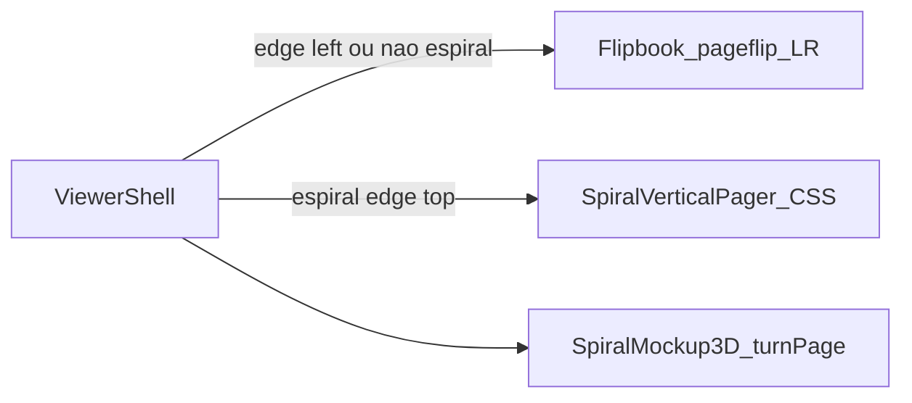

# Folhear vertical (topo) + páginas no mockup espiral

## Respostas

- **Folhear com `edge=top`:** page-flip só faz L↔R. Usar **pager vertical próprio (CSS 3D)** quando `manifest.spiralMockup?.edge === "top"`; com `edge=left` (ou sem espiral) manter `PageFlip` atual.
- **Mockup:** sim — possible. Virar **uma folha por vez** no bloco fechado: textura da face muda; animação leve no eixo do binding (`left` → `rotateY`, `top` → `rotateX`). Sem abrir caderno completo nesta entrega.

## 1. Folhear vertical para `edge=top`

**Detecção** em [`ProvaWebFlipbook.tsx`](apps/web/src/features/prova-web/ProvaWebFlipbook.tsx) (ou thin wrapper no Shell):

- Se `manifest.spiralMockup?.edge === "top"` → render `ProvaWebSpiralVerticalPager` (novo).
- Senão → Flipbook atual sem mudança de API.

**Novo** `ProvaWebSpiralVerticalPager.tsx` (+ CSS mínimo):

- Mesmas páginas/`pageUrl`/janela de load leve (reusar helpers de [`flipbookFit.ts`](apps/web/src/features/prova-web/flipbookFit.ts) se couber).
- UI: setas **cima/baixo** (ChevronUp/Down), indicador de página, zoom/fullscreen alinhados ao Flipbook quando prático.
- Animação: folha atual `rotateX` (~−90° saindo para cima / entrando de baixo); pivot no **topo** (binding).
- Teclado/click: prev = baixo→cima inverso conforme UX de calendário (próxima sobe para fora; anterior volta). Definir: **Next** = página sobe e sai (como folhear calendário wire-o); Prev reverso.
- **Não** alterar modos `unico` / `capa_miolo` / `folha_dobrada` sem `spiralMockup.edge=top`.

## 2. Virar páginas no mockup 3D

Arquivos: [`ProvaWebSpiralMockup3D.tsx`](apps/web/src/features/prova-web/ProvaWebSpiralMockup3D.tsx), [`spiralSceneThree.ts`](apps/web/src/features/prova-web/spiralSceneThree.ts).

- Estado `pageIndex` (0-based) sobre `pages` não-blank.
- Toolbar: Anterior / Próxima (+ label “Pág. i / N”).
- Wheel (após `engage`) ou botões: avanço/recuo.
- `createSpiralScene`: API `setFrontTexture(url)` / `setPageTextures({ frontUrl, backUrl? })` + `playPageTurn(dir, edge)`:
  - Mesh folha fina (plane) na face +Z com textura atual;
  - Anima pivot na borda de binding: `edge=left` → `rotateY`; `edge=top` → `rotateX`;
  - No meio/fim, troca textura da capa do bloco para a nova página; remove a folha animada.
- Face verso do bloco: manter contracapa (última `cover-back` / última página) estável — não precisa espelhar miolo agora.
- Idle yaw: pausar ou desengajar no turn (chamar `engage()` no nav).

## 3. Isolamento

- Não modificar `fold-engine/**` nem `ProvaWebBookMockup3D`.
- page-flip: só deixado de montar quando `edge=top`.
- Portal/staff: mesmo `manifest.spiralMockup`.

## 4. Verificação

- Espiral `edge=left`: Folhear L↔R (page-flip); mockup vira no eixo vertical da borda.
- Espiral `edge=top`: Folhear sobe/desce (CSS); mockup vira no eixo horizontal do topo.
- Livro lombada / folheto: Folhear e mockups inalterados.
- Teste unitário leve: branch `edge === "top"` seleciona pager vertical (helper puro).

## Ordem

1. Vertical pager + branch no Flipbook  
2. `setPageTextures` + animação turn no `spiralSceneThree`  
3. Controles UI no SpiralMockup3D  
4. Testes / smoke
