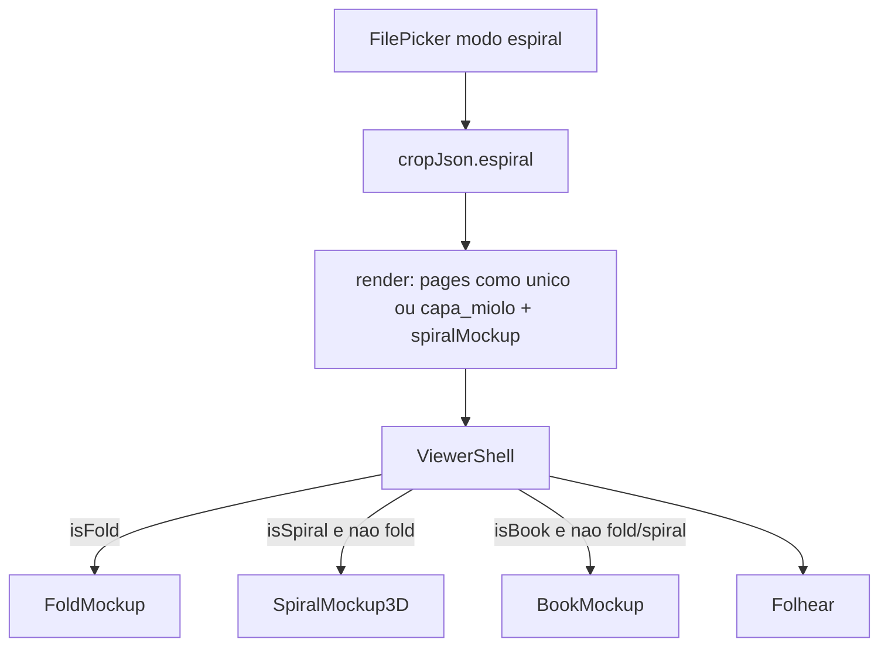

# Mockup e produto com espiral (faseado e isolado)

## Viabilidade

**Sim.** O viewer já escolhe mockup por metadado (`foldMockup` vs `bookMockup`); dá para plugar um terceiro ramo isolado. Livro = caixa CSS 3D com lombada; folheto = Three.js. Espiral/wire-o **não existe** hoje — extensão paralela, sem reutilizar `bookMockup.lombadaMm` (evita confundir hotmelt com espiral).

Entrega **faseada** (escolha sua): Fase 1 entrega modo + gerar prova + Folhear/PDF + Mockup 3D com furos/espiral; Fase 2 polimento de crop/params. Livro e folheto permanecem intocados no fluxo crítico.

## Decisões fixas

| Decisão | Escolha |
|--------|---------|
| Produto | Novo `modo: "espiral"` (não flag dentro de `capa_miolo`) |
| Arquivos | Subfonte no picker: `unico` **ou** `capa_miolo` |
| Eixo | `edge: "left" \| "top"` no crop |
| Mockup | Componente **novo** CSS 3D + SVG (irmão de [`ProvaWebBookMockup3D.tsx`](apps/web/src/features/prova-web/ProvaWebBookMockup3D.tsx)), **não** Three.js / fold-engine |
| Metadado | `manifest.spiralMockup` separado de `bookMockup` / `foldMockup` |
| Prioridade viewer | fold → espiral → livro |

## Isolamento (não mexer)

- [`fold-engine/**`](apps/web/src/features/prova-web/fold-engine/), idle unfold, wizard de dobras
- Comportamento visual/lógica de [`ProvaWebBookMockup3D.tsx`](apps/web/src/features/prova-web/ProvaWebBookMockup3D.tsx) / emissão `_book_mockup_meta` para `capa_miolo`
- Papelaria

**Pode tocar levemente:** picker, crop assistant routing, tipos API, `Literal` de modo no backend, um `if` em [`ProvaWebViewerShell.tsx`](apps/web/src/features/prova-web/ProvaWebViewerShell.tsx), render service (branch nova que **reusa** assembly existente).

---

## Fase 1 — produto + mockup seguro (MVP)

### 1. Contrato de dados

Em [`apps/web/src/api/provaWeb.ts`](apps/web/src/api/provaWeb.ts) e backend (`MODE_*`, rotas `Literal`):

- `ProvaWebModo` += `"espiral"`
- `cropJson.espiral`:
  - `sourceKind: "unico" | "capa_miolo"`
  - `edge: "left" | "top"`
  - `holeCount: number` (default tipográfico, ex. 12–18 conforme altura útil)
  - `holeDiameterMm`, `marginFromEdgeMm` (defaults conservadores)
  - `crop: CropSidesMm` (reuso)
  - se `capa_miolo`: opcional `capa` mínimo **sem** exigir lombada (só faces; ou reusar crop capa simplificado)
- `ProvaWebSpiralMockupMeta`: `{ edge, holeCount, holeDiameterMm, marginFromEdgeMm, pageWidthMm, pageHeightMm, blockThicknessMm? }`

Registros antigos sem `espiral` **não mudam**.

### 2. UI de entrada

- [`ProvaWebFilePicker.tsx`](apps/web/src/features/prova-web/ProvaWebFilePicker.tsx): botão **Espiral**; com modo ativo, toggle Único / Capa+Miolo e slots iguais aos modos atuais.
- Backend create/update: validar `espiral` + paths (1 ou 2 arquivos conforme `sourceKind`).
- [`ProvaWebCropAssistant.tsx`](apps/web/src/features/prova-web/ProvaWebCropAssistant.tsx): ramo `espiral` → wizard leve `ProvaWebSpiralWizard` (crop + edge + furos). **Sem** CoverWizard de lombada.

### 3. Render (reuso, sem reinventar PDF)

Em [`prova_web_render_service.py`](app/backend/services/prova_web_render_service.py):

- Se `modo == espiral` e `sourceKind == unico` → mesmo path de páginas que `unico`.
- Se `capa_miolo` → mesmo assembly de capas/miolo que `capa_miolo`, **sem** emitir `bookMockup` (lombada omitida / 0).
- Sempre emitir `spiralMockup` com dims da página + params do crop.
- Não escrever `foldMockup`; não chamar `_book_mockup_meta` neste modo.

### 4. Mockup 3D paralelo

Novos arquivos (só espiral):

- `ProvaWebSpiralMockup3D.tsx` + CSS
- Caixa fechada (frente/verso/miolo) a partir das roles de página já existentes (capa ou 1ª/última)
- Faixa de **furos** circulares na borda `edge`
- **Espiral** como SVG/CSS (fio helicoidal estilizado) alinhado aos furos; `left` = lateral; `top` = superior (calendário)
- Idle: reutilizar [`useIdleYawSpin`](apps/web/src/features/prova-web/useIdleYawSpin.ts) (igual livro)
- ViewerShell: `isSpiral = !isFold && Boolean(spiralMockup)`; `showMockupTab` inclui espiral; default tab mockup ou Folhear como livro

### 5. Testes de não-regressão

- Unit: defaults `espiral`, packing/meta shape
- Viewer selection: com `foldMockup` → fold; só `bookMockup` → book; só `spiralMockup` → spiral; nunca misturar
- Backend: modo `capa_miolo` com lombada ainda emite só `bookMockup`; modo `espiral` emite só `spiralMockup`
- Smoke manual: gerar `unico` / `capa_miolo` / `folha_dobrada` existentes + 1 OS espiral left + 1 top

**Critério de aceite Fase 1:** mockup mostra furos + espiral na borda correta; Folhear/PDF funcionam; livro e folheto inalterados.

---

## Fase 2 — robustez de produto (após Fase 1 estável)

- Wizard mais completo (preview dos furos no crop, clamps por formato)
- Espessura do bloco derivada de nº de páginas / grammage se fizer sentido
- Ajuste visual do fio (densidade = `holeCount`)
- Textos de UX (copy, ícone, permissões)
- Opcional futuro (fora desta fase): open-book / folhear com bind axis — **não** necessário para aceite do mockup

---

## Riscos e mitigações

| Risco | Mitigação |
|-------|-----------|
| Quebrar livro/folheto | Branch por `modo` + meta separada; testes de prioridade |
| `capa_miolo` + espiral confundidos | Modo distinto; nunca `lombadaMm` como sinal de espiral |
| Escopo Explode (Three.js) | CSS+SVG na Fase 1; Three.js só se Fase 2 exigir e isolado |
| PDF unico vs capa | `sourceKind` explícito no crop e validação no save |
| Perf mockup | Sem Three.js; mesmas texturas PNG do Folhear |

## Ordem de implementação recomendada

1. Tipos + backend `MODE_ESPIRAL` + validação save  
2. FilePicker + SpiralWizard mínimo + CropAssistant  
3. Render: pages reuse + `spiralMockup`  
4. `ProvaWebSpiralMockup3D` + ViewerShell  
5. Testes isolamento + smoke dos 3 modos legados  

Não inicia Fase 2 até aceite da Fase 1.
