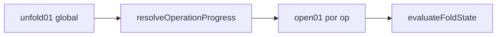

# Atraso entre dobras (stagger) no desdobramento

## Objetivo

Permitir que a operação N comece a abrir quando a anterior atingir X% de abertura (ex.: 20%), em vez de só depois de 100%. **Padrão = 100%** — zero mudança perceptível sem configuração. Persistido em fold models + `cropJson`.

## Semântica (contrato congelado)

| Sinal | 0 | 1 |
|-------|---|---|
| `unfold01` (slider global) | folha fechada | folha aberta plana |
| `open01` por operação | fechada no ângulo alvo | plana |

Campo novo na operação: **`startAfterPrevOpen01`** (opcional, `0..1`, **default `1`**).

- Unidade = `open01` do **nível de ordem anterior** (não % de “fechar”).
- `1` = espera a anterior abrir 100% → **igual ao algoritmo atual**.
- `0.2` = próxima começa quando a anterior está 20% aberta.
- `0` = começa junto com a anterior (paralelo total entre níveis).
- O **primeiro** nível no unfold (maior `order`) **ignora** o campo.



## Matemática (compatível com o atual)

Hoje em [`foldProgress.ts`](apps/web/src/features/prova-web/fold-engine/foldProgress.ts):

```text
levels = unique(order) DESC   // maior order abre primeiro
open_i = clamp(unfold01 * n - i)
```

Com waits `w_i = startAfterPrevOpen01` do nível i (nível 0 não usa wait):

```text
starts[0] = 0
starts[i] = starts[i-1] + w_i     // i >= 1
total = starts[n-1] + 1
open_i = clamp(unfold01 * total - starts[i])
```

Prova de não-regressão: todos `w_i = 1` ⇒ `starts = [0,1,…,n-1]`, `total = n` ⇒ fórmula idêntica à atual. `n = 1` ⇒ `open_0 = unfold01`.

Nível com várias ops (mesmo `order`): um único wait por nível — usar o **máximo** dos `startAfterPrevOpen01` das ops daquele nível (mais conservador; evita abrir antes do desejado).

## Escopo de mudança (mínimo)

### 1. Motor — único ponto de verdade

- Estender `resolveOperationProgress` em [`foldProgress.ts`](apps/web/src/features/prova-web/fold-engine/foldProgress.ts) com o remap acima.
- Manter `unfoldLevelProgress` como helper do caso uniforme, ou implementar só dentro de `resolveOperationProgress`.
- **Não** alterar `foldKinematics`, `foldCollision`, `foldRenderer` API pública (`setHingeAnglesFromUnfold` continua um único `unfold01`).

### 2. Tipos + pack/apply

- [`api/provaWeb.ts`](apps/web/src/api/provaWeb.ts) e [`foldTypes.ts`](apps/web/src/features/prova-web/fold-engine/foldTypes.ts): `startAfterPrevOpen01?: number` em `FoldOperation` (omitido = 1).
- [`provaWebFoldPresets.ts`](apps/web/src/features/prova-web/provaWebFoldPresets.ts): `packFoldModelConfig` / `applyFoldModelConfig` repassam o campo se presente.
- Presets em [`foldPresets.ts`](apps/web/src/features/prova-web/fold-engine/foldPresets.ts): **não** setam o campo → default 1.

### 3. Backend (persistência)

- [`prova_web_fold_model_service.py`](app/backend/services/prova_web_fold_model_service.py): ao normalizar operação, se presente clampa `0..1`; se ausente ou `≈1`, pode omitir do JSON salvo.
- [`prova_web_fold_service.py`](app/backend/services/prova_web_fold_service.py): mesma normalização ao montar config do folheto/`foldMockup` (para o viewer receber o valor).

### 4. Wizard UI

Em [`ProvaWebFoldWizard.tsx`](apps/web/src/features/prova-web/ProvaWebFoldWizard.tsx), na linha da operação (ao lado de lado/ângulo):

- Controle numérico **“Inicia após % da anterior”** (0–100 na UI → `/100` no modelo).
- Desabilitado / oculto na operação de **maior `order`** (primeira a abrir no unfold) com tooltip: “Primeira no desdobrar — não espera ninguém.”
- Label claro: valor 100 = “só depois da anterior totalmente aberta (padrão)”.
- **Não** exige mudança no `FoldSchemaPreview` (setas de sentido permanecem; o stagger é só temporal no 3D).

### 5. Viewer

[`ProvaWebFoldMockup3D.tsx`](apps/web/src/features/prova-web/ProvaWebFoldMockup3D.tsx): **sem mudança de API**. Wheel/botões/slider continuam em `unfold01`. Steps por `hingeCount` continuam por níveis de `order`. O overlap aparece só nos frames intermediários via `resolveOperationProgress`.

## Testes (obrigatórios para confiança)

1. **Parity default**: ops sem o campo / todos `1` → mesmo mapa `open01` que a fórmula antiga (n=1,2,3; vários `unfold01`).
2. **Stagger 0.2**: com 2 níveis, em `unfold01` logo após o start do nível 1, nível 0 já `> 0.2` e nível 1 `> 0`.
3. **`wait=0`**: dois níveis com mesmo `open01` ao longo do unfold.
4. Backend: round-trip do campo no fold-model service (teste existente de create/config).
5. Carteira L/R: kinematic tests existentes devem passar sem alteração (default).

Arquivos de teste: estender [`foldMockupMath.test.ts`](apps/web/src/features/prova-web/foldMockupMath.test.ts) ou novo `foldProgress.test.ts`; backend `test_prova_web_fold_model_service.py`.

## Riscos e mitigação

| Risco | Mitigação |
|-------|-----------|
| Config antiga sem campo | Default 1 implícito — bit-identical |
| Ops no mesmo `order` com waits diferentes | Usar max do nível |
| Colisão OBB mais cedo se overlap | Já existe empilhamento/câmera carteira; default 1 não muda; overlap é escolha do usuário |
| Pack omitindo campo | Omitir só se `undefined` ou ≈1; valores 0–0.99 sempre salvos |

## Fora de escopo

- Mudar sequência de `order` / sentido / miolo
- Animação automática 1ª→2ª no schema 2D
- Alterar sensibilidade do wheel ou chevrons
- Forçar 20% em presets do sistema