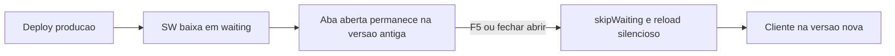

# Suprimir badge de atualização PWA

O aviso vem de [`PwaUpdatePrompt.tsx`](apps/web/src/components/pwa/PwaUpdatePrompt.tsx): toast fixo no rodapé quando o service worker entra em `waiting` ou quando `/api/app-version` diverge do `VITE_SAGRA_BUILD_ID`.

Comportamento alvo:

- Aba já aberta: continua na versão antiga, **sem UI**.
- F5: passa para a versão nova.
- Fechar e abrir (browser ou PWA): passa para a versão nova.

## Por que não ativar o SW no meio da sessão

`skipWaiting` no instante do deploy apagaria o precache antigo enquanto a aba ainda roda o JS velho (rotas lazy podem 404). O SW novo fica em **waiting** até o próximo carregamento da página.

`registerType` permanece `"prompt"` em [`vite.config.ts`](apps/web/vite.config.ts) — **não** usar `"autoUpdate"`, que recarrega a aba sozinha.

## Implementação

### 1. Registrar o SW sem UI

Em [`PwaUpdatePrompt.tsx`](apps/web/src/components/pwa/PwaUpdatePrompt.tsx):

- Manter `PwaProvider` + `useRegisterSW({ immediate: true })` (produção).
- Manter o intervalo de 5 min e o `visibilitychange` chamando `registration.update()` — só para **baixar** o SW novo, não para ativar.
- Remover banner, botões Atualizar/Depois, polling de `build_id` e estado `visible`.
- O componente passa a não renderizar nada.

**Aplicar a versão só no boot da página** (janela curta, ~3s após o mount), com trava em `sessionStorage` para não loopar:

- Se `registration.waiting` já existir no `onRegisteredSW` (caso típico do F5), ou o SW terminar de instalar nessa janela: `updateServiceWorker(true)` / `SKIP_WAITING` + reload uma vez.
- Depois da janela de boot: update encontrado pelo intervalo **não** chama `skipWaiting`.

### 2. Não assumir controle de outras abas

- [`vite.config.ts`](apps/web/vite.config.ts): `clientsClaim: false` (hoje está `true`).
- [`push-sw.js`](apps/web/public/push-sw.js): remover `self.clients.claim()` no `activate` (esse script entra no SW via `importScripts` e hoje reivindicaria as abas mesmo com Workbox em `false`). Manter o handler `SKIP_WAITING`.

### 3. Push e testes

- [`useWebPush.ts`](apps/web/src/hooks/useWebPush.ts): atualizar o comentário; continuar **sem** ativar SW em waiting (isso continua sendo do boot do PWA).
- Reescrever [`PwaUpdatePrompt.test.tsx`](apps/web/src/components/pwa/PwaUpdatePrompt.test.tsx): o texto “Nova versão…” nunca aparece, mesmo com `needRefresh` ou `build_id` divergente.
- Endpoint `/api/app-version` e [`pwaUpdateUtils.ts`](apps/web/src/components/pwa/pwaUpdateUtils.ts) permanecem (auth/testes); só deixam de alimentar UI.

### 4. Nota operacional

Uma linha em [`deploy/templates/LEIA-ME-DEPLOY.md`](deploy/templates/LEIA-ME-DEPLOY.md): após o deploy o cliente atualiza no F5 ou ao reabrir, sem aviso na interface.

## Fora de escopo

- Não forçar reload automático com a aba em uso.
- Não desligar o PWA / cache de shell.
- Várias abas: F5 numa delas ativa o SW novo; as outras devem ser recarregadas também (limite do precache compartilhado).
