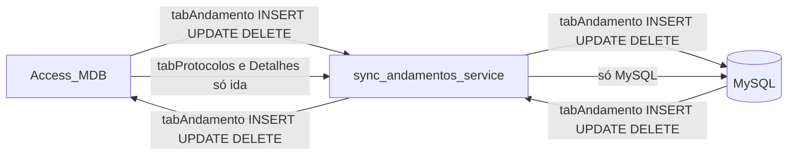

# Plano: sync tabAndamento bidirecional + UltimoStatus canônico

## Contrato de produto (decidido)

| Tabela | Direção |
|--------|---------|
| **tabAndamento** | **Bidirecional** — alteração no MySQL → MDB; alteração no MDB → MySQL |
| tabProtocolos | **Só MDB → MySQL** (inalterado) |
| tabDetalhesServico | **Só MDB → MySQL** (inalterado) |
| UltimoStatus (flag) | Autoridade MySQL por **maior CodStatus** operacional; espelho no MDB após mutações |

---

## Diagnóstico (auditoria)

### Estado atual em produção

- Runner: [`sync_andamentos_service.py`](sync_andamentos_service.py) + [`sync_andamentos_v2_Old.py`](sync_andamentos_v2_Old.py).
- **tabAndamento hoje é unidirecional MDB→MySQL**: bloco MySQL→MDB comentado em Old (~1685–1699) e ausente no `perform_sync` do serviço.
- Existe `insert_mdb` / `delete_mdb` no Old; **não existe `update_mdb`** — updates em `comuns` só fazem `update_mysql` (MDB vence sempre).
- Dual-write da API (`mdb_writer`) é paralelo e some com `MYSQL_ONLY=true`; **não substitui** o bot bidirecional.
- `sync_os_data_from_mdb` + thread de OS (~822+) já é MDB→MySQL para Protocolos/Detalhes — **permanece assim**.

### Sintoma #1 — Web grava MySQL e Access não recebe

Com bot uni, andamentos só-MySQL nunca entram no MDB ao reiniciar. Com bi, o ciclo seguinte faz `novos_no_mysql → insert_mdb` (e updates se campos divergirem).

### Sintoma #2 — UltimoStatus no andamento errado

[`ULTIMO_ORDER_BY_SQL`](app/backend/services/andamento_operacional.py) ordena por **`Data` DESC primeiro**, não por maior CodStatus. Sync chama `ensure_mysql_ultimo_status_from_mdb` e espelha no MDB → promove penúltimo quando Access tem Data “mais nova”.

### Outras falhas (“vivo mas cego”)

- `[SKIP] MDB indisponivel` + watchdog reiniciando
- Tombstone `is_deleted` bloqueando resurrect
- SAFETY LOCK >5 deletes silencioso
- Risco de launcher cair em `app/services/sync_andamentos_v2.py` (bi incompleto, sem UPDATE MDB→MySQL)

---

## Decisões fixadas

1. **tabAndamento bidirecional no serviço** (INSERT + UPDATE + DELETE seguro nos dois sentidos). Flag de emergência `SYNC_TABANDAMENTO_BIDI=true` (default on).
2. **Conflito em UPDATE (mesmo CodStatus, conteúdo diferente):** last-write-wins pela coluna **`Data`** do registro; se `Data` empatar, **MySQL vence** (Web). Nunca copiar `UltimoStatus` como campo de payload — sempre heal pós-mutação.
3. **UltimoStatus = maior CodStatus** operacional (sufixo numérico), excluindo espelhos Sub OS; `Data` só desempate.
4. **Outras tabelas:** zero escrita MySQL→MDB de Protocolos/Detalhes neste trabalho.
5. Mudanças de fluxo no **`ResilientSynchronizer.perform_sync`** (+ `update_mdb` no serviço ou mixin); regra UltimoStatus em [`andamento_operacional.py`](app/backend/services/andamento_operacional.py) compartilhada com a API.

---

## Fase 1 — Invariante UltimoStatus (P0)

**Canônico:** [`app/backend/services/andamento_operacional.py`](app/backend/services/andamento_operacional.py)

- `ULTIMO_ORDER_BY_SQL` → sufixo CodStatus DESC, depois CodStatus, depois Data.
- `assert_or_fix_unico_ultimo_status(cursor, nro, ano)`: count≠1 ou marcado≠expected → heal + log `[ULTIMO_HEAL]`.
- Sync: após cada `ensure_*` e no fim do ciclo nas OSs tocadas; query leve de OSs com `COUNT(UltimoStatus=1)<>1`.
- MDB: [`_fix_ultimo_status_mdb`](app/backend/routers/mdb_writer.py) com a mesma ordem de candidatos.
- Testes em [`test_ultimo_status_align.py`](app/backend/tests/test_ultimo_status_align.py) + script one-shot de remediação em prod.

---

## Fase 2 — Bidirecional tabAndamento (P0)

Em [`ResilientSynchronizer.perform_sync`](sync_andamentos_service.py) (espelhando a lógica Old, sem alterar Protocolos):

**Ordem do ciclo (preservar proteções atuais):**

1. Lê MySQL + MDB (abort se leitura falhar; skip se path MDB ausente).
2. Detecta exclusões MDB (cache) → candidatos a delete MySQL.
3. **MDB → MySQL INSERT** (`novos_no_mdb`) + heal UltimoStatus.
4. **Comuns — UPDATE bidirecional:**
   - Se `_andamentos_differ` (já ignora UltimoStatus):
     - Se `Data` MDB > MySQL → `update_mysql` (+ `sync_os_data_from_mdb` só neste sentido, como hoje).
     - Se `Data` MySQL > MDB → **`update_mdb`** (novo; sem sync de Protocolos/Detalhes).
     - Se `Data` igual → MySQL vence → `update_mdb`.
   - Depois heal UltimoStatus na OS.
5. **MySQL → MDB INSERT** (`novos_no_mysql` → `insert_mdb` + heal). Reativa o bloco comentado do Old.
6. **Deletes:**
   - MDB sumiu (confirmado) → `delete_mysql` (existente + SAFETY LOCK).
   - MySQL sumiu e CodStatus ainda no MDB **e** estava no cache/ciclo anterior como presente nos dois → `delete_mdb` (existente), com o mesmo SAFETY LOCK / fail-open de verificação.
7. Formatação periódica (só MySQL, como hoje).

**Implementar `update_mdb`** no serviço (espelho de `update_mysql` / campos do `insert_mdb`), sem gravar UltimoStatus no UPDATE de campos — heal depois.

**Não fazer:** qualquer INSERT/UPDATE MySQL→MDB em tabProtocolos ou tabDetalhesServico.

Heartbeat: `ins_m2y`, `upd_m2y`, `ins_y2m`, `upd_y2m`, `del_y`, `del_m`, `ultimo_heals`, `mysql_only_remaining`.

---

## Fase 3 — Resiliência operacional (P1)

1. Tombstones: não `continue` cego em `is_deleted` nos inserts; permitir resurrect.
2. Watchdog: `phase=mdb_unavailable` não conta como stall de restart.
3. Heartbeat rico + SAFETY LOCK em ERROR.
4. Launcher: só serviço/Old; bloquear fallback para `app/services/sync_andamentos_v2.py` em prod.
5. RUNBOOK: contrato bi tabAndamento / uni demais tabelas / UltimoStatus=max CodStatus.

---

## Fase 4 — Verificação

- Testes: INSERT Y→M; UPDATE Y→M quando Data MySQL maior; UPDATE M→Y quando Data MDB maior; Protocolos nunca escritos no sentido Y→M; UltimoStatus heal.
- Manual:
  1. Parar sync → andamento Web → subir → aparece no Access.
  2. Editar observação no Access → aparece no MySQL.
  3. Editar observação no MySQL → aparece no Access.
  4. Dois UltimoStatus=1 → heal no maior CodStatus.
  5. Andamento com Data nova e CodStatus menor → não vira último.
  6. Share offline → sem storm-restart; ao voltar catch-up bi.

---

## Escopo fora

- Não reescrever formatação obs/ponto.
- Não unificar os três scripts nesta entrega (só impedir path errado).
- Dual-write da API continua como aceleração opcional; o bot bi é a garantia de convergência.
