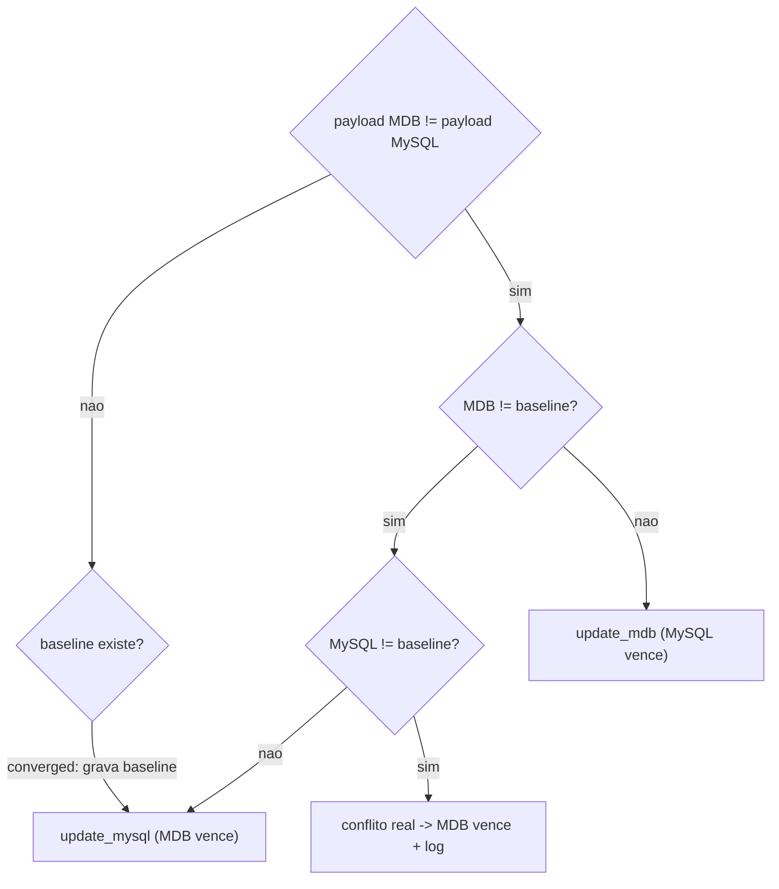

## Diagnóstico

A regra de conflito trata `Data` (data do andamento) como relógio de última escrita:

```762:765:sync_andamentos_service.py
    @staticmethod
    def _mysql_wins_lww(mysql_rec, mdb_rec) -> bool:
        d_mysql = ResilientSynchronizer._parse_andamento_data(mysql_rec.get("Data"))
        d_mdb = ResilientSynchronizer._parse_andamento_data(mdb_rec.get("Data"))
        return d_mysql >= d_mdb
```

Editar `Observaçao`, `SetorLink`, `SituacaoLink` ou `Ponto` no Access não altera `Data`. Logo `d_mysql == d_mdb`, o `>=` declara MySQL vencedor, e o ciclo chama `update_mdb` gravando a linha antiga do MySQL sobre a edição. Com `intervalo_segundos=0.2` a reversão é quase instantânea. Só sobrevive a edição em que o usuário também empurra `Data` para frente.

Nem `tabandamento` (MySQL) nem `tabAndamento` (MDB) têm coluna de modificação — confirmado em [RELATORIO_AUDITORIA_BANCOS_SAGRA_ATUAL.md](RELATORIO_AUDITORIA_BANCOS_SAGRA_ATUAL.md) (9 e 7 colunas, nenhuma de timestamp). Não existe relógio para comparar, então a decisão precisa vir de "quem divergiu do último estado convergido".

Agrava: `config_manager.is_mysql_only()` tem default `True`, ou seja o dual-write da API para o MDB está desligado e este bot é o único mecanismo de convergência.

## Solução: baseline de último estado convergido

Nova tabela no MySQL guardando o hash do payload sincronizado da última vez que os dois lados estavam iguais. Quem não casa mais com o baseline é quem mudou, e vence.



Decisões confirmadas: sem baseline, ou com os dois lados alterados, **MDB vence**.

## Mudanças

Todo o trabalho fica em [sync_andamentos_service.py](sync_andamentos_service.py). `sync_andamentos_v2_Old.py` **não** é alterado — o docstring do runner avisa que ele é espelho da cópia canônica de produção em `\\cgrafsysvm\s\SagraWeb`.

### 1. Payload canônico e hash

Uma função de normalização única, com exatamente os campos que `_andamentos_differ` já compara (`UltimoStatus` continua fora — autoridade é o MySQL via `ensure_mysql_ultimo_status_from_mdb`):

`NroProtocoloLink` (int), `AnoProtocoloLink` (int), `SituacaoLink`, `SetorLink`, `Data` (`%Y-%m-%d %H:%M:%S`), `Observaçao`, `Ponto`.

Aplicar `format_observacao` / `format_ponto` (ambas idempotentes) aos **dois** lados, não só ao MDB como hoje. Hash = SHA-256 do payload normalizado.

Override de `_andamentos_differ` no serviço para usar `hash(mdb) != hash(mysql)`. Isso mantém a semântica atual e elimina um ping-pong pré-existente: hoje o comparador formata só o MDB, então uma `Observaçao` fora do formato canônico gera UPDATE repetido a cada ciclo até `_format_mysql_records` rodar (a cada 10 ciclos).

### 2. Tabela de baseline

```sql
CREATE TABLE IF NOT EXISTS sync_andamento_baseline (
  CodStatus VARCHAR(50) NOT NULL PRIMARY KEY,
  payload_hash CHAR(64) NOT NULL,
  updated_at DATETIME NOT NULL DEFAULT CURRENT_TIMESTAMP ON UPDATE CURRENT_TIMESTAMP
) ENGINE=InnoDB DEFAULT CHARSET=utf8mb4 COLLATE=utf8mb4_unicode_ci
```

Criada de forma lazy no primeiro ciclo depois de `_wait_for_dependencies` (MySQL pode estar fora no `__init__`). Cache em memória `self._baseline: Dict[str, str]`, carregado uma vez no startup — seguro porque o `InstanceMutex` garante instância única. Write-through só quando o hash muda, em um `executemany` de `INSERT ... ON DUPLICATE KEY UPDATE` no fim do ciclo. Depois do primeiro ciclo (que semeia a janela de 15 dias) o volume de escrita por ciclo cai praticamente a zero.

Poda a cada N ciclos: remover `CodStatus` que saíram da janela (`mysql_codes | mdb_all_codes` do ciclo).

### 3. Decisão de direção no `perform_sync`

Substituir o bloco atual do loop de `comuns`:

```994:1005:sync_andamentos_service.py
                if bidi and self._mysql_wins_lww(mysql_rec, mdb_rec):
                    mdb_conn = self.conn_mgr.get_mdb_by_nro(nro)
                    destino = self.conn_mgr.get_mdb_name_by_nro(nro)
                    self.update_mdb(mysql_rec, mdb_conn, destino)
                    self._cycle_stats["upd_y2m"] += 1
                    self._svc_log.info(
                        "[BI] UPDATE MySQL->MDB CodStatus=%s OS=%s/%s", code, nro, ano
                    )
                else:
                    self.sync_os_data_from_mdb(nro, ano, origem)
                    self.update_mysql(mdb_rec, origem)
                    self._cycle_stats["upd_m2y"] += 1
```

por uma chamada a `_resolve_update_direction(code, mdb_rec, mysql_rec)` que retorna `"mdb"` ou `"mysql"` conforme o diagrama. Depois da gravação, o baseline do `CodStatus` passa a ser o hash do vencedor. Para linhas que não divergem, o baseline é semeado/atualizado com o hash comum. Inserts (`ins_m2y` e `ins_y2m`) também semeiam o baseline, evitando um ciclo ambíguo. Deletes removem a entrada.

`_mysql_wins_lww` e `_parse_andamento_data` deixam de ser usados na decisão e saem junto com o teste correspondente.

### 4. Observabilidade e kill-switch

- Heartbeat: novas stats `conflitos` e `baseline_rows`.
- Log `[CONFLITO] CodStatus=... ambos alterados - MDB vence` (throttled, no padrão de `_blocked_warnings_cache`).
- `SYNC_CONFLICT_WINNER` (`mdb` default, `mysql` como escape hatch) para o desempate.
- `SYNC_TABANDAMENTO_BIDI=false` continua sendo o kill-switch total, voltando ao comportamento "MDB sempre vence".

### 5. Testes

Em [app/backend/tests/test_sync_service_resilience.py](app/backend/tests/test_sync_service_resilience.py), no padrão de `_make_sync_for_notify`:

- Regressão exata do relato: edição só de `Observaçao` no MDB, `Data` idêntica → `update_mysql` chamado, `update_mdb` não.
- MySQL alterado contra baseline → `update_mdb`.
- Ambos alterados → MDB vence, stat `conflitos` incrementada.
- Sem baseline → MDB vence.
- Linhas iguais → nenhum update e baseline semeado.
- `_andamentos_differ` simétrico: `Observaçao` fora do formato canônico não gera divergência perpétua.
- Ajustar `test_perform_sync_update_mysql_to_mdb_when_newer` (hoje depende de `Data` maior no MySQL) para montar baseline; remover `test_mysql_wins_lww`.

Rodar com `python -m pytest app/backend/tests/test_sync_service_resilience.py -q`.

### 6. Documentação

Atualizar a regra de conflito e a tabela de variáveis em [docs/RUNBOOK_SYNC_ANDAMENTOS_SERVICO.md](docs/RUNBOOK_SYNC_ANDAMENTOS_SERVICO.md) (`SYNC_CONFLICT_WINNER`, `sync_andamento_baseline`, como zerar o baseline em caso de dúvida).

`deploy/scripts/package-release.ps1` já copia `sync_andamentos_service.py` para a raiz do release — não precisa mudar.

## Fora de escopo

- Não alterar `sync_andamentos_v2_Old.py` nem `app/services/sync_andamentos_v2.py`.
- Não mexer em tabProtocolos / tabDetalhesServico (seguem só MDB→MySQL).
- Não reescrever `format_observacao` / `format_ponto`.
- Não alterar a regra de `UltimoStatus` (maior CodStatus, autoridade MySQL).