# Timbrado A4 Digital (SVG → DOCX)

## Contexto confirmado

Hoje **não existe** pipeline DOCX na papelaria. `Gerar arquivo` enfileira `tipo_job=create` → worker preenche `TimbradoA4.cdr` (`Cabecalho`/`Rodape`) → CDR + PDF de prova. `Timbrado A4` e `Timbrado A4 (Digital)` compartilham o mesmo CDR.

Os modelos Word em `G:\Laboratorio\...\Timbrado A4 Digital\` são `.doc` (OLE). Após conversão para DOCX:

| Parte | Identificador (`o:title`) | Mídia | Ação |
|-------|---------------------------|-------|------|
| Brasão | `Brasao_TIF-COR` / `Brasao_TIF-PB` | `image1.png` | **Não tocar** |
| Cabeçalho | `Cabeçalho` | `image2.wmf` (~328×28 pt Cor / ~377×28 pt PB) | Trocar por `cabecalho.svg` |
| Rodapé | `Rodapé` | `image3.wmf` (~283×20 pt) | Trocar por `rodape.svg` |

## Decisões fixas (escopo)

- Botão separado **"Timb A4 Digital"** ao lado de **Gerar arquivo**; `Gerar arquivo` permanece intacto (CDR/PDF).
- Job novo: `tipo_job = timbrado_a4_digital`.
- Artefatos na pasta Sefoc da OS: **2 DOCX** + `cabecalho.svg` + `rodape.svg` (SVGs nomeados como pedido; também ficam disponíveis para auditoria).
- **Sem** revisão de prova / mockup PDF neste job (`ProvaRevisao` nula / `n_a`).
- Templates canônicos em runtime: **DOCX convertidos** (não `.doc` legado), na pasta DFS já existente `...\Papelaria\Timbrado A4 Digital\`.
- Montagem DOCX no **worker Windows** (Word COM), junto com Corel — evita mudar `complete_job` de jobs antigos além de um branch explícito.

```mermaid
flowchart LR
  UI["Botao Timb A4 Digital"] --> API["POST jobs/timbrado-a4-digital"]
  API --> Q["tabPapelariaJobs tipo_job=timbrado_a4_digital"]
  Q --> W["Worker"]
  W --> Corel["Temp CDR: preencher Cabecalho/Rodape"]
  Corel --> SVG["Export SVG curvas"]
  SVG --> Word["Word COM: 2 templates DOCX"]
  Word --> Out["Sefoc: Cor.docx + PB.docx + SVGs"]
  Out --> Done["complete sem prova"]
```

## 1. Preparação de templates (uma vez, fora do fluxo quente)

1. Converter os dois `.doc` v2 para `.docx` (já validado via Word):
   - `TimbradoA4Digital - Cor Personalizado - TIFF v2.docx`
   - `TimbradoA4Digital - PB Personalizado - TIFF v2.docx`
2. Salvar na pasta DFS `...\Papelaria\Timbrado A4 Digital\` (ao lado dos `.doc` atuais).
3. Worker: config `timbrado_a4_digital_templates_dir` (default: irmão de `models_dir` → `..\Timbrado A4 Digital`), espelhado em [`config.example.yaml`](worker/papelaria_worker/config.example.yaml).

## 2. Backend — job isolado

Arquivos principais: [`papelaria_jobs_service.py`](app/backend/services/papelaria_jobs_service.py), [`papelaria_routes.py`](app/backend/routers/papelaria_routes.py).

- Constante `TIPO_JOB_TIMBRADO_A4_DIGITAL = "timbrado_a4_digital"`.
- `create_timbrado_a4_digital_job(ano, nro, modelo_id, dados, solicitado_por)`:
  - Reusa validação de OS/modelo de `create_job`.
  - **Gate de produto**: `TipoPublicacaoLink` normalizado deve ser exatamente `Timbrado A4 (Digital)` (não parcial em `Timbrado A4`).
  - Exige modelo com campos `Cabecalho`/`Rodape` (mesmo `TimbradoA4.cdr`).
- Rota dedicada `POST /papelaria/jobs/timbrado-a4-digital` (payload igual ao create: `ano`, `nro`, `modelo_id`, `dados`, `lancar_andamento` opcional) — não alterar o contrato de `POST /papelaria/jobs`.
- `build_worker_job_payload`: branch como DEPOL/create, incluindo `campos`, `dados`, `arquivo_modelo`, `output_dir`, e nomes dos DOCX/SVG + `templates_dir` (ou só paths absolutos resolvidos no worker via config).
- `complete_job`: branch para este `tipo_job`:
  - Aceitar lista de artefatos (ex.: `arquivo_cdr`/`arquivo_pdf` reaproveitados **não** — preferir campos JSON em `DadosJson` ou novos args opcionais `artefatos` no endpoint worker complete).
  - Abordagem mínima e segura: estender o body de complete com `artefatos: string[]` opcional; se `tipo_job == timbrado_a4_digital`, validar existência dos 2 DOCX (+ 2 SVG) em `output_dir`, gravar nomes em `ArquivoCdrGerado`/`ArquivoPdfGerado` **somente se necessário para schema** — melhor: guardar em `DadosJson.__artefatos` e deixar CDR/PDF vazios, `ProvaRevisao = NULL`.
  - **Não** disparar hooks de prova/andamento de prova; não chamar lógica de `export_existing_cdr` / DEPOL.
- Download opcional: estender `GET .../arquivo/{tipo}` só se já houver padrão fácil; caso contrário, arquivos ficam só na pasta Sefoc (suficiente para operação).

Testes: [`test_papelaria_jobs_service.py`](app/backend/tests/test_papelaria_jobs_service.py) — create rejeita produto errado; complete exige DOCX e não marca `prova_revisao=pending`.

## 3. Worker — geração Corel SVG + Word DOCX

Novos módulos (não misturar em `gerar_arquivo_corel` além de helpers reutilizáveis):

- [`worker/papelaria_worker/timbrado_a4_digital_generator.py`](worker/papelaria_worker/timbrado_a4_digital_generator.py) — orquestração.
- Extensões pontuais em [`corel_generator.py`](worker/papelaria_worker/corel_generator.py): funções **novas** `exportar_shapes_svg_curvas(...)` (temp copy only).

### 3.1 Corel (temp only)

1. Copiar `TimbradoA4.cdr` → working temp (mesmo padrão de cache UNC).
2. Abrir COM; aplicar `Cabecalho`/`Rodape` via `aplicar_campo` existente (mesmos `{placeholders}`).
3. Em cópia/temp (nunca no modelo DFS nem em `BaseSefoc.cdr`):
   - Localizar shapes `Cabecalho` e `Rodape`.
   - `ConvertToCurves` nos objetos de texto.
   - Exportar cada um para SVG de alta qualidade (API Corel `Export`/`ExportEx` com filtro SVG; preferir export por seleção/limites do shape para crop apertado).
4. Gravar `cabecalho.svg` e `rodape.svg` no temp; depois copiar para `output_dir`.
5. Fechar sem salvar CDR na pasta da OS.

**Spike obrigatório no início da implementação:** validar no Corel da máquina worker o filtro SVG + curvas (versão instalada). Se o SVG do Corel vier com texto vivo, forçar curvas antes do export; se o filtro for limitado, fallback documentado: export EPS/EMF → conversão, mas o contrato preferido permanece SVG.

### 3.2 Word (posição idêntica)

1. Abrir cada template DOCX via Word COM (read-only copy no temp).
2. No Header: achar `InlineShape` cujo título/alternativa corresponda a cabeçalho (ou 2ª imagem / tamanho ~faixa larga); **não** substituir o brasão.
3. No Footer: achar shape `Rodapé`.
4. Substituir mídia mantendo **Width/Height** atuais do placeholder (Cor e PB têm larguras de cabeçalho diferentes — respeitar cada template).
5. Inserir o SVG (`cabecalho.svg` / `rodape.svg`) no lugar (Word 2016+ na estação SEFOC).
6. Salvar como:
   - `{prefix}-TimbradoA4Digital-Cor.docx`
   - `{prefix}-TimbradoA4Digital-PB.docx`
   na pasta Sefoc (`output_dir`).

Evitar `python-docx` `add_picture` solto — quebraria âncoras VML. Word COM no header/footer é o caminho alinhado aos modelos reais.

### 3.3 Dispatch

Em [`worker.py`](worker/papelaria_worker/worker.py): branch `elif tipo_job == "timbrado_a4_digital"` espelhando DEPOL (pré-validação de templates + models_dir; complete com artefatos; cleanup temp). **Não** alterar o branch `create`.

## 4. Frontend — botão condicional

Arquivos: [`PapelariaCorelPanel.tsx`](apps/web/src/features/papelaria/components/PapelariaCorelPanel.tsx), [`papelaria.ts`](apps/web/src/api/papelaria.ts), [`papelariaSession.ts`](apps/web/src/features/papelaria/papelariaSession.ts) (helper).

- Helper `isTimbradoA4DigitalProduct(produto)` — match **exato** normalizado `"timbrado a4 (digital)"`.
- Na linha dos botões (junto a Gerar arquivo / Abrir Corel), renderizar **"Timb A4 Digital"** só se o helper for true.
- Mesma validação de formulário / pasta OS que `Gerar arquivo`; mutation própria → novo endpoint.
- Polling do job: toast/sucesso ao `completed`; **não** forçar painel de prova PDF. Em [`PapelariaProofPanel.tsx`](apps/web/src/features/papelaria/components/PapelariaProofPanel.tsx) (ou no status do job): se `tipo_job === "timbrado_a4_digital"`, mostrar mensagem de conclusão com nomes dos DOCX, sem fetch de preview-pages.
- Desabilitar o botão enquanto houver job pending/processing (igual aos outros).

Teste unitário do helper de produto.

## 5. Isolamento / não regressão

| Área | Proteção |
|------|----------|
| `create` / PDF `TextAsCurves: False` | Intocado |
| `BaseSefoc.cdr` / prova | Só via Gerar arquivo |
| Bloco A5 / outros Cabecalho-Rodape | Gate por produto + tipo_job |
| Match parcial `timbrado a4` ⊆ digital | Gate **exato** no backend e no botão |
| `complete_job` legado | Branch early-return; asserts de CDR/PDF só nos tipos antigos |
| Worker exe | Novo módulo no build; config example atualizado |

## 6. Ordem de implementação

1. Converter e publicar templates DOCX na pasta DFS; spike Corel SVG curvas.
2. Backend: tipo_job + rota + complete branch + testes.
3. Worker: export SVG + montagem Word + dispatch.
4. Frontend: botão + API + UX sem prova.
5. Verificação manual numa OS Timbrado A4 (Digital): 2 DOCX abrem no Word com brasão intacto e textos vetoriais nas mesmas caixas; OS Timbrado A4 (não digital) **sem** botão; Gerar arquivo continua gerando CDR/PDF.

## Critérios de aceite

- Botão visível **somente** para produto `Timbrado A4 (Digital)`.
- Clique gera `cabecalho.svg`, `rodape.svg` e os dois DOCX (Cor e PB) na pasta Sefoc, com SVG em curvas e posição/tamanho dos placeholders Cabeçalho/Rodapé.
- Brasão permanece; Gerar arquivo / Abrir Corel / Finalizar / export CDR / DEPOL / cartão SVG inalterados.
- Job Digital concluído não entra em `prova_revisao=pending` nem quebra o painel de prova.
