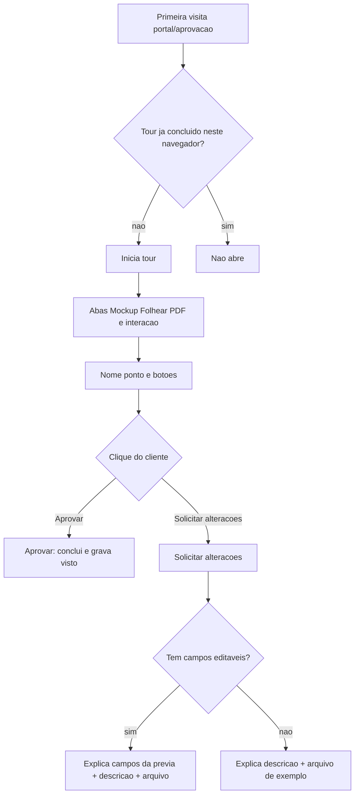

# Tutorial automático no portal de aprovação

## Contexto

[`PortalAprovacaoPage`](apps/web/src/features/portal/PortalAprovacaoPage.tsx) usa [`ClienteProofPage`](apps/web/src/features/cliente/components/proof/ClienteProofPage.tsx) com `publicPortal`. O overlay de tour está só em [`AppShell`](apps/web/src/components/layout/AppShell.tsx); o portal usa [`PortalLayout`](apps/web/src/components/portal/PortalLayout.tsx) **sem** overlay.

Visualizações reais:

- **Prova WEB:** abas Mockup 3D / Folhear / PDF em [`ProvaWebViewerShell`](apps/web/src/features/prova-web/ProvaWebViewerShell.tsx) (abas podem faltar).
- **Papelaria:** PDF + mockup 3D lado a lado (sem Folhear).
- **Demais:** só PDF.

Após **Solicitar alterações**: papelaria com `campos_formulario` entra em edição + [`ClienteProofAlteracoesDescriptionForm`](apps/web/src/features/cliente/components/proof/ClienteProofPortalExtras.tsx) (texto + arquivo de exemplo); sem campos ou não-papelaria, só o formulário de descrição.

Não entra no submenu Ajuda (catálogo interno). Só `publicPortal`.

## 1. Motor: complete vs Sair, overlay no portal

Em [`tourStore.ts`](apps/web/src/features/guided-tour/tourStore.ts):

- `stop()` continua sendo Sair/Esc — **não** marca visto.
- `complete()` (e `next()` além do último passo) chama `complete()` — marca visto.
- Persistência em [`tourSeen.ts`](apps/web/src/features/guided-tour/tourSeen.ts): `localStorage` chave `sagra.tour.portal-aprovacao.seen`.

Montar [`GuidedTourOverlay`](apps/web/src/features/guided-tour/components/GuidedTourOverlay.tsx) em [`PortalLayout`](apps/web/src/components/portal/PortalLayout.tsx).

No overlay, no passo de escolha: se o cliente clicar **Aprovar**, chamar `complete()` (não avançar para os passos de alterações).

## 2. Tour `portal-aprovacao`

Arquivo [`tours/portalAprovacao.ts`](apps/web/src/features/guided-tour/tours/portalAprovacao.ts), registrado em [`catalog.ts`](apps/web/src/features/guided-tour/catalog.ts) via `getTour`, **fora** de `TOUR_CATALOG`.

Passos (alvos ausentes são pulados, como no tour de andamentos):

1. Intro central — prova real; pode girar o mockup e responder.
2. Barra de abas (`proof-viewer-tabs`) — Mockup, Folhear e PDF. **Próximo**.
3. Mockup (`proof-tab-mockup` ou palco `proof-mockup-stage`) — arrastar/girar/abrir. **Próximo** (não exigir gesto 3D).
4. Folhear (`proof-tab-folhear`) — skip se não houver.
5. PDF (`proof-tab-pdf` ou `proof-pdf-viewer`) — skip se não houver.
6. Nome (`proof-field-nome`) — espera valor.
7. Ponto (`proof-field-ponto`) — espera valor (libera os botões).
8. Botões (`proof-actions-buttons`) — espera clique. **Aprovar** → `complete()`. **Solicitar alterações** → avança.
9a. Com campos (`proof-editable-fields`): prévia, alterar dados, ver atualização. **Próximo**. Skip se `data-tour-editable-fields != "true"`.
9b. Sem campos (`proof-alteracoes-texto`): descrever no texto. **Próximo**. Skip se houver campos (já explicado em 9a como extra).
10. Arquivo de exemplo (`proof-example-file`) — botão “Arquivo de exemplo”. **Próximo**.
11. Fim — **Concluir** (`complete()`).

9a+9b: com campos, o passo 9a explica os inputs da prévia e menciona o texto à esquerda para o que não estiver nos campos; 9b é pulado. Sem campos, 9a é pulado e 9b explica só a descrição.

## 3. Âncoras e auto-start

`data-tour` mínimo:

- [`ProvaWebViewerShell`](apps/web/src/features/prova-web/ProvaWebViewerShell.tsx): barra e cada `TabButton`.
- [`ClienteProofMockupPanel`](apps/web/src/features/cliente/components/proof/ClienteProofMockupPanel.tsx) / palco 3D: `proof-mockup-stage`.
- [`ClienteProofViewer`](apps/web/src/features/cliente/components/proof/ClienteProofViewer.tsx): `proof-pdf-viewer`.
- [`ClienteProofActions`](apps/web/src/features/cliente/components/proof/ClienteProofActions.tsx): nome, ponto, grupo dos dois botões, `proof-approve` / `proof-reject`.
- Página: `data-tour-alteracoes`, `data-tour-editable-fields`, `data-tour-approve-modal`.
- Formulário de alterações e botão de arquivo em [`ClienteProofPortalExtras`](apps/web/src/features/cliente/components/proof/ClienteProofPortalExtras.tsx).
- Painel de campos em [`ClienteProofPapelariaEditPanel`](apps/web/src/features/cliente/components/proof/ClienteProofPapelariaEditPanel.tsx) ou wrapper em `ClienteProofPage`.

Auto-start só em `publicPortal`, depois do load com sucesso, se `!hasSeenPortalAprovacaoTour()` e a prova ainda está pendente (`!done`).

## 4. Testes

- `tourSeen`: não visto; `complete` grava; `stop` não grava.
- Catálogo: `getTour("portal-aprovacao")` existe; **não** aparece em `TOUR_CATALOG`.
- `waitUntil` / `shouldSkip`: campos vazios não avançam; passo de campos editáveis pulado sem `data-tour-editable-fields`; passo de texto pulado com campos.
- Overlay: clique em Aprovar no passo de escolha chama `complete` (teste do helper, não E2E 3D).

Verificação: testes Vitest focados. Sem browser tools nesta sessão, o fluxo visual fica para conferência manual em `/portal/aprovacao/...` (primeira visita, Sair e recarregar, concluir, Aprovar, Solicitar alterações com/sem campos).
