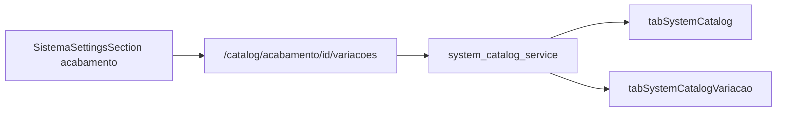

# Variações no cadastro de acabamentos

## Escopo

- **Inclui:** CRUD de variações por item da categoria `acabamento` em Admin → Configurações → Sistema.
- **Fora:** formulário da OS (Gerência) continua com `DescAcabamento` em texto livre; catálogo de acabamento segue “preparação / uso futuro” operacional.

## Modelo de dados

Nova tabela MySQL `tabSystemCatalogVariacao`, criada em [`app/backend/system_catalog_schema.py`](app/backend/system_catalog_schema.py) via `ensure_system_catalog_schema()` (mesmo padrão de `CREATE TABLE IF NOT EXISTS` do catálogo):

- `ID`, `CatalogID` (FK → `tabSystemCatalog.ID` **ON DELETE CASCADE**), `Rotulo`, `Ativo`, `Ordem`, timestamps, `AtualizadoPorPonto`
- `UNIQUE (CatalogID, Rotulo)`
- Índice em `CatalogID`

Variações só fazem sentido para itens com `Categoria = 'acabamento'`; a API valida isso.

Seed opcional e idempotente: para o rótulo **Laminação**, inserir `fosca` e `brilho` com `INSERT IGNORE` (alinha ao exemplo do pedido).

## Backend

Estender [`app/backend/services/system_catalog_service.py`](app/backend/services/system_catalog_service.py):

- `list_variacoes(catalog_id)`, `create_variacao`, `set_variacao_active`, `delete_variacao` (espelhando o estilo do CRUD de itens: normalizar rótulo, unicidade, ponto do usuário)
- Em `list_catalog_items("acabamento")`, incluir `variacoes_count` (e opcionalmente lista resumida) para a UI mostrar badge sem N+1 pesado — preferir um `LEFT JOIN` / subquery por item

Rotas em [`app/backend/routers/admin_system_routes.py`](app/backend/routers/admin_system_routes.py) (mesma auth `require_admin_config_access`):

| Método | Rota |
|--------|------|
| GET | `/api/admin/system/catalog/acabamento/{item_id}/variacoes` |
| POST | idem — body `{ label, ordem? }` |
| POST | `.../variacoes/{variacao_id}/activate` / `deactivate` |
| DELETE ou POST `.../delete` | `.../variacoes/{variacao_id}` |

Rejeitar com 400 se o `item_id` não for da categoria `acabamento`.

Atualizar descrição da categoria em `VALID_CATEGORIES["acabamento"]` para mencionar variações.

Testes em [`app/backend/tests/test_system_catalog_service.py`](app/backend/tests/test_system_catalog_service.py): create/list/toggle/delete variação; rejeitar item que não é acabamento; cascade implícito ao deletar pai (mock ou assert do SQL).

## Frontend

Tipos em [`apps/web/src/features/configuracoes/types.ts`](apps/web/src/features/configuracoes/types.ts): `SystemCatalogVariacao`, campo opcional `variacoes_count` no item.

Cliente em [`apps/web/src/api/adminSystem.ts`](apps/web/src/api/adminSystem.ts): funções espelhando as rotas acima.

UI em [`apps/web/src/features/configuracoes/components/SistemaSettingsSection.tsx`](apps/web/src/features/configuracoes/components/SistemaSettingsSection.tsx):

- Só quando `activeCategory === "acabamento"`: cada linha expansível (“Variações”)
- Painel expandido: lista (ativo/inativo + excluir) + input “Nova variação…” + Incluir
- Acabamentos sem variações continuam válidos (lista vazia)
- Demais categorias: UI inalterada

## Critérios de aceite

1. Em Acabamentos, expandir “Laminação” (ou outro item) e incluir/remover/ativar/desativar “fosca” e “brilho”.
2. Variação duplicada no mesmo acabamento é rejeitada; mesmo rótulo em acabamentos diferentes é permitido.
3. Excluir um acabamento remove as variações filhas (CASCADE).
4. Outras listas do Sistema não ganham UI de variação.
5. Gerência / OS não mudam neste entrega.
