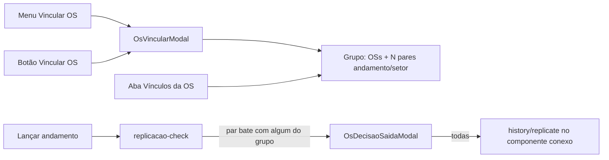

# Vínculos com vários andamentos e aba na gerência

## Situação atual

O grupo em [`tabOSVinculoGrupos`](app/backend/os_vinculo_grupo_schema.py) guarda **um** par `situacao`+`setor`. O modal [`OsVincularModal.tsx`](apps/web/src/features/os/components/OsVincularModal.tsx) trava esses campos depois da primeira definição. [`check_replicacao_andamento`](app/backend/services/os_vinculo_grupo_service.py) só pergunta se o lançamento bate exatamente com esse par.

Não existe aba de vínculos em [`OsGerenciaDetailModal.tsx`](apps/web/src/features/os/components/OsGerenciaDetailModal.tsx); **Duplicar OS** fica no rodapé. A replicação em `replicate_history` usa só vizinhos diretos em `tabOSVinculadas`, enquanto o diálogo lista o **componente conexo** — isso será alinhado.



## Modelo de dados

Nova tabela filha, criada no startup (mesmo padrão de `ensure_os_vinculo_grupo_schema`) e em [`deploy/sql/`](deploy/sql/):

```sql
CREATE TABLE IF NOT EXISTS tabOSVinculoGrupoAndamentos (
  id INT AUTO_INCREMENT PRIMARY KEY,
  grupo_id INT NOT NULL,
  situacao VARCHAR(120) NOT NULL,
  setor VARCHAR(80) NOT NULL,
  criado_em DATETIME NOT NULL DEFAULT CURRENT_TIMESTAMP,
  UNIQUE KEY unique_grupo_andamento (grupo_id, situacao, setor),
  INDEX idx_vinculo_grupo_andamentos_grupo (grupo_id)
)
```

- Backfill: cada linha existente de `tabOSVinculoGrupos` vira um par na filha.
- Colunas `situacao`/`setor` no pai **permanecem** (compatibilidade expand/migrate): sempre sincronizadas com o **primeiro** par da lista. Não dropar nesta entrega.
- Deduplicação: collation `utf8mb4_unicode_ci` + unique; a API também normaliza trim/casefold antes de gravar.

## Backend

Arquivos: [`os_vinculo_grupo_schema.py`](app/backend/os_vinculo_grupo_schema.py), [`os_vinculo_grupo_service.py`](app/backend/services/os_vinculo_grupo_service.py), [`schemas/os.py`](app/backend/schemas/os.py), [`os_routes.py`](app/backend/routers/os_routes.py).

Contrato:

- `VinculoGrupoAndamento { situacao, setor }`
- `VinculoGrupoConfigResponse` e `VinculoReplicacaoCheckResponse` passam a incluir `andamentos: list` (além de `situacao`/`setor` do primeiro par, para clientes antigos).
- `VinculoRequest` aceita `andamentos: list` opcional; `situacao`+`setor` continuam válidos como atalho de um único par.

Regras em `os_vinculo_grupo_service.py`:

- **Criar grupo:** exige **pelo menos um** par; grava pai + filha.
- **Adicionar OS a grupo existente:** não sobrescreve a lista de andamentos.
- **Unir dois grupos:** união dos pares (dedupe); apaga o grupo absorvido e seus andamentos.
- **`check_replicacao_andamento`:** confirma se `(situacao, setor)` lançado casa com **qualquer** par da lista (mesmo match casefold de hoje).
- **Atualizar lista:** `replace_grupo_andamentos(grupo_id, pares)` — exige ≥1 par; sincroniza colunas do pai.
- **`replicate_history` (alvo `vinculo`):** alvos = `get_connected_os_members`, não só arestas diretas.

Novo endpoint:

- `PUT /os/{ano}/{id}/vinculo/grupo-andamentos` com `{ andamentos: [{situacao, setor}] }` — exige `grupo_id` (OS já vinculada); permissão igual à de vincular.

`POST /os/{ano}/{id}/vincular`: se nenhum lado tem grupo, exige a lista (ou o par legado); grava todos os pares na criação.

## Frontend — editor compartilhado

Extrair o formulário de [`OsVincularModal.tsx`](apps/web/src/features/os/components/OsVincularModal.tsx) para um editor reutilizável (ex.: `OsVinculosEditor`), usado pelo modal **e** pela aba.

Comportamento do editor:

- Lista editável de pares **Andamento** + **Setor** (selects de `useSituacoesLookup` / `useSetoresLookup`), com adicionar / remover / alterar.
- Campos **não** ficam somente-leitura após o primeiro vínculo.
- Seção de OSs: número/ano + Salvar; lista com remover (fluxo atual).
- Grupo novo: pares vão no `POST /vincular` junto com a primeira OS.
- Grupo existente: alteração de pares chama o `PUT`; inclusão/remoção de OS continua nos endpoints atuais.
- Validação: pelo menos um par; sem duplicata andamento+setor; OS alvo existente e distinta.

O modal de contexto mantém `data-testid="os-vincular-root"`. Subir z-index para `z-[10004]` para empilhar sobre `os-gerencia-root` (`z-[10002]`).

## Modal de gerência (`os-gerencia-root`)

Em [`OsGerenciaDetailModal.tsx`](apps/web/src/features/os/components/OsGerenciaDetailModal.tsx):

1. **Botão "Vincular OS"** no rodapé, imediatamente após **Duplicar OS**, com `ctx_vincular_os`, apenas em OS existente (`showComposeActions` / `!composing`). Dispara o mesmo `sagra:os-vincular` do menu em [`OsContextMenu.tsx`](apps/web/src/features/os/components/OsContextMenu.tsx). Test id: `os-gerencia-vincular`.
2. **Aba "Vínculos da OS"** (mesmo padrão da aba Histórico): visível só se `mode.kind === "existing"` **e** a OS tiver pelo menos um vínculo (`GET /vinculos`). Conteúdo: o mesmo editor (membros + pares), independente do modo Editar da ficha. Sem `ctx_vincular_os`, a aba permanece visível em somente leitura.

A aba **não** entra em `GERENCIA_MODAL_SECTIONS` (isso afetaria a página de gerência); fica só no `navSections` do modal, como `historico`.

## Replicação ao lançar

Nenhuma mudança de UI em [`OsDecisaoSaidaModal.tsx`](apps/web/src/features/os/components/OsDecisaoSaidaModal.tsx) além de continuar mostrando o par **lançado**. O check passa a disparar para qualquer par cadastrado no grupo, em qualquer OS membro.

Juntada de gravação permanece com prioridade sobre vínculo (comportamento atual).

## Testes

Backend (`app/backend/tests/test_os_vinculo_grupo.py`, novo):

- Match de replicação com vários pares; não-match não pede confirmação.
- União de listas ao juntar grupos.
- `PUT` substitui a lista e rejeita lista vazia.
- Backfill/leitura: grupo legado de uma coluna vira um item em `andamentos`.

Frontend:

- Editor: dá para adicionar dois pares; não trava após grupo definido.
- Gerência: botão ao lado de Duplicar; aba entra no nav quando há vínculo e não entra quando não há.
- Ajuste pontual em [`GerenciaFormGrid.test.tsx`](apps/web/src/features/gerencia/components/GerenciaFormGrid.test.tsx) só se o array canônico mudar (não deve).

Rodar `pnpm test:backend` (arquivo novo + `test_gravacao_pendente_juntada.py`) e `pnpm test:frontend` nos testes tocados.

## Fora de escopo

- Tablet/mobile (já não passam pelo `replicacao-check`).
- Sub-OS.
- Dropar colunas `situacao`/`setor` do pai.
