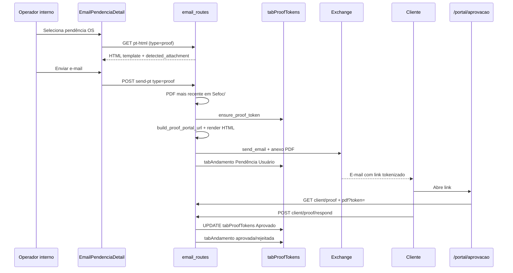
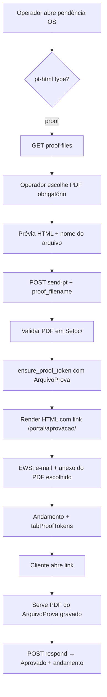

# Auditoria técnica — Envio de e-mail de prova com link tokenizado

**Data:** 08/06/2026  
**Escopo:** Análise do código existente (sem alterações) para implementar envio obrigatório de prova com PDF escolhido pelo usuário interno e link público tokenizado.  
**Repositório:** SAGRA Web (`C:\dev\SagraWeb`)

---

## 1. Resumo executivo

O SAGRA Web **já possui a maior parte da infraestrutura** de envio de e-mail de prova, geração de token, link no corpo do e-mail e portal público de aprovação. O fluxo atual cobre:

- Página interna de e-mail (`/email`) com aba **Pendências** para envio de PT ou prova.
- Backend `POST /api/email/send-pt` com ramo `type === "proof"`: template HTML, anexo PDF, token em `tabProofTokens`, link `{{link}}` no e-mail, andamento e envio via **EWS**.
- Portal público **`/portal/aprovacao/{token}?os=&ano=`** reutilizando `ClienteProofPage` (visualização PDF + aprovação/rejeição).
- Portal autenticado **`/cliente/os/{ano}/{nrOs}/prova`** via bridge que reutiliza o mesmo token/endpoints.

**Lacuna principal em relação ao objetivo desta etapa:** o operador **não escolhe** qual PDF é a prova. O sistema usa heurística **“PDF mais recente em `{pasta_os}/Sefoc/*.pdf`”** tanto no envio (anexo) quanto na visualização pública. Não há campo estruturado em banco ligando token ↔ arquivo escolhido.

**Recomendação:** evoluir o fluxo existente (não recriar do zero). A implementação mínima segura exige: (1) listagem/seleção de PDFs na UI de e-mail; (2) parâmetro `proof_filename` (ou similar) no `send-pt`; (3) coluna `ArquivoProva` (ou equivalente) em `tabProofTokens`; (4) servir PDF pelo token usando o arquivo gravado, não `_latest_proof_pdf`.

**Rota pública correta hoje:** `/portal/aprovacao/{token}` — **não** `/portal/prova/{token}` (esta última é comprovante read-only de Problemas Técnicos).

---

## 2. Como a página de e-mail funciona hoje

### 2.1 Componente principal

| Item | Detalhe |
|------|---------|
| Rota autenticada | `apps/web/src/routes/_authenticated/email.tsx` → lazy `EmailPage` |
| Permissão | `AuthGuard` com `requiredPermission="sb_email"` |
| Componente raiz | `apps/web/src/features/email/components/EmailPage.tsx` |

`EmailPage` organiza duas abas via `EmailNav`:

- **Inbox** — e-mails não lidos do Exchange (`EmailInboxDetail`).
- **Pendências** — OS com andamento `Encam. de Docum.` (`EmailPendenciaDetail`) — **é aqui que ocorre o envio de prova/PT**.

### 2.2 Como o usuário seleciona o tipo de e-mail

Não há dropdown explícito “tipo de e-mail”. O tipo é **inferido automaticamente** pelo endpoint de prévia:

```
GET /api/email/pt-html/{ano}/{os}
```

- Se existir `RelatorioEmail` ou `RelatorioHTML` em `tabAnalises` → `type: "pt"` (Problemas Técnicos).
- Caso contrário → `type: "proof"` (envio de prova), com template `proof_os` ou `proof_sp`.

O frontend repassa `type` no payload de envio:

```typescript
// EmailPendenciaDetail.tsx
type: emailType  // "pt" | "proof"
```

### 2.3 Como o sistema identifica e-mail de prova

1. **Frontend:** `ptQuery.data?.type === "proof"` exibe banner “Modo: Envio de Prova” e nome do anexo detectado.
2. **Backend:** `EmailPTRequest.type == "proof"` em `send_pt_email` (`email_routes.py`).

Critério de negócio implícito: OS **sem** relatório de análise salvo no banco é tratada como envio de prova direta.

### 2.4 Campos existentes hoje (formulário de envio)

Em `EmailPendenciaDetail.tsx`:

| Campo | Editável | Origem |
|-------|----------|--------|
| Nr OS / Ano | Não (readonly) | Pendência selecionada |
| Versão | Sim | Pré-preenchida de `pt-html`; usuário pode alterar |
| Solicitante | Não | `GET /aux/protocolo/buscar` |
| E-mail Dep / Gab / Contato | Sim | Deputado (`/aux/deputado/emails`) ou contato do protocolo |
| Prévia HTML | Não (somente leitura) | `EmailHtmlViewer` |
| **Arquivo PDF da prova** | **Não existe seletor** | Backend escolhe o mais recente |

### 2.5 Seleção de anexos / arquivos da OS

- **Anexos de e-mail recebido (inbox):** listados em `InboxEmail.attachments`; download via `GET /api/email/download?entry_id=&att_index=`.
- **Anexos de envio (pendência):** não há UI de seleção. Para prova, o backend anexa automaticamente um PDF de `Sefoc/`.
- **Arquivos da OS:** não há integração na página de e-mail com listagem de arquivos. Existe endpoint genérico `GET /api/files/list?path=` (analise_routes), mas exige caminho absoluto e **não é usado** pelo módulo de e-mail.

### 2.6 Montagem do corpo do e-mail

| Tipo | Onde o HTML é montado |
|------|------------------------|
| PT | Salvo previamente em `tabAnalises.RelatorioEmail` (gerado na análise) |
| Prova | Template configurável `proof_os` / `proof_sp` via `email_template_service.get_rendered_html` |

Variáveis de prova no envio real (`email_routes.py`): `nr_os`, `ano`, `versao`, `produto`, `solicitante`, **`link`**, `jobname`, `ordernumber`.

Template legado (`email_prova.html` / presets Outlook) usa `href="{{link}}"` para botão de acesso.

### 2.7 Edição do corpo antes de enviar

**Não.** O operador só visualiza a prévia. Não há editor WYSIWYG nem campo `html` no `POST /email/send-pt`.

### 2.8 Link no corpo — frontend ou backend?

**100% backend**, no momento do envio (`type == "proof"`):

1. `ensure_proof_token(os, ano, versao)` → `tabProofTokens`
2. `build_proof_portal_url(os, ano, token)` → URL absoluta
3. `get_rendered_html(..., { link: proof_link, ... })`

O frontend **não** monta nem insere o link.

---

## 3. Como o envio de e-mail funciona hoje

### 3.1 Endpoints relevantes

| Método | Endpoint | Função |
|--------|----------|--------|
| GET | `/api/email/inbox` | Sincroniza Exchange (EWS) |
| GET | `/api/email/pendencias` | Lista OS pendentes de envio |
| GET | `/api/email/pt-html/{ano}/{os}` | Prévia HTML + tipo pt/proof |
| POST | `/api/email/send-pt` | **Envio principal** PT ou prova |
| POST | `/api/email/send` | Envio genérico (subject + html) — não usado pela UI de pendências |
| POST | `/api/email/andamento` | Andamento manual a partir do inbox |
| POST | `/api/email/save-mht` | Salva e-mail recebido como `.mht` em `Sefoc/` |
| GET | `/api/email/download` | Download de anexo EWS |

Autenticação: sessão interna (`require_session`) em todas as rotas acima.

### 3.2 Diferenciação prova vs PT

Campo `type` em `EmailPTRequest`:

```python
type: str = "pt"  # pt | proof | reply (reply parcialmente tratado)
```

Ramo `proof` em `send_pt_email`:

- Template e assunto via `proof_template_id(os)` (`proof_os` se OS < 5000, `proof_sp` se ≥ 5000).
- PDF: `max(pdfs, key=mtime)` em `{os_path}/Sefoc/*.pdf`.
- Versão: `str(len(pdfs))` — quantidade de PDFs na pasta, **não** necessariamente o campo “Versão” digitado pelo usuário.
- Token + link no HTML.
- Pasta de saída EWS: `"Saida de Provas"` (PT usa `"Saida de Prob. Tec."`).

### 3.3 Anexos

- Lidos do filesystem (`open(pdf_path, "rb")`).
- Enviados como tuplas `(filename, bytes)` para `EWSService.send_email`.
- Resposta inclui `attachments: [basename, ...]`.

### 3.4 Serviço de e-mail

**EWS (Exchange Web Services)** via `services/ews_service.py`. Não há SMTP direto na rota de pendências.

Remetente:

- OS < 5000 → `sepim.deapa@camara.leg.br` (configurável)
- OS ≥ 5000 → `papelaria.deapa@camara.leg.br`

Credenciais/config por ponto do operador (`email_config_service`).

### 3.5 Registro pós-envio

Após envio bem-sucedido:

1. **Andamento** em `tabAndamento`: situação `Pendência Usuário`, setor `SEFOC`, obs `Prova v{versao} enviada por e-mail` (ou `PTV{versao} enviado`).
2. **Auditoria** via `log_andamento_added(..., origem="EMAIL")`.
3. **Sync MDB** opcional se `config_manager.is_mdb_write_enabled()`.
4. **Não** grava cópia do e-mail enviado em tabela dedicada (apenas cópia na pasta Exchange de saída, se configurada).

### 3.6 Gravação do e-mail em banco

Não há tabela de “e-mails enviados”. O HTML de PT fica em `tabAnalises`; o HTML de prova é renderizado on-the-fly a partir de templates (`tabEmailTemplateConfig` / presets).

---

## 4. Como os arquivos da OS são localizados hoje

### 4.1 Estrutura de pastas na rede

Helper duplicado em `email_routes._get_os_folder_path` e `os_routes._get_os_folder_path`:

| Condição | Base |
|----------|------|
| OS < 5000 | `\\redecamara\DfsData\CGraf\Sefoc\Deputados\{ano}\Deputados_{ano}\{id:05d}*` |
| OS ≥ 5000 | `\\redecamara\DfsData\CGraf\Sefoc\Deputados\{ano}\Deputados_Papelaria_{ano}\{id:05d}*` |

Glob `{id:05d}*` permite sufixo no nome da pasta (ex.: solicitante).

**Fallback local (dev):** `storage_test/{ano}/{id}` se UNC indisponível.

Subpastas padrão incluem **`Sefoc`** (PDFs de prova e `.mht` de e-mails salvos).

### 4.2 Listagem de arquivos

| Mecanismo | Endpoint | Uso atual |
|-----------|----------|-----------|
| Genérico | `GET /api/files/list?path=` | Análise/outros; valida path via `security/file_access.resolve_allowed_directory` |
| Servir arquivo | `GET /api/files/serve?filepath=` | Mesma validação de roots |
| Prova pública | `GET /api/client/proof/{ano}/{os_id}/pdf?token=` | **Não** usa `/files/serve`; resolve PDF internamente |

**Não existe** endpoint dedicado `GET /api/email/os/{ano}/{os}/proof-pdfs` ou similar.

### 4.3 Vínculo OS ↔ prova enviada

| O que existe | O que falta |
|--------------|-------------|
| `tabProofTokens`: token, OS, ano, versão (string), resposta do cliente | Nome/caminho/hash do PDF escolhido |
| Andamento textual “Prova vX enviada por e-mail” | Referência ao arquivo específico |
| Anexo no e-mail (cópia física enviada ao cliente) | Garantia de que portal exibe o **mesmo** arquivo |

### 4.4 Identificação segura do PDF correto

**Hoje:** inseguro para múltiplas versões — `_latest_proof_pdf` usa `max(mtime)`.

**Necessário para o objetivo:** persistir **nome relativo** (ex.: `Sefoc/prova_v2.pdf`) ou hash no token no momento do envio; validar no serve/respond.

---

## 5. Como provas/aprovação funcionam hoje

### 5.1 Fluxo completo (estado atual)



### 5.2 Portal público de aprovação

| Item | Valor |
|------|-------|
| Rota SPA | `/portal/aprovacao/$token` → `PortalAprovacaoPage` → `ClienteProofPage` |
| Query | `?os={nr}&ano={ano}` |
| API dados | `GET /api/client/proof/{ano}/{os_id}?token=` |
| API PDF | `GET /api/client/proof/{ano}/{os_id}/pdf?token=` |
| API resposta | `POST /api/client/proof/respond` |

Campos de resposta: `nome_cliente`, `ponto`, `observacao` (obrigatória se rejeição), `aprovado`.

### 5.3 Portal autenticado

| Item | Valor |
|------|-------|
| Rota | `/cliente/os/$ano/$nrOs/prova` |
| Bridge | `ClienteProofBridgePage` — obtém token de `pendencia_url` no dashboard |
| UI | Mesmo `ClienteProofPage` com `embedded=true` |

Conciliação: dashboard monta `pendencia_url` com token ativo de `tabProofTokens` (`cliente_gabinete_routes._batch_fetch_proof_tokens`). Link público do e-mail e botão autenticado **compartilham o mesmo token** enquanto `Aprovado IS NULL`.

### 5.4 Confusão de rotas — `/portal/prova`

`/portal/prova/$token` renderiza `PortalProvaPage` — **comprovante read-only de Problemas Técnicos** (`fetchClientAnalysis`), **não** aprovação de prova PDF.

Documentação antiga (`MANUAL_COMPLETO_SAGRA_WEB.md`) mistura rotas; implementação correta de prova usa **`/portal/aprovacao`**.

---

## 6. O que já existe e pode ser reaproveitado

| Área | Artefato | Reaproveitamento |
|------|----------|------------------|
| UI envio e-mail | `EmailPendenciaDetail` | Adicionar seletor de PDF quando `type === "proof"` |
| API envio | `POST /email/send-pt` | Estender payload com `proof_filename` |
| Token | `ensure_proof_token`, `tabProofTokens` | Adicionar coluna de arquivo; ajustar lógica de reuso |
| Link | `build_proof_portal_url` | Manter rota `/portal/aprovacao` |
| Template e-mail | `proof_os`, `proof_sp`, `{{link}}` | Já suporta link; incluir `link` em `html_variables` na documentação de templates |
| Portal público | `ClienteProofPage`, `proof-portal.ts` | Sem mudança estrutural se backend servir PDF correto |
| Portal autenticado | `ClienteProofBridgePage` | Continua válido |
| Segurança path | `security/file_access.py` | Validar filename dentro de `{os}/Sefoc/` |
| Andamento | `_register_proof_andamento` | Manter; opcionalmente citar nome do arquivo na obs |
| Testes | `test_public_tokens.py` | Estender para arquivo vinculado |
| Referência PT | `tabClientTokens`, `/portal/pt/{token}` | Padrão de URL + query; **não** reutilizar tabela para prova |

---

## 7. O que não existe e precisa ser criado

| # | Item | Prioridade |
|---|------|------------|
| 1 | **Seletor obrigatório de PDF** na UI de e-mail (modo prova) | Alta |
| 2 | **Endpoint** listar PDFs da OS em `Sefoc/` (sem expor UNC ao browser) | Alta |
| 3 | Campo **`ArquivoProva`** (VARCHAR) em `tabProofTokens` | Alta |
| 4 | Backend: validar filename, gravar no token, servir PDF fixo | Alta |
| 5 | Invalidar/reemitir token ao enviar **nova** versão de prova (política a definir) | Média |
| 6 | Alinhar **versão** digitada pelo operador com versão do token (hoje diverge) | Média |
| 7 | Prévia do e-mail mostrando link **antes** do envio (opcional) | Baixa |
| 8 | Registro de operador que enviou (`PontoEnvio` em token ou andamento) | Baixa |
| 9 | Rota `/portal/prova` para aprovação — **não recomendado** (colide com PT) | N/A |

---

## 8. Proposta de rotas frontend

### 8.1 Rotas existentes (manter)

| Rota | Papel |
|------|-------|
| `/_authenticated/email` | Página interna de e-mail |
| `/portal/aprovacao/$token?os=&ano=` | **Aprovação pública de prova** (link do e-mail) |
| `/cliente/os/$ano/$nrOs/prova` | Aprovação autenticada |
| `/portal/prova/$token` | Comprovante PT (não alterar sem impacto) |

### 8.2 Alterações propostas (somente módulo e-mail)

Nenhuma rota nova obrigatória. Alterações em:

- `EmailPendenciaDetail.tsx` — bloco “Arquivo da prova” com `<select>` ou lista radio.
- `apps/web/src/api/email.ts` — tipos e payload `proof_filename?: string`.
- Opcional: hook `useOsProofPdfs(ano, os)` → novo endpoint backend.

### 8.3 Rota sugerida pelo enunciado vs realidade

Enunciado sugeriu `/portal/prova/{token}?os=&ano=`. **No código atual**, essa rota já existe com **outro propósito**. Recomenda-se **não** migrar aprovação para lá; manter `/portal/aprovacao/{token}` documentado e usado no e-mail.

---

## 9. Proposta de endpoints backend

### 9.1 Endpoints existentes (reutilizar)

| Endpoint | Ajuste necessário |
|----------|-------------------|
| `POST /api/email/send-pt` | Aceitar `proof_filename`; obrigatório se `type=proof`; validar existência |
| `GET /api/email/pt-html/{ano}/{os}` | Retornar `available_pdfs: string[]` e `selected_pdf` sugerido |
| `GET /api/client/proof/{ano}/{os_id}` | Incluir `arquivo` (nome) nos metadados |
| `GET /api/client/proof/{ano}/{os_id}/pdf` | Servir arquivo de `tabProofTokens.ArquivoProva`, não latest |
| `POST /api/client/proof/respond` | Sem mudança estrutural |

### 9.2 Endpoint novo recomendado

```
GET /api/email/os/{ano}/{os}/proof-files
```

**Resposta:**

```json
{
  "os": 1234,
  "ano": 2026,
  "sefoc_path_hint": "Sefoc/",
  "files": [
    { "name": "1234_2026_prova_v1.pdf", "size": 1048576, "modified_at": "2026-06-08T10:00:00" }
  ],
  "suggested": "1234_2026_prova_v1.pdf"
}
```

**Regras:**

- Sessão interna obrigatória.
- Lista apenas `*.pdf` em `{os_folder}/Sefoc/`.
- **Nunca** retornar caminho UNC completo ao cliente — apenas `name`.
- Resolução física no servidor com `_get_os_folder_path` + `os.path.join(sefoc, basename)`.

Alternativa: reutilizar `/api/files/list` passando path calculado no backend via endpoint wrapper (evita expor path no frontend).

### 9.3 Geração de token

Manter `ensure_proof_token` em `proof_portal_routes.py`, evoluído para:

```python
def ensure_proof_token(os_id, ano, versao, arquivo_prova: str, ponto_envio: str | None) -> str
```

Política sugerida:

- Se existe token **pendente** (`Aprovado IS NULL`) para mesma OS/ano **e mesmo arquivo** → reutilizar.
- Se arquivo ou versão mudou → invalidar token anterior (`DataExpiracao = NOW()`) e inserir novo registro.

---

## 10. Proposta de persistência em banco

### 10.1 Tabela `tabProofTokens` (existente)

Definição em `cliente_gabinete_schema.py`:

| Coluna | Tipo | Uso atual |
|--------|------|-----------|
| ID | INT PK | — |
| NroProtocolo, AnoProtocolo | INT | OS |
| Versao | VARCHAR(32) | Versão textual |
| Token | VARCHAR(128) UNIQUE | URL |
| DataExpiracao | DATETIME NULL | Expira ao responder; NULL = sem TTL fixo na criação |
| Aprovado | TINYINT NULL | NULL pendente; 1 aprovado; 0 rejeitado |
| Observacao | TEXT | Do cliente |
| DataResposta | DATETIME | — |
| ClienteNome | VARCHAR(255) | — |
| CreatedAt | TIMESTAMP | — |

**Ausente:** `ArquivoProva`, `PontoEnvio`, `DataEnvio`, hash do arquivo.

### 10.2 `tabClientTokens` — reutilizar?

**Não recomendado.** PT e prova têm ciclos de vida diferentes:

- PT: ligado a `ID_Analise`, upload de arquivos, expiração ao concluir envio.
- Prova: ligado a PDF fixo, aprovação binária, andamento SEFOC.

Manter **`tabProofTokens` dedicada**.

### 10.3 Migration mínima sugerida

```sql
ALTER TABLE tabProofTokens
  ADD COLUMN ArquivoProva VARCHAR(512) NULL AFTER Versao,
  ADD COLUMN PontoEnvio VARCHAR(32) NULL AFTER ClienteNome,
  ADD COLUMN DataEnvio DATETIME NULL AFTER CreatedAt;
```

Implementação via `ensure_cliente_gabinete_schema()` (padrão já usado para `TipoConta`).

Índice opcional: `(NroProtocolo, AnoProtocolo, Aprovado, DataExpiracao)`.

### 10.4 Outras tabelas impactadas

| Tabela | Impacto |
|--------|---------|
| `tabAndamento` | Texto de observação pode incluir nome do arquivo |
| `tabEmailTemplateConfig` | Opcional: variável `{{arquivo_prova}}` |
| `tabAnalises` | Nenhum (fluxos separados) |
| `tabProtocolos` | Nenhum direto |

---

## 11. Proposta de fluxo completo (alvo)



**Regras de negócio propostas:**

1. Envio de prova **bloqueado** sem `proof_filename`.
2. Anexo do e-mail = PDF selecionado (mesmo arquivo do portal).
3. Portal serve **sempre** o arquivo do token, não o latest da pasta.
4. Resposta única por token (`Aprovado` preenchido → 409).
5. Token expira ao responder (`DataExpiracao = NOW()` — já implementado).

---

## 12. Riscos técnicos

| Risco | Severidade | Mitigação |
|-------|------------|-----------|
| Quebrar envio de e-mail PT/prova atual | Alta | Feature flag ou ramo isolado; testes em `send-pt` |
| Enviar link sem token | Média | Manter geração atômica antes do EWS; teste de integração |
| Exibir PDF errado (latest vs escolhido) | **Alta (já ocorre hoje)** | Coluna `ArquivoProva` + serve por token |
| Expor caminho físico UNC | Alta | Apenas basename na API; `file_access` no serve |
| Resposta duplicada | Média | Já tratado (409); manter |
| Quebrar Problemas Técnicos | Média | Não tocar `tabClientTokens` / `/portal/pt` |
| Quebrar Portal do Cliente | Média | Bridge depende de token ativo; invalidar tokens com cuidado |
| Acoplamento e-mail ↔ prova | Baixa | Centralizar em `proof_portal_routes` |
| `ensure_proof_token` reutiliza token antigo sem atualizar versão/arquivo | Alta | Política de invalidação na implementação |
| Divergência versão UI vs `len(pdfs)` | Média | Usar versão informada pelo operador como fonte única |
| Múltiplos PDFs na pasta Sefoc | Alta | Seletor obrigatório resolve |
| Template sem `{{link}}` configurado | Média | Validar template efetivo antes do envio |
| Deploy desalinhado (`deploy/release`) | Média | Publicar backend e frontend juntos |

---

## 13. Perguntas pendentes

1. **Nova versão de prova:** ao reenviar, invalidar token anterior automaticamente ou permitir múltiplos tokens pendentes?
2. **Expiração por tempo:** além da expiração ao responder, há TTL (ex.: 30 dias) exigido?
3. **Versão:** o número exibido ao cliente deve ser o digitado pelo operador ou sequencial automático?
4. **PDF fora de `Sefoc/`:** algum caso de prova em outra subpasta?
5. **Anexo no e-mail:** manter PDF anexo **e** link, ou apenas link (reduz tamanho do e-mail)?
6. **Operador no token:** gravar `ponto` de quem enviou em `tabProofTokens.PontoEnvio`?
7. **Prévia com link:** operador precisa ver URL tokenizada antes de enviar?
8. **Homologação:** ambiente de teste usa `storage_test` — validar listagem lá também?
9. **Rota pública:** confirmar oficialmente `/portal/aprovacao` vs renomear para `/portal/prova` (breaking change)?

---

## 14. Plano de implementação recomendado em fases

### Fase 0 — Alinhamento (0,5 dia)

- Responder perguntas pendentes com negócio/SEFOC.
- Confirmar rota pública definitiva (`/portal/aprovacao`).

### Fase 1 — Persistência (1 dia)

- Migration `ArquivoProva`, `PontoEnvio`, `DataEnvio` em `tabProofTokens`.
- Atualizar `ensure_proof_token` e `_validate_proof_token`.
- Testes unitários em `test_public_tokens.py`.

### Fase 2 — Backend listagem e envio (1–2 dias)

- `GET /api/email/os/{ano}/{os}/proof-files`.
- Estender `EmailPTRequest` + validação em `send_pt_email`.
- Gravar arquivo no token; anexar PDF correto; alinhar versão.
- Ajustar `serve_proof_pdf` / metadados para usar `ArquivoProva`.
- Estender `pt-html` com lista de PDFs para a UI.

### Fase 3 — Frontend e-mail (1 dia)

- Seletor obrigatório em `EmailPendenciaDetail` quando `type === "proof"`.
- Bloquear “Enviar” sem seleção.
- Exibir arquivo escolhido na prévia (substituir “detected_attachment” passivo).
- Atualizar `postEmailSendPt` e tipos.

### Fase 4 — Templates e documentação (0,5 dia)

- Garantir `{{link}}` nos templates efetivos `proof_os` / `proof_sp`.
- Opcional: variável `{{arquivo_prova}}` no corpo.

### Fase 5 — QA e regressão (1–2 dias)

- Casos: 1 PDF, N PDFs, reenvio, token respondido, PT inalterado, portal autenticado.
- Testes manuais roteiro homologação.
- `pnpm test:backend`, `pnpm test:frontend`, build.

### Fase 6 — Deploy

- Sincronizar `deploy/release` se aplicável ao processo da equipe.
- Verificar `resolve_link_web_base()` em produção (URL do link no e-mail).

---

## Apêndice A — Respostas às questões obrigatórias (checklist)

### 1. Página de e-mail

| Pergunta | Resposta |
|----------|----------|
| Componente | `EmailPage` → `EmailPendenciaDetail` (pendências) |
| Tipo de e-mail | Inferido por `GET /email/pt-html` (`pt` vs `proof`) |
| Identificação prova | `type === "proof"` (sem HTML de análise no banco) |
| Campos | OS, ano, versão, solicitante, 3 e-mails |
| Seleção anexos | Não (inbox tem download; envio não) |
| Arquivos OS | Não |
| Corpo | Template backend; prévia read-only |
| Editar corpo | Não |
| Link | Backend no `send-pt` |

### 2. Envio backend

| Pergunta | Resposta |
|----------|----------|
| Endpoint | `POST /api/email/send-pt` |
| Diferenciação | `request.type == "proof"` |
| Anexos | PDF filesystem → EWS |
| Serviço | EWS |
| HTML | `email_template_service` + presets |
| Template prova | `proof_os` / `proof_sp` |
| Andamento | Sim — `Pendência Usuário` |
| Gravação e-mail | Não em tabela dedicada |

### 3. Arquivo de prova

| Pergunta | Resposta |
|----------|----------|
| Local | `{pasta_os}/Sefoc/*.pdf` na rede DFS |
| Listar | Não na UI e-mail; `/files/list` genérico existe |
| Endpoint listar OS | **Não dedicado** |
| Baixar/visualizar | Portal: `/client/proof/.../pdf?token=` |
| Arquivo salvo no envio | **Não** (só anexo EWS) |
| Vínculo estruturado | **Não** |
| Identificação segura | **Requer implementação** (`ArquivoProva`) |

### 4. Token

| Pergunta | Resposta |
|----------|----------|
| Tabela prova | `tabProofTokens` — **já existe** |
| Reutilizar `tabClientTokens` | **Não** |
| Diferenciar PT vs prova | Tabelas separadas |
| Expiração | Ao responder; opcional TTL futuro |
| Resposta única | Sim (`Aprovado` → 409) |
| Validar OS/ano/token | `_validate_proof_token(os, ano, token)` |

### 5. Página pública

| Pergunta | Resposta |
|----------|----------|
| Existe | Sim — `/portal/aprovacao/$token` |
| Rota sugerida `/portal/prova` | Já usada para **comprovante PT** |
| Buscar dados | `GET /api/client/proof/{ano}/{os}?token=` |
| Buscar PDF | `GET /api/client/proof/{ano}/{os}/pdf?token=` |
| Registrar resposta | `POST /api/client/proof/respond` |

### 6. Portal autenticado

| Pergunta | Resposta |
|----------|----------|
| Rota `/cliente/os/.../prova` | Sim |
| Deve continuar | Sim |
| Conciliação | Mesmo token via dashboard `pendencia_url` |
| Compartilhar componentes | Sim — `ClienteProofPage` |

### 7. Banco

| Pergunta | Resposta |
|----------|----------|
| Tabelas impactadas | `tabProofTokens` (+ `tabAndamento`) |
| Campos faltantes | `ArquivoProva`, envio, ponto operador |
| Migration | Sim — colunas novas (mínima) |

### 8. Segurança

| Pergunta | Resposta |
|----------|----------|
| Outra OS | Token validado com OS+ano+token juntos |
| Token inválido/expirado | 403 |
| Resposta duplicada | 409 |
| Path físico | FileResponse basename; reforçar com arquivo tokenizado |
| Serve seguro | Endpoint tokenizado (não `/files/serve` público) |
| Validação campos | Pydantic + frontend em `ClienteProofActions` |

### 9–10. Implementação e riscos

Ver seções 8–12 deste documento.

---

## Apêndice B — Arquivos auditados (referência)

**Frontend:** `EmailPage.tsx`, `EmailPendenciaDetail.tsx`, `EmailInboxDetail.tsx`, `email.ts`, `useEmailQueries.ts`, `PortalAprovacaoPage.tsx`, `PortalProvaPage.tsx`, `ClienteProofPage.tsx`, `ClienteProofBridgePage.tsx`, `proof-portal.ts`, `pendenciaBridge.ts`, rotas `email.tsx`, `portal/aprovacao.$token.tsx`, `portal/prova.$token.tsx`, `cliente/.../prova.tsx`.

**Backend:** `email_routes.py`, `email_template_service.py`, `email_presets.py`, `proof_portal_routes.py`, `cliente_gabinete_routes.py`, `cliente_gabinete_schema.py`, `analise_routes.py` (tokens PT, files/list), `os_routes.py`, `security/file_access.py`, `ews_service.py`, `test_public_tokens.py`.

**Templates:** `email_prova.html`, `config/email_templates.json`, presets `legacy_emailProvaOS` / `legacy_emailProvaSP`.

**Documentação existente:** `RELATORIO_IMPLEMENTACAO_PROVA_CLIENTE.md`, `PAGINA_CLIENTE.md`, `EMAIL_EWS_ENVIO_E_MONITORAMENTO.md`.

---

*Documento gerado por auditoria estática do código — nenhuma alteração foi aplicada ao sistema.*
