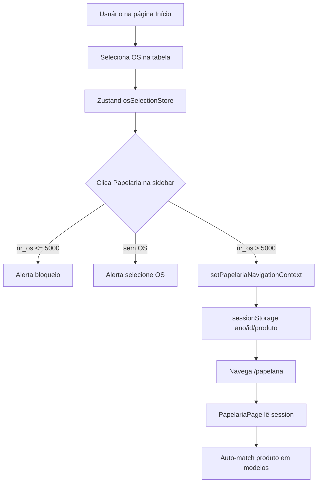
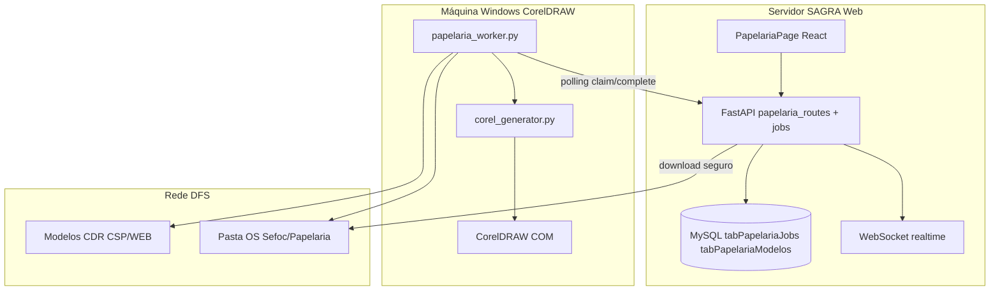
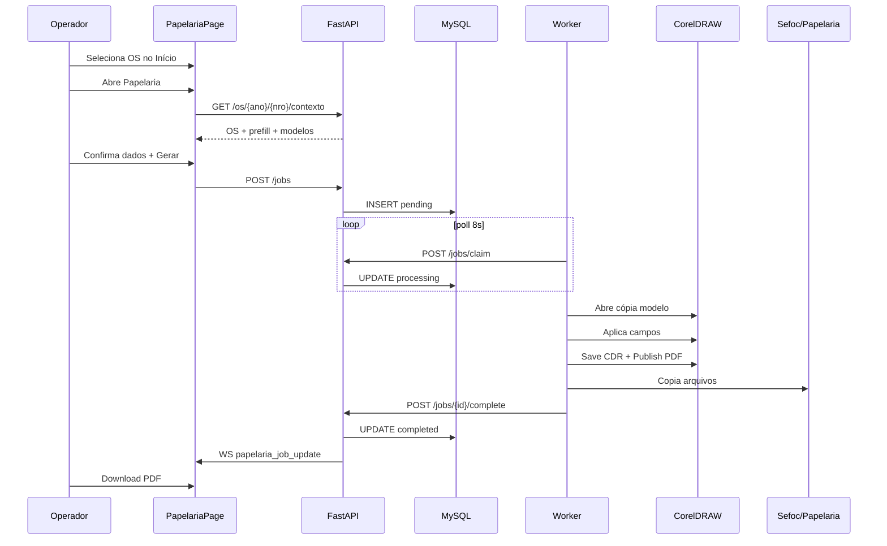

# Auditoria Técnica — Funcionalidade Papelaria CorelDRAW

**Projeto:** SAGRA Web  
**Data:** 10/06/2026  
**Escopo:** Auditoria e proposta de arquitetura (sem implementação)  
**Arquivos base analisados:**

- `Modelos/papelaria/papelaria.py`
- `Modelos/papelaria/papelaria_variacoes_unicas.xlsx`
- `docs/papelaria_variacoes_unicas.csv` (histórico de variações OS)

---

## 1. Resumo executivo

A funcionalidade **Papelaria** do SAGRA Web deve permitir que operadores gerem automaticamente produtos de papelaria no CorelDRAW a partir de modelos `.cdr`, com os arquivos finais salvos na pasta `Sefoc` da OS.

**Situação atual:**

- Existe um **script Python funcional** (`papelaria.py`) que lê a planilha de variações, abre o CorelDRAW via COM, substitui variáveis em objetos nomeados e exporta `.cdr` + `.pdf`.
- O **SAGRA Web já possui** rota `/papelaria`, permissão `sb_papelaria`, aba de cartão SVG madura e aba **Corel/PDF legado parcial**.
- O backend legado (`papelaria_routes.py`) executa **CorelDRAW COM diretamente no servidor** — inviável em produção onde o Corel não está instalado.
- **Não existe** fila de jobs, worker externo nem integração com pasta da OS para geração Corel.

**Arquitetura recomendada:**

1. **Servidor SAGRA Web** — metadados de modelos, contexto da OS, fila de jobs em MySQL, APIs web e worker, download seguro de arquivos.
2. **Máquina Windows dedicada** — worker Python com `pywin32`, CorelDRAW instalado, polling HTTP a cada 5–10 s, processamento **um job por vez**.
3. **Fila em banco** (`tabPapelariaJobs`) — padrão alinhado a `tab_pcp_fila` já existente no projeto.
4. **Modelos `.cdr`** — rede DFS em `\\redecamara\DfsData\CGraf\Sefoc\Laboratorio\Modelos\Modelos Corel\Papelaria\CSP\WEB` (já referenciado no backend).
5. **Saída final** — `{pasta_os}/Sefoc/Papelaria/` com nomenclatura padronizada.

**Próximo passo:** implementação em 10 fases (Fase 0 a Fase 9), detalhadas na seção 27.

---

## 2. Análise do script `papelaria.py`

Arquivo: `Modelos/papelaria/papelaria.py` (730 linhas)

### 2.1 Carregamento da planilha

- Constante `ARQUIVO_PLANILHA = "papelaria_variacoes_unicas.xlsx"`.
- Caminho: mesma pasta do script (`pasta_script()`).
- Biblioteca: `openpyxl.load_workbook(caminho, data_only=True)`.
- Aba: `Variacoes` (`ABA_PLANILHA`).
- Erro explícito se arquivo ausente.

### 2.2 Estrutura esperada na planilha

| Linha | Conteúdo |
|-------|----------|
| 1 | Cabeçalhos gerais: Produto, Frente/Verso, Cores, Arquivo modelo, Campos (colunas dinâmicas) |
| 2 | Nomes dos **objetos CorelDRAW** (campos): `NomeDep`, `Genero`, `PartidoDep`, etc. |
| 3+ | Uma linha por variação de modelo |

Colunas fixas (índice 1-based):

| Col | Campo |
|-----|-------|
| 1 | Produto |
| 2 | Frente/Verso |
| 3 | Cores |
| 4 | Arquivo modelo (`.cdr`) |
| 5+ | Textos modelo por campo Corel (cabeçalho na linha 2) |

Linhas sem `arquivo_modelo` ou sem campos preenchidos são ignoradas.

### 2.3 Identificação de produto

- Coluna 1 (`produto`), texto livre (ex.: `Ct Visita`, `Timbrado A4`).
- Usado na listagem CLI e no nome do arquivo de saída.

### 2.4 Identificação frente/verso

- **Metadado:** coluna 2 (`frente_verso`): `Somente Frente`, `Frente e Verso`.
- **Conteúdo da célula:** formato `Frente:\n{texto}\nVerso:\n{texto}` detectado por `dividir_frente_verso()`.
- Quando Frente/Verso no texto: página 1 = frente, página 2 = verso; páginas extras recebem texto da frente.

### 2.5 Identificação de cores

- Coluna 3 (`cores`): `Policromia`, `Relev Seco`, `Port/Inglês`, etc.
- Entra no nome do arquivo de saída (`nome_saida()`).

### 2.6 Arquivo modelo `.cdr`

- Coluna 4; se não termina em `.cdr`, o script adiciona automaticamente.
- Resolução: `{pasta_script}/{arquivo_modelo}`.
- Geração: **cópia** do modelo (`shutil.copy2`) antes de abrir no Corel (evita `SaveAs` problemático via COM).

### 2.7 Campos CorelDRAW

- Cabeçalhos na **linha 2**, colunas 5+.
- Cada célula de dados (linha do modelo) contém o **texto modelo** com variáveis `{...}`.
- Objetos localizados pelo **nome do shape** (`shape.Name`), não pelo conteúdo do texto.

### 2.8 Extração de variáveis

- Regex: `\{([^{}]+)\}` em todos os textos dos campos.
- Função `variaveis_necessarias(modelo)` agrega variáveis de todos os campos.
- Correção tolerante: `nome_acessor` → `nome_assessor`.

### 2.9 Variáveis esperadas

| Variável | Rótulo CLI | Tratamento especial |
|----------|------------|---------------------|
| `nome_deputado` | Nome do deputado/deputada | — |
| `genero` | Gênero/Cargo | Ex.: Deputado Federal |
| `partido` | Partido | Ex.: PT, PL |
| `uf` | UF | `upper()` |
| `anexo` | Anexo | Padrão `IV` se vazio |
| `gabinete` | Gabinete | `normalizar_gabinete()` |
| `email` | E-mail | — |
| `nome_assessor` | Nome do assessor | — |
| `contato_assessor` | Contato do assessor | — |
| `funcao_assessor` | Função do assessor | — |

Ordem de perguntas: `ORDEM_VARIAVEIS` (linhas 16–27).

### 2.10 Tratamento de `gabinete`

`normalizar_gabinete(valor)`:

- Extrai todos os dígitos com regex; usa o **último grupo**.
- Mantém no máximo 3 dígitos (últimos 3 se maior).
- Preenche com zeros à esquerda (`zfill(3)`).
- Aceita: `123`, `Gabinete 123`, `Anexo IV, Gabinete 123`.

Usado em templates de telefone: `3215-5{gabinete}`, `3215-3{gabinete}`.

### 2.11 Tratamento de `uf`

- Convertido para maiúsculas na entrada (`perguntar_dados`).
- Combinado com partido em templates: `{partido}/{uf}`.

### 2.12 Tratamento de `Frente:` e `Verso:`

Função `dividir_frente_verso(texto)`:

- Remove aspas externas da célula.
- Normaliza quebras de linha.
- Regex: `^\s*Frente:\s*\n?(.*?)\n\s*Verso:\s*\n?(.*?)\s*$` (case-insensitive, DOTALL).
- Retorna `{1: frente, 2: verso}` ou `None`.
- Em `aplicar_campo()`: cada ocorrência do shape recebe texto conforme número da página.

Exemplo real: linha 16 (`CtVisitaFVIngles.cdr`) — campos `Genero`, `Endereco`, `Contato` com textos bilíngues Frente/Verso.

### 2.13 Localização de objetos no CorelDRAW

- `encontrar_shapes_por_nome(shapes, nome)` — recursivo em grupos.
- `encontrar_shapes_na_pagina(page, nome)` — percorre todas as camadas (`page.Layers`).
- `encontrar_shapes_no_documento(doc, nome)` — todas as páginas; retorna lista `{pagina, shape}`.
- Versão singular `encontrar_shape_*` para primeira ocorrência (não usada no fluxo principal).

### 2.14 Busca dentro de grupos

- Em cada shape: se `shape.Shapes.Count > 0`, recursão em `shape.Shapes`.
- Comparação exata: `str(shape.Name).strip() == nome_procurado`.

### 2.15 Percorrimento de páginas e camadas

```
doc.Pages[1..Count]
  → page.Layers[1..Count]
    → layer.Shapes[1..Count] (+ grupos recursivos)
```

### 2.16 Alteração de texto preservando formatação

`alterar_texto(shape, novo_texto)`:

1. Normaliza quebras para `chr(13)` (padrão Corel).
2. Tenta `shape.Text.Story.Text = texto`.
3. Fallback: `shape.Text.Story.Characters.All.Text`.
4. Fallback: `shape.Text.Story = texto`.
5. Erro se objeto não for texto editável (ex.: convertido em curvas).

### 2.17 Salvamento `.cdr`

- `salvar_documento(doc)` → `doc.Save()` no arquivo já aberto (cópia prévia do modelo).
- Não usa `SaveAs` (comentário: falhou via COM em testes).

### 2.18 Exportação PDF

- `configurar_pdf(corel, doc)` — metadados, `PublishRange = pdfWholeDocument`, `PageRange = 1-N`.
- `exportar_pdf()` → `doc.PublishToPDF(caminho_pdf)` após remover PDF existente.
- Configurações: JPEG 90%, embed fonts, RGB, sem text-as-curves.

### 2.19 Dependências

| Dependência | Uso |
|-------------|-----|
| `pythoncom` | `CoInitialize` / `CoUninitialize` |
| `win32com.client` | `gencache.EnsureDispatch("CorelDRAW.Application")` |
| `openpyxl` | Leitura da planilha |
| CorelDRAW instalado | Obrigatório — automação COM |
| `os`, `re`, `shutil`, `time` | Utilitários |

### 2.20 Limitações

- Interface CLI interativa (`input()`).
- Corel fica `Visible = True`.
- Processa um modelo por execução; sem fila.
- Salva na pasta do script, não na pasta da OS.
- Não fecha/reinicia instância Corel entre execuções.
- Não valida existência de todos os shapes antes de processar (falha por campo).
- Linha 21 da planilha (`PastaCBolsoSemNome`) seria ignorada (sem campos).
- Requer Windows + CorelDRAW local.

### 2.21 Partes reaproveitáveis

| Função / bloco | Destino |
|----------------|---------|
| `carregar_modelos_da_planilha` | Serviço de importação + worker |
| `substituir_variaveis`, `extrair_variaveis` | Backend (metadados) + worker |
| `dividir_frente_verso`, `aplicar_campo` | Worker (`corel_generator.py`) |
| `encontrar_shapes_*`, `alterar_texto` | Worker |
| `configurar_pdf`, `exportar_pdf`, `salvar_documento` | Worker |
| `normalizar_gabinete`, `normalizar_quebras_para_corel` | Backend (validação) + worker |
| `nome_saida`, `limpar_nome_arquivo` | Worker + backend (nomenclatura) |
| `ORDEM_VARIAVEIS`, `ROTULOS_VARIAVEIS` | Frontend (formulário dinâmico) |

### 2.22 Partes a transformar em worker/API

| Hoje (CLI) | Futuro |
|------------|--------|
| `escolher_modelo()` | API `GET /modelos` + UI cards |
| `perguntar_dados()` | Formulário web + `GET /os/{ano}/{nro}/contexto` |
| `gerar_arquivo()` | Worker: claim job → gerar → copiar → complete |
| `main()` | `papelaria_worker.py` loop de polling |
| Saída local | Cópia para `{os}/Sefoc/Papelaria/` |

---

## 3. Análise da planilha `papelaria_variacoes_unicas.xlsx`

### 3.1 Nome da aba

`Variacoes` (única aba).

### 3.2 Cabeçalhos

**Linha 1:** `Produto`, `Frente/Verso`, `Cores`, `Arquivo modelo`, `Campos` (+ colunas mescladas), `informações necessárias` (col. 15).

**Linha 2 (nomes Corel):** `NomeDep`, `Genero`, `PartidoDep`, `Endereco`, `Contato`, `NomeAssessor`, `ContatoAssessor`, `Funcao`, `Cabecalho`, `Rodape`.

### 3.3 Estrutura das linhas

- 22 modelos válidos (linhas 3–24, exceto linha 21 inválida).
- Cada linha = uma combinação única produto + frente/verso + cores + arquivo `.cdr` + textos por campo.

### 3.4 Organização dos modelos

Agrupados por **produto** na coluna 1; múltiplas linhas por produto quando há variação de cores, frente/verso ou arquivo.

### 3.5 Produtos existentes (10)

| Produto | Qtd modelos |
|---------|-------------|
| Bloco A5 | 1 |
| Ct de Cumprimento | 2 |
| Ct Duplo Paisagem Lateral | 2 |
| Ct Duplo Paisagem Topo | 2 |
| Ct Duplo Retrato Lateral | 2 |
| Ct Gab Simples (Cor) | 2 |
| Ct Visita | 5 |
| Pasta Avulso c/ Bolso | 3 |
| Pasta Avulso s/ Bolso | 1 |
| Timbrado A4 | 1 |
| Timbrado A4 (Digital) | 1 |

### 3.6 Variações por produto

Critérios de variação:

- **Cores:** Policromia vs Relev Seco vs Port/Inglês.
- **Frente/Verso:** Somente Frente vs Frente e Verso.
- **Arquivo:** modelo `.cdr` distinto (ex.: `CtVisitaFVAssissor.cdr` com campos de assessor).
- **Campos:** quantidade de objetos Corel preenchidos.

### 3.7 Arquivos `.cdr` referenciados (21 válidos)

`BlocoA5.cdr`, `CtCump.cdr`, `CtCumpRS.cdr`, `CtDpPsLt.cdr`, `CtDpPsLtRS.cdr`, `CtDpPsTp.cdr`, `CtDpPsTpRS.cdr`, `CtDpRtLt.cdr`, `CtDpRtLtRS.cdr`, `CtGabSimples.cdr`, `CtGabSimplesRS.cdr`, `CtVisitaFV.cdr`, `CtVisitaFVAssissor.cdr`, `CtVisitaFVIngles.cdr`, `CtVisita.cdr`, `CtVisitaRS.cdr`, `PastaCBolsoLogo.cdr`, `PastaCBolso.cdr`, `PastaSBolso.cdr`, `TimbradoA4.cdr` (compartilhado por Timbrado A4 e Timbrado A4 Digital).

**Inválido:** `PastaCBolsoSemNome` (linha 21) — sem extensão `.cdr`, sem campos.

### 3.8 Campos CorelDRAW esperados

| Campo Corel | Produtos típicos |
|-------------|------------------|
| `NomeDep` | Cartões, pastas |
| `Genero` | Cartões, pastas |
| `PartidoDep` | Cartões, pastas |
| `Endereco` | Ct Visita |
| `Contato` | Ct Visita |
| `NomeAssessor` | Ct Visita c/ assessor |
| `ContatoAssessor` | Ct Visita c/ assessor |
| `Funcao` | Ct Visita c/ assessor |
| `Cabecalho` | Bloco A5, Timbrado |
| `Rodape` | Bloco A5, Timbrado |

### 3.9 Variáveis nos textos

Todas encontradas: `anexo`, `contato_assessor`, `email`, `funcao_assessor`, `gabinete`, `genero`, `nome_assessor`, `nome_deputado`, `partido`, `uf`.

### 3.10 Modelos frente/verso

**Metadado `Frente e Verso`:** linhas 14, 15, 16 (`CtVisitaFV*.cdr`).

**Texto Frente/Verso na célula:** linha 16 (`CtVisitaFVIngles.cdr`) nos campos `Genero`, `Endereco`, `Contato`.

### 3.11 Múltiplas opções para o mesmo produto

| Produto | Opções |
|---------|--------|
| Ct Visita | 5 (FV poli, FV assessor, FV inglês, frente poli, frente relev) |
| Pasta Avulso c/ Bolso | 3 (logo, sem logo, sem nome — inválido) |
| Ct de Cumprimento, Ct Duplo *, Ct Gab Simples | 2 (Policromia / Relev Seco) |
| Timbrado A4 / Digital | mesmo `.cdr`, produtos OS distintos |

### 3.12 Campos que o usuário deve preencher (por modelo)

Derivado das variáveis em cada linha — ver Apêndice B (inventário completo).

Regra geral:

- **Ct Visita básico:** nome, gênero, partido, UF, anexo, gabinete, e-mail.
- **Ct Visita assessor:** + nome/contato/função assessor.
- **Cartões simples (Cumprimento, Duplo, Gab, Pasta):** nome, gênero, partido, UF.
- **Timbrado / Bloco A5:** nome, gênero, partido, UF, anexo, gabinete, e-mail.

### 3.13 Campos que podem vir da OS

| Variável | Fonte OS / sistema |
|----------|-------------------|
| `nome_deputado` | `tabProtocolos.Titular` ou `NomeUsuario` |
| `partido` / `uf` | `tabProtocolos.SiglaOrgao` (parse `PT/DF`) ou `tabDetalhesServico.Titulo` |
| `gabinete` | `tabProtocolos.GabSalaUsuario` |
| `anexo` | Inferir de `Andar`/`Localizacao` ou padrão `IV` |
| `email` | API Câmara / `DeputadosCache` |
| `genero` | Inferir do título ou manual |
| Produto | `tabDetalhesServico.TipoPublicacaoLink` |
| Cores (desempate) | `tabDetalhesServico.Cores` / `CoresDescricao` |
| Frente/Verso (desempate) | `tabDetalhesServico.FrenteVerso` |

### 3.14 Campos manuais

- `nome_assessor`, `contato_assessor`, `funcao_assessor` — quando modelo exige.
- `genero` — se não inferível.
- Redes sociais — apenas fluxo SVG (fora do escopo Corel planilha atual).

### 3.15 Campos do cadastro deputado/gabinete

Serviço existente: `deputados_camara_service.py` + tabela `DeputadosCache`.

| Variável Corel | Campo API Câmara |
|----------------|------------------|
| `nome_deputado` | `nome_eleitoral` / `nome` |
| `partido`, `uf` | `partido`, `uf`, `partido_uf` |
| `email` | `email` |
| `gabinete` | `gabinete` (formatado Anexo IV, Gabinete NNN) |
| Telefones em `Contato` | `ramal` → `formatar_fones_camara()` |

Função `aplicar_deputado_em_campos_papelaria()` já usada no prefill SVG — adaptar mapeamento de chaves para variáveis Corel.

### 3.16 Planilha vs banco

**Recomendação:** planilha como **fonte inicial** (Fase 0); importação para `tabPapelariaModelos`. Manter planilha editável até existir painel admin. Sincronização periódica ou comando de importação manual.

O CSV histórico (`docs/papelaria_variacoes_unicas.csv`) complementa com frequência real de combinações (máquina, formato) para regras de matching OS → modelo.

---

## 4. Modelos, variáveis e campos Corel identificados

### 4.1 Mapeamento variável → campo Corel

| Variável | Campos Corel típicos |
|----------|---------------------|
| `{nome_deputado}` | `NomeDep` |
| `{genero}` | `Genero`, `Cabecalho` |
| `{partido}/{uf}` | `PartidoDep`, `Cabecalho` |
| `{anexo}`, `{gabinete}` | `Endereco`, `Rodape`, `Contato` |
| `{email}` | `Rodape`, `Contato` |
| `{nome_assessor}` | `NomeAssessor` |
| `{contato_assessor}` | `ContatoAssessor` |
| `{funcao_assessor}` | `Funcao` |

### 4.2 Inventário resumido (22 linhas)

Ver **Apêndice B** para tabela linha a linha.

---

## 5. Arquitetura atual do SAGRA Web relevante

### 5.1 Página inicial

- Rota: `/` → `OsHomePage` (`apps/web/src/features/os/components/OsHomePage.tsx`).
- Lista OS via `GET /api/os/search`.
- Seleção em Zustand: `useOsSelectionStore` (`osSelectionStore.ts`).

### 5.2 Seleção de OS

- Clique na tabela → `setSelected(normalizeOsSelection(row))`.
- Dados: `nr_os`, `ano`, `produto`, `titulo`, `solicitante`, etc. (`OsSearchRow`).

### 5.3 Navegação para outras páginas

- Sidebar: `nav-config.ts` → `NAV_ITEMS`.
- Papelaria: `/papelaria`, permissão `sb_papelaria`.
- Guard: OS deve ter `nr_os > 5000` (`Sidebar.tsx`).

### 5.4 Rota `/papelaria`

**Existe.** Arquivo: `apps/web/src/routes/_authenticated/papelaria.tsx`.

### 5.5 Nova rota autenticada (padrão existente)

1. Criar `routes/_authenticated/<nome>.tsx`.
2. Envolver com `<AuthGuard requiredPermission="sb_*">`.
3. Registrar em `nav-config.ts` + `ROUTE_PERMISSIONS`.
4. TanStack Router regenera `routeTree.gen.ts`.

### 5.6 Passagem de `ano` e `nr_os`

**Papelaria usa `sessionStorage`** (não URL):

- Chaves: `sagra_current_os_id`, `sagra_current_os_ano`, `sagra_target_product`.
- Set no clique da sidebar: `setPapelariaNavigationContext()`.
- Leitura: `readPapelariaSession()` em `PapelariaPage`.

Alternativa usada em Análise: `?ano=&id=` na URL.

### 5.7 Busca de dados da OS

- `GET /api/os/{ano}/{id}/details` → `fetchOsDetails()`.
- Prefill SVG: `GET /api/papelaria/svg/prefill?ano=&nro=`.

### 5.8 APIs de arquivos e pasta

| Endpoint | Função |
|----------|--------|
| `GET /api/os/{ano}/{id}/path` | Caminho pasta OS (interno) |
| `GET /api/os/{ano}/{id}/folder-browse` | Navegação relativa |
| `POST /api/os/{ano}/{id}/folder-create` | Cria estrutura padrão |
| `GET /api/files/list?path=` | Lista arquivos (analise) |
| `GET /api/files/serve?filepath=` | Serve PDF/imagem |
| `GET /api/email/os/{ano}/{os}/proof-files` | PDFs em `Sefoc/` |

### 5.9 Resolução pasta da OS

`os_routes._get_os_folder_path(ano, id)`:

```python
# OS >= 5000 (papelaria):
\\redecamara\DfsData\CGraf\Sefoc\Deputados\{ano}\Deputados_Papelaria_{ano}\{id:05d}*

# OS < 5000:
\\redecamara\DfsData\CGraf\Sefoc\Deputados\{ano}\Deputados_{ano}\{id:05d}*
```

Fallback dev: `storage_test/{ano}/{id}`.

Estrutura criada por `os_folder_structure.py`:

- `Original`, `Sefoc`, `Sefoc/Offset`, `Sefoc/Digital`, `Sefoc/AdminDocs`.

### 5.10 Pasta `Sefoc`

- Provas PDF: `proof_files_service._sefoc_dir()`.
- E-mail: salva `.mht` em `Sefoc/`.
- **Proposta:** subpasta `Sefoc/Papelaria/` para artefatos Corel gerados.

### 5.11 Autenticação e permissões

- Cookie `sagra_session` (HMAC).
- `APIAccessMiddleware` + `resolve_effective_permissions()`.
- Tabelas: `ip_permissions`, `user_permissions`.
- Chave Papelaria: `sb_papelaria`.

### 5.12 WebSocket / eventos

- `realtime.py`: `/ws`, `/api/ws`.
- `schedule_broadcast()` para `system_update`, `pcp_queue_update`.
- Notify externo: `POST /api/realtime/notify` + `X-Sagra-Notify-Secret`.

### 5.13 Filas e workers existentes

| Mecanismo | Arquivo | Uso |
|-----------|---------|-----|
| `tab_pcp_fila` | `pcp_queue_service.py` | Fila ordenada PCP |
| `mdb-sync-worker` | `os_routes.py` | Thread + queue MySQL→MDB |
| `pre_analise_guard` | `resilience/pre_analise_guard.py` | Limite concorrência análise |
| `ThreadPoolExecutor` | `pre_analise/registry.py` | Jobs análise |

**Não há** fila Corel nem worker Windows.

### 5.14 Papelaria backend atual

Arquivo: `app/backend/routers/papelaria_routes.py`

| Endpoint | Comportamento |
|----------|---------------|
| `GET /api/papelaria/modelos` | `DISTINCT TipoPublicacaoLink` (OS > 5000) |
| `GET /api/papelaria/modelos/{nome}` | `tabPapelariaModelos.ConfigCampos` |
| `POST /api/papelaria/preview` | **Corel COM no servidor** — substitui por fila |
| `GET/POST /api/papelaria/svg/*` | Cartão SVG (sem Corel) |

CDR models path hardcoded:

```
\\redecamara\dfsdata\CGraf\Sefoc\Laboratorio\Modelos\Modelos Corel\Papelaria\CSP\WEB
```

### 5.15 Papelaria frontend atual

`PapelariaPage.tsx` — duas abas:

1. **Cartão SVG** — madura: prefill OS, render, export (`PapelariaCartaoSvgPanel`).
2. **Corel/PDF legado** — preview via COM, salva observações na OS (não gera arquivo na pasta).

### 5.16 Tabelas de banco relevantes

| Tabela | Uso Papelaria |
|--------|---------------|
| `tabProtocolos` | Solicitante, titular, gabinete, sigla |
| `tabDetalhesServico` | Produto, cores, F/V, título |
| `tabPapelariaModelos` | Modelos Corel legado (sem DDL no repo) |
| `tabPapelariaSvgModelos` | Modelos SVG (DDL em `deploy/sql/`) |
| `DeputadosCache` | E-mail e dados deputado |
| `tab_pcp_fila` | Referência de padrão de fila |

---

## 6. Como a OS selecionada chega à página Papelaria



---

## 7. Dados da OS para preenchimento automático

| Campo formulário | Fonte primária | Fonte secundária | Manual |
|------------------|----------------|------------------|--------|
| Produto / modelo | `TipoPublicacaoLink` | Match planilha por nome | Se ambíguo |
| Título | `tabDetalhesServico.Titulo` | — | — |
| Solicitante | `NomeUsuario` | — | — |
| Parlamentar | `Titular` | API Câmara | — |
| Gabinete | `GabSalaUsuario` | API Câmara | — |
| E-mail | API Câmara | Inferido `dep.{slug}@camara.leg.br` | — |
| Contato / fones | `RamalUsuario` | API Câmara | — |
| Tipo publicação | `TipoPublicacaoLink` | — | — |
| Partido | `SiglaOrgao` (parse) | API Câmara | — |
| UF | `SiglaOrgao` (parse) | API Câmara | — |
| Gênero/cargo | Inferir de titular | — | Sim |
| Anexo | Padrão `IV` | `Localizacao`/`Andar` | Sim |
| Cores (modelo) | `Cores`/`CoresDescricao` | Desempate UI | Se ambíguo |
| Frente/Verso | `FrenteVerso` | Desempate UI | Se ambíguo |
| Assessor | — | — | Sim |

---

## 8. Proposta de arquitetura completa

### 8.1 Componentes



### 8.2 Responsabilidades

| Componente | Faz | Não faz |
|------------|-----|---------|
| Frontend | Formulário, status jobs, download | Abrir Corel; enviar UNC |
| Backend | Fila, validação, metadados, paths | Abrir Corel (após migração) |
| Worker | Corel COM, CDR/PDF, cópia OS | Decidir permissões usuário |
| MySQL | Estado jobs, auditoria | Armazenar binários |

### 8.3 Controle de concorrência

- Um worker ativo processa **1 job** por vez (lock local + status `processing`).
- Claim atômico no banco: `UPDATE ... WHERE Status='pending' ORDER BY OrdemFila LIMIT 1`.
- Múltiplos workers possíveis no futuro com `WorkerID` e fila única.

---

## 9. Proposta de fila

### 9.1 Comparativo de opções

| Opção | Prós | Contras | Veredito |
|-------|------|---------|----------|
| **Fila em banco** | Rastreável, transacional, padrão PCP existente | Latência polling | **Adotar** |
| JSON em pasta compartilhada | Simples | Race, sem auditoria forte | Rejeitar |
| HTTP polling | Funciona com rede atual, debug fácil | Latência 5–10 s | **Adotar** |
| WebSocket worker | Tempo real | Complexidade reconexão worker | Opcional UI only |
| Redis/Celery | Escalável | Sem infra no projeto | Rejeitar (inicial) |
| Pasta monitorada | Sem API | Claim difícil, status parcial | Rejeitar |

### 9.2 Estratégia recomendada

**Tabela `tabPapelariaJobs` + worker com polling HTTP a cada 5–10 segundos.**

Fluxo:

1. `pending` — criado pelo usuário.
2. `processing` — claim pelo worker.
3. `completed` / `failed` / `cancelled` — terminal.

Ordem: `OrdemFila` ASC, depois `SolicitadoEm` ASC.

Reprocessamento: `Tentativas` máx. 3 com backoff; falha definitiva grava `Erro`.

---

## 10. Proposta de worker CorelDRAW

### 10.1 Requisitos

- Windows 10/11 com CorelDRAW instalado.
- Python 3.10+ com `pywin32`, `openpyxl`, `requests`, `pyyaml`.
- Acesso leitura UNC aos modelos `.cdr`.
- Acesso escrita UNC à pasta `Sefoc/Papelaria/` das OS.
- Rede até API SAGRA (`config.yaml`: `api_base_url`).

### 10.2 Ciclo de vida

```
INICIAR → carregar config → loop:
  1. heartbeat (opcional)
  2. POST /jobs/claim
  3. se job:
     a. copiar modelo para temp/
     b. CoInitialize → Corel → aplicar campos (papelaria.py)
     c. salvar CDR + PDF em temp/
     d. copiar para OS/Sefoc/Papelaria/
     e. POST /jobs/{id}/complete
     f. limpar temp/
  4. sleep(poll_interval)
  5. em erro: POST /jobs/{id}/fail + log
PARADA SEGURA: SIGTERM → terminar job atual → sair
```

### 10.3 Tratamento Corel travado

- Timeout por job (ex.: 5 min).
- Se falha COM repetida: `taskkill` CorelDRAW + reiniciar instância.
- Registrar em `tabPapelariaJobLog`.

### 10.4 Configuração externa (`config.yaml`)

```yaml
api_base_url: "https://sagra.interno/api"
worker_secret: "..."          # ou env SAGRA_PAPELARIA_WORKER_SECRET
worker_id: "corel-ws-01"
poll_interval_sec: 8
models_dir: "\\\\redecamara\\DfsData\\CGraf\\Sefoc\\Laboratorio\\Modelos\\Modelos Corel\\Papelaria\\CSP\\WEB"
temp_dir: "C:\\SAGRA-Papelaria-Worker\\temp"
logs_dir: "C:\\SAGRA-Papelaria-Worker\\logs"
corel_visible: false
job_timeout_sec: 300
max_retries: 3
```

### 10.5 Instalação e execução

| Modo | Comando |
|------|---------|
| Manual | `python worker\papelaria_worker.py --config config.yaml` |
| Dev | Mesmo, apontando API local `:8001` |
| Serviço Windows (futuro) | NSSM ou `sc create` + Task Scheduler ao boot |

### 10.6 Estrutura código worker

```
worker/papelaria_worker/
  worker.py           # loop polling, sinais, heartbeat
  corel_generator.py  # extraído de papelaria.py
  api_client.py       # claim, complete, fail, log
  config.py           # yaml + env
```

---

## 11. Proposta de tabelas

### 11.1 `tabPapelariaModelos`

```sql
CREATE TABLE IF NOT EXISTS tabPapelariaModelos (
    ID INT AUTO_INCREMENT PRIMARY KEY,
    Produto VARCHAR(120) NOT NULL,
    FrenteVerso VARCHAR(32) NOT NULL,
    Cores VARCHAR(64) NOT NULL,
    ArquivoModelo VARCHAR(255) NOT NULL,
    CamposJson JSON NOT NULL,
    VariaveisJson JSON NOT NULL,
    Ativo TINYINT(1) NOT NULL DEFAULT 1,
    Ordem INT NOT NULL DEFAULT 0,
    AtualizadoEm TIMESTAMP DEFAULT CURRENT_TIMESTAMP ON UPDATE CURRENT_TIMESTAMP,
    UNIQUE KEY uniq_modelo (Produto, FrenteVerso, Cores, ArquivoModelo),
    INDEX idx_produto (Produto),
    INDEX idx_ativo (Ativo)
) ENGINE=InnoDB DEFAULT CHARSET=utf8mb4;
```

> Nota: tabela já referenciada no código legado; DDL acima unifica schema proposto.

### 11.2 `tabPapelariaJobs`

```sql
CREATE TABLE IF NOT EXISTS tabPapelariaJobs (
    ID BIGINT AUTO_INCREMENT PRIMARY KEY,
    NroProtocolo INT NOT NULL,
    AnoProtocolo INT NOT NULL,
    TipoJob VARCHAR(32) NOT NULL DEFAULT 'create',
    Produto VARCHAR(120) NOT NULL,
    ModeloID INT NULL,
    ArquivoModelo VARCHAR(255) NOT NULL,
    DadosJson JSON NOT NULL,
    Status VARCHAR(20) NOT NULL DEFAULT 'pending',
    Prioridade INT NOT NULL DEFAULT 0,
    OrdemFila BIGINT NOT NULL,
    SolicitadoPor VARCHAR(32) NOT NULL,
    SolicitadoEm DATETIME NOT NULL DEFAULT CURRENT_TIMESTAMP,
    IniciadoEm DATETIME NULL,
    ConcluidoEm DATETIME NULL,
    WorkerID VARCHAR(64) NULL,
    ArquivoCdrGerado VARCHAR(512) NULL,
    ArquivoPdfGerado VARCHAR(512) NULL,
    Erro TEXT NULL,
    Tentativas INT NOT NULL DEFAULT 0,
    Versao INT NOT NULL DEFAULT 1,
    JobPaiID BIGINT NULL,
    INDEX idx_status_ordem (Status, OrdemFila),
    INDEX idx_os (AnoProtocolo, NroProtocolo),
    INDEX idx_solicitado (SolicitadoEm)
) ENGINE=InnoDB DEFAULT CHARSET=utf8mb4;
```

Status: `pending`, `processing`, `completed`, `failed`, `cancelled`.

TipoJob (futuro): `create`, `edit`, `export_pdf`, `update_fields`.

### 11.3 `tabPapelariaJobLog`

```sql
CREATE TABLE IF NOT EXISTS tabPapelariaJobLog (
    ID BIGINT AUTO_INCREMENT PRIMARY KEY,
    JobID BIGINT NOT NULL,
    Nivel VARCHAR(16) NOT NULL DEFAULT 'info',
    Mensagem TEXT NOT NULL,
    DetalheJson JSON NULL,
    CriadoEm DATETIME NOT NULL DEFAULT CURRENT_TIMESTAMP,
    INDEX idx_job (JobID),
    FOREIGN KEY (JobID) REFERENCES tabPapelariaJobs(ID) ON DELETE CASCADE
) ENGINE=InnoDB DEFAULT CHARSET=utf8mb4;
```

### 11.4 `tabPapelariaWorkers` (opcional)

```sql
CREATE TABLE IF NOT EXISTS tabPapelariaWorkers (
    ID VARCHAR(64) PRIMARY KEY,
    Nome VARCHAR(120) NOT NULL,
    UltimoHeartbeat DATETIME NULL,
    VersaoWorker VARCHAR(32) NULL,
    Ativo TINYINT(1) NOT NULL DEFAULT 1
) ENGINE=InnoDB DEFAULT CHARSET=utf8mb4;
```

---

## 12. Proposta de endpoints

### 12.1 Endpoints web (sessão + `sb_papelaria`)

| Método | Endpoint | Descrição |
|--------|----------|-----------|
| GET | `/api/papelaria/modelos` | Lista modelos; query: `produto`, `cores`, `frente_verso` |
| GET | `/api/papelaria/modelos/{modelo_id}` | Detalhe + campos + variáveis |
| GET | `/api/papelaria/os/{ano}/{nro}/contexto` | OS + prefill + modelos compatíveis |
| POST | `/api/papelaria/jobs` | Cria job `pending` |
| GET | `/api/papelaria/jobs/{job_id}` | Status + metadados + log resumido |
| GET | `/api/papelaria/os/{ano}/{nro}/jobs` | Histórico da OS |
| POST | `/api/papelaria/jobs/{job_id}/cancel` | Cancela se `pending` |
| GET | `/api/papelaria/jobs/{job_id}/arquivo/{tipo}` | Download `pdf` ou `cdr` |

Manter `/api/papelaria/svg/*` sem alteração.

### 12.2 Endpoints worker (`X-Sagra-Worker-Secret`)

| Método | Endpoint | Descrição |
|--------|----------|-----------|
| POST | `/api/papelaria/worker/heartbeat` | Registra worker ativo |
| POST | `/api/papelaria/jobs/claim` | Claim atômico próximo `pending` |
| POST | `/api/papelaria/jobs/{job_id}/complete` | Body: paths relativos, nomes arquivo |
| POST | `/api/papelaria/jobs/{job_id}/fail` | Body: erro, tentativa |
| POST | `/api/papelaria/jobs/{job_id}/log` | Append log |

Autenticação worker: espelhar `notify_auth.py` (`hmac.compare_digest`).

Middleware: bypass sessão para rotas `/api/papelaria/worker/*` e claim/complete com secret válido.

### 12.3 Deprecar

- `POST /api/papelaria/preview` — remover COM do servidor após Fase 8.

---

## 13. Estrutura de pastas (obrigatório)

### 13.1 Servidor / repositório

```text
\\cgrafsysvm\Sistemas CGraf\Sagra Web\          (ou C:\dev\SagraWeb)
  Modelos\
    papelaria\
      papelaria.py
      papelaria_variacoes_unicas.xlsx
      cdr\                                      # cópia dev/homolog opcional
  storage\
    papelaria\
      imports\                                  # log importação planilha
      artifacts\                                # metadados internos
  deploy\
    sql\
      create_papelaria_modelos.sql              # futuro
      create_papelaria_jobs.sql                 # futuro
  worker\
    papelaria_worker\
      worker.py
      corel_generator.py
      api_client.py
      config.example.yaml
  docs\
    AUDITORIA_FUNCIONALIDADE_PAPELARIA_CORELDRAW.md
```

### 13.2 Modelos `.cdr` (produção — autoritativo)

```text
\\redecamara\DfsData\CGraf\Sefoc\Laboratorio\Modelos\Modelos Corel\Papelaria\CSP\WEB\
  BlocoA5.cdr
  CtVisitaFV.cdr
  CtVisitaFVIngles.cdr
  ... (21 arquivos válidos)
```

- Já referenciado em `papelaria_routes.py` (`COREL_MODELS_DIR`).
- Worker e servidor leem deste path; **não versionar `.cdr` no git**.

### 13.3 Planilha

```text
Modelos/papelaria/papelaria_variacoes_unicas.xlsx    # fonte editável
```

Importar para `tabPapelariaModelos` via script Fase 0.

### 13.4 Máquina worker CorelDRAW

```text
C:\SAGRA-Papelaria-Worker\
  worker\                   # deploy do pacote worker/
  config.yaml
  cache\modelos\            # mirror opcional
  temp\                     # limpar após cada job
  logs\
    worker-20260610.log
```

### 13.5 Pasta da OS (saída final)

```text
\\redecamara\DfsData\CGraf\Sefoc\Deputados\{ano}\Deputados_Papelaria_{ano}\
  {NNNNN}-{Solicitante}-{Produto}\
    Sefoc\
      Papelaria\
        {NNNNN}_{Produto}_{NomeDep}_Gab{gab}_{Cores}.cdr
        {NNNNN}_{Produto}_{NomeDep}_Gab{gab}_{Cores}.pdf
```

- Criar `Sefoc/Papelaria/` no primeiro job se ausente.
- Backend resolve path; frontend recebe apenas `job_id` e links de API.

### 13.6 Arquivos temporários

- Worker: `C:\SAGRA-Papelaria-Worker\temp\{job_id}\` — sempre removido no `finally`.
- Servidor: não armazenar CDR/PDF em `previews/` para produção (legado preview será removido).

---

## 14. Estratégia de segurança

| Risco | Mitigação |
|-------|-----------|
| OS errada | Validar `NroProtocolo`/`AnoProtocolo` existem; `nr_os >= 5000` |
| Path traversal | `validate_proof_filename` pattern; `_is_path_under_dir` |
| Frontend envia UNC | Proibir; backend resolve com `_get_os_folder_path` |
| Worker não autenticado | `X-Sagra-Worker-Secret` obrigatório |
| Payload grande | Limite `DadosJson` 32 KB |
| Expor erro de rede | Mensagens genéricas; `mask_path_for_log` |
| Download `.cdr` | Endpoint dedicado; permissão opcional `sb_papelaria_download_cdr` |
| Auditar solicitações | `SolicitadoPor` + `tabPapelariaJobLog` |

`file_access.py` bloqueia `.cdr` em `/api/files/serve` — manter bloqueio global; liberar só via endpoint de job.

---

## 15. Estratégia de permissões

| Ação | Permissão |
|------|-----------|
| Acessar `/papelaria` | `sb_papelaria` (existente) |
| Criar job | `sb_papelaria` |
| Cancelar job próprio | `sb_papelaria` |
| Download PDF | `sb_papelaria` |
| Download CDR | `sb_papelaria` ou nova `sb_papelaria_download_cdr` |
| Endpoints worker | Secret header (sem sessão usuário) |
| Admin ver todos jobs | `sb_configuracoes` ou MASTER IP (futuro) |

---

## 16. Estratégia de logs e auditoria

| Camada | Destino |
|--------|---------|
| API | `logs/api/sagra_api.log` — criar job, claim, complete, fail |
| Job | `tabPapelariaJobLog` — passos do worker |
| Worker | `C:\SAGRA-Papelaria-Worker\logs\worker-YYYYMMDD.log` |
| WebSocket | Evento `papelaria_job_update` para UI |

Campos auditáveis: quem solicitou, quando, modelo, OS, status, erro, duração.

---

## 17. UX recomendada da página Papelaria

### 17.1 Layout proposto (aba Corel — evolução)

1. **Cabeçalho OS** — número, ano, solicitante, titular, produto OS.
2. **Modelos compatíveis** — cards com produto, cores, F/V; auto-select se único.
3. **Formulário dinâmico** — variáveis de `ORDEM_VARIAVEIS` + labels `ROTULOS_VARIAVEIS`.
4. **Máscaras** — gabinete (3 dígitos), UF (2 letras), e-mail, telefone.
5. **Pré-visualização textual** — render template com dados (sem Corel no servidor).
6. **Botão "Gerar arquivo"** — `POST /jobs`.
7. **Painel de status** — aguardando / processando / concluído / erro (poll ou WS).
8. **Histórico** — jobs anteriores da OS com links PDF/CDR.
9. **Mensagens didáticas** — sem modelo, OS inválida, fila vazia, worker offline.

### 17.2 Estados da UI

| Estado | Comportamento |
|--------|---------------|
| Carregando | Skeleton contexto + modelos |
| Sem modelo | Mensagem + sugestão verificar produto OS |
| Formulário | Campos preenchidos da OS |
| Aguardando | Job na fila, posição estimada |
| Processando | Spinner + tempo decorrido |
| Concluído | Links download + resumo log |
| Falhou | Erro amigável + botão reprocessar |

### 17.3 Aba SVG

Manter como está — geração local sem Corel, prefill já funcional.

---

## 18. Fluxo ponta a ponta



---

## 19. Preparação para edições automáticas futuras

| Recurso | Preparação desde Fase 4 |
|---------|-------------------------|
| Tipo `edit` | Campo `TipoJob` + `JobPaiID` |
| Reprocessar | Novo job referenciando pai |
| Versionar arquivos | Campo `Versao` + sufixo `_v2` no nome |
| `DadosJson` histórico | Nunca sobrescrever job concluído |
| Editar CDR existente | Worker abre `ArquivoCdrGerado` na OS em vez do modelo |
| Só PDF | `TipoJob = export_pdf` |
| Atualizar campos | `update_fields` com diff em `DetalheJson` |

---

## 20. Riscos técnicos

| # | Risco | Impacto | Mitigação |
|---|-------|---------|-----------|
| 1 | Corel COM no servidor | Preview falha em produção | Remover; só worker |
| 2 | Matching produto OS ↔ planilha | Modelo errado | Regra cores + F/V + UI desempate |
| 3 | `tabPapelariaModelos` sem DDL | Import falha | Criar SQL Fase 0 |
| 4 | `.cdr` só na rede | Worker sem acesso | Validar UNC + mirror cache |
| 5 | Corel trava | Fila bloqueada | Timeout + kill processo |
| 6 | Linha 21 planilha inválida | Confusão operador | Excluir na importação |
| 7 | `.cdr` bloqueado em file_access | Download falha | Endpoint dedicado |
| 8 | Um worker lento | Fila cresce | Monitoramento + segundo worker futuro |
| 9 | Nomes shape Corel alterados | RuntimeError por campo | Validar na importação |
| 10 | Sigla órgão sem `/` | partido/uf vazios | Parse + API Câmara |

---

## 21. Pontos pendentes (decisões)

1. **Critério exato** de desempate quando OS tem produto mas múltiplos modelos (cores/F/V).
2. **Permitir download CDR** a todos com `sb_papelaria` ou permissão separada?
3. **Qual máquina** será o worker oficial (hostname, IP)?
4. **CorelDRAW versão** instalada no worker (compatibilidade COM).
5. **Incluir `Sefoc/Papelaria/`** em `OS_FOLDER_SUBFOLDERS` na criação de pasta?
6. **Manter aba legado** ou unificar em fluxo único após Fase 3?
7. **Sincronização planilha → banco** manual ou agendada?

---

## 22. Plano de implementação por fases

| Fase | Nome | Entregas |
|------|------|----------|
| **0** | Organização | Pastas, validar `.cdr` no DFS, corrigir linha 21, import planilha → `tabPapelariaModelos` |
| **1** | Leitura modelos | `papelaria_models_service.py`, matching produto/cores/FV |
| **2** | Contexto OS | `GET /os/{ano}/{nro}/contexto`, prefill Corel + API Câmara |
| **3** | UI Corel | Refatorar aba legado: cards, formulário variáveis, prévia textual |
| **4** | Fila jobs | DDL `tabPapelariaJobs`, APIs web CRUD job |
| **5** | Worker | `worker/papelaria_worker/`, claim/complete, Corel COM |
| **6** | Integração OS | Cópia para `Sefoc/Papelaria/`, download endpoints |
| **7** | Tempo quase real | WebSocket `papelaria_job_update` |
| **8** | Hardening | Logs, testes, remover COM servidor, serviço Windows |
| **9** | Edições | `TipoJob edit`, versionamento, reprocessar |

---

## 23. Checklist de testes futuros

### Funcional

- [ ] OS > 5000 abre Papelaria com contexto correto
- [ ] OS ≤ 5000 bloqueada na sidebar
- [ ] Auto-select modelo quando produto + cores + F/V únicos
- [ ] Desempate manual quando múltiplos modelos
- [ ] Prefill deputado via API Câmara
- [ ] Job criado → `pending` no banco
- [ ] Worker claim atômico (2 workers simultâneos → 1 job cada)
- [ ] CDR + PDF gerados com variáveis corretas
- [ ] Frente/Verso inglês (linha 16) páginas 1 e 2
- [ ] Gabinete normalizado em telefones
- [ ] Arquivos na pasta `Sefoc/Papelaria/`
- [ ] Download PDF via API sem expor UNC
- [ ] Cancelamento job `pending`
- [ ] Falha Corel → `failed` + log + reprocesso

### Segurança

- [ ] Worker sem secret → 401
- [ ] Job em OS inexistente → 404
- [ ] Path traversal no download → 400
- [ ] Payload > 32 KB → 413

### Regressão

- [ ] Aba SVG continua funcionando
- [ ] Permissão `sb_papelaria` respeitada
- [ ] PCP / MDB sync não afetados

---

## Apêndice A — Diff script `papelaria.py` vs backend legado

| Aspecto | `papelaria.py` | `papelaria_routes.py` preview |
|---------|--------------|-------------------------------|
| Fonte modelos | Planilha xlsx | `tabPapelariaModelos` + DB |
| Localização shapes | Por nome, grupos, páginas | `FindShapes(key, 6, 1)` só página ativa |
| Variáveis | `{variavel}` template | Substituição direta chave→valor |
| Frente/Verso | Suporte completo | Não implementado |
| Cópia modelo | Sim | Abre original na rede |
| Saída | Pasta script | PDF temp em `previews/` |
| Integração OS | Não | Não |

**Conclusão:** o script `papelaria.py` deve ser a base do worker; o preview legado do servidor deve ser descontinuado.

---

## Apêndice B — Inventário completo de modelos (planilha)

| Linha | Produto | F/V | Cores | Arquivo | Campos Corel |
|-------|---------|-----|-------|---------|--------------|
| 3 | Bloco A5 | SF | Policromia | BlocoA5.cdr | Cabecalho, Rodape |
| 4 | Ct de Cumprimento | SF | Policromia | CtCump.cdr | NomeDep, Genero, PartidoDep |
| 5 | Ct de Cumprimento | SF | Relev Seco | CtCumpRS.cdr | NomeDep, Genero, PartidoDep |
| 6 | Ct Duplo Paisagem Lateral | SF | Policromia | CtDpPsLt.cdr | NomeDep, Genero, PartidoDep |
| 7 | Ct Duplo Paisagem Lateral | SF | Relev Seco | CtDpPsLtRS.cdr | NomeDep, Genero, PartidoDep |
| 8 | Ct Duplo Paisagem Topo | SF | Policromia | CtDpPsTp.cdr | NomeDep, Genero, PartidoDep |
| 9 | Ct Duplo Paisagem Topo | SF | Relev Seco | CtDpPsTpRS.cdr | NomeDep, Genero, PartidoDep |
| 10 | Ct Duplo Retrato Lateral | SF | Policromia | CtDpRtLt.cdr | NomeDep, Genero, PartidoDep |
| 11 | Ct Duplo Retrato Lateral | SF | Relev Seco | CtDpRtLtRS.cdr | NomeDep, Genero, PartidoDep |
| 12 | Ct Gab Simples (Cor) | SF | Policromia | CtGabSimples.cdr | NomeDep |
| 13 | Ct Gab Simples (Cor) | SF | Relev Seco | CtGabSimplesRS.cdr | NomeDep, Genero, PartidoDep |
| 14 | Ct Visita | FV | Policromia | CtVisitaFV.cdr | NomeDep, Genero, PartidoDep, Endereco, Contato |
| 15 | Ct Visita | FV | Policromia | CtVisitaFVAssissor.cdr | + NomeAssessor, ContatoAssessor, Funcao |
| 16 | Ct Visita | FV | Port/Inglês | CtVisitaFVIngles.cdr | NomeDep..Contato (FV texto) |
| 17 | Ct Visita | SF | Policromia | CtVisita.cdr | NomeDep, Genero, PartidoDep, Endereco, Contato |
| 18 | Ct Visita | SF | Relev Seco | CtVisitaRS.cdr | NomeDep, Genero, PartidoDep, Endereco, Contato |
| 19 | Pasta Avulso c/ Bolso | SF | Policromia | PastaCBolsoLogo.cdr | NomeDep, Genero, PartidoDep |
| 20 | Pasta Avulso c/ Bolso | SF | Policromia | PastaCBolso.cdr | NomeDep, Genero, PartidoDep |
| 21 | Pasta Avulso c/ Bolso | SF | Policromia | PastaCBolsoSemNome | **INVÁLIDO** |
| 22 | Pasta Avulso s/ Bolso | SF | Policromia | PastaSBolso.cdr | NomeDep, Genero, PartidoDep |
| 23 | Timbrado A4 | SF | Policromia | TimbradoA4.cdr | Cabecalho, Rodape |
| 24 | Timbrado A4 (Digital) | SF | Policromia | TimbradoA4.cdr | Cabecalho, Rodape |

*SF = Somente Frente; FV = Frente e Verso*

---

## 24. Resposta final

### Caminho do relatório

`C:\dev\SagraWeb\docs\AUDITORIA_FUNCIONALIDADE_PAPELARIA_CORELDRAW.md`

### Resumo da arquitetura recomendada

- **Servidor:** APIs de modelos, contexto OS, fila MySQL, download seguro; **sem CorelDRAW**.
- **Worker Windows:** polling HTTP 5–10 s, claim atômico, um job por vez, COM via código de `papelaria.py`.
- **Fila:** `tabPapelariaJobs` (padrão `tab_pcp_fila`).
- **Realtime:** WebSocket `papelaria_job_update` (Fase 7).

### Onde colocar modelos `.cdr`

```
\\redecamara\DfsData\CGraf\Sefoc\Laboratorio\Modelos\Modelos Corel\Papelaria\CSP\WEB\
```

Cópia dev opcional: `Modelos/papelaria/cdr/`

### Onde colocar a planilha

```
Modelos/papelaria/papelaria_variacoes_unicas.xlsx
```

Importar para `tabPapelariaModelos` na Fase 0.

### Onde colocar o worker

```
C:\SAGRA-Papelaria-Worker\
  worker\       ← código do pacote worker/ no repo
  config.yaml
  temp\
  logs\
```

### Estratégia de fila recomendada

**Tabela no banco (`tabPapelariaJobs`) + worker com polling HTTP** — claim `pending` → `processing` → `completed`/`failed`.

### Arquivos provavelmente alterados na implementação

| Área | Arquivos |
|------|----------|
| Backend rotas | `app/backend/routers/papelaria_routes.py`, novo `papelaria_jobs_routes.py`, `app/backend/routers/api.py` |
| Backend serviços | novo `papelaria_models_service.py`, `papelaria_jobs_service.py` |
| SQL | `deploy/sql/create_papelaria_jobs.sql`, `create_papelaria_modelos.sql` |
| Segurança | `app/backend/security/api_auth.py`, novo `worker_auth.py` |
| Realtime | `app/backend/routers/realtime.py` |
| Pasta OS | `app/backend/services/os_folder_structure.py` (opcional: `Sefoc/Papelaria`) |
| Frontend | `apps/web/src/features/papelaria/components/PapelariaPage.tsx`, `apps/web/src/api/papelaria.ts`, `types.ts`, `utils.ts` |
| Worker (novo) | `worker/papelaria_worker/*` |
| Corel lib | `Modelos/papelaria/papelaria.py` → refatorar para `worker/.../corel_generator.py` |
| Permissões | `app/backend/schemas/permissions.py`, `ip_permissions_schema.py` |

---

*Documento gerado em modo auditoria — nenhum código, banco ou configuração foi alterado.*
