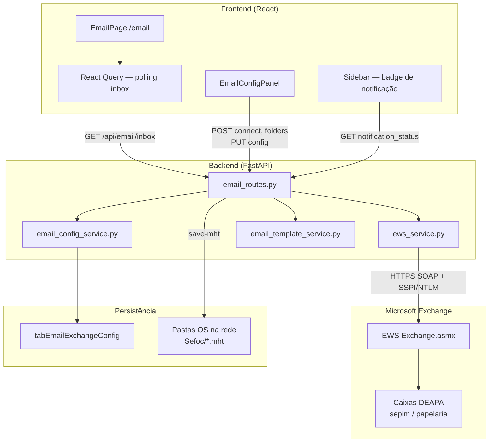

# E-mail no SAGRA Web — Envio e Monitoramento de Caixas de Entrada

Este documento descreve em detalhes como o SAGRA Web se conecta ao **Microsoft Exchange** via **EWS (Exchange Web Services)**, como monitora pastas de entrada configuradas e como envia e-mails (PT, provas, ativação de conta, recuperação de senha e mensagens genéricas).

---

## 1. Visão geral

O módulo de e-mail **não usa SMTP/IMAP diretamente**. Toda comunicação com o Exchange é feita por **SOAP/XML** sobre HTTPS, no endpoint corporativo:

```
https://ce.camara.leg.br/EWS/Exchange.asmx
```

A implementação central está em:

| Camada | Arquivo principal |
|--------|-------------------|
| Serviço EWS (SOAP) | `app/backend/services/ews_service.py` |
| Rotas HTTP | `app/backend/routers/email_routes.py` |
| Configuração por usuário | `app/backend/services/email_config_service.py` |
| Templates e remetentes globais | `app/backend/services/email_template_service.py` |
| Frontend (UI + polling) | `apps/web/src/features/email/` |
| Cliente API | `apps/web/src/api/email.ts` |

O frontend expõe a tela em `/email` (permissão `sb_email`). O backend monta as rotas em `/api/email/*`.

---

## 2. Arquitetura



**Resumo do fluxo:**

1. O **servidor Python** autentica no Exchange (credencial Windows/NTLM ou variáveis de ambiente).
2. O **monitoramento** consulta pastas específicas dentro da Inbox de caixas compartilhadas/delegadas.
3. O **envio** cria mensagens via operação SOAP `CreateItem` com `MessageDisposition="SendAndSaveCopy"`.
4. A **configuração de pastas monitoradas** é salva por **ponto** (matrícula do operador) em `tabEmailExchangeConfig`.

---

## 3. Conexão com o Exchange (EWS)

### 3.1 Protocolo

O `EWSService` monta envelopes SOAP 1.1 manualmente e envia POST para a URL EWS. Cada requisição inclui:

- Header `RequestServerVersion` com valor `Exchange2010_SP2`
- Content-Type `text/xml; charset=utf-8`
- Corpo com operações EWS padrão Microsoft (`FindItem`, `GetItem`, `CreateItem`, `UpdateItem`, `FindFolder`, `GetAttachment`, `GetDelegate`, etc.)

A resposta é parseada com **lxml** (`etree.fromstring`).

### 3.2 Sessão HTTP (`requests.Session`)

Ao instanciar `EWSService`:

1. Cria uma `requests.Session`
2. **Desabilita proxy automático do Windows** (`session.trust_env = False`), evitando timeout quando `HTTP_PROXY` aponta para proxy interno inacessível no servidor CGrafSysVM
3. Aplica autenticação (ver seção 4)
4. Define timeout padrão de **30 segundos** (`EWS_TIMEOUT` no ambiente sobrescreve)

Proxy explícito só é usado se `EWS_HTTPS_PROXY` ou `EWS_HTTP_PROXY` estiver definido no `.env`.

### 3.3 Verificação SSL

Por padrão, `verify_ssl=False` (`DEFAULT_VERIFY_SSL` em `email_config_service.py`), pois o certificado interno da Câmara costuma exigir essa configuração no ambiente atual. Pode ser alterado por usuário na config ou via `EWS_VERIFY_SSL`.

### 3.4 Tratamento de falhas de rede

Erros comuns são convertidos em `EWSUnavailableError` (mensagem segura ao cliente):

| Situação | Comportamento |
|----------|---------------|
| Timeout | HTTP 503 — "Exchange não respondeu a tempo" |
| ConnectionError | HTTP 503 — "Não foi possível conectar" |
| HTTP 4xx/5xx | HTTP 503 genérico (detalhe no log) |
| XML inválido | HTTP 503 — "Resposta inválida do Exchange" |

O mapeamento final para respostas HTTP está em `app/backend/resilience/http_errors.py` (`ews_http_exception`).

---

## 4. Autenticação

A função `_resolve_ews_auth()` em `ews_service.py` escolhe o método nesta ordem:

### 4.1 NTLM com credenciais explícitas

Se `username` + `password` forem passados ao construtor **ou** se existirem no ambiente:

- `EWS_USERNAME` / `EWS_USER`
- `EWS_PASSWORD`

→ usa `HttpNtlmAuth` (`requests_ntlm`), desde que o pacote esteja instalado.

### 4.2 SSPI (padrão em produção Windows)

Se não houver credenciais explícitas → usa **`HttpNegotiateAuth`** (`requests_negotiate_sspi`).

Nesse modo, a identidade é a **conta Windows sob a qual o processo da API roda** (serviço IIS/Uvicorn/gMSA). Essa conta precisa ter:

- Permissão EWS no Exchange
- Acesso delegado ou "Full Access" às caixas monitoradas (`sepim.deapa@camara.leg.br`, `papelaria.deapa@camara.leg.br`, etc.)

### 4.3 Dependências obrigatórias

```text
requests
requests-negotiate-sspi   # autenticação Windows integrada
lxml                      # parse SOAP
requests-ntlm             # opcional, para credenciais explícitas
```

Se `EWSService` não puder ser importado, a API retorna HTTP 500 informando dependência ausente.

### 4.4 Descoberta de caixas acessíveis

`POST /api/email/config/connect` chama `list_accessible_mailboxes()`:

1. Normaliza o SMTP primário a partir do username (`usuario@camara.leg.br`)
2. Consulta delegações via `GetDelegate`
3. Adiciona candidatas fixas (`DEFAULT_MAILBOX_CANDIDATES`) e extras informadas pelo usuário
4. Para cada candidata, executa `probe_mailbox_access()` — tenta listar subpastas da Inbox
5. Retorna lista com flags `accessible`, `is_primary`

Isso permite ao operador **testar a conexão** antes de salvar pastas monitoradas.

---

## 5. Configuração de monitoramento

### 5.1 Tabela `tabEmailExchangeConfig`

Cada registro é keyed por **Ponto** (matrícula do operador logado):

| Coluna | Descrição |
|--------|-----------|
| `EwsUrl` | URL do endpoint EWS |
| `VerifySsl` | Verificar certificado SSL |
| `MaxItemsPerFolder` | Máximo de e-mails por pasta (1–100, padrão 20) |
| `RefreshIntervalSec` | Intervalo sugerido de refresh no frontend (3–120 s, padrão 5) |
| `OnlyUnread` | Se true, busca apenas não lidos (padrão true) |
| `MonitoredTargets` | JSON — caixas e pastas monitoradas |
| `SendMailboxOsLt5000` | Remetente fallback OS &lt; 5000 |
| `SendMailboxOsGte5000` | Remetente fallback OS ≥ 5000 |

**Importante:** credenciais EWS (`EwsUsername`, `EwsPasswordEnc`) existem no schema, mas o fluxo atual de produção usa autenticação do **servidor**, não credenciais por operador na UI.

### 5.2 Estrutura de `MonitoredTargets`

```json
[
  {
    "mailbox": "sepim.deapa@camara.leg.br",
    "folders": [
      { "id": "", "name": "Entrada de Provas", "parent": "Inbox" },
      { "id": "", "name": "Entrada de Prob. Tec.", "parent": "Inbox" }
    ]
  },
  {
    "mailbox": "papelaria.deapa@camara.leg.br",
    "folders": [ ... ]
  }
]
```

**Defaults do sistema** (quando o usuário ainda não configurou nada — `get_default_runtime_config()`):

- Duas caixas DEAPA
- Quatro pastas: "Entrada de Provas" e "Entrada de Prob. Tec." em cada caixa

### 5.3 Resolução de config em runtime

```text
_resolve_email_runtime_config(ponto)
  ├─ Se existe config do usuário COM monitored_targets → usa ela
  └─ Senão → get_default_runtime_config()
```

### 5.4 Fluxo de configuração na UI (`EmailConfigPanel`)

1. **Conectar** — `POST /api/email/config/connect` com `ews_url`, `verify_ssl`, `extra_mailboxes`
2. **Listar pastas** — `POST /api/email/config/folders` com `mailbox` e `parent` (`inbox` ou `msgfolderroot`)
3. Operador marca subpastas desejadas
4. **Salvar** — `PUT /api/email/config` com `monitored_targets`

Ao salvar, o backend valida que há ao menos uma pasta selecionada.

---

## 6. Monitoramento das caixas de entrada

### 6.1 Endpoint principal

```
GET /api/email/inbox
```

Requer sessão autenticada. Executa `fetch_exchange_emails(ponto)`.

### 6.2 Algoritmo de sincronização

Para cada alvo em `monitored_targets`:

1. **Resolver ID da subpasta**
   - Se `folder.id` estiver vazio → `find_folder_id()` busca pelo `DisplayName` dentro da Inbox da mailbox
   - Se não encontrar → log de warning e pula a pasta

2. **Buscar mensagens não lidas**
   - `find_unread_messages()` com operação SOAP `FindItem`
   - Restrição: `message:IsRead = false`
   - Ordenação: `DateTimeReceived` descendente
   - Limite: `max_items_per_folder` (padrão 20, máx. 100)

3. **Enriquecer cada mensagem**
   - `get_message_details(item_id)` — corpo HTML completo, lista de anexos com `attachment_id`
   - Monta objeto JSON para o frontend:

```json
{
  "id": "<ItemId EWS>",
  "sender": "Nome do remetente",
  "email": "remetente@camara.leg.br",
  "subject": "Assunto",
  "preview": "Primeiros 100 chars...",
  "body": "<html>...</html>",
  "date": "2026-06-08T10:00:00Z",
  "read": false,
  "hasAttachment": true,
  "attachments": [{ "name": "arquivo.pdf" }],
  "account": "sepim.deapa@camara.leg.br",
  "folder": "Entrada de Prob. Tec."
}
```

4. **Erros parciais**
   - Falha em uma pasta não aborta as demais; erros são acumulados em `sync_errors`
   - Se **nenhum e-mail** foi retornado **e** houve erro → HTTP 503 com mensagem orientando revisar credencial/pastas
   - Erro 401 → mensagem específica sobre autenticação recusada

### 6.3 Polling no frontend

Hook `useEmailInbox()` (`useEmailQueries.ts`):

- Chama `GET /api/email/inbox` repetidamente
- Intervalo: `refresh_interval_sec` da config do usuário × 1000 ms (mín. 3 s, máx. 120 s; padrão 5 s)
- `placeholderData`: mantém lista anterior na tela se um refresh falhar (Exchange indisponível momentâneo)
- `staleTime: 0` — sempre considera dados potencialmente desatualizados

A `EmailPage` usa esse intervalo quando `config.configured === true`; caso contrário, usa 5 segundos.

### 6.4 Badge de notificação no menu

`Sidebar.tsx` consulta `GET /api/email/notification_status?setor=SEFOC` a cada **15 segundos** (usuários com `sb_email`):

```json
{
  "inbox_count": 3,
  "pendencias_count": 1,
  "last_check": "14:32:05"
}
```

- `inbox_count` — resultado de `fetch_exchange_emails()` (mesma lógica da inbox)
- `pendencias_count` — OS com andamento `Encam. de Docum.` no setor SEFOC

O badge aparece quando `inbox_count + pendencias_count > 0`.

### 6.5 Ações sobre e-mails monitorados

| Ação | Endpoint | Efeito no Exchange |
|------|----------|-------------------|
| Marcar lido / desconsiderar | `POST /api/email/mark-read` | `UpdateItem`: `IsRead=true` + categoria Outlook |
| Registrar andamento | `POST /api/email/andamento` | Idem + insert em `tabAndamento` |
| Baixar anexo | `GET /api/email/download` | `GetAttachment` |
| Salvar .mht na OS | `POST /api/email/save-mht` | `GetItem` com `IncludeMimeContent` → arquivo UNC |

Categorias padrão aplicadas via EWS:

- Andamento registrado: `"Pedido atendido (lido e proc.)"`
- Desconsiderar: `"Lido e Desconsiderado"` (customizável no request)

---

## 7. Envio de e-mails

Todos os envios passam por `EWSService.send_email()`, que executa SOAP `CreateItem` com:

- `MessageDisposition="SendAndSaveCopy"`
- Corpo HTML (`BodyType="HTML"`)
- Destinatários em `<ToRecipients>`
- Anexos opcionais em Base64 (`FileAttachment`)
- Remetente opcional em `<From>` (requer permissão "Send As" / "Send on Behalf" no Exchange)
- Pasta de cópia opcional via `<SavedItemFolderId>` (subpasta customizada em vez de Sent Items padrão)

### 7.1 Remetentes (From)

Prioridade para envios operacionais (PT/Prova):

1. Configuração **global admin** — `get_global_send_mailboxes()` em `config/email_templates.json` (via `email_template_service`)
2. Fallback na config Exchange do usuário (`SendMailboxOsLt5000` / `SendMailboxOsGte5000`)

| Tipo de OS | Remetente padrão |
|------------|------------------|
| OS &lt; 5000 | `sepim.deapa@camara.leg.br` |
| OS ≥ 5000 | `papelaria.deapa@camara.leg.br` |
| Ativação / reset senha | `send_mailboxes.activation` ou `SAGRA_ACTIVATION_FROM` |

### 7.2 Tipos de envio

#### A) Envio genérico

```
POST /api/email/send
Body: { to, subject, html }
```

Usa config runtime do operador logado. Remetente = conta autenticada EWS (sem `from_mailbox` explícito).

#### B) Problemas Técnicos (PT) e Provas

```
POST /api/email/send-pt
Body: { os, ano, versao, to, ponto, type, email_entry_id? }
```

| `type` | Comportamento |
|--------|---------------|
| `pt` (padrão) | HTML de `tabAnalises.RelatorioEmail`; assunto via template `pt_send_subject` |
| `proof` | Template de prova + anexo PDF mais recente em `Sefoc/`; link portal de prova |
| `reply` | Resposta simplificada (fluxo parcial) |

Após envio bem-sucedido:

- Registra andamento `"Pendência Usuário"` / setor SEFOC
- Copia salva em subpasta específica:
  - Prova → `"Saida de Provas"`
  - PT → `"Saida de Prob. Tec."`
- A pasta é localizada via `find_folder_id()` a partir de `SentItems` da mailbox remetente

#### C) Ativação de conta

`activation_email_service.send_activation_email()` — disparado no fluxo de cadastro de usuário cliente. Usa template `activation`, remetente global de ativação, **sem** config por ponto.

#### D) Recuperação de senha

`password_reset_email_service.send_password_reset_email()` — mesmo padrão EWS da ativação, template `password_reset`.

#### E) Ativação cliente

`cliente_activation_email_service.py` — variante para portal cliente.

### 7.3 Templates HTML

Gerenciados por `email_template_service.py` + `config/email_templates.json` + tabela `tab_email_template_config`. Variáveis `{{nr_os}}`, `{{link}}`, etc. são substituídas antes do envio.

Prévia de PT antes do envio:

```
GET /api/email/pt-html/{ano}/{os}
```

---

## 8. Referência de endpoints

| Método | Rota | Função |
|--------|------|--------|
| GET | `/api/email/config` | Config pública do operador |
| POST | `/api/email/config/connect` | Testar conexão / listar mailboxes |
| POST | `/api/email/config/folders` | Listar subpastas de uma mailbox |
| PUT | `/api/email/config` | Salvar pastas monitoradas |
| GET | `/api/email/inbox` | Sincronizar inbox monitorada |
| GET | `/api/email/pendencias` | OS com pendência de documento |
| GET | `/api/email/notification_status` | Contadores para badge |
| GET | `/api/email/pt-html/{ano}/{os}` | Prévia HTML PT/Prova |
| GET | `/api/email/download` | Download de anexo |
| POST | `/api/email/send` | Envio genérico |
| POST | `/api/email/send-pt` | Envio PT / Prova |
| POST | `/api/email/andamento` | Andamento + marcar lido no Exchange |
| POST | `/api/email/mark-read` | Marcar lido + categoria |
| POST | `/api/email/save-mht` | Salvar MIME na pasta Sefoc da OS |

Todas as rotas (exceto `pt-html` e `pendencias`) exigem sessão autenticada.

---

## 9. Operações SOAP utilizadas

| Operação EWS | Método Python | Uso |
|--------------|---------------|-----|
| `FindItem` | `find_unread_messages` | Listar não lidos na pasta monitorada |
| `GetItem` | `get_message_details`, `get_message_mime_content` | Detalhes, corpo, anexos, MIME |
| `GetAttachment` | `get_attachment_content` | Download de anexo |
| `UpdateItem` | `mark_as_read_and_categorize` | Marcar lido + categoria |
| `CreateItem` | `send_email` | Enviar mensagem |
| `FindFolder` | `find_folder_id`, `list_child_folders` | Resolver pastas por nome / listar subpastas |
| `GetDelegate` | `list_delegate_mailboxes` | Caixas delegadas ao usuário autenticado |

### Identificação de pastas (`MailboxFolderTarget`)

| `folder_type` | Significado |
|---------------|-------------|
| `distinguished_inbox` | Inbox raiz de uma mailbox |
| `distinguished_sentitems` | Itens enviados (base para achar pastas de saída) |
| `distinguished_msgfolderroot` | Raiz da árvore de pastas |
| `folder_id` | Subpasta com ID EWS conhecido |

---

## 10. Variáveis de ambiente

| Variável | Efeito |
|----------|--------|
| `EWS_URL` | URL do endpoint (default: `https://ce.camara.leg.br/EWS/Exchange.asmx`) |
| `EWS_VERIFY_SSL` | `true`/`1` para verificar certificado |
| `EWS_TIMEOUT` | Timeout HTTP em segundos (default 30) |
| `EWS_USERNAME` / `EWS_USER` | Usuário NTLM explícito |
| `EWS_PASSWORD` | Senha NTLM explícita |
| `EWS_HTTPS_PROXY` / `EWS_HTTP_PROXY` | Proxy explícito (senão conexão direta) |
| `SAGRA_ACTIVATION_FROM` | Remetente fallback para e-mails de ativação |
| `SAGRA_PUBLIC_WEB_BASE` | Base URL de links em e-mails (default intranet `http://cgrafsysvm`) |

---

## 11. Fluxos operacionais resumidos

### 11.1 Operador recebe pedido por e-mail

```text
Exchange (pasta "Entrada de Prob. Tec.")
  → polling GET /inbox
  → operador abre e-mail na EmailPage
  → identifica OS no assunto/corpo
  → registra andamento OU envia PT OU desconsidera
  → UpdateItem marca lido + categoria no Outlook
```

### 11.2 Envio de PT após análise

```text
Análise concluída → RelatorioEmail gravado em tabAnalises
  → operador abre pendência ou inbox
  → prévia GET /pt-html
  → POST /send-pt (type=pt)
  → EWS envia + salva em "Saida de Prob. Tec."
  → andamento "PTVx enviado" / Pendência Usuário
```

### 11.3 Primeiro uso — configurar monitoramento

```text
Email → ícone configurações
  → Conectar (valida SSPI/NTLM)
  → selecionar mailbox DEAPA
  → carregar subpastas da Inbox
  → marcar "Entrada de Provas" e "Entrada de Prob. Tec."
  → Salvar → tabEmailExchangeConfig
  → polling passa a usar pastas do operador
```

---

## 12. Scripts de diagnóstico

Em `app/backend/scripts/`:

| Script | Propósito |
|--------|-----------|
| `diag_ews_folders.py` | Testar listagem de pastas |
| `diag_ews_messages.py` | Testar leitura de mensagens |
| `diag_ews_all_folders.py` | Varredura completa de pastas |

Úteis para validar credencial e permissões fora da UI.

---

## 13. Limitações e observações

1. **Somente não lidos:** com `OnlyUnread=true` (padrão), e-mails já lidos no Outlook somem da lista monitorada.
2. **Sem push do Exchange:** o monitoramento é **pull** (polling HTTP), não há webhook nem WebSocket dedicado ao EWS.
3. **Credencial centralizada:** autenticação é do serviço Windows, não por senha digitada na UI.
4. **Permissões Exchange:** enviar como outra mailbox (`from_mailbox`) exige delegação "Send As" configurada no Exchange Admin.
5. **Categorias:** `mark_as_read_and_categorize` **substitui** a lista de categorias (não faz merge com categorias existentes).
6. **Desenvolvimento:** se envio de ativação falhar em modo dev, o link é logado em vez de propagar erro.

---

## 14. Arquivos relacionados (mapa rápido)

```
app/backend/
  services/ews_service.py              # Cliente SOAP EWS
  services/email_config_service.py     # Config por ponto + defaults
  services/email_template_service.py   # Templates e remetentes globais
  services/activation_email_service.py
  services/password_reset_email_service.py
  services/cliente_activation_email_service.py
  routers/email_routes.py              # API REST

apps/web/src/
  features/email/components/EmailPage.tsx
  features/email/components/EmailConfigPanel.tsx
  features/email/components/EmailInboxDetail.tsx
  api/email.ts
  api/hooks/useEmailQueries.ts
  components/layout/Sidebar.tsx        # Badge notification_status

config/email_templates.json            # Remetentes globais + templates
```

Para visão funcional resumida da tela de e-mail, consulte também a seção **7.4** do `docs/MANUAL_COMPLETO_SAGRA_WEB.md`.
