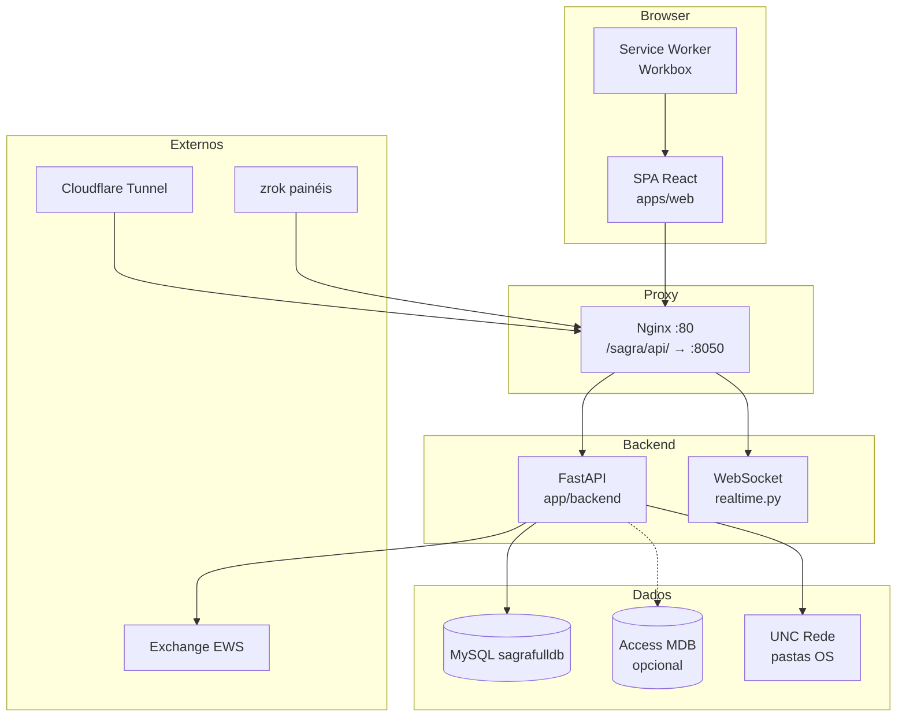
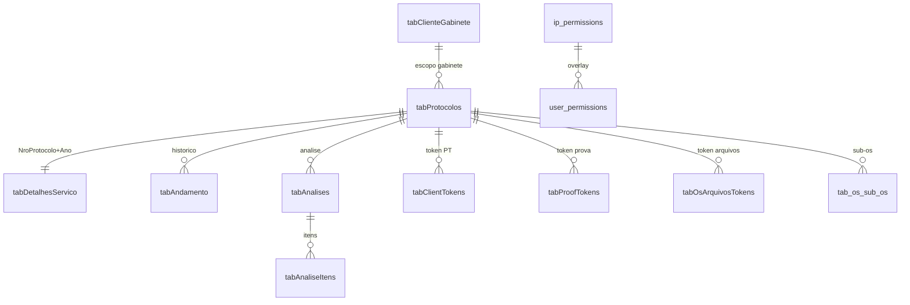
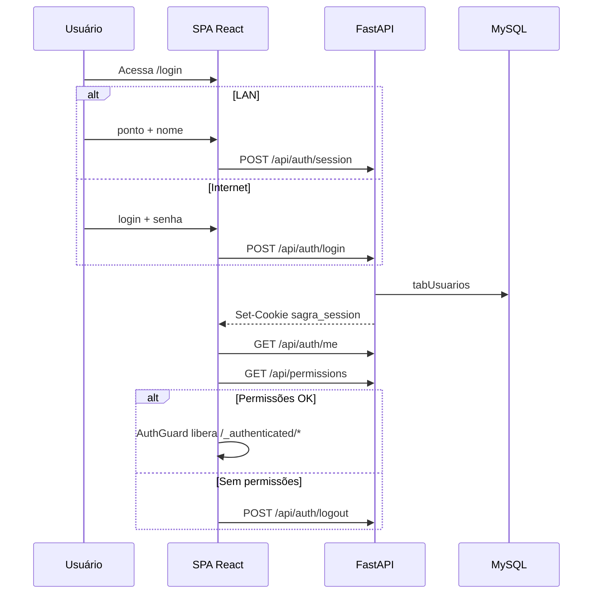
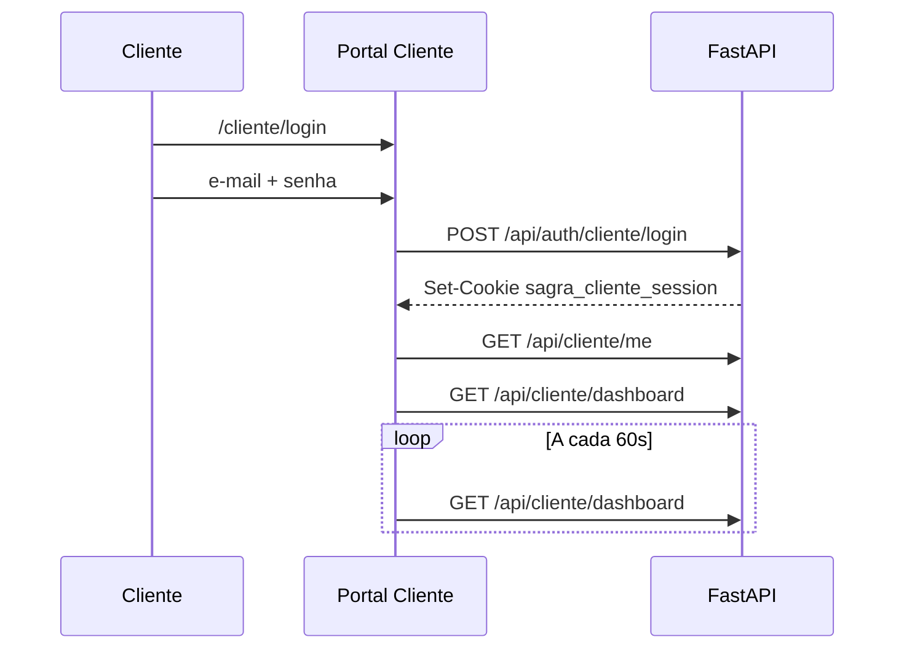
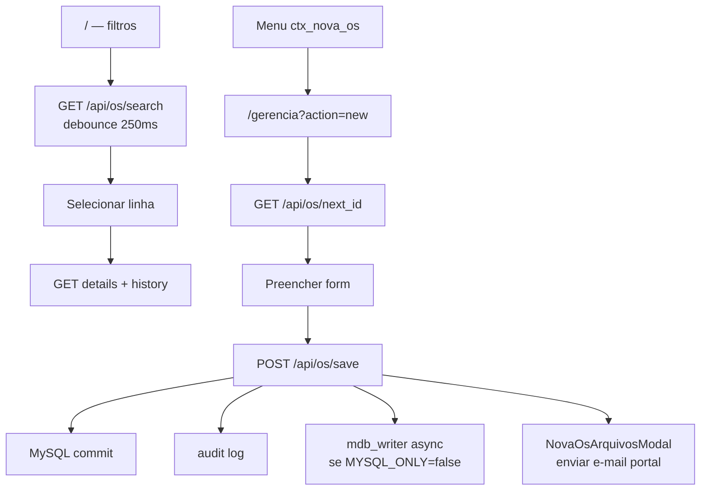
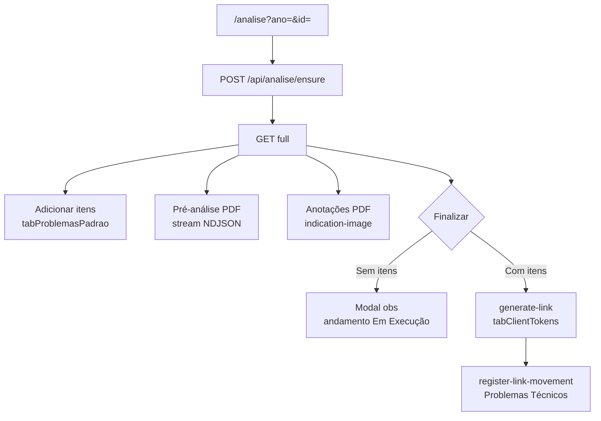
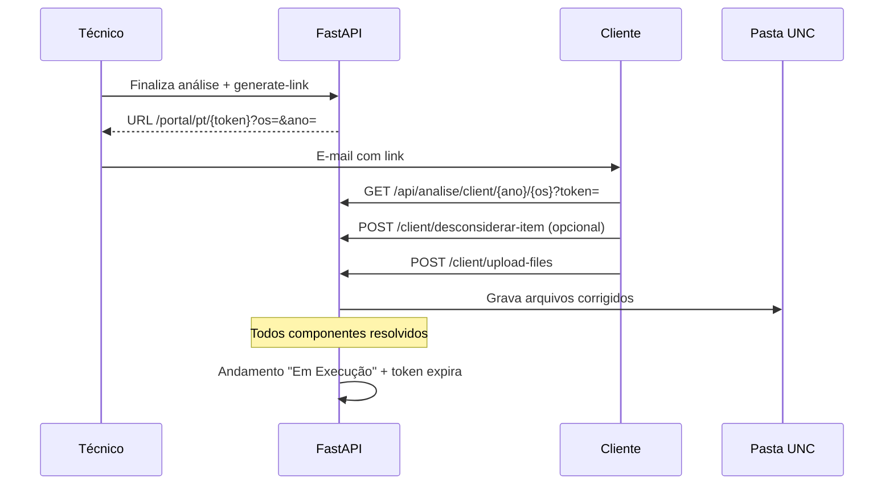
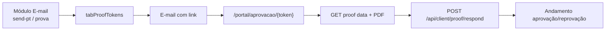
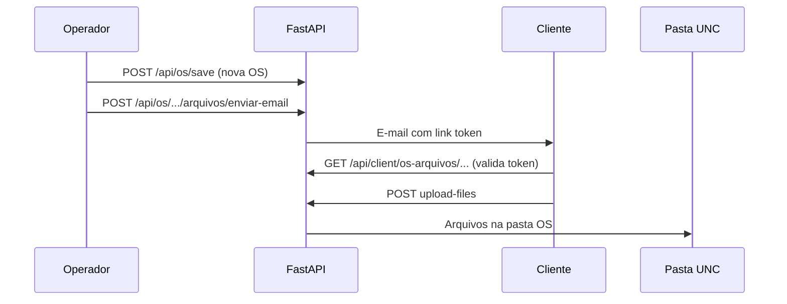

# MANUAL COMPLETO DO SISTEMA SAGRA WEB

---

## Capa

| Campo | Valor |
|-------|-------|
| **Nome do sistema** | SAGRA Web — Sistema de Acompanhamento Gráfico |
| **Subtítulo** | Manual Técnico e Operacional — DEAPA / SEFOC / Câmara dos Deputados |
| **Versão do manual** | 2.0 |
| **Data de geração** | 09/06/2026 |
| **Finalidade do documento** | Documentação completa do sistema SAGRA Web para equipes técnicas (Parte 1) e usuários finais (Parte 2). Baseado em auditoria estática do código-fonte e configuração de produção. |
| **Público-alvo** | Analistas de sistemas, desenvolvedores, suporte técnico, administradores, operadores SEFOC/DEAPA, analistas de qualidade, PCP, gabinetes/deputados (clientes) |
| **Confidencialidade** | **Uso interno** — Câmara dos Deputados / DEAPA / SEFOC. Não distribuir externamente sem autorização. Contém referências a caminhos de rede, IPs internos e arquitetura de produção. |
| **Base documental** | `docs/INVENTARIO_COMPLETO_PARA_MANUAL_SAGRA_WEB.md`, código em `C:\dev\SagraWeb`, deploy em `\\cgrafsysvm\Sistemas CGraf\Sagra Web` |
| **Legenda de confiança** | **[CERTO]** — confirmado no código; **[INFERÊNCIA]** — deduzido; **[NÃO IDENTIFICADO]** — não encontrado |

---

## Sumário

### Parte 1 — Manual Técnico do Sistema

1. [Visão Geral Técnica](#1-visão-geral-técnica)
2. [Arquitetura do Sistema](#2-arquitetura-do-sistema)
3. [Estrutura de Pastas](#3-estrutura-de-pastas)
4. [Front-end](#4-front-end)
5. [Back-end](#5-back-end)
6. [APIs e Endpoints](#6-apis-e-endpoints)
7. [Banco de Dados](#7-banco-de-dados)
8. [Autenticação, Sessões e Permissões](#8-autenticação-sessões-e-permissões)
9. [Fluxos Técnicos Ponta a Ponta](#9-fluxos-técnicos-ponta-a-ponta)
10. [Integrações Externas](#10-integrações-externas)
11. [Performance e Atualizações Automáticas](#11-performance-e-atualizações-automáticas)
12. [Segurança e Pontos Críticos](#12-segurança-e-pontos-críticos)
13. [Build, Deploy e Produção](#13-build-deploy-e-produção)
14. [Manutenção e Suporte](#14-manutenção-e-suporte)

### Parte 2 — Manual do Usuário Final

15. [Introdução ao Sistema](#15-introdução-ao-sistema)
16. [Acesso ao Sistema](#16-acesso-ao-sistema)
17. [Página Inicial / Dashboard](#17-página-inicial--dashboard)
18. [Ordens de Serviço](#18-ordens-de-serviço)
19. [Gerência / Gestão de OS](#19-gerência--gestão-de-os)
20. [Análise Técnica](#20-análise-técnica)
21. [Problemas Técnicos](#21-problemas-técnicos)
22. [Provas e Aprovação](#22-provas-e-aprovação)
23. [Portal do Cliente](#23-portal-do-cliente)
24. [Envio de Arquivos](#24-envio-de-arquivos)
25. [E-mail](#25-e-mail)
26. [Contas do Gabinete](#26-contas-do-gabinete)
27. [Relatórios](#27-relatórios)
28. [Usuários e Permissões](#28-usuários-e-permissões)
29. [Erros Comuns e Como Resolver](#29-erros-comuns-e-como-resolver)
30. [Boas Práticas de Uso](#30-boas-práticas-de-uso)
31. [Glossário](#31-glossário)
32. [Checklists Operacionais](#32-checklists-operacionais)
33. [Apêndices](#33-apêndices)

---

# PARTE 1 — MANUAL TÉCNICO DO SISTEMA

## 1. Visão Geral Técnica

### 1.1 Identificação do sistema

| Item | Valor |
|------|-------|
| Nome | **SAGRA Web** — Sistema de Acompanhamento Gráfico |
| Organização | DEAPA / SEFOC / Câmara dos Deputados |
| Repositório de desenvolvimento | `C:\dev\SagraWeb` |
| Deploy produção | `\\cgrafsysvm\Sistemas CGraf\Sagra Web` **[CERTO]** |
| Proxy reverso | `\\cgrafsysvm\nginx\conf\nginx.conf` **[CERTO]** |
| Banco de dados | MySQL `sagrafulldb` em `10.1.1.73` **[CERTO]** |

### 1.2 Finalidade

O SAGRA Web gerencia o **ciclo de vida completo de Ordens de Serviço (OS) gráficas** na produção parlamentar:

- Busca, criação, edição e duplicação de OS
- Registro de andamentos e timeline operacional
- Análise técnica de qualidade com pré-análise automatizada de PDFs
- Comunicação via Microsoft Exchange (EWS): PT, provas, andamentos
- Portais seguros por token para clientes externos (PT, prova, upload de arquivos)
- Portal autenticado para gabinetes/deputados
- Fila PCP (kanban), gravação (Xpose), papelaria, relatórios customizados
- Painéis TV em tempo real (setor e global)

### 1.3 Estado atual da plataforma **[CERTO]**

O sistema está em **migração de UI legada HTML/jQuery** (`app/frontend/`) para **SPA React 19 + TypeScript** (`apps/web/`). O backend **FastAPI** permanece como camada única de API.

Em produção (`config/config.json`):

| Flag | Valor prod | Efeito |
|------|------------|--------|
| `mysql_only` | `true` | MySQL é a fonte da verdade |
| `sync_andamentos_enabled` | `false` | Sync bidirecional MDB↔MySQL desabilitado |
| `env` | `production` | Modo produção |

**Importante:** Escrita dual-write em Access MDB (`mdb_writer.py`) só ocorre quando `mysql_only=false`. Em produção atual, saves vão exclusivamente ao MySQL.

### 1.4 Público atendido e perfis de acesso

| Perfil | Autenticação | Cookie / credencial | Rotas principais |
|--------|--------------|---------------------|------------------|
| Operador LAN | Ponto + nome | `sagra_session` | `/_authenticated/*` (URLs reais: `/`, `/analise`, etc.) |
| Operador remoto | E-mail/ponto + senha | `sagra_session` | Idem, via internet (`cgraf.online`) **[INFERÊNCIA]** |
| MASTER / admin sistema | IP privilegiado + sessão | `sagra_session` | `/api/admin/*`, `/admin/ips`, `/admin/configuracoes` |
| Admin usuários | Permissão `sb_usuarios` | `sagra_session` | `/usuarios` |
| Cliente gabinete | E-mail + senha | `sagra_cliente_session` | `/cliente/*` |
| Cliente anônimo (link) | Token na URL | — | `/portal/*` |
| Painel TV | Sem login (GET anônimo) | — | `/painel/setor`, `/painel/global` |

### 1.5 Módulos mapeados

| Módulo | Status | Router / rota principal |
|--------|--------|-------------------------|
| Login interno | ✅ | `/login/*` → `auth_routes.py` |
| Login cliente | ✅ | `/cliente/login/*` → `cliente_gabinete_routes.py` |
| Dashboard / Início | ✅ | `/` → `OsHomePage` |
| Gerência | ✅ | `/gerencia` → `os_routes.py` (acesso via menu contexto, não sidebar) |
| Análise | ✅ | `/analise` → `analise_routes.py` |
| E-mail | ✅ | `/email` → `email_routes.py` |
| Portal Cliente | ✅ | `/cliente/*` → `cliente_gabinete_routes.py` |
| Portal PT | ✅ | `/portal/pt/$token` → `analise_routes.py` |
| Provas / Aprovação | ✅ | `/portal/aprovacao/$token` → `proof_portal_routes.py` |
| Envio arquivos | ✅ | `/portal/os-arquivos/$token` → `os_arquivos_routes.py` |
| Contas gabinete | ✅ | `/cliente/contas` → `cliente_gabinete_routes.py` |
| PCP | ✅ | `/pcp` → `pcp_routes.py` |
| Gravação | ✅ | `/gravacao` → `gravacao_routes.py` |
| Papelaria | ✅ | `/papelaria` → `papelaria_routes.py` |
| Relatórios | ✅ | `/relatorios` → `report_custom_routes.py` |
| Painéis TV | ✅ | `/painel/*` |
| Sub-OS / componentes | ✅ | `os_sub_os_routes.py` |
| Pré-análise | ✅ | `pre_analise_routes.py` |
| Sync MDB/MySQL | ⚠️ Condicional | `sync_routes.py` — só se `SYNC_ANDAMENTOS_ENABLED=true` |
| Computadores ativos | ⚠️ | Permissão `sb_active_computers` existe; rota React **[NÃO IDENTIFICADO]** |

### 1.6 Stack tecnológica resumida **[CERTO]**

| Camada | Tecnologia |
|--------|------------|
| Monorepo | pnpm workspaces (`pnpm-workspace.yaml`) |
| Frontend | React 19, TypeScript 5.7, Vite 6, TanStack Router/Query/Table |
| Estado | Zustand (6 stores), React Hook Form + Zod |
| Estilo | Tailwind CSS v4, `@sagra/ui` (shadcn-style) |
| PWA | vite-plugin-pwa + Workbox |
| Backend | FastAPI + Uvicorn (Python 3) |
| Banco | MySQL via PyMySQL pool (`database.py`) — **sem ORM** |
| Legado | Microsoft Access MDB (opcional) |
| Proxy | Nginx → Uvicorn `:8050` (prod), `:8001` (dev) |

### 1.7 Visão arquitetural simplificada



---

## 2. Arquitetura do Sistema

### 2.1 Separação frontend / backend **[CERTO]**

```
Dev:  Vite :5173  ──proxy /api,/ws──►  FastAPI :8001
Prod: Nginx :80   ──/sagra/api/────►  FastAPI :8050
      Nginx       ──/ (SPA)────────►  app/frontend/ (build React)
```

Resolução de prefixo API no front: `apps/web/src/lib/api.ts` → `resolveSagraApiPrefix()` retorna `/api` (dev) ou `/sagra/api` (prod).

### 2.2 Camadas do backend

| Camada | Localização | Responsabilidade |
|--------|-------------|------------------|
| Entry point | `app/backend/main.py` → `routers/api.py:app` | Startup, middleware, registro routers |
| Routers | `app/backend/routers/` (~25 módulos) | Endpoints REST + WebSocket |
| Services | `app/backend/services/` (57 módulos) | Regras de negócio |
| Schemas | `app/backend/schemas/` + inline nos routers | Contratos Pydantic |
| Security | `app/backend/security/` | Auth, sessão, IP, Cloudflare |
| Database | `app/backend/database.py` | Pool PyMySQL, SQL raw |
| Config | `app/backend/config_manager.py` | `config/config.json` + `.env` |

### 2.3 Camadas do frontend

| Camada | Localização | Responsabilidade |
|--------|-------------|------------------|
| Entry | `apps/web/src/main.tsx` | Bootstrap React, providers |
| Rotas | `apps/web/src/routes/` (file-based) | TanStack Router; `routeTree.gen.ts` gerado |
| Features | `apps/web/src/features/` | Módulos de domínio (os, analise, email, cliente…) |
| API clients | `apps/web/src/api/` | Hooks React Query + fetch |
| Components | `apps/web/src/components/` | Auth, layout, portal, PWA |
| Lib | `apps/web/src/lib/` | `api.ts`, `query-client.ts`, utilitários |
| UI compartilhada | `packages/ui/` | Componentes shadcn |

### 2.4 Padrões arquiteturais **[CERTO]**

| Padrão | Implementação |
|--------|---------------|
| Rotas API | Routers FastAPI montados em `api.py` |
| Acesso a dados | SQL raw via `execute_query` / `execute_transaction` |
| Auth API | `APIAccessMiddleware` (`security/api_auth.py`) — IP + sessão HttpOnly |
| Auth SPA | `AuthGuard` / `ClienteAuthGuard` + `GET /api/permissions` |
| Tempo real | WebSocket `/ws`, `/api/ws` — `routers/realtime.py` |
| Schema DB | `CREATE TABLE IF NOT EXISTS` no startup (`api.py`) + DDL em `deploy/sql/` |
| Deep links SPA | `_register_spa_shell_routes` em `api.py` |

### 2.5 Ambientes **[CERTO / INFERÊNCIA]**

| Ambiente | Host | Porta API | URL pública |
|----------|------|-----------|-------------|
| Dev local | `10.1.1.73` | `8001` | `http://10.1.1.73:8001` |
| Produção | `cgrafsysvm` / `10.1.1.73` | `8050` | `http://cgrafsysvm` (Nginx) |
| Internet staff | Cloudflare | — | `cgraf.online` **[INFERÊNCIA]** |
| Painéis TV | zrok | — | `sagra-painel.shares.zrok.io` **[INFERÊNCIA]** |

### 2.6 Bibliotecas principais

**Frontend** (`apps/web/package.json`): `@tanstack/react-router`, `@tanstack/react-query`, `@tanstack/react-table`, `@tanstack/react-virtual`, `zustand`, `chart.js`, `pdfjs-dist`, `@dnd-kit/*`, `lucide-react`, `workbox-window`.

**Backend** (`app/backend/requirements.txt`): `fastapi`, `uvicorn`, `pydantic`, `PyMySQL`, `pyodbc`, `fpdf2`, `pymupdf`, `pytesseract`, `opencv-python-headless`, `pandas`, `Jinja2`, `bleach`, `requests-negotiate-sspi`, `google-api-python-client`.

### 2.7 PWA e cache **[CERTO]**

- `vite-plugin-pwa` com Workbox em `apps/web/vite.config.ts`
- Nginx aplica `no-cache` em HTML via `$sagra_html_no_cache`
- Atualizações via componente `PwaUpdatePrompt`
- **Atenção:** Clientes com Service Worker antigo após deploy podem precisar aceitar atualização via prompt ou hard refresh.

---

## 3. Estrutura de Pastas

```
C:\dev\SagraWeb\
├── apps\web\                    # SPA React (fonte principal UI)
│   └── src\
│       ├── routes\              # Rotas TanStack (file-based)
│       ├── features\            # Módulos de domínio
│       ├── api\                 # Clientes HTTP + hooks React Query
│       ├── components\          # UI compartilhada
│       └── lib\                 # api.ts, query-client.ts
├── packages\
│   ├── ui\                      # Componentes shadcn compartilhados
│   └── api-types\               # Tipos TS derivados de OpenAPI (planejado)
├── app\
│   ├── backend\                 # FastAPI — routers, services, security
│   │   ├── routers\             # ~25 routers REST
│   │   ├── services\            # 57 módulos de negócio
│   │   ├── security\            # Auth, sessão, IP
│   │   ├── schemas\             # Pydantic
│   │   └── tests\               # pytest
│   └── frontend\                # Build SPA + HTML legado (migração)
├── config\                      # config.json, .env, .env.example
├── deploy\                      # Scripts release, templates, SQL DDL
│   ├── scripts\                 # package-release.ps1, deploy-producao.ps1
│   └── sql\                     # Migrations manuais
├── docs\                        # Documentação
├── app\services\                # Scripts operacionais (sync, backup)
│   └── sync_tables\             # Sync MDB↔MySQL batch
├── logs\                        # Logs de runtime
└── package.json                 # Scripts monorepo
```

### 3.1 Entry points críticos

| Função | Arquivo |
|--------|---------|
| Bootstrap front | `apps/web/src/main.tsx` |
| Bootstrap back | `app/backend/main.py` → `routers/api.py:app` |
| Configuração | `app/backend/config_manager.py` |
| Prefixo API | `apps/web/src/lib/api.ts` |
| Permissões front | `apps/web/src/features/auth/permissions.ts` |
| Middleware auth | `app/backend/security/api_auth.py` |
| Sessão/cookies | `app/backend/security/session_auth.py` |
| Pool DB | `app/backend/database.py` |
| Nav sidebar | `apps/web/src/components/layout/nav-config.ts` |
| Tipos permissão | `apps/web/src/features/auth/types.ts` |

### 3.2 Onde encontrar cada tipo de artefato

| Artefato | Localização |
|----------|-------------|
| Páginas React | `apps/web/src/routes/` + `apps/web/src/features/*/pages/` |
| Componentes compartilhados | `apps/web/src/components/` |
| Hooks de API | `apps/web/src/api/` e `apps/web/src/features/*/api.ts` |
| Stores Zustand | `apps/web/src/features/*/Store.ts` |
| Routers backend | `app/backend/routers/*.py` |
| Services backend | `app/backend/services/*.py` |
| DDL incremental | `deploy/sql/*.sql` |
| Templates e-mail | `tabEmailTemplateModel` + presets em disco |
| UI legada | `app/frontend/` (HTML/jQuery, migração) |

---

## 4. Front-end

### 4.1 Framework e padrões

| Aspecto | Implementação |
|---------|---------------|
| Framework | React 19 + TypeScript |
| Build | Vite 6 (`apps/web/vite.config.ts`) |
| Roteamento | TanStack Router — file-based; segmento `_authenticated` é **pathless** |
| Estado servidor | TanStack Query v5 (`lib/query-client.ts`) |
| Estado cliente | Zustand — 6 stores principais |
| Formulários | React Hook Form + Zod |
| Estilo | Tailwind CSS v4 + `@sagra/ui` |
| Tabelas | TanStack Table + virtualização |
| DnD | `@dnd-kit` (PCP) |
| PDF viewer | `pdfjs-dist` (portais prova/PT) |
| WebSocket | `useSagraWebSocket` hook |

**Total de rotas identificadas:** 33 em `routeTree.gen.ts` **[CERTO]**

**Lazy-loaded (6):** `/gerencia`, `/email`, `/analise`, `/relatorios`, `/pcp`, `/gravacao`

### 4.2 Layouts e guards

| Layout | Arquivo | Guard | Shell |
|--------|---------|-------|-------|
| Staff autenticado | `routes/_authenticated.tsx` | `AuthGuard` | `AppShell` |
| Login staff | `routes/login.tsx` | Redireciona autenticados → `/` | — |
| Cliente autenticado | `features/cliente/layout/ClienteAuthenticatedLayout.tsx` | `ClienteAuthGuard` | `ClientePortalShell` |
| Portal token | `routes/portal.tsx` | — | `PortalLayout` |
| Painéis TV | `routes/painel.tsx` | Sem AuthGuard | Fullscreen |

Nav sidebar staff: `components/layout/nav-config.ts` — itens controlados por permissões `sb_*`.

### 4.3 Stores Zustand

| Store | Arquivo | Persistência |
|-------|---------|--------------|
| `useAuthStore` | `features/auth/authStore.ts` | Cookie sessão |
| `useClienteStore` | `features/cliente/clienteStore.ts` | Cookie cliente |
| `useOsFiltersStore` | `features/os/osFiltersStore.ts` | localStorage |
| `useOsSelectionStore` | `features/os/osSelectionStore.ts` | Memória |
| `usePcpConfigStore` | `features/pcp/pcpConfigStore.ts` | localStorage |
| `usePainelConfigStore` | `features/painel-global/painelConfigStore.ts` | localStorage |

### 4.4 Rotas internas (staff autenticado)

Layout: `_authenticated` → `AuthGuard` + `AppShell`

#### 4.4.1 `/` — Início / Lista de OS

| Campo | Valor |
|-------|-------|
| **URL** | `/` |
| **Arquivo rota** | `routes/_authenticated/index.tsx` |
| **Componente** | `OsHomePage` (`features/os/pages/OsHomePage.tsx`) |
| **Permissão** | `sb_inicio` |
| **Usuário** | Operadores de produção, atendimento |
| **Finalidade** | Busca/lista OS, detalhes, histórico, ações de contexto |
| **APIs** | `GET /api/os/search`, `GET /api/os/{ano}/{id}/details`, `GET /api/os/{ano}/{id}/history`, `GET /api/os/{ano}/{id}/vinculos`, audit-log |
| **Ações** | Filtrar, selecionar OS, menu contexto (`ctx_*`), abrir pasta, vincular, imprimir ficha |
| **Estados UI** | loading (query), erro, vazio, refresh via WebSocket `system_update` |
| **Obs.** | Debounce busca 250ms; paginação server-side |

#### 4.4.2 `/gerencia` — Gerência de OS

| Campo | Valor |
|-------|-------|
| **URL** | `/gerencia` (query: `?action=new`, `?ano=&id=` edit) |
| **Arquivo rota** | `routes/_authenticated/gerencia.tsx` |
| **Componente** | `GerenciaPage` (lazy) |
| **Permissão** | `sb_gerencia` + `ctx_nova_os` / `ctx_editar_os` / `ctx_duplicar_os` |
| **Usuário** | Operadores com permissão de gerência |
| **Finalidade** | Criar, editar, duplicar OS; componentes; sub-OS; pasta rede |
| **APIs** | `POST /api/os/save`, `GET /api/os/next_id`, `/api/aux/*`, `/api/os/{ano}/{id}/folder-*`, `/api/os/{ano}/{id}/componentes`, `/api/os/{ano}/{id}/sub-os/*` |
| **Ações** | Salvar, duplicar, browse pasta UNC, modal envio arquivos (nova OS) |
| **Estados UI** | loading aux/OS, erro save, validação formulário |
| **Obs.** | **Não está no sidebar** — acesso via menu contexto na `/` |

#### 4.4.3 `/analise` — Análise Técnica

| Campo | Valor |
|-------|-------|
| **URL** | `/analise?ano=&id=` |
| **Arquivo rota** | `routes/_authenticated/analise.tsx` |
| **Componente** | `AnalisePage` (lazy) |
| **Permissão** | `sb_analise` |
| **Usuário** | Analistas de qualidade |
| **Finalidade** | Análise técnica, pré-análise PDF, biblioteca problemas, links PT |
| **APIs** | `/api/analise/*`, `/api/files/*`, `/api/pre-analise/*` |
| **Ações** | Adicionar itens, pré-análise stream, anotações PDF, finalizar, gerar link PT |
| **Estados UI** | Requer `?ano=&id=`; loading análise; stream pré-análise NDJSON |
| **Obs.** | Sem OS na URL → tela orienta seleção |

#### 4.4.4 `/email` — Módulo E-mail

| Campo | Valor |
|-------|-------|
| **URL** | `/email` |
| **Arquivo rota** | `routes/_authenticated/email.tsx` |
| **Componente** | `EmailPage` (lazy) |
| **Permissão** | `sb_email` |
| **Usuário** | Atendimento, analistas |
| **Finalidade** | Inbox Exchange, pendências, envio PT/prova |
| **APIs** | `/api/email/*` (config, inbox, pendencias, send, send-pt, andamento) |
| **Ações** | Configurar EWS, ler inbox, enviar e-mail/PT, registrar andamento |
| **Estados UI** | Badge contador no menu; loading inbox |
| **Obs.** | Requer config Exchange por ponto (`tabEmailExchangeConfig`) |

#### 4.4.5 `/papelaria` — Papelaria

| Campo | Valor |
|-------|-------|
| **URL** | `/papelaria` |
| **Arquivo rota** | `routes/_authenticated/papelaria.tsx` |
| **Componente** | `PapelariaPage` |
| **Permissão** | `sb_papelaria` |
| **Usuário** | Operadores papelaria |
| **Finalidade** | Cartões SVG + preview Corel legado |
| **APIs** | `/api/papelaria/*` |
| **Ações** | Selecionar modelo, gerar SVG, preview PDF |
| **Estados UI** | Exige OS com `NroProtocolo >= 5000` |
| **Obs.** | Preview Corel via COM Windows — **[INFERÊNCIA]** |

#### 4.4.6 `/relatorios` — Relatórios

| Campo | Valor |
|-------|-------|
| **URL** | `/relatorios` |
| **Arquivo rota** | `routes/_authenticated/relatorios.tsx` |
| **Componente** | `RelatorioPage` (lazy) |
| **Permissão** | `sb_relatorio` |
| **Usuário** | Gestão, operadores autorizados |
| **Finalidade** | Relatórios customizados HTML/XLSX |
| **APIs** | `POST /api/reports/custom`, `POST /api/reports/xlsx` |
| **Ações** | Definir filtros/colunas, gerar, exportar |
| **Estados UI** | loading geração |

#### 4.4.7 `/pcp` — Fila PCP

| Campo | Valor |
|-------|-------|
| **URL** | `/pcp` |
| **Arquivo rota** | `routes/_authenticated/pcp.tsx` |
| **Componente** | `PcpPage` (lazy) |
| **Permissão** | `sb_pcp` |
| **Usuário** | PCP, planejamento |
| **Finalidade** | Fila kanban por setor, reordenação |
| **APIs** | `GET/POST /api/pcp/queue` |
| **Ações** | Selecionar setor, drag-and-drop reorder |
| **Estados UI** | DnD + WS `pcp_queue_update` |

#### 4.4.8 `/gravacao` — Gravação

| Campo | Valor |
|-------|-------|
| **URL** | `/gravacao` |
| **Arquivo rota** | `routes/_authenticated/gravacao.tsx` |
| **Componente** | `GravacaoPage` (lazy) |
| **Permissão** | `sb_gravacao` |
| **Usuário** | Setor gravação |
| **Finalidade** | Monitor Xpose/PrintQ |
| **APIs** | `/api/gravacao/*`, WS `/api/ws/jobs` |
| **Ações** | Monitorar jobs CTP |
| **Estados UI** | Tempo real via WebSocket |

#### 4.4.9 `/usuarios` — Administração de Usuários

| Campo | Valor |
|-------|-------|
| **URL** | `/usuarios` |
| **Arquivo rota** | `routes/_authenticated/usuarios.tsx` |
| **Componente** | `UsuariosPage` |
| **Permissão** | `sb_usuarios` |
| **Usuário** | Administradores |
| **Finalidade** | CRUD usuários internos e clientes gabinete |
| **APIs** | `/api/admin/users/*`, `/api/admin/clientes/*` |
| **Ações** | Criar/editar usuário, permissões, cadastrar gabinete |

#### 4.4.10 `/admin/ips` — Administração de IPs

| Campo | Valor |
|-------|-------|
| **URL** | `/admin/ips` |
| **Arquivo rota** | `routes/_authenticated/admin/ips.tsx` |
| **Componente** | `AdminIpsPage` |
| **Permissão** | `sb_admin_ips` |
| **Usuário** | MASTER / admins |
| **Finalidade** | Matriz RBAC por IP |
| **APIs** | `/api/admin/ip/*`, `POST /api/access-request` |
| **Ações** | CRUD IPs, flags permissão, gestão solicitações |

#### 4.4.11 `/admin/configuracoes` — Configurações do Sistema

| Campo | Valor |
|-------|-------|
| **URL** | `/admin/configuracoes` |
| **Arquivo rota** | `routes/_authenticated/admin/configuracoes.tsx` |
| **Componente** | `ConfiguracoesPage` |
| **Permissão** | `sb_admin_ips` |
| **Usuário** | MASTER / admins |
| **Finalidade** | Checks pré-análise, templates e-mail |
| **APIs** | `/api/admin/system/*` |
| **Ações** | Editar checks, reset templates, teste envio |

#### 4.4.12 `/impressao/requisicao/$ano/$id` — Ficha Requisição

| Campo | Valor |
|-------|-------|
| **URL** | `/impressao/requisicao/{ano}/{id}` |
| **Arquivo rota** | `routes/_authenticated/impressao/requisicao.$ano.$id.tsx` |
| **Componente** | `RequisicaoPrintPage` |
| **Permissão** | `ctx_imprimir_ficha` |
| **APIs** | `GET /api/reports/requisicao/{ano}/{id}` |
| **Ações** | Auto-print ao carregar |

#### 4.4.13 Catch-all — Módulo em migração

| Campo | Valor |
|-------|-------|
| **URL** | Qualquer rota autenticada não migrada |
| **Arquivo rota** | `routes/_authenticated/$.tsx` |
| **Componente** | `ModulePlaceholderPage` |
| **Permissão** | Sessão apenas |
| **Estados UI** | Mensagem "Módulo em migração" |

### 4.5 Rotas login staff (público)

| URL | Arquivo | Finalidade | APIs |
|-----|---------|------------|------|
| `/login` | `login.index.tsx` | Login LAN (ponto+nome) ou internet (senha) | `POST /api/auth/session`, `POST /api/auth/login` |
| `/login/activate` | `login.activate.tsx` | Ativação conta internet | `/api/auth/activate/*` |
| `/login/forgot` | `login.forgot.tsx` | Solicitar reset senha | `POST /api/auth/forgot-password` |
| `/login/reset` | `login.reset.tsx` | Redefinir senha com token | `/api/auth/reset-password/*` |

### 4.6 Rotas portal cliente (gabinete autenticado)

Cookie: `sagra_cliente_session` (separado de `sagra_session`)

| URL | Arquivo | Componente | Finalidade | APIs |
|-----|---------|------------|------------|------|
| `/cliente` | `cliente/index.tsx` | `ClienteDashboardPage` | Dashboard OS, timeline, pendências | `GET /api/cliente/dashboard`, `/api/cliente/me` |
| `/cliente/login` | `cliente/login.index.tsx` | `ClienteLoginPage` | Login gabinete | `POST /api/auth/cliente/login` |
| `/cliente/login/activate` | `cliente/login.activate.tsx` | Ativação conta | `?token=` | `/api/auth/cliente/activate/*` |
| `/cliente/contas` | `cliente/contas.tsx` | `ClienteContasPanel` | Subcontas | `GET/POST /api/cliente/contas` |
| `/cliente/provas` | `cliente/provas.tsx` | `ClientePendenciasListPage` | Pendências prova | dashboard + tokens |
| `/cliente/problemas-tecnicos` | `cliente/problemas-tecnicos.tsx` | `ClientePendenciasListPage` | Pendências PT | dashboard + tokens |
| `/cliente/os/$ano/$nrOs/prova` | bridge | `ClienteProofBridgePage` | Ponte → portal prova | redireciona `/portal/aprovacao/$token` |
| `/cliente/os/$ano/$nrOs/arquivos` | bridge | `ClienteArquivosBridgePage` | Ponte → upload | redireciona `/portal/os-arquivos/$token` |
| `/cliente/os/$ano/$nrOs/problemas-tecnicos` | bridge | `ClientePtBridgePage` | Ponte → portal PT | redireciona `/portal/pt/$token` |

**Refetch automático:** dashboard a cada 60s via React Query **[CERTO — `docs/PAGINA_CLIENTE.md`]**

### 4.7 Rotas portais públicos por token

Layout: `routes/portal.tsx` → `PortalLayout`. Validação: token + query `?os=&ano=` no backend.

| URL | Arquivo | Componente | Finalidade | APIs |
|-----|---------|------------|------------|------|
| `/portal/pt/$token` | `portal/pt.$token.tsx` | `PortalPtPage` | PT interativo, upload correções | `/api/analise/client/*`, `/api/client/upload-*` |
| `/portal/prova/$token` | `portal/prova.$token.tsx` | `PortalProvaPage` | Visualização PDF PT (read-only) | `GET /api/client/report/{ano}/{os_id}` |
| `/portal/aprovacao/$token` | `portal/aprovacao.$token.tsx` | `PortalAprovacaoPage` | Aprovar/reprovar prova | `/api/client/proof/*` |
| `/portal/os-arquivos/$token` | `portal/os-arquivos.$token.tsx` | `PortalOsArquivosPage` | Upload arquivos nova OS | `/api/client/os-arquivos/*` |

### 4.8 Rotas painéis TV (sem login)

| URL | Arquivo | Componente | Finalidade | APIs |
|-----|---------|------------|------------|------|
| `/painel/setor` | `painel/setor.tsx` | `DashboardSetorPage` | Dashboard setor fullscreen | `GET /api/os/search`, `/api/pcp/queue`, WS |
| `/painel/global` | `painel/global.tsx` | `PainelGlobalPage` | Visão global produção | `GET /api/os/search`, WS, Chart.js |

**Atenção:** Rotas sem `AuthGuard`. Controle via permissão sidebar + flag `SAGRA_PAINEL_SKIP_IP_CHECK` no backend.

### 4.9 Permissões de menu de contexto OS (não são rotas)

Definidas em `features/auth/types.ts`, aplicadas via `useAccessControl`:

| Chave | Finalidade |
|-------|------------|
| `ctx_nova_os` | Abrir `/gerencia?action=new` |
| `ctx_duplicar_os` | Duplicar OS selecionada |
| `ctx_editar_os` | Editar OS selecionada |
| `ctx_vincular_os` | Modal vincular OS |
| `ctx_abrir_pasta` | Abrir pasta UNC (Folder Opener) |
| `ctx_imprimir_ficha` | Imprimir ficha requisição |
| `ctx_detalhes_os` | Ver detalhes expandidos |

### 4.10 Padrões de loading, erro e vazio

| Padrão | Implementação |
|--------|---------------|
| Loading listas | TanStack Query `isLoading` / `isFetching` + skeletons |
| Erro API | Toast + mensagem inline; 403 → redirect login |
| Vazio | Componentes empty state por feature |
| Retry | React Query retry configurado em `query-client.ts` |
| Debounce busca OS | 250ms em filtros |
| Permissão negada | `AuthGuard` redirect ou mensagem; `createDeniedPermissions()` anti fail-open |

## 5. Back-end

### 5.1 Framework e organização

| Aspecto | Detalhe |
|---------|---------|
| Framework | FastAPI + Uvicorn |
| Entry | `app/backend/main.py` → `routers/api.py:app` |
| Porta dev | `8001` (via `config.json` / `.env`) |
| Porta prod | `8050` **[CERTO — nginx upstream]** |
| Routers | ~25 módulos em `app/backend/routers/` |
| Services | 57 módulos em `app/backend/services/` |
| Testes | `app/backend/tests/` — pytest |
| OpenAPI | `/docs`, `/openapi.json` (OpenAPI 3.1) |

### 5.2 Registro de routers **[CERTO]**

Montagem central em `app/backend/routers/api.py`:

| Router | Prefixo / escopo |
|--------|------------------|
| `auth_routes.py` | `/api/auth/*` |
| `os_routes.py` | `/api/os/*` |
| `os_sub_os_routes.py` | `/api/os/{ano}/{id}/sub-os/*` |
| `analise_routes.py` | `/api/analise/*`, `/api/files/*`, `/api/analise/client/*` |
| `pre_analise_routes.py` | `/api/pre-analise/*` |
| `email_routes.py` | `/api/email/*` |
| `cliente_gabinete_routes.py` | `/api/cliente/*`, `/api/auth/cliente/*` |
| `proof_portal_routes.py` | `/api/client/proof/*` |
| `os_arquivos_routes.py` | `/api/client/os-arquivos/*` |
| `ip_admin_routes.py` | `/api/permissions`, `/api/admin/ip/*` |
| `user_admin_routes.py` | `/api/admin/users/*` |
| `admin_system_routes.py` | `/api/admin/system/*` |
| `auxiliar_routes.py` | `/api/aux/*` |
| `pcp_routes.py` | `/api/pcp/*` |
| `papelaria_routes.py` | `/api/papelaria/*` |
| `gravacao_routes.py` | `/api/gravacao/*` |
| `report_custom_routes.py` | `/api/reports/*` |
| `requisicao_routes.py` | `/api/reports/requisicao/*` |
| `settings_routes.py` | `/api/settings/*` |
| `notifications_routes.py` | `/api/notifications/*` |
| `config_routes.py` | `/api/config/*` |
| `realtime.py` | `/ws`, `/api/ws`, `/api/realtime/notify` |
| `sync_routes.py` | `/api/sync/*` — **condicional** |

**Total aproximado:** ~190 rotas REST + WebSocket **[CERTO]**

### 5.3 Middleware e startup

| Componente | Arquivo | Função |
|------------|---------|--------|
| `APIAccessMiddleware` | `security/api_auth.py` | Valida IP + cookie sessão; 403 anti fail-open |
| Startup schema | `api.py` | `CREATE TABLE IF NOT EXISTS` tabelas web-only |
| SPA shell routes | `api.py` | Deep links `/login`, `/cliente`, `/portal`, `/painel` |
| Cloudflare Access | `security/cloudflare_access.py` | Bloqueio rotas internas via internet |
| Rate limit | **[INFERÊNCIA]** `SAGRA_RATE_LIMIT_ENABLED` | Limitação requisições |

### 5.4 Services principais por domínio

| Domínio | Service(s) | Arquivo |
|---------|------------|---------|
| OS / save | lógica save, audit | `os_save_service.py`, `os_audit_service.py` |
| Andamentos | regras operacionais | `andamento_operacional.py` |
| Timeline cliente | filtros, sub-OS | `cliente_os_timeline_service.py` |
| Análise | CRUD, finalização | services em `analise_routes.py` + dedicados |
| Pré-análise | checks PDF | `services/pre_analise/` |
| E-mail | EWS wrapper | `ews_service.py` |
| Prova | tokens, PDF | `proof_files_service.py` |
| Pasta OS | path UNC | `os_folder_structure.py` |
| Arquivos | acesso rede | `file_access.py` |
| MDB dual-write | fila async | `mdb_writer.py` |
| Sync | batch MDB↔MySQL | `sync_andamentos_v2.py` |
| Deputados | API Câmara | `deputados_camara_service.py` |
| GDrive | upload portal | `gdrive_portal_upload.py` (desabilitado prod) |
| Ativação e-mail | SMTP | `activation_email_service.py`, `cliente_activation_email_service.py` |

### 5.5 Autenticação backend

| Modo | Handler | Cookie |
|------|---------|--------|
| LAN staff | `POST /api/auth/session` | `sagra_session` (HMAC) |
| Internet staff | `POST /api/auth/login` | `sagra_session` |
| Cliente gabinete | `POST /api/auth/cliente/login` | `sagra_cliente_session` |
| Token portal | Validação no handler | — |

Arquivos: `security/session_auth.py`, `security/api_auth.py`, `routers/auth_routes.py`

### 5.6 Uploads e arquivos

| Fluxo | Router | Destino |
|-------|--------|---------|
| Upload PT (cliente) | `analise_routes.py` | UNC pasta OS |
| Upload arquivos OS | `os_arquivos_routes.py` | UNC pasta OS |
| Upload indicação análise | `analise_routes.py` | Path controlado |
| GDrive staging | `gdrive_portal_upload.py` | Drive → UNC (se habilitado) |
| Serve arquivo UNC | `GET /api/files/serve` | Stream do filesystem |

### 5.7 Geração de relatórios e PDF

| Tipo | Router/Service | Saída |
|------|----------------|-------|
| Relatório customizado | `report_custom_routes.py` | HTML / XLSX |
| Ficha requisição | `requisicao_routes.py` | HTML print |
| PDF prova | `proof_files_service.py` | PDF da pasta OS |
| PDF PT legado SAT | `analise_routes.py` | `tabRegistroPT` |
| Pré-análise | `pre_analise/` | NDJSON stream |

### 5.8 Logs e erros comuns

| Código HTTP | Causa típica |
|-------------|--------------|
| 401 | Sem cookie em rota que exige sessão explícita |
| 403 | IP não cadastrado ou sessão inválida (`APIAccessMiddleware`) |
| 404 | OS/recurso não encontrado |
| 503 | Pool DB esgotado ou GDrive desabilitado |

Logs runtime: diretório `logs/`; sync logs podem ser grandes (~234 MB mencionados em auditoria anterior) **[INFERÊNCIA]**.

### 5.9 Compatibilidade UI legada

`POST /api/users/identify` também emite cookie `sagra_session` **[CERTO — `docs/API_FASE_B_AUTH.md`]**. UI legada em `app/frontend/` ainda consome alguns endpoints.

---

## 6. APIs e Endpoints

> **Referência completa:** OpenAPI em `http://127.0.0.1:8001/docs` (dev) ou via Nginx em produção.  
> **Legenda auth:** **Pub** = público; **Sess** = sessão+IP; **M** = MASTER; **Token** = validado no handler; **Cli** = cookie cliente.

### 6.1 Infraestrutura

| Método | Rota | Arquivo | Auth | Finalidade | Tabelas | Telas |
|--------|------|---------|------|------------|---------|-------|
| GET | `/health` | `api.py` | Pub | Ping DB | — | — |
| GET | `/api/config/public` | `config_routes.py` | Pub | Flags bootstrap (`apiBase`, `mysqlOnly`, `syncEnabled`, `env`) | — | `main.tsx` |
| GET | `/api/connected-ips` | `api.py` | M | IPs ativos (60s) | — | admin |
| GET | `/api/download/folder-opener` | `api.py` | Sess | Download `SAGRA-FolderOpener.exe` | — | menu contexto pasta |

### 6.2 Autenticação (auth)

| Método | Rota | Arquivo | Auth | Finalidade | Tabelas | Telas |
|--------|------|---------|------|------------|---------|-------|
| POST | `/api/auth/session` | `auth_routes.py` | Pub (LAN) | Login ponto+nome → cookie | `tabUsuarios` | `/login` |
| POST | `/api/auth/login` | `auth_routes.py` | Pub (internet) | Login e-mail/senha → cookie | `tabUsuarios`, `user_permissions` | `/login` |
| GET | `/api/auth/me` | `auth_routes.py` | Pub (401 se sem cookie) | Sessão atual | — | bootstrap |
| POST | `/api/auth/logout` | `auth_routes.py` | Pub | Limpa cookie | — | header |
| GET/POST | `/api/auth/activate/*` | `auth_routes.py` | Pub | Ativação conta internet | `tabUsuarios` | `/login/activate` |
| POST | `/api/auth/forgot-password` | `auth_routes.py` | Pub | Solicita reset (SMTP) | `tabUsuarios` | `/login/forgot` |
| GET/POST | `/api/auth/reset-password/*` | `auth_routes.py` | Pub | Nova senha com token | `tabUsuarios` | `/login/reset` |
| POST | `/api/auth/cliente/login` | `cliente_gabinete_routes.py` | Pub | Login gabinete | `tabClienteGabinete` | `/cliente/login` |
| GET/POST | `/api/auth/cliente/activate/*` | `cliente_gabinete_routes.py` | Pub | Ativação cliente | `tabClienteGabinete` | `/cliente/login/activate` |

### 6.3 Usuário interno e permissões (user)

| Método | Rota | Arquivo | Auth | Finalidade | Tabelas | Telas |
|--------|------|---------|------|------------|---------|-------|
| GET | `/api/permissions` | `ip_admin_routes.py` | Sess | Permissões efetivas IP+usuário | `ip_permissions`, `user_permissions` | todas autenticadas |
| GET/POST | `/api/admin/ip/*` | `ip_admin_routes.py` | M | CRUD IPs e flags RBAC | `ip_permissions` | `/admin/ips` |
| POST | `/api/access-request` | `ip_admin_routes.py` | Pub | Solicitação auto-acesso | `tabSolicitacoesAcesso` | login |
| GET/POST | `/api/admin/access-requests` | `ip_admin_routes.py` | M | Gestão solicitações | `tabSolicitacoesAcesso` | `/admin/ips` |
| GET/POST/PUT/DELETE | `/api/admin/users/*` | `user_admin_routes.py` | M | CRUD usuários, permissões | `tabUsuarios`, `user_permissions` | `/usuarios` |
| GET/POST | `/api/admin/clientes/*` | `cliente_gabinete_routes.py` | M | Admin clientes gabinete | `tabClienteGabinete` | `/usuarios` |
| GET/PUT | `/api/settings/*` | `settings_routes.py` | Sess | Preferências UI, filtros salvos | `tabUserPreferences` | SettingsModal |
| GET/POST | `/api/notifications/*` | `notifications_routes.py` | Sess | Notificações (stub front) | `tabNotificacoes` | header |

### 6.4 Cliente gabinete (cliente)

| Método | Rota | Arquivo | Auth | Finalidade | Tabelas | Telas |
|--------|------|---------|------|------------|---------|-------|
| GET | `/api/cliente/me` | `cliente_gabinete_routes.py` | Cli | Sessão atual gabinete | `tabClienteGabinete` | `/cliente` |
| GET | `/api/cliente/dashboard` | `cliente_gabinete_routes.py` | Cli | OS do gabinete, pendências | `tabProtocolos`, tokens | `/cliente` |
| GET | `/api/cliente/os/{ano}/{nr_os}/andamentos` | `cliente_gabinete_routes.py` | Cli | Timeline filtrada | `tabAndamento` | timeline cliente |
| GET/POST | `/api/cliente/contas` | `cliente_gabinete_routes.py` | Cli | Subcontas gabinete | `tabClienteGabinete` | `/cliente/contas` |

### 6.5 Ordens de Serviço (OS)

| Método | Rota | Arquivo | Auth | Finalidade | Tabelas | Telas |
|--------|------|---------|------|------------|---------|-------|
| GET | `/api/os/search` | `os_routes.py` | Sess | Busca paginada OS | `tabProtocolos`, `tabDetalhesServico` | `/`, painéis |
| GET | `/api/os/next_id` | `os_routes.py` | Sess | Próximo ID OS | leitura | `/gerencia` |
| GET | `/api/os/{ano}/{id}/details` | `os_routes.py` | Sess | Detalhes OS | leitura | OsDetailsPanel |
| POST | `/api/os/save` | `os_routes.py` | Sess | Criar/editar OS | `tabProtocolos`, `tabDetalhesServico` | `/gerencia` |
| POST | `/api/os/{ano}/{id}/duplicate` | `os_routes.py` | Sess | Duplicar OS | idem | `/gerencia` |
| GET | `/api/os/{ano}/{id}/path` | `os_routes.py` | Sess | Path UNC pasta OS | — | menu contexto |
| GET/POST | `/api/os/{ano}/{id}/folder-*` | `os_routes.py` | Sess | Browse/criar pasta rede | filesystem | FolderBrowserModal |
| GET/POST/DELETE | `/api/os/{ano}/{id}/vinculo*` | `os_routes.py` | Sess | Vínculos OS | `tabOSVinculadas` | OsVincularModal |
| GET | `/api/os/{ano}/{id}/componentes` | `os_sub_os_routes.py` | Sess | Componentes Sub-OS | `tab_os_componentes` | `/gerencia` |
| GET/POST | `/api/os/{ano}/{id}/sub-os/*` | `os_sub_os_routes.py` | Sess | Sub-ordens | `tab_os_sub_os`, `tab_os_sub_os_andamento` | `/gerencia` |
| GET | `/api/aux/protocolo/buscar` | `auxiliar_routes.py` | Sess | Lookup protocolo | `tabProtocolos` | `/gerencia` |
| GET | `/api/aux/*` | `auxiliar_routes.py` | Sess | Categorias, situações, setores, deputado | lookups | filtros, gerência |

**Efeito colateral save:** fila async `mdb_writer` se `MYSQL_ONLY=false` **[CERTO]**.

### 6.6 Andamento (andamento)

| Método | Rota | Arquivo | Auth | Finalidade | Tabelas | Telas |
|--------|------|---------|------|------------|---------|-------|
| GET | `/api/os/{ano}/{id}/history` | `os_routes.py` | Sess | Listar andamentos | `tabAndamento` | OsHistoryPanel |
| POST | `/api/os/{ano}/{id}/history` | `os_routes.py` | Sess | Adicionar andamento | `tabAndamento` | OsHistoryPanel |
| PUT | `/api/os/{ano}/{id}/history` | `os_routes.py` | Sess | Editar andamento | `tabAndamento` | OsHistoryPanel |
| DELETE | `/api/os/{ano}/{id}/history/{cod_status}` | `os_routes.py` | Sess | Excluir (tombstone) | `tabAndamento`, `deleted_andamentos` | OsHistoryPanel |
| POST | `/api/email/andamento` | `email_routes.py` | Sess | Andamento via e-mail | `tabAndamento` | `/email` |

### 6.7 Análise (analise)

| Método | Rota | Arquivo | Auth | Finalidade | Tabelas | Telas |
|--------|------|---------|------|------------|---------|-------|
| POST | `/api/analise/ensure` | `analise_routes.py` | Sess | Garantir sessão análise | `tabAnalises` | `/analise` |
| GET | `/api/analise/{ano}/{os_id}/full` | `analise_routes.py` | Sess | Análise completa | `tabAnalises`, `tabAnaliseItens` | `/analise` |
| POST | `/api/analise/save` | `analise_routes.py` | Sess | Salvar análise | idem | `/analise` |
| POST | `/api/analise/finalize/{ano}/{os_id}` | `analise_routes.py` | Sess | Finalizar análise | idem + andamento | `/analise` |
| GET/POST | `/api/analise/item/*` | `analise_routes.py` | Sess | CRUD itens | `tabAnaliseItens` | `/analise` |
| GET/POST | `/api/analise/problemas-padrao/*` | `analise_routes.py` | Sess | Biblioteca problemas | `tabProblemasPadrao` | `/analise` |
| POST | `/api/analise/generate-link` | `analise_routes.py` | Sess | Gerar token PT | `tabClientTokens` | `/analise` |
| POST | `/api/analise/register-link-movement` | `analise_routes.py` | Sess | Andamento "Problemas Técnicos" | `tabAndamento` | `/analise` |
| GET | `/api/files/list` | `analise_routes.py` | Sess | Listar arquivos UNC | filesystem | `/analise` |
| GET | `/api/files/serve` | `analise_routes.py` | Sess/Token | Servir arquivo | filesystem | `/analise`, portais |
| GET/POST | `/api/pre-analise/*` | `pre_analise_routes.py` | Sess | Checks PDF automatizados | `tab_pre_analise_snapshot` | `/analise` |
| GET | `/api/analise/legacy-pt/{sat_codigo}/pdf` | `analise_routes.py` | Sess/Token | PDF SAT legado | `tabRegistroPT` | `/analise` |

### 6.8 Problemas Técnicos — portal (PT)

| Método | Rota | Arquivo | Auth | Finalidade | Tabelas | Telas |
|--------|------|---------|------|------------|---------|-------|
| GET | `/api/analise/client/{ano}/{os_id}` | `analise_routes.py` | Token | Dados PT para cliente | `tabClientTokens`, `tabAnaliseItens` | `/portal/pt/$token` |
| POST | `/api/client/desconsiderar-item` | `analise_routes.py` | Token | Desconsiderar item opcional | `tabAnaliseItens` | `/portal/pt/$token` |
| POST | `/api/client/upload-files` | `analise_routes.py` | Token | Upload correções | filesystem, `tabAndamento` | `/portal/pt/$token` |
| POST | `/api/client/resolver-item` | `analise_routes.py` | Token | Marcar item resolvido | idem | `/portal/pt/$token` |

### 6.9 Provas e aprovação (provas)

| Método | Rota | Arquivo | Auth | Finalidade | Tabelas | Telas |
|--------|------|---------|------|------------|---------|-------|
| GET | `/api/client/proof/{ano}/{os_id}` | `proof_portal_routes.py` | Token | Dados prova | `tabProofTokens` | `/portal/aprovacao/$token` |
| GET | `/api/client/proof/pdf` | `proof_portal_routes.py` | Token | PDF prova | filesystem | `/portal/aprovacao/$token` |
| POST | `/api/client/proof/respond` | `proof_portal_routes.py` | Token | Aprovar/reprovar | `tabAndamento` | `/portal/aprovacao/$token` |
| GET | `/api/client/report/{ano}/{os_id}` | `proof_portal_routes.py` | Token | Relatório PT read-only | — | `/portal/prova/$token` |
| GET | `/api/email/proof-files/{ano}/{os}` | `email_routes.py` | Sess | Arquivos prova na pasta | filesystem | `/email` |
| GET | `/api/email/pt-html/{ano}/{os}` | `email_routes.py` | Sess | Preview HTML PT | templates | `/email` |

### 6.10 Arquivos / upload (arquivos)

| Método | Rota | Arquivo | Auth | Finalidade | Tabelas | Telas |
|--------|------|---------|------|------------|---------|-------|
| GET/POST | `/api/client/os-arquivos/*` | `os_arquivos_routes.py` | Token | Portal upload nova OS | `tabOsArquivosTokens` | `/portal/os-arquivos/$token` |
| POST | `/api/os/{ano}/{id}/arquivos/enviar-email` | `os_arquivos_routes.py` | Sess | Enviar link upload por e-mail | tokens + EWS | NovaOsArquivosModal |

### 6.11 E-mail (email)

| Método | Rota | Arquivo | Auth | Finalidade | Tabelas | Telas |
|--------|------|---------|------|------------|---------|-------|
| GET/PUT | `/api/email/config` | `email_routes.py` | Sess | Config Exchange por ponto | `tabEmailExchangeConfig` | `/email` |
| POST | `/api/email/config/connect` | `email_routes.py` | Sess | Teste conexão EWS | — | `/email` |
| POST | `/api/email/config/folders` | `email_routes.py` | Sess | Listar pastas EWS | — | `/email` |
| GET | `/api/email/inbox` | `email_routes.py` | Sess | Caixa de entrada | EWS | `/email` |
| GET | `/api/email/pendencias` | `email_routes.py` | Sess | Pendências | EWS | `/email` |
| GET | `/api/email/notification_status` | `email_routes.py` | Sess | Status notificações | EWS | `/email` |
| POST | `/api/email/send` | `email_routes.py` | Sess | Envio e-mail livre | EWS | `/email` |
| POST | `/api/email/send-pt` | `email_routes.py` | Sess | Envio PT com template | EWS + tokens | `/email` |
| POST | `/api/email/save-mht` | `email_routes.py` | Sess | Salvar MHT | EWS + filesystem | `/email` |
| POST | `/api/email/mark-read` | `email_routes.py` | Sess | Marcar lido | EWS | `/email` |

### 6.12 Contas (contas)

| Método | Rota | Arquivo | Auth | Finalidade | Tabelas | Telas |
|--------|------|---------|------|------------|---------|-------|
| GET/POST | `/api/cliente/contas` | `cliente_gabinete_routes.py` | Cli | Subcontas gabinete | `tabClienteGabinete` | `/cliente/contas` |
| GET/POST | `/api/admin/clientes/*` | `cliente_gabinete_routes.py` | M | Cadastro gabinete master | `tabClienteGabinete` | `/usuarios` |

### 6.13 Relatórios (relatorios)

| Método | Rota | Arquivo | Auth | Finalidade | Tabelas | Telas |
|--------|------|---------|------|------------|---------|-------|
| POST | `/api/reports/custom` | `report_custom_routes.py` | Sess | Relatório HTML customizado | queries dinâmicas | `/relatorios` |
| POST | `/api/reports/xlsx` | `report_custom_routes.py` | Sess | Exportação XLSX | queries dinâmicas | `/relatorios` |
| GET | `/api/reports/requisicao/{ano}/{id}` | `requisicao_routes.py` | Sess | Ficha requisição HTML | leitura OS | impressão |

### 6.14 Demais módulos (others)

| Módulo | Prefixo | Endpoints chave | Telas |
|--------|---------|-----------------|-------|
| PCP | `/api/pcp` | `GET/POST /api/pcp/queue` | `/pcp`, `/painel/setor` |
| Papelaria | `/api/papelaria` | modelos, svg, preview | `/papelaria` |
| Gravação | `/api/gravacao` | xpose/status, jobticket | `/gravacao` |
| Admin sistema | `/api/admin/system` | pré-análise checks, email templates | `/admin/configuracoes` |
| Painel defaults | `/api/admin/setor-painel-defaults` | defaults por setor | `/painel/setor` |
| WebSocket | `/ws`, `/api/ws` | `system_update`, `pcp_queue_update`, `force_refresh` | OS, PCP, painéis |
| Realtime notify | `/api/realtime/notify` | push admin | admin |
| Sync | `/api/sync/*` | start/stop/logs — **condicional** | UI legada **[NÃO IDENTIFICADO]** React |

**Exemplo** — fluxo de chamada típico na `/`:

```
GET /api/config/public  →  bootstrap
POST /api/auth/session  →  cookie
GET /api/permissions    →  RBAC front
GET /api/os/search      →  lista OS
WS /api/ws              →  system_update
```

## 7. Banco de Dados

### 7.1 Identificação de OS **[CERTO]**

| Conceito | Campo / regra |
|----------|---------------|
| Chave composta | `NroProtocolo` + `AnoProtocolo` |
| Tabela cabeçalho | `tabProtocolos` |
| Detalhes técnicos | `tabDetalhesServico` |
| Papelaria vs OS | `NroProtocolo >= 5000` → MDB Papelaria; `< 5000` → MDB OS Atual |
| Pasta rede | Derivada via `os_folder_structure.py` → UNC `\\redecamara\DfsData\...` |

### 7.2 Conexão e acesso **[CERTO]**

| Item | Detalhe |
|------|---------|
| Engine | MySQL 8 (`sagrafulldb`) |
| Driver | PyMySQL pool — `app/backend/database.py` |
| Host prod | `10.1.1.73` (`config/config.json`) |
| Padrão acesso | SQL raw — **sem ORM** |
| Pool size | `SAGRA_DB_POOL_SIZE` (env) |
| Schema startup | `CREATE TABLE IF NOT EXISTS` em `api.py` |
| DDL incremental | `deploy/sql/*.sql` |

**Atenção:** `schema_sagrafulldb.sql` completo **[NÃO IDENTIFICADO]** no repo dev — apenas DDL incrementais.

### 7.3 Tabelas legadas (Access-synced) **[CERTO]**

| Tabela | Finalidade | Fluxos |
|--------|------------|--------|
| `tabProtocolos` | Cabeçalho OS | Busca, save, dashboard cliente |
| `tabDetalhesServico` | Especificação, produto, setor | Detalhes, gerência |
| `tabAndamento` | Histórico status (`CodStatus` PK) | Timeline staff/cliente |
| `tabOSVinculadas` | OS vinculadas | Vincular modal |
| `tabRegistroPT` | Relatórios SAT legados (PDF) | PDF PT legado |
| `tabcategorias`, `tabPapel`, `tabCores`, `tabFormatos` | Lookups | Gerência, filtros |
| `tabdadosdeputados` | Deputados locais (XLS) | Gerência |

### 7.4 Tabelas análise / portal **[CERTO]**

| Tabela | Finalidade | Fluxos |
|--------|------------|--------|
| `tabAnalises` | Sessão análise por OS | `/analise` |
| `tabAnaliseItens` | Itens/problemas da análise | Análise, portal PT |
| `tabProblemasPadrao` | Biblioteca problemas padrão | Análise |
| `tabClientTokens` | Tokens portal PT (`DataExpiracao`) | `/portal/pt/*` |
| `tabProofTokens` | Tokens aprovação prova | `/portal/aprovacao/*` |
| `tabOsArquivosTokens` | Tokens upload arquivos | `/portal/os-arquivos/*` |
| `tabMigracaoSatRegistroPT` | Controle migração SAT → análise | Migração legado |

### 7.5 Tabelas web-only (MySQL, sem MDB) **[CERTO]**

| Tabela | Finalidade |
|--------|------------|
| `tab_os_componentes` | Componentes para Sub-OS |
| `tab_os_sub_os` | Sub-ordens de serviço |
| `tab_os_sub_os_andamento` | Andamentos Sub-OS (espelho de `tabAndamento`) |
| `tabOSVinculoGrupos` | Grupos sincronização vínculos |
| `tabClienteGabinete` | Contas portal cliente / subcontas |
| `tabEmailExchangeConfig` | Config EWS por ponto |
| `tabEmailTemplateModel` | Modelos e-mail multi-template |
| `tab_pre_analise_snapshot` | Cache pré-análise |
| `tab_os_audit_log` | Auditoria alterações OS |
| `tabUserPreferences` | Preferências UI |
| `tabSetorPainelDefaults` | Defaults painel por setor |
| `tab_pcp_fila` | Fila PCP |
| `tabSolicitacoesAcesso` | Solicitações acesso IP |
| `user_permissions` | RBAC por ponto (internet) |
| `ip_permissions` | RBAC por IP |
| `deleted_andamentos` | Tombstone andamentos excluídos |
| `ct_gravacao_*`, `xpose_*` | Gravação / Xpose |
| `tabNotificacoes` | Notificações (stub front) |
| `log_sync_andamentos` | Logs sync MDB (se habilitado) |

### 7.6 Autenticação e RBAC **[CERTO]**

| Item | Detalhe |
|------|---------|
| Usuário interno | `tabUsuarios.Ponto` (numérico); colunas auth em `user_auth_schema.py` |
| Sessão staff | Cookie `sagra_session` — HMAC `SAGRA_SESSION_SECRET` |
| Sessão cliente | Cookie `sagra_cliente_session` |
| Token portal | UUID em tabelas `*Tokens`; validação OS+ano+expiração |
| IP permissions | `ip_permissions` — base RBAC |
| User permissions | `user_permissions` — overlay internet |

### 7.7 Diagrama ER simplificado



### 7.8 Arquivos (fora do DB)

| Tipo | Localização |
|------|-------------|
| Pasta OS | UNC — `GET /api/os/{ano}/{id}/path` |
| PDFs prova | Subpasta OS — `proof_files_service.py` |
| Indicações análise | Upload controlado — `analise_routes.py` |
| Templates e-mail | `tabEmailTemplateModel` + presets HTML em disco |
| Modelos Corel | UNC — `config.json` → `network_paths` |

---

## 8. Autenticação, Sessões e Permissões

### 8.1 Três modos de acesso **[CERTO]**

| Modo | Cookie / credencial | Middleware | Rotas |
|------|---------------------|------------|-------|
| Staff | `sagra_session` | `APIAccessMiddleware` + IP | `/_authenticated/*`, `/api/*` (exceto públicas) |
| Cliente | `sagra_cliente_session` | Validação em `/api/cliente/*` | `/cliente/*` |
| Token público | Query/path token | Validação no handler | `/portal/*`, `/api/client/*` (público) |

### 8.2 Login interno — LAN vs internet

| Modo | Endpoint | Credencial | Cookie |
|------|----------|------------|--------|
| LAN | `POST /api/auth/session` | `{ponto, nome}` | `sagra_session` (HttpOnly HMAC) |
| Internet | `POST /api/auth/login` | `{login, password}` | `sagra_session` + overlay `user_permissions` |

Arquivos: `auth_routes.py`, `session_auth.py`, `features/auth/api.ts`, `AuthBootstrap.tsx`

**Importante:** Permissões RBAC continuam baseadas no **IP** da sessão (`ip_permissions`), com overlay de `user_permissions` para login internet.

### 8.3 Login cliente gabinete

```
POST /api/auth/cliente/login → cookie sagra_cliente_session
GET /api/cliente/me + GET /api/cliente/dashboard → ClienteAuthGuard libera /cliente/*
```

Cookie **separado** de `sagra_session` — sessões staff e cliente são independentes.

### 8.4 Portal por token vs portal autenticado

| Aspecto | Portal token (`/portal/*`) | Portal cliente (`/cliente/*`) |
|---------|---------------------------|--------------------------------|
| Auth | Token UUID na URL + `?os=&ano=` | Cookie `sagra_cliente_session` |
| Escopo | Uma OS / uma ação (PT, prova, arquivos) | Todas OS do gabinete |
| Expiração | `DataExpiracao` na tabela token | Sessão cookie |
| Bridge routes | `/cliente/os/.../prova` redireciona para token | — |

### 8.5 Guards frontend **[CERTO]**

| Guard | Arquivo | Granularidade |
|-------|---------|---------------|
| `AuthGuard` | `components/auth/AuthGuard.tsx` | `sb_*` por rota |
| `ClienteAuthGuard` | `features/cliente/` | Sessão cliente |
| `useAccessControl` | hook | `ctx_*` menu contexto OS |
| `AuthBootstrap` | bootstrap | `GET /api/auth/me` + `/api/permissions` |

### 8.6 Chaves de permissão **[CERTO]** — `features/auth/types.ts`

**Sidebar (`sb_*`):**

| Chave | Rota / função |
|-------|---------------|
| `sb_inicio` | `/` |
| `sb_gerencia` | `/gerencia` |
| `sb_email` | `/email` |
| `sb_analise` | `/analise` |
| `sb_papelaria` | `/papelaria` |
| `sb_relatorio` | `/relatorios` |
| `sb_dashboard_setor` | `/painel/setor` |
| `sb_dashboard_global` | `/painel/global` |
| `sb_pcp` | `/pcp` |
| `sb_gravacao` | `/gravacao` |
| `sb_usuarios` | `/usuarios` |
| `sb_admin_ips` | `/admin/ips`, `/admin/configuracoes` |
| `sb_configuracoes` | alias admin |
| `sb_active_computers` | **[NÃO IDENTIFICADO]** rota React |

**Contexto OS (`ctx_*`):** `ctx_nova_os`, `ctx_duplicar_os`, `ctx_editar_os`, `ctx_vincular_os`, `ctx_abrir_pasta`, `ctx_imprimir_ficha`, `ctx_detalhes_os`

**Painel setor:** `painelSetores[]` ou `painelSetoresLegacyAll`

### 8.7 Precedência IP vs usuário **[CERTO / INFERÊNCIA]**

1. Base: `ip_permissions` (sempre aplicada)
2. Overlay: `user_permissions` (login internet; LAN se customizado)
3. Em conflito: overlay usuário prevalece **[INFERÊNCIA — `get_permissions`]**

### 8.8 MASTER **[CERTO]**

| Item | Valor |
|------|-------|
| IPs master | `10.120.2.11` (`allowed_ips.master`), servidor `10.1.1.73`, loopback |
| Acesso exclusivo | `/api/admin/*`, `/api/sync/*`, `/api/connected-ips` |
| Decorators | `require_master_ip`, `require_admin_config_access` |

### 8.9 Política anti fail-open **[CERTO]**

| Camada | Comportamento |
|--------|---------------|
| Backend | Sem sessão/IP → HTTP **403** (`api_auth.py`) |
| Frontend | `createDeniedPermissions()` — todas negadas por padrão (`permissions.ts`) |
| Permissões | Só concedidas com resposta explícita da API |

**Atenção:** RBAC granular `sb_*` é **primariamente frontend**. API valida IP cadastrado + sessão, não flag individual por endpoint (exceto admin). Operador LAN com IP amplo tem acesso API completo mesmo sem permissão de sidebar.

### 8.10 Configuração produção sessão

Variáveis em `config/.env` (nomes apenas — **sem valores**):

```
SAGRA_SESSION_SECRET
SAGRA_SESSION_SECURE
SAGRA_PUBLIC_WEB_BASE
SAGRA_CORS_ORIGINS
```

Ver `config/.env.example` e `docs/API_FASE_B_AUTH.md`.

## 9. Fluxos Técnicos Ponta a Ponta

### 9.1 Autenticação interna (staff) **[CERTO]**



Arquivos: `authStore.ts`, `AuthBootstrap.tsx`, `session_auth.py`, `api_auth.py`

### 9.2 Autenticação cliente gabinete **[CERTO]**



### 9.3 Criação e consulta de OS **[CERTO]**



### 9.4 Andamento / timeline **[CERTO]**

**Staff:** `OsHistoryPanel` → `GET /api/os/{ano}/{id}/history`

| Ação | Endpoint | Efeito |
|------|----------|--------|
| Adicionar | POST history | `tabAndamento` + broadcast WS |
| Editar | PUT history | Atualiza registro |
| Excluir | DELETE history/{cod_status} | Tombstone `deleted_andamentos` |
| Replicar | POST replicate | OS vinculadas |

**Cliente:** `GET /api/cliente/os/{ano}/{nr_os}/andamentos` → `cliente_os_timeline_service.py` (filtros, espelho sub-OS)

**Sub-OS:** andamentos em `tab_os_sub_os_andamento` espelham `tabAndamento`

### 9.5 Análise técnica **[CERTO]**



### 9.6 Problemas técnicos — portal **[CERTO]**



Detalhe: `docs/PAGINA_PORTAL_PT_PROBLEMAS_TECNICOS.md`

### 9.7 Provas e aprovação **[CERTO]**



Bridge autenticada: `/cliente/os/{ano}/{nrOs}/prova` → redireciona para portal token.

### 9.8 Envio de e-mails **[CERTO]**

```
/email → configurar EWS (tabEmailExchangeConfig)
  ├─ GET inbox / pendencias
  ├─ POST /send (corpo livre)
  └─ POST /send-pt (template HTML, link portal, anexos)
       └─ POST /andamento (registra movimento na OS)
```

### 9.9 Contas do gabinete **[CERTO]**

```
/cliente/contas → GET /api/cliente/contas
  └─ POST criar subconta → e-mail ativação (cliente_activation_email_service)
Admin: /usuarios → POST /api/admin/clientes (cadastro gabinete master)
```

### 9.10 Upload arquivos nova OS **[CERTO]**



### 9.11 Sync MDB/MySQL **[CERTO — desabilitado prod]**

```
Se SYNC_ANDAMENTOS_ENABLED=true:
  POST /api/sync/start → subprocess sync_andamentos_v2.py
  ↔ bidirecional tabAndamento MySQL ↔ Access cache

Produção atual: mysql_only=true, sync_andamentos_enabled=false
```

---

## 10. Integrações Externas

| Integração | Status | Arquivos | Config / env | Fluxo resumido |
|------------|--------|----------|--------------|----------------|
| **MySQL** | Ativo | `database.py` | `DB_*`, `SAGRA_DB_*` | Pool PyMySQL; fonte da verdade |
| **Access MDB** | Desabilitado prod | `mdb_writer.py` | `MYSQL_ONLY`, `mdb_*_path` | Dual-write async se habilitado |
| **UNC rede** | Ativo | `os_folder_structure.py`, `file_access.py` | `network_paths` em `config.json` | Pastas OS, modelos Corel, PDFs |
| **Exchange EWS** | Ativo | `ews_service.py` | `EWS_*`, `tabEmailExchangeConfig` | SSPI/NTLM Windows; inbox, send, PT |
| **SMTP** | Ativo | `activation_email_service.py` | env **[INFERÊNCIA]** | Ativação usuário/cliente, reset senha |
| **Google Drive** | Código pronto, off | `gdrive_portal_upload.py` | `SAGRA_PORTAL_UPLOAD_GDRIVE` | Upload portal Drive → UNC |
| **Cloudflare Tunnel** | Ativo prod | `security/cloudflare_access.py` | — | Acesso internet staff |
| **zrok** | Ativo painéis | `iniciar-zrok-painel.bat` | — | Expõe `/painel/*` externamente |
| **Nginx** | Ativo | `\\cgrafsysvm\nginx\conf\nginx.conf` | upstream `:8050` | `/sagra/api/` → API; SPA na raiz |
| **PyMuPDF / Tesseract** | Ativo | `services/pre_analise/` | `TESSERACT_CMD`, `SAGRA_PREANALISE_*` | Checks PDF automatizados |
| **Corel COM** | Windows only | `papelaria_routes.py` | UNC modelos `.cdr` | Preview PDF legado |
| **Câmara API deputados** | Ativo | `deputados_camara_service.py` | cache TTL env | Lookup gerência |
| **Xpose / Apogee** | Ativo | `gravacao_routes.py` | UNC `\\cgrafsysvm\ApogeeFiles\` | Jobs CTP em MySQL |
| **Folder Opener** | Ativo Windows | download endpoint | — | Abre Explorer em UNC |
| **WebSocket** | Ativo | `realtime.py` | — | Eventos tempo real |

### 10.1 Nginx — roteamento SAGRA **[CERTO]**

| Location | Destino |
|----------|---------|
| `/sagra/api/` | `http://127.0.0.1:8050/api/` |
| `/sagra/api/ws` | WebSocket backend |
| `/sagra/*` (exceto api) | 301 → `/*` |
| `/` (SPA) | Arquivos estáticos build React |
| `/producao` | 301 → `/painel/global` |

App produção: `C:/Sistemas CGraf/Sagra Web` **[CERTO — comentário nginx.conf]**

### 10.2 Paths de rede (`config/config.json`)

| Chave | Path |
|-------|------|
| `network_paths.dfs_deputados` | `\\redecamara\DfsData\CGraf\Sefoc\Deputados` |
| MDB paths | `I:\ControleDeTrabalhos\...` (legado) |

**Atenção:** Conteúdo exato `.env` produção **[NÃO ACESSÍVEL]** nesta documentação.

---

## 11. Performance e Atualizações Automáticas

### 11.1 React Query **[CERTO]**

| Configuração | Onde | Valor / efeito |
|--------------|------|--------------|
| `staleTime` | hooks por feature | Controla freshness dos dados |
| `refetchInterval: 60_000` | hooks cliente dashboard | Refetch a cada 60s |
| Retry | `query-client.ts` | Retry automático em falha |
| Invalidação | após mutations | Refresh listas afetadas |

### 11.2 WebSocket vs polling

| Consumidor | Mecanismo | Eventos |
|------------|-----------|---------|
| Staff `/` | WebSocket | `system_update` → refresh busca OS |
| PCP | WebSocket | `pcp_queue_update` |
| Painéis | WebSocket + polling | Chart.js refresh |
| Portal cliente | Polling 60s | **[INFERÊNCIA]** cliente não usa WS diretamente |
| Admin | `force_refresh` | Reload página todos clientes |

### 11.3 WebSocket — tipos de mensagem

| Tipo | Efeito no front |
|------|-----------------|
| `system_update` | Refresh busca OS |
| `pcp_queue_update` | Refresh fila PCP |
| `force_refresh` | Reload página (admin) |
| `ping` / `pong` | Keepalive |

Hook: `useSagraWebSocket`; router: `realtime.py`

### 11.4 Lazy loading

6 rotas staff lazy-loaded: `/gerencia`, `/email`, `/analise`, `/relatorios`, `/pcp`, `/gravacao` — reduz bundle inicial.

### 11.5 Timeline sob demanda

Timeline cliente carregada ao expandir OS no dashboard — não no load inicial **[CERTO — `docs/PAGINA_CLIENTE.md`]**.

### 11.6 PWA / Service Worker

| Aspecto | Detalhe |
|---------|---------|
| Plugin | `vite-plugin-pwa` + Workbox |
| Atualização | `PwaUpdatePrompt` — prompt ao usuário |
| Cache HTML | Nginx `no-cache` em HTML |
| Risco | SW antigo após deploy — mitigado por prompt |

### 11.7 Riscos de performance

| Risco | Mitigação / observação |
|-------|------------------------|
| `GET /api/os/search` com milhares de registros | Paginação server-side; filtros |
| Pré-análise `run-all/stream` | CPU intensivo (PyMuPDF/OCR) |
| Pool DB esgotado | 503; ajustar `SAGRA_DB_POOL_SIZE` |
| Logs sync grandes | Monitorar `logs/` |
| Refetch excessivo cliente | Corrigido P0 — ver `RELATORIO_CORRECAO_P0_REFETCH_PORTAL_CLIENTE.md` |

**Importante:** Evitar reduzir `staleTime` globalmente — pode aumentar carga no MySQL e EWS.

---

## 12. Segurança e Pontos Críticos

### 12.1 Arquivos críticos (alterar com cautela)

| Arquivo / área | Risco |
|----------------|-------|
| `app/backend/routers/api.py` | Startup schema, middleware, routers |
| `app/backend/security/api_auth.py` | Toda segurança API |
| `app/backend/security/session_auth.py` | Cookies e HMAC |
| `app/backend/database.py` | Pool e transações |
| `app/backend/routers/os_routes.py` | CRUD OS + histórico |
| `app/backend/routers/mdb_writer.py` | Dual-write legado |
| `app/backend/services/andamento_operacional.py` | Regras andamento |
| `config/config.json`, `config/.env` | Segredos e paths produção |
| `\\cgrafsysvm\nginx\conf\nginx.conf` | Roteamento público |
| `apps/web/src/lib/api.ts` | Prefixo API prod/dev |
| `apps/web/src/features/auth/permissions.ts` | Anti fail-open front |

### 12.2 Endpoints sensíveis

| Endpoint | Risco |
|----------|-------|
| `POST /api/os/save` | Altera dados produção |
| `DELETE /api/os/.../history/{cod_status}` | Remove histórico (tombstone) |
| `POST /api/admin/ip/delete` | Remove acesso IP |
| `POST /api/realtime/notify` (force_refresh) | Recarrega todos clientes |
| `POST /api/sync/start` | Sync MDB (se habilitado) |
| `POST /api/admin/system/email-templates/*/reset` | Restaura templates |
| `/api/client/*` com token | Upload para pasta OS (escopo token) |

### 12.3 Tokens portal

| Aspecto | Controle |
|---------|----------|
| Entropia | UUID em tabelas `*Tokens` |
| Expiração | `DataExpiracao` |
| Validação | Token + OS + ano conferidos no handler |
| Escopo | Uma OS / uma ação por token |

**Atenção:** Links por token são **capability URLs** — quem possui o link tem acesso. Não compartilhar publicamente.

### 12.4 Uploads

| Risco | Mitigação |
|-------|-----------|
| Escrita UNC | Validado escopo token/sessão |
| Tamanho | `client_max_body_size 50M` (nginx); `SAGRA_EMAIL_ATTACHMENT_MAX_MB` |
| GDrive 503 | Desabilitado por padrão em prod |

### 12.5 Permissões — lacunas conhecidas

| Lacuna | Detalhe |
|--------|---------|
| API não valida cada `sb_*` | Operador LAN com IP amplo → acesso API completo |
| Painéis sem AuthGuard | Dependem de `SAGRA_PAINEL_SKIP_IP_CHECK` |
| WebSocket `/api/ws/jobs` | Autenticação limitada **[CERTO]** |
| Redis em realtime | Uso **[NÃO CONFIRMADO]** no código analisado |

### 12.6 Fluxos que impactam produção

- Save OS + andamentos
- Finalizar análise → gera token PT
- Resposta prova cliente
- Upload portal → grava UNC
- Reordenação PCP
- Admin IPs / permissões

### 12.7 Dependências externas frágeis

| Dependência | Impacto se indisponível |
|-------------|-------------------------|
| MySQL `10.1.1.73` | Sistema inteiro para |
| UNC `\\redecamara\DfsData\...` | Pastas OS, uploads, pré-análise |
| Exchange EWS | Módulo e-mail; envio PT/prova |
| Nginx / Uvicorn | Acesso web |
| Tesseract | Pré-análise OCR degradada |
| Corel COM | Preview papelaria legado falha |
| Cloudflare/zrok | Acesso externo |

### 12.8 Divergência documentação legada

`contexto_executivo.md` (26/05/2026) descreve vulnerabilidades **parcialmente corrigidas** na Fase B (`APIAccessMiddleware`, `permissions.ts` anti fail-open). **Validar sempre no ambiente alvo.**

---

## 13. Build, Deploy e Produção

### 13.1 Comandos monorepo **[CERTO]**

| Comando | Script | Finalidade |
|---------|--------|------------|
| `pnpm dev` | `apps/web` Vite :5173 | Desenvolvimento front |
| `pnpm build` | build recursivo workspaces | Build produção |
| `pnpm test` | pytest + vitest | Testes |
| `pnpm package:release` | `deploy/scripts/package-release.ps1` | Empacotar release |
| `pnpm deploy:prod` | `deploy/scripts/deploy-producao.ps1` | Deploy produção |
| `pnpm typecheck` | TS check | Validação tipos |
| `pnpm lint` | ESLint | Lint |

Backend dev: `uvicorn` em `:8001`; prod: `:8050`.

### 13.2 Fluxo build front

```
apps/web/  →  vite build  →  app/frontend/  (assets estáticos)
```

Prefixo API prod: `/sagra/api` via `resolveSagraApiPrefix()` em `apps/web/src/lib/api.ts`.

### 13.3 Deploy produção **[CERTO / INFERÊNCIA]**

| Item | Valor |
|------|-------|
| Pasta produção | `\\cgrafsysvm\Sistemas CGraf\Sagra Web` |
| Script | `deploy/scripts/deploy-producao.ps1` |
| Nginx | Reinício/reload conforme script — **não reiniciar servidor indevidamente** |
| Backup | Script de release deve fazer backup antes **[INFERÊNCIA]** |

### 13.4 Arquitetura produção

```
Browser → Nginx :80 (cgrafsysvm)
           ├─ /           → SPA React (app/frontend/)
           ├─ /sagra/api/ → Uvicorn :8050
           └─ /sagra/api/ws → WebSocket
```

### 13.5 Variáveis de ambiente críticas

Fonte: `config/.env.example` — ver Apêndice do inventário para lista completa de nomes.

| Variável | Finalidade |
|----------|------------|
| `PORT` | Porta Uvicorn (8050 prod) |
| `ENV` | Ambiente |
| `MYSQL_ONLY` | Desabilita dual-write MDB |
| `SYNC_ANDAMENTOS_ENABLED` | Habilita sync (false prod) |
| `SAGRA_SESSION_SECRET` | HMAC cookies |
| `SAGRA_DB_POOL_SIZE` | Pool conexões |
| `SAGRA_PAINEL_SKIP_IP_CHECK` | Painéis sem check IP |
| `EWS_*` | Exchange |
| `VITE_DEV_PORT` | Porta dev Vite |

### 13.6 O que NÃO alterar em produção sem procedimento

- `config/.env` — segredos e flags
- `config/config.json` — paths MDB, rede, flags
- `nginx.conf` — roteamento
- DDL manual em `deploy/sql/` — executar com backup
- IPs master em `allowed_ips`

### 13.7 Validação pós-deploy

| Check | Como validar |
|-------|--------------|
| API viva | `GET /health` ou `GET /api/config/public` |
| SPA carrega | Abrir `/` no browser |
| Login | `POST /api/auth/session` + `GET /api/permissions` |
| Prefixo API | Network tab — chamadas em `/sagra/api/` |
| WebSocket | Conexão WS em `/sagra/api/ws` |
| PWA | Verificar prompt atualização se SW antigo |

**Exemplo** — smoke test API:

```powershell
curl http://cgrafsysvm/sagra/api/config/public
curl http://cgrafsysvm/health
```

---

## 14. Manutenção e Suporte

### 14.1 Onde procurar erros

| Fonte | Localização |
|-------|-------------|
| Logs backend | `logs/` no diretório da aplicação |
| Logs Nginx | `C:/nginx/logs/error.log`, `access.log` |
| Logs sync | `log_sync_andamentos` (se sync habilitado) |
| Console browser | DevTools → Network, Console |
| pytest | `app/backend/tests/` |
| OpenAPI | `/docs` — testar endpoints isolados |

### 14.2 Diagnóstico por sintoma

| Sintoma | Causa provável | Ação |
|---------|----------------|------|
| HTTP 403 em `/api/*` | IP não cadastrado ou cookie ausente | Verificar `ip_permissions`; refazer login |
| HTTP 401 em `/api/auth/me` | Cookie expirado/inválido | Limpar cookies; login novamente |
| HTTP 503 | Pool DB esgotado ou GDrive off | Verificar MySQL; `SAGRA_DB_POOL_SIZE` |
| Lista OS vazia | Filtros restritivos | Reset filtros; verificar query params |
| `/analise` sem dados | Falta `?ano=&id=` | Selecionar OS na `/` primeiro |
| E-mail não conecta | EWS/credenciais | Verificar `tabEmailExchangeConfig`, `EWS_*` |
| Upload falha | UNC inacessível / tamanho | Verificar path OS; limite nginx 50M |
| Token expirado | `DataExpiracao` passada | Gerar novo link (análise/e-mail) |
| Painel não atualiza | WS desconectado | Verificar `/sagra/api/ws`; reload |
| Portal cliente desatualizado | Cache/staleTime | Aguardar 60s ou hard refresh |
| Save OS aviso MDB | Dual-write falhou | Normal se `mysql_only=true`; ignorar aviso MDB |

### 14.3 Validação APIs

```powershell
# Config pública (sem auth)
curl http://127.0.0.1:8001/api/config/public

# Login dev
curl -c cookies.txt -X POST http://127.0.0.1:8001/api/auth/session `
  -H "Content-Type: application/json" `
  -d "{\"ponto\": 918713, \"nome\": \"Seu Nome\"}"

# Permissões
curl -b cookies.txt http://127.0.0.1:8001/api/permissions

# Health DB
curl http://127.0.0.1:8001/health
```

Ver fluxo completo: `docs/API_FASE_B_AUTH.md`

### 14.4 Validação frontend

| Check | Procedimento |
|-------|--------------|
| Build | `pnpm build` sem erros |
| Typecheck | `pnpm typecheck` |
| Testes | `pnpm test:frontend` |
| Rotas | Navegar 33 rotas em `routeTree.gen.ts` |
| Guards | Usuário sem `sb_analise` não acessa `/analise` |

### 14.5 Scripts operacionais

| Script | Finalidade |
|--------|------------|
| `ajuste_andamentos_os_antigas.py` | Manutenção andamentos (MySQL only) |
| `app/services/sync_tables/` | Sync MDB↔MySQL batch |
| `deploy/scripts/package-release.ps1` | Empacotar release |
| `deploy/scripts/deploy-producao.ps1` | Publicar produção |
| `iniciar-zrok-painel.bat` | Expor painéis via zrok |

### 14.6 Itens pendentes / validação humana

| Item | Status |
|------|--------|
| Rota React `sb_active_computers` | **[NÃO IDENTIFICADO]** |
| UI React sync (`/api/sync/*`) | **[NÃO IDENTIFICADO]** — UI legada |
| Google Drive em produção | Desabilitado por padrão |
| Header notificações (sino) | Stub — badge fixo 0 |
| `schema_sagrafulldb.sql` completo | **[NÃO IDENTIFICADO]** no repo dev |
| Conteúdo `.env` produção | **[NÃO ACESSÍVEL]** |
| Redis em realtime | **[NÃO CONFIRMADO]** |

### 14.7 Checklist suporte rápido

| # | Verificação |
|---|-------------|
| 1 | MySQL acessível (`GET /health`) |
| 2 | Nginx rodando; upstream `:8050` responde |
| 3 | IP do usuário em `ip_permissions` |
| 4 | Cookie `sagra_session` presente |
| 5 | `GET /api/permissions` retorna flags esperadas |
| 6 | UNC pasta OS acessível do servidor |
| 7 | EWS configurado (módulo e-mail) |
| 8 | Token portal não expirado |
| 9 | Build front publicado (versão correta) |
| 10 | Logs em `logs/` sem erro crítico recente |

### 14.8 Prioridades homologação **[recomendado]**

1. Login staff LAN + internet + cliente gabinete
2. Ciclo OS → análise → PT → upload cliente → execução
3. Ciclo prova → aprovação
4. E-mail send-pt com template configurado
5. PCP reorder + WebSocket
6. Painéis setor/global via URL TV
7. Contas gabinete + subconta
8. Permissões IP — operador sem `sb_analise` não acessa `/analise`

# PARTE 2 — MANUAL DO USUÁRIO FINAL

> **Público:** operadores SEFOC/DEAPA, analistas de qualidade, atendimento, PCP, administradores e **clientes** (gabinetes parlamentares e órgãos).  
> **Objetivo:** explicar, em linguagem simples, como usar o SAGRA Web no dia a dia — sem exigir conhecimento técnico de programação ou infraestrutura.

---

## 15. Introdução ao Sistema

### 15.1 O que é o SAGRA Web?

O **SAGRA Web** (Sistema de Acompanhamento Gráfico) é o sistema da DEAPA/SEFOC da Câmara dos Deputados para acompanhar e gerenciar **Ordens de Serviço (OS)** gráficas — desde o pedido do gabinete até a entrega do material impresso.

Com ele você pode:

- Buscar e acompanhar OS em produção
- Registrar andamentos e histórico
- Fazer análise técnica de arquivos PDF
- Comunicar problemas técnicos e provas ao cliente
- Receber arquivos corrigidos e aprovações
- Gerar relatórios e acompanhar filas de produção

### 15.2 Quem usa o sistema?

| Perfil | O que faz no sistema |
|--------|----------------------|
| **Operador de produção** | Busca OS, registra andamentos, acompanha status |
| **Analista de qualidade** | Analisa arquivos, registra problemas técnicos, gera links para o cliente |
| **Atendimento / e-mail** | Lê caixa Exchange, envia PT e provas por e-mail |
| **PCP / planejamento** | Organiza fila de produção por setor |
| **Administrador** | Gerencia usuários, permissões e configurações |
| **Cliente (gabinete/órgão)** | Acompanha OS, resolve pendências, aprova provas, envia arquivos |

### 15.3 Duas interfaces principais

| Área | Endereço | Quem acessa |
|------|----------|-------------|
| **Sistema interno** | `/`, `/analise`, `/email`, etc. | Equipe SEFOC/DEAPA |
| **Portal do Cliente** | `/cliente` | Gabinetes e órgãos solicitantes |

**Importante:** As duas áreas têm **logins separados**. Entrar no sistema interno não dá acesso ao Portal do Cliente, e vice-versa.

### 15.4 Conceitos que você verá com frequência

| Conceito | Significado resumido |
|----------|---------------------|
| **OS** | Ordem de Serviço — pedido de trabalho gráfico |
| **Protocolo** | Número + ano que identificam a OS |
| **Andamento** | Registro de movimentação (situação, setor, data) |
| **PT / PTV** | Problemas Técnicos — relatório de inconsistências no arquivo |
| **Prova** | Versão digital do material para aprovação do cliente |
| **Token** | Código na URL para acesso seguro sem senha |
| **Pendência** | Situação que exige ação do cliente ou da equipe |

**Exemplo:** A OS **2150/2026** pode estar em **"Problemas Técnicos"** — o cliente precisa corrigir o arquivo e enviar de volta pelo portal.

---

## 16. Acesso ao Sistema

### 16.1 Sistema interno — rede interna (LAN)

1. Abra o navegador e acesse o endereço do SAGRA Web (ex.: `http://cgrafsysvm`).
2. Se não estiver logado, você será direcionado para **`/login`**.
3. Informe seu **ponto** e **nome**.
4. Clique em entrar.

**Resultado esperado:** Página **Início** (`/`) com menu lateral conforme suas permissões.

### 16.2 Sistema interno — internet (remoto)

1. Acesse o endereço externo (ex.: `cgraf.online`).
2. Use **e-mail ou ponto + senha** em `/login`.
3. Primeiro acesso: ative a conta em `/login/activate` (link por e-mail).
4. Esqueceu a senha: use `/login/forgot`.

**Atenção:** Acesso remoto exige conta ativada e permissões configuradas pelo administrador.

### 16.3 Portal do Cliente

1. Acesse **`/cliente/login`**.
2. Informe **e-mail** e **senha**.
3. Primeiro acesso: `/cliente/login/activate?token=...` (senha mínimo 8 caracteres).

**Resultado esperado:** Dashboard em `/cliente`.

### 16.4 Links por token (sem login)

| Tipo | Rota |
|------|------|
| Problemas técnicos | `/portal/pt/{token}?os=...&ano=...` |
| Aprovação de prova | `/portal/aprovacao/{token}?os=...&ano=...` |
| Envio de arquivos | `/portal/os-arquivos/{token}?os=...&ano=...` |

**Atenção:** Não compartilhe links publicamente; encaminhe apenas ao destinatário correto.

### 16.5 Encerrar sessão

| Área | Como sair |
|------|-----------|
| Sistema interno | Botão **Sair** no cabeçalho |
| Portal do Cliente | Botão **Sair** na barra superior |

---

## 17. Página Inicial / Dashboard

### 17.1 O que é a página Início

A rota **`/`** (menu **Início**) é o ponto central do sistema interno: busca OS, detalhes, histórico e ações pelo **menu de contexto**.

**Quem acessa:** operadores com permissão **Início** (`sb_inicio`).

### 17.2 Buscar uma OS

1. Abra o menu **Início**.
2. Use os **filtros** (protocolo, ano, situação, setor, gabinete).
3. A lista atualiza automaticamente (debounce ~250 ms).
4. Clique na linha da OS desejada.

**Resultado esperado:** Painel lateral com detalhes e histórico.

**Dica:** Se a lista estiver vazia, limpe os filtros restritivos.

### 17.3 Menu de contexto

| Ação | O que faz |
|------|-----------|
| **Nova OS** | `/gerencia?action=new` |
| **Editar OS** | Edição da OS selecionada |
| **Duplicar OS** | Cópia com novo número |
| **Vincular OS** | Associa OS relacionadas |
| **Abrir pasta** | Pasta de rede no Windows |
| **Imprimir ficha** | Ficha de requisição |
| **Detalhes** | Informações expandidas |

**Importante:** Cada ação exige permissão específica (`ctx_*`).

### 17.4 Atualização automática

A lista é atualizada via **WebSocket** quando há mudanças. Recarregue a página se necessário.

---

## 18. Ordens de Serviço

### 18.1 Identificação

| Campo | Exemplo | Significado |
|-------|---------|-------------|
| **Número** | 2150 | Protocolo |
| **Ano** | 2026 | Ano de abertura |

**Formato:** OS **2150/2026**.

### 18.2 Situações comuns

| Situação | Significado |
|----------|-------------|
| **Entrada Inicial** | OS recém-aberta |
| **Em Execução** | Em produção / análise |
| **Problemas Técnicos** | Cliente deve corrigir arquivo |
| **Aguard. Aprovação** | Prova aguardando cliente |
| **Pendência Usuário** | Aguardando ação do cliente |
| **Entregue** | Material finalizado |
| **Cancelada** | OS encerrada |

### 18.3 Pasta de rede

Cada OS possui pasta na rede com arquivos de produção. Operadores autorizados abrem via **Abrir pasta** no menu de contexto.

**Atenção:** Requer Windows com acesso à rede interna.

---

## 19. Gerência / Gestão de OS

### 19.1 Acesso

A **Gerência** **não** aparece no menu lateral. Acesso pelo menu de contexto na Início.

**Permissão:** `sb_gerencia` + `ctx_nova_os` / `ctx_editar_os`.

### 19.2 Criar nova OS

1. Menu de contexto → **Nova OS**.
2. Preencha campos obrigatórios (gabinete, produto, título).
3. Confirme pasta de rede, se solicitado.
4. Clique em **Salvar**.

**Resultado esperado:** OS criada; modal opcional para enviar link de arquivos ao cliente.

### 19.3 Editar e duplicar

- **Editar:** selecione OS → menu contexto → **Editar OS**.
- **Duplicar:** copia dados de OS existente para novo protocolo.

**Atenção:** Alterações em OS avançada podem impactar setores downstream.

---

## 20. Análise Técnica

### 20.1 Finalidade

Verificar se o PDF do cliente está adequado para impressão (margens, fontes, imagens, sangria).

**Rota:** `/analise?ano=...&id=...` — permissão `sb_analise`.

### 20.2 Passo a passo

1. Selecione a OS na Início.
2. Abra menu **Análise**.
3. Selecione versão e **componente** (Capa, Miolo, etc.).
4. Adicione itens da biblioteca de problemas padrão.
5. **Opcional:** pré-análise automatizada ou anotações no PDF.
6. Clique em **Concluir e salvar**.

### 20.3 Resultado ao concluir

| Situação | O que acontece |
|----------|----------------|
| **Sem problemas** | Andamento **Em Execução** |
| **Com problemas** | Link portal PT + andamento **Problemas Técnicos** |
| **Já em PT** | Reenvio PTV → **Encam. de Docum.** |

**Importante:** Concluir análise **não envia e-mail** automaticamente. Envie PT pelo módulo **E-mail**.

---

## 21. Problemas Técnicos

### 21.1 Fluxo resumido

```
Analista conclui com problemas → link /portal/pt/{token}
→ Técnico envia e-mail (módulo E-mail)
→ Cliente corrige e envia arquivos
→ OS volta para Em Execução; link expira
```

### 21.2 Portal PT — procedimento do cliente

**Rota:** `/portal/pt/{token}?os=...&ano=...`

1. Abra o link (e-mail ou `/cliente/problemas-tecnicos`).
2. Preencha **nome** e **ponto** no cabeçalho.
3. Revise itens por componente.
4. **Desconsiderar** itens opcionais ou **Enviar arquivo** corrigido.
5. Repita até todos os componentes pendentes.

**Resultado esperado:** Tela de sucesso; OS em **Em Execução**.

**Atenção:** Itens **obrigatórios** (cadeado) não podem ser desconsiderados.

### 21.3 Pelo Portal do Cliente

- Dashboard → seção **Problemas Técnicos**
- Página **`/cliente/problemas-tecnicos`**
- Bridge: `/cliente/os/{ano}/{nrOs}/problemas-tecnicos`

---

## 22. Provas e Aprovação

### 22.1 O que é prova

Versão digital do material enviada ao cliente para **aprovar** antes da impressão final.

### 22.2 Procedimento do cliente

**Rota:** `/portal/aprovacao/{token}?os=...&ano=...`

1. Abra o link (e-mail ou `/cliente/provas`).
2. Aguarde carregamento do PDF.
3. Revise texto, imagens, cores e dimensões.
4. **Aprovar** ou **Reprovar** com comentário.
5. Confirme.

**Importante:** Aprovar autoriza continuidade da produção. Em dúvida, **reprove** com motivo claro.

### 22.3 Rotas relacionadas

| Rota | Função |
|------|--------|
| `/portal/aprovacao/{token}` | Aprovar/reprovar |
| `/portal/prova/{token}` | Visualização read-only do relatório PT |
| `/cliente/os/{ano}/{nrOs}/prova` | Ponte autenticada → aprovação |

---

## 23. Portal do Cliente

### 23.1 Visão geral

| Item | Detalhe |
|------|---------|
| **URL** | `/cliente` |
| **Login** | `/cliente/login` |
| **Atualização** | Automática a cada **60 segundos** |

### 23.2 Cabeçalho e barra de contexto

- Logo DEAPA, título **SAGRA Web**
- **Solicitante**, deputado/órgão, gabinete, usuário logado
- Botões **Atualizar** e **Sair**

### 23.3 Menu lateral

| Item | Rota |
|------|------|
| Visão Geral | `/cliente` |
| Problemas Técnicos | `/cliente/problemas-tecnicos` |
| Provas | `/cliente/provas` |
| Contas | `/cliente/contas` |

### 23.4 Dashboard — seções

| Seção | Conteúdo | Botão |
|-------|----------|-------|
| **Problemas Técnicos** | OS com correção pendente | Ver pendência — PT |
| **Aguardando Aprovação** | Provas para conferir | Ver pendência — Prova |
| **Aguardando Arquivos** | OS aguardando arquivos | Enviar arquivos |
| **Em andamento** | Produção sem pendência do gabinete | (acompanhamento) |

Cada OS é **acordeão**: expanda para ver a **timeline**.

### 23.5 Contas (`/cliente/contas`)

1. Conta **Principal** administra subcontas.
2. Preencha nome + e-mail da subconta.
3. Pessoa recebe e-mail de ativação (48 h).

**Atenção:** E-mail da subconta deve ser único.

### 23.6 Timeline

Marcos: Entrada Inicial → Pré-Impressão → Análise → Impressão → Acabamento → Expedição → Entregue.

| Cor | Significado |
|-----|-------------|
| Verde | Concluído |
| Âmbar | Pendência do cliente |
| Cinza | Aguardando |

Carregada **ao expandir** a OS (não no carregamento inicial).

### 23.7 Atualizar e sair

- **Automático:** refetch a cada 60 s.
- **Manual:** botão **Atualizar** após ação no portal PT/prova.
- **Sair:** encerra sessão → `/cliente/login`.

---

## 24. Envio de Arquivos

### 24.1 Quando enviar

- OS recém-criada (link por e-mail da equipe)
- Pendência em **Aguardando Arquivos** no portal

### 24.2 Procedimento

**Rota:** `/portal/os-arquivos/{token}?os=...&ano=...`

1. Abra o link.
2. Confira número da OS.
3. Arraste arquivos ou use seletor.
4. Clique em **Enviar**.
5. Aguarde confirmação.

**Atenção:** Limite de upload no servidor: até **50 MB** por requisição (Nginx).

---

## 25. E-mail

### 25.1 Finalidade

Integração com **Microsoft Exchange**: inbox, pendências, envio de PT e provas.

**Rota:** `/email` — permissão `sb_email`.

### 25.2 Configuração inicial

1. Abra **E-mail** → configurações Exchange.
2. Informe credenciais e pastas.
3. Teste conexão e salve.

### 25.3 Enviar PT

1. Conclua análise com problemas (seção 20).
2. Módulo **E-mail** → **Enviar PT**.
3. Revise assunto e corpo.
4. Confirme envio.

**Resultado esperado:** E-mail ao cliente; andamento **Pendência Usuário**; pendência visível no `/cliente`.

---

## 26. Contas do Gabinete

| Tipo | Quem | Função |
|------|------|--------|
| **Principal** | Responsável pelo gabinete | Ver OS, criar subcontas |
| **Subconta** | Membro da equipe | Mesmo escopo após ativação |

Conta principal cadastrada pela equipe interna em **Usuários** (`/usuarios`).

---

## 27. Relatórios

**Rota:** `/relatorios` — permissão `sb_relatorio`.

1. Escolha filtros (período, situação, setor).
2. Selecione colunas.
3. **Gerar** → HTML no navegador.
4. **Opcional:** exportar XLSX.

**Ficha de requisição:** menu contexto → **Imprimir ficha** → `/impressao/requisicao/{ano}/{id}`.

---

## 28. Usuários e Permissões

### 28.1 Permissões de menu (`sb_*`)

| Permissão | Módulo |
|-----------|--------|
| `sb_inicio` | Início |
| `sb_gerencia` | Gerência (contexto) |
| `sb_analise` | Análise |
| `sb_email` | E-mail |
| `sb_papelaria` | Papelaria |
| `sb_relatorio` | Relatórios |
| `sb_pcp` | PCP |
| `sb_gravacao` | Gravação |
| `sb_usuarios` | Usuários |
| `sb_admin_ips` | Admin IPs / Configurações |

### 28.2 Permissões de contexto (`ctx_*`)

`ctx_nova_os`, `ctx_editar_os`, `ctx_duplicar_os`, `ctx_vincular_os`, `ctx_abrir_pasta`, `ctx_imprimir_ficha`, `ctx_detalhes_os`.

### 28.3 Sem permissão?

Informe ponto, IP e justificativa ao administrador (Admin IPs / Usuários).

Clientes do portal **não** usam `sb_*` — isolamento automático por gabinete.

---

## 29. Erros Comuns e Como Resolver

| Problema | Causa provável | Solução | Escalar quando |
|----------|----------------|---------|----------------|
| "Sem permissão" após login | IP não cadastrado | Solicitar cadastro ao admin | Persiste após liberação |
| Sessão expirada | Cookie expirado | Login novamente | Loop contínuo |
| Lista OS vazia | Filtros restritivos | Limpar filtros | OS existe e não aparece |
| Análise sem dados | OS não selecionada | Selecionar OS na Início | URL correta e sem dados |
| Link PT inválido/expirado | Token expirado ou upload concluído | Solicitar novo link | Cliente ainda precisa corrigir |
| Botão pendência ausente no `/cliente` | Token expirado | Aguardar reenvio; Atualizar | Dias sem botão |
| Upload falha | Arquivo grande / rede | Reduzir tamanho; outro navegador | Falha com arquivos pequenos |
| E-mail não conecta | Credenciais Exchange | Reconfigurar módulo E-mail | Após credenciais confirmadas |
| Conta pendente ativação | Primeiro acesso incompleto | Link de ativação | Link expirado |
| Prova não carrega PDF | Arquivo ausente na pasta | Contatar SEFOC | Urgência de prazo |
| Página desatualizada | Cache / PWA antigo | Ctrl+F5 ou aceitar atualização PWA | Layout quebrado para todos |
| Erro 503 / lentidão | Carga ou indisponibilidade | Aguardar e tentar | > 15 min indisponível |

---

## 30. Boas Práticas de Uso

### Operadores internos

1. Selecione a OS na Início antes de Análise/E-mail.
2. Conclua análise antes de enviar PT.
3. Registre andamentos claros.
4. Não compartilhe links com token publicamente.
5. Encerre sessão em estações compartilhadas.

### Analistas

1. Use biblioteca de problemas padrão.
2. Marque **obrigatório** só quando indispensável.
3. Envie PT por e-mail após concluir com problemas.

### Clientes

1. Monitore pendências no `/cliente`.
2. Responda PT e provas rapidamente.
3. Preencha nome e ponto no portal PT.
4. Use subcontas em vez de compartilhar senha.

---

## 31. Glossário

| Termo | Definição |
|-------|-----------|
| **OS** | Ordem de Serviço gráfica |
| **Protocolo** | Número da OS (ex.: 2150) |
| **Andamento** | Movimentação com situação, setor e data |
| **Setor** | Área da produção (SEFOC, SIELT, etc.) |
| **Situação** | Status atual da OS |
| **PT / PTV** | Problemas Técnicos / versão do relatório |
| **Prova** | Material digital para aprovação |
| **Token** | Código na URL para ação sem login |
| **Dashboard** | Painel resumo (Início ou Portal Cliente) |
| **Portal** | Área para cliente externo (PT, prova, arquivos) |
| **Upload** | Envio de arquivo ao servidor |
| **Refetch** | Atualização automática ou manual de dados |
| **Pendência** | Ação necessária do cliente ou equipe |
| **Gabinete** | Escritório parlamentar solicitante |
| **Subconta** | Usuário adicional do gabinete |
| **Componente** | Parte da publicação (Capa, Miolo) |
| **PCP** | Planejamento e Controle da Produção |
| **Timeline** | Linha do tempo de marcos da OS |

---

## 32. Checklists Operacionais

### 32.1 Técnico — concluir análise

| # | Item | ✓ |
|---|------|---|
| 1 | OS correta selecionada | |
| 2 | Versão e componente corretos | |
| 3 | Problemas registrados com clareza | |
| 4 | Análise concluída e salva | |
| 5 | Se houve problemas: PT enviado por e-mail | |
| 6 | Andamento verificado na Início | |

### 32.2 Cliente — resolver PT

| # | Item | ✓ |
|---|------|---|
| 1 | Link aberto (e-mail ou `/cliente/problemas-tecnicos`) | |
| 2 | Nome e ponto preenchidos | |
| 3 | Arquivos corrigidos enviados por componente | |
| 4 | Tela de sucesso exibida | |
| 5 | Pendência sumiu no `/cliente` (Atualizar) | |

### 32.3 Cliente — aprovar prova

| # | Item | ✓ |
|---|------|---|
| 1 | PDF carregou completamente | |
| 2 | Texto, imagens e cores conferidos | |
| 3 | Aprovação ou reprovação com comentário | |

### 32.4 Suporte

| # | Item | ✓ |
|---|------|---|
| 1 | `/health` ou página inicial responde | |
| 2 | Login funciona | |
| 3 | IP cadastrado (se 403) | |
| 4 | Token portal válido (se pendência) | |
| 5 | Build recente (se layout quebrado) | |

### 32.5 Publicação (deploy)

| # | Item | ✓ |
|---|------|---|
| 1 | Backup antes do deploy | |
| 2 | `pnpm build` sem erros | |
| 3 | Login staff e cliente testados | |
| 4 | Fluxos PT e prova validados | |
| 5 | Equipe avisada sobre atualização PWA | |

---

## 33. Apêndices

### Apêndice A — Matriz de módulos

| Módulo | Rota | Perfil | Login |
|--------|------|--------|-------|
| Início | `/` | Operador | Staff |
| Gerência | `/gerencia` | Operador | Staff |
| Análise | `/analise` | Analista | Staff |
| E-mail | `/email` | Atendimento | Staff |
| Portal Cliente | `/cliente` | Gabinete | Cliente |
| PT portal | `/portal/pt/{token}` | Cliente | Token |
| Prova | `/portal/aprovacao/{token}` | Cliente | Token |
| Contas | `/cliente/contas` | Gabinete | Cliente |

### Apêndice B — Endpoints resumidos

| Grupo | Método | Endpoint | Tela |
|-------|--------|----------|------|
| Auth staff | POST | `/api/auth/session` | Login LAN |
| Auth cliente | POST | `/api/auth/cliente/login` | Login portal |
| OS | GET | `/api/os/search` | Início |
| Análise | POST | `/api/analise/{ano}/{os}/generate-link` | Concluir análise |
| Cliente | GET | `/api/cliente/dashboard` | `/cliente` |
| E-mail | POST | `/api/email/send-pt` | Envio PT |

*Prefixo produção: `/sagra/api`.*

### Apêndice C — Histórico de versão do manual

| Versão | Data | Alterações |
|--------|------|------------|
| 1.0 | — | Rascunhos e inventário |
| 1.1 | 06/06/2026 | Revisão crítica parcial |
| **2.0** | **09/06/2026** | **Parte 1 técnica (seções 1–14) + Parte 2 usuário (seções 15–33)** |

---

*Fim do Manual Completo do Sistema SAGRA Web — versão 2.0 (09/06/2026).*

*Base: `docs/INVENTARIO_COMPLETO_PARA_MANUAL_SAGRA_WEB.md`, `docs/PAGINA_CLIENTE.md`, `docs/PAGINA_PORTAL_PT_PROBLEMAS_TECNICOS.md`. Validar em homologação antes do uso operacional.*
