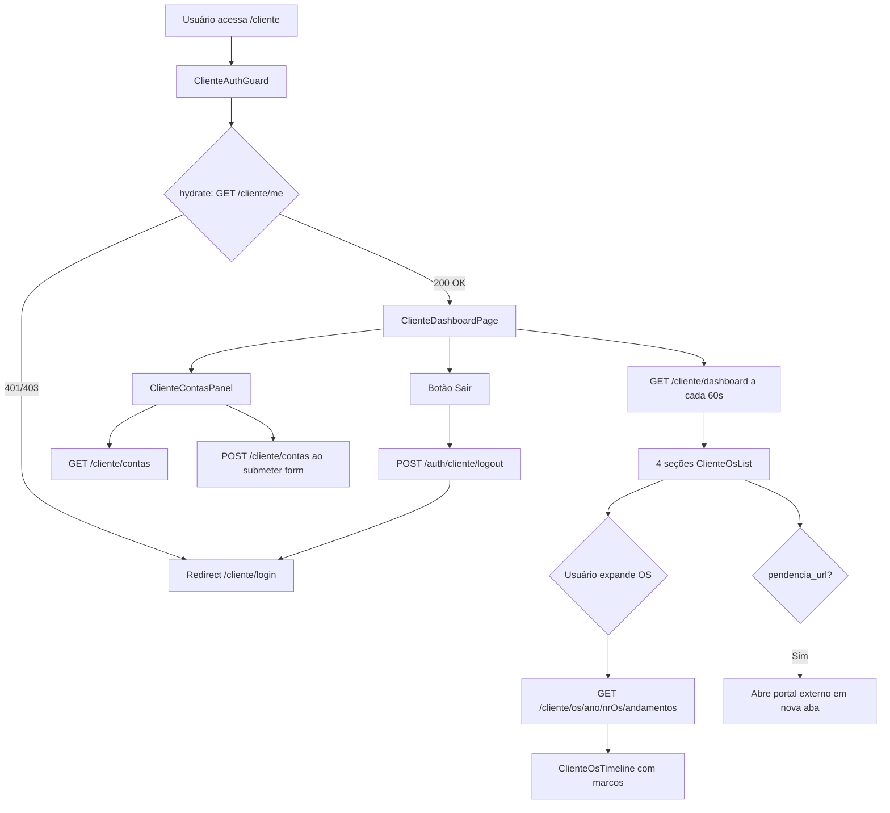

# Página `/cliente` — Relatório Técnico Completo

> Documentação do funcionamento atual do **Portal do Cliente** no SAGRA Web.  
> Data de referência: junho de 2026.  
> Escopo: rota `/cliente` e ecossistema diretamente relacionado (autenticação, APIs, backend, estilos).

---

## Sumário

1. [Visão geral](#1-visão-geral)
2. [Roteamento e URLs](#2-roteamento-e-urls)
3. [Hierarquia de componentes](#3-hierarquia-de-componentes)
4. [Fluxo de autenticação](#4-fluxo-de-autenticação)
5. [Estado e gerenciamento de dados](#5-estado-e-gerenciamento-de-dados)
6. [Layout e estilos](#6-layout-e-estilos)
7. [Seções da página (UI)](#7-seções-da-página-ui)
8. [APIs e endpoints](#8-apis-e-endpoints)
9. [Lógica de backend](#9-lógica-de-backend)
10. [Linha do tempo (timeline)](#10-linha-do-tempo-timeline)
11. [Portais externos de pendência](#11-portais-externos-de-pendência)
12. [Banco de dados](#12-banco-de-dados)
13. [Segurança e permissões](#13-segurança-e-permissões)
14. [Fluxo de dados (diagrama)](#14-fluxo-de-dados-diagrama)
15. [Arquivos de referência](#15-arquivos-de-referência)

---

## 1. Visão geral

A rota `/cliente` é o **dashboard autenticado do Portal do Cliente** — interface voltada a gabinetes parlamentares e órgãos que acompanham ordens de serviço (OSs) vinculadas ao seu cadastro.

**Título exibido:** *Portal do Cliente — Acompanhamento de OSs*

**Características principais:**

- Portal **separado** do SAGRA interno (`/_authenticated/*`).
- Autenticação própria via cookie `sagra_cliente_session` (não usa a sessão interna `sagra_session`).
- Estado de autenticação gerenciado por **Zustand** (`clienteStore`), independente do `authStore` da equipe interna.
- Dados do dashboard carregados via **TanStack React Query** com refetch automático a cada 60 segundos.
- Estilização 100% via **Tailwind CSS** (classes utilitárias inline); não há CSS dedicado à página.

---

## 2. Roteamento e URLs

### 2.1 Rotas do frontend (TanStack Router)

O roteamento é baseado em arquivos em `apps/web/src/routes/cliente/`. O arquivo gerado `routeTree.gen.ts` registra as rotas automaticamente.

| URL | Arquivo | Componente | Proteção |
|-----|---------|------------|----------|
| `/cliente` | `routes/cliente/index.tsx` | `ClienteHomeRoute` → `ClienteDashboardPage` | `ClienteAuthGuard` |
| `/cliente/login` | `routes/cliente/login.index.tsx` | `ClienteLoginPage` | Pública |
| `/cliente/login/activate` | `routes/cliente/login.activate.tsx` | `ClienteActivatePage` | Pública (requer `?token=`) |

**Definição da rota principal:**

```tsx
// apps/web/src/routes/cliente/index.tsx
export const Route = createFileRoute("/cliente/")({
  component: ClienteHomeRoute,
});

function ClienteHomeRoute() {
  return (
    <ClienteAuthGuard>
      <ClienteDashboardPage />
    </ClienteAuthGuard>
  );
}
```

### 2.2 Base path em produção

O router é criado em `main.tsx` com `basepath` derivado de `import.meta.env.BASE_URL`. Em produção, o app costuma ser servido em `/sagra`, fazendo as URLs efetivas:

- `/sagra/cliente`
- `/sagra/cliente/login`
- `/sagra/cliente/login/activate`

### 2.3 Shell SPA no backend (deep links)

O FastAPI em `app/backend/routers/api.py` registra rotas que servem `index.html` para permitir acesso direto via URL:

- `/cliente`
- `/cliente/login`
- `/cliente/login/activate`
- `/sagra/cliente`
- `/sagra/cliente/login`
- `/sagra/cliente/login/activate`

Isso garante que recarregar a página ou abrir um link direto não resulte em 404 do servidor.

### 2.4 Prefixo da API

Resolvido em `apps/web/src/lib/api.ts`:

| Ambiente | Prefixo da API |
|----------|----------------|
| Desenvolvimento | `/api` (proxy Vite) |
| Produção | `/sagra/api` |
| Customizado | `VITE_API_PREFIX` (se definido) |

Todas as chamadas do portal cliente usam `apiUrl(path)` + `credentials: "include"`.

---

## 3. Hierarquia de componentes

```
ClienteHomeRoute
└── ClienteAuthGuard
    └── ClienteDashboardPage
        ├── PortalSystemHeader
        ├── [Cabeçalho: título, saudação, botões Atualizar/Sair]
        ├── Seção: Pendências — Problemas técnicos
        │   └── ClienteOsList (showPendenciaButton=true)
        ├── Seção: Pendências — Aprovação de prova
        │   └── ClienteOsList (showPendenciaButton=true)
        ├── Seção: Pendências — Envio de arquivos
        │   └── ClienteOsList (showPendenciaButton=true)
        ├── Seção: OSs em andamento
        │   └── ClienteOsList (showPendenciaButton=false)
        └── ClienteContasPanel
            └── (por OS expandida, dentro de ClienteOsList)
                └── ClienteOsTimeline
```

### 3.1 `ClienteAuthGuard`

**Arquivo:** `apps/web/src/components/auth/ClienteAuthGuard.tsx`

- Ao montar, chama `clienteStore.hydrate()` → `GET /api/cliente/me`.
- Enquanto hidrata: spinner de carregamento com texto "Validando sessão…".
- Se não autenticado: `<Navigate to="/cliente/login" replace />`.
- Se autenticado: renderiza `children`.

### 3.2 `ClienteDashboardPage`

**Arquivo:** `apps/web/src/features/cliente/components/ClienteDashboardPage.tsx`

Componente principal do dashboard. Responsabilidades:

- Buscar dados do dashboard (`fetchClienteDashboard`).
- Exibir cabeçalho com nome do gabinete/órgão e saudação ao usuário.
- Botão **Atualizar** → `dashboardQuery.refetch()`.
- Botão **Sair** → `clienteStore.logout()` + navegação para `/cliente/login`.
- Renderizar 4 seções de listas de OS + painel de contas.

### 3.3 `PortalSystemHeader`

**Arquivo:** `apps/web/src/components/portal/PortalSystemHeader.tsx`

Cabeçalho visual compartilhado com outras páginas do portal:

- Logo DEAPA (`@/logo.png`)
- Título "SAGRA Web"
- Subtítulo "Sistema de Acompanhamento Gráfico"
- Prop `subtitle` customizável (na `/cliente`: "Portal do Cliente — Acompanhamento de OSs")
- Fundo `bg-secondary-blue`, altura fixa `h-20`, texto branco

### 3.4 `ClienteOsList`

**Arquivo:** `apps/web/src/features/cliente/components/ClienteOsList.tsx`

Lista acordeão de OSs. Props:

| Prop | Tipo | Descrição |
|------|------|-----------|
| `items` | `ClienteOsItem[]` | OSs da seção |
| `showPendenciaButton` | `boolean` | Exibe botão verde de pendência (default: `false`) |
| `emptyMessage` | `string` | Mensagem quando lista vazia |

**Comportamento:**

- Estado local `expandedKeys: Set<string>` controla quais OSs estão expandidas (chave: `{ano}-{nr_os}`).
- Cada item exibe: `OS {nr_os}/{ano}`, título, produto, situação, setor.
- Se `showPendenciaButton` e `item.pendencia_url`: botão verde abre link externo em nova aba.
- Ao expandir: renderiza `ClienteOsTimeline` (carregamento lazy via React Query).

### 3.5 `ClienteOsTimeline`

**Arquivo:** `apps/web/src/features/cliente/components/ClienteOsTimeline.tsx`

Linha do tempo vertical de marcos de produção. Props: `ano`, `nrOs`, `expanded`.

- Query habilitada apenas quando `expanded === true`.
- Query key: `["cliente", "timeline", ano, nrOs]`.
- `staleTime`: 30 segundos.
- Estados: loading (spinner), erro, vazio, timeline com steps.
- Cada step: círculo colorido (verde=concluído, âmbar=pendência, cinza=aguardando), conector vertical, situação, setor, data formatada.
- Pendências exibem mensagem + link externo (quando `pendencia_url` disponível).
- Datas formatadas com `formatDateTimeBr()` → locale `pt-BR`.

### 3.6 `ClienteContasPanel`

**Arquivo:** `apps/web/src/features/cliente/components/ClienteContasPanel.tsx`

Painel de gestão de subcontas do gabinete:

- Lista contas existentes (`GET /api/cliente/contas`).
- Formulário para criar subconta (nome + e-mail).
- Após criação: invalida query `["cliente", "contas"]` e exibe mensagem de sucesso.

---

## 4. Fluxo de autenticação

### 4.1 Acesso à `/cliente`

```
Usuário → /cliente
  → ClienteAuthGuard.hydrate()
    → GET /api/cliente/me (cookie sagra_cliente_session)
      → 200: renderiza ClienteDashboardPage
      → 401/403: redirect /cliente/login
```

### 4.2 Login (`/cliente/login`)

**Arquivo:** `apps/web/src/features/cliente/components/ClienteLoginPage.tsx`

- Formulário: e-mail + senha.
- Validação: **react-hook-form** + **zod** (`email` válido, `password` min 1 char).
- Submit → `clienteStore.login()` → `POST /api/auth/cliente/login`.
- Sucesso → navega para `/cliente`.
- Link para login interno SAGRA (`/login`).

### 4.3 Ativação (`/cliente/login/activate?token=...`)

**Arquivo:** `apps/web/src/routes/cliente/login.activate.tsx`

Fluxo de primeiro acesso:

1. `GET /api/auth/cliente/activate/check?token=` — valida token, exibe nome/gabinete.
2. Usuário define senha (schema `activateSchema`: min 8 chars, confirmação igual).
3. `POST /api/auth/cliente/activate` — grava hash da senha.
4. Redirect para `/cliente/login`.

### 4.4 Logout

Botão "Sair" no dashboard:

1. `POST /api/auth/cliente/logout` — limpa cookie.
2. `clienteStore` zera `user` e `isAuthenticated`.
3. Navega para `/cliente/login`.

### 4.5 Cookie de sessão

| Propriedade | Valor |
|-------------|-------|
| Nome | `sagra_cliente_session` |
| Tipo | HttpOnly, assinado HMAC |
| SameSite | `lax` |
| Path | `/` |
| Validade | 7 dias (`SESSION_MAX_AGE_SECONDS`) |
| Modo | `auth_mode: "cliente"` |

Dados na sessão (`SessionData`): `cliente_id`, `gabinete` (vínculo), `cliente_tipo` (`gabinete` ou `orgao`), `nome`, `ip`, `iat`.

---

## 5. Estado e gerenciamento de dados

### 5.1 Zustand — `clienteStore`

**Arquivo:** `apps/web/src/features/cliente/clienteStore.ts`

| Campo / Ação | Descrição |
|--------------|-----------|
| `user` | `ClienteUser \| null` |
| `isAuthenticated` | `boolean` |
| `isHydrating` | `boolean` — durante `hydrate()` |
| `isSubmitting` | `boolean` — durante login |
| `error` | `string \| null` — erro de login |
| `login(email, password)` | POST login, atualiza user |
| `logout()` | POST logout, limpa estado |
| `hydrate()` | GET /cliente/me; deduplica chamadas concorrentes via `hydrateInFlight` |
| `clearError()` | Limpa erro de login |

**Importante:** O `clienteStore` é **independente** do `authStore` interno. O `AuthBootstrap` da aplicação principal não interfere no portal do cliente.

### 5.2 TanStack React Query

| Query Key | Função | Configuração | Componente |
|-----------|--------|--------------|------------|
| `["cliente", "dashboard"]` | `fetchClienteDashboard` | `refetchInterval: 60_000` | `ClienteDashboardPage` |
| `["cliente", "timeline", ano, nrOs]` | `fetchClienteOsTimeline` | `enabled: expanded`, `staleTime: 30_000` | `ClienteOsTimeline` |
| `["cliente", "contas"]` | `fetchClienteContas` | padrão | `ClienteContasPanel` |

**Mutation:**

- `createClienteSubConta` → invalida `["cliente", "contas"]` no sucesso.

### 5.3 Estado local (UI)

| Componente | Estado | Propósito |
|------------|--------|-----------|
| `ClienteOsList` | `expandedKeys: Set<string>` | Controle do acordeão |
| `ClienteContasPanel` | `nome`, `email`, `msg`, `err` | Formulário e feedback |

---

## 6. Layout e estilos

### 6.1 Abordagem geral

- **Sem arquivo CSS dedicado** à página `/cliente`.
- Todas as classes são **Tailwind CSS v4** aplicadas inline nos componentes.
- Utilitário `cn()` de `@sagra/ui` para classes condicionais.
- Ícones via **lucide-react**.

### 6.2 Estilos globais

**Arquivo:** `apps/web/src/index.css`

- Importa Tailwind (`@import "tailwindcss"`).
- Importa `@sagra/ui/styles.css`.
- Fonte: **Inter** (Google Fonts).
- Tokens DEAPA definidos em `:root` e mapeados em `@theme`.

### 6.3 Tokens de design utilizados

| Token / classe Tailwind | Valor CSS | Uso na `/cliente` |
|-------------------------|-----------|-------------------|
| `bg-sagra-bg` | `#f8f9fa` | Fundo da página |
| `text-secondary-blue` | `#24344d` | Títulos, cabeçalho |
| `text-primary-green` / `bg-primary-green` | `#00b142` | Ícones, CTAs, steps concluídos |
| `border-sagra-border` | `#dddddd` | Bordas de cards e inputs |
| `text-neutral-*` | escala Tailwind | Textos secundários |
| Paleta `amber-*` | — | Estados de pendência na timeline |
| `text-red-700` / `bg-red-50` | — | Erros, botão Sair |
| `bg-slate-50` | — | Fundo da área expandida (timeline) |

### 6.4 Padrões visuais recorrentes

| Elemento | Classes típicas |
|----------|-----------------|
| Container principal | `min-h-screen bg-sagra-bg` |
| Conteúdo centralizado | `mx-auto max-w-5xl px-4 py-6` |
| Cards / listas | `rounded-lg border border-sagra-border bg-white shadow-sm` |
| Estado vazio | `border border-dashed ... text-center text-sm text-neutral-500` |
| Botão primário (pendência) | `rounded-md bg-primary-green px-3 py-2 text-sm font-medium text-white` |
| Botão secundário | `rounded-md border border-sagra-border bg-white px-3 py-2 text-sm hover:bg-slate-50` |
| Inputs | `rounded-md border border-sagra-border px-3 py-2` |
| Títulos de seção | `text-sm font-bold uppercase tracking-wide text-neutral-600` |
| Timeline — conector | `absolute left-[11px] top-6 h-[calc(100%-12px)] w-0.5` |
| Timeline — círculo | `size-6 rounded-full border-2` (verde/âmbar/cinza conforme estado) |

### 6.5 Responsividade

- `flex-wrap` no cabeçalho de ações.
- `max-w-5xl` limita largura do conteúdo.
- Formulário de contas: `grid gap-3 sm:grid-cols-2`.
- Cabeçalho do portal: altura fixa `h-20` (sem breakpoints neste componente).

---

## 7. Seções da página (UI)

### 7.1 Cabeçalho do dashboard

Exibe:

- Ícone `ClipboardList` (verde) + nome do gabinete/órgão (`data.gabinete` ou `user.gabinete`).
- Saudação: "Olá, **{nome}** — acompanhe as ordens de serviço do {gabinete/órgão}."
- Botões: **Atualizar** e **Sair**.

### 7.2 Pendências — Problemas técnicos

- Fonte: `data.pendencias_pt`.
- Classificação backend: situação "Problemas Técnicos" ou "Pendência Usuário" com "ptv" na observação.
- Botão: "Ver pendência — Problemas Técnicos" → portal PT externo.
- Mensagem vazia: "Nenhuma OS com pendência de problemas técnicos."

### 7.3 Pendências — Aprovação de prova

- Fonte: `data.pendencias_aprovacao`.
- Classificação: situação "Aguard. Aprovação".
- Botão: "Ver pendência — Prova v{versao}" → portal de prova externo.
- Mensagem vazia: "Nenhuma OS aguardando aprovação de prova."

### 7.4 Pendências — Envio de arquivos

- Fonte: `data.pendencias_envio_arquivo`.
- Classificação: "Pendência Usuário" + "pendente o envio de arquivo" na observação.
- Botão: "Enviar arquivos" → portal de arquivos externo.
- Mensagem vazia: "Nenhuma OS aguardando envio de arquivos."

### 7.5 OSs em andamento

- Fonte: `data.em_andamento`.
- OSs sem pendência classificada (em produção normal).
- Sem botão de pendência (`showPendenciaButton=false`).
- Mensagem vazia: "Nenhuma OS em andamento para este gabinete."

### 7.6 Contas do gabinete

- Lista todas as contas ativas do grupo (principal + subcontas).
- Badge "Principal" ou "Subconta".
- Formulário de criação de subconta com validação client-side.
- Após criação: e-mail de ativação enviado automaticamente.

### 7.7 Estados de carregamento e erro

| Estado | Exibição |
|--------|----------|
| Dashboard loading | "Carregando OSs…" (texto centralizado) |
| Dashboard erro | Banner vermelho com mensagem do erro |
| Timeline loading | Spinner + "Carregando linha do tempo…" |
| Timeline erro | Banner vermelho na área expandida |
| Timeline vazia | "Nenhum andamento registrado." |
| Contas loading | "Carregando contas…" |

---

## 8. APIs e endpoints

### 8.1 Módulo frontend

**Arquivo:** `apps/web/src/api/cliente-portal.ts`

Função base `clienteFetch<T>()`:

- `fetch(apiUrl(path), { credentials: "include", headers: { "Content-Type": "application/json" } })`.
- Em erro: tenta parsear `detail` do JSON FastAPI; senão, `API {status}: {text}`.

### 8.2 Endpoints usados diretamente na `/cliente`

| Método | Path (relativo) | Path completo (prod) | Chamado por | Descrição |
|--------|-----------------|----------------------|-------------|-----------|
| GET | `/cliente/me` | `/sagra/api/cliente/me` | `ClienteAuthGuard` (hydrate) | Valida sessão, retorna usuário |
| GET | `/cliente/dashboard` | `/sagra/api/cliente/dashboard` | `ClienteDashboardPage` | Listas de OS por categoria |
| GET | `/cliente/os/{ano}/{nrOs}/andamentos` | `/sagra/api/cliente/os/{ano}/{nr_os}/andamentos` | `ClienteOsTimeline` | Timeline de marcos |
| GET | `/cliente/contas` | `/sagra/api/cliente/contas` | `ClienteContasPanel` | Lista contas do grupo |
| POST | `/cliente/contas` | `/sagra/api/cliente/contas` | `ClienteContasPanel` | Cria subconta |
| POST | `/auth/cliente/logout` | `/sagra/api/auth/cliente/logout` | Botão Sair | Encerra sessão |

### 8.3 Endpoints do fluxo de acesso (não renderizados em `/cliente`, mas necessários)

| Método | Path | Descrição |
|--------|------|-----------|
| POST | `/api/auth/cliente/login` | Login com e-mail/senha |
| GET | `/api/auth/cliente/activate/check?token=` | Valida token de ativação |
| POST | `/api/auth/cliente/activate` | Define senha no primeiro acesso |

### 8.4 Endpoints administrativos (equipe interna, não na `/cliente`)

| Método | Path | Proteção | Descrição |
|--------|------|----------|-----------|
| POST | `/api/admin/clientes` | `require_master_ip` | Cadastra cliente principal |
| GET | `/api/admin/clientes` | `require_master_ip` | Lista todos os clientes |
| GET | `/api/admin/clientes/vinculo-opcoes?tipo=` | `require_master_ip` | Opções de vínculo (gabinete/órgão) |
| POST | `/api/admin/clientes/{id}/resend-activation` | `require_master_ip` | Reenvia e-mail de ativação |

Usados em `ClienteCadastroForm` na rota interna `/usuarios`.

### 8.5 Tipos TypeScript (contratos de dados)

#### `ClienteUser`

```typescript
{
  id: number;
  nome: string;
  email: string;
  gabinete: string;        // vínculo normalizado
  tipo_conta: "gabinete" | "orgao";
  is_principal: boolean;   // ParentID === null
}
```

#### `ClienteDashboardResponse`

```typescript
{
  gabinete: string;
  tipo_conta: "gabinete" | "orgao";
  vinculo_label: string;   // "gabinete" ou "órgão"
  em_andamento: ClienteOsItem[];
  pendencias_pt: ClienteOsItem[];
  pendencias_aprovacao: ClienteOsItem[];
  pendencias_envio_arquivo: ClienteOsItem[];
}
```

#### `ClienteOsItem`

```typescript
{
  nr_os: number;
  ano: number;
  titulo: string;
  produto: string;
  situacao: string;
  setor: string;
  observacao?: string;
  data_andamento?: string | null;
  pendencia_tipo?: string | null;
  pendencia_url?: string | null;
  pendencia_label?: string;
  versao?: string;         // versão da prova (aprovacao)
}
```

#### `ClienteOsTimelineResponse`

```typescript
{
  steps: ClienteTimelineStep[];
  maquina?: string | null;
  produto?: string | null;
  referencia_os_count: number;
}
```

#### `ClienteTimelineStep`

```typescript
{
  ordem: number;
  situacao: string;        // título do marco
  setor: string;
  concluido: boolean;
  data?: string | null;
  pendencia_tipo?: string | null;
  pendencia_url?: string | null;
  pendencia_label?: string | null;
  pendencia_mensagem?: string | null;
}
```

#### `POST /cliente/contas` — request/response

**Request:** `{ nome: string, email: string }`  
**Response:** `{ status: "ok", email: string }`

#### `POST /auth/cliente/login` — request/response

**Request:** `{ email: string, password: string }`  
**Response:** `{ status: "ok", user: ClienteUser }`

---

## 9. Lógica de backend

**Router:** `app/backend/routers/cliente_gabinete_routes.py`  
**Tag OpenAPI:** `cliente-gabinete`

### 9.1 Tipos de conta e vínculo

| `tipo_conta` | Filtro SQL de OSs | Label |
|--------------|-------------------|-------|
| `gabinete` | `TRIM(p.GabSalaUsuario) = vínculo` | "gabinete" |
| `orgao` | `TRIM(p.NomeUsuario) = vínculo` | "órgão" |

O campo `Gabinete` na tabela `tabClienteGabinete` armazena o vínculo normalizado (espaços colapsados), independente do tipo.

### 9.2 Dashboard — query e classificação

**Endpoint:** `GET /api/cliente/dashboard`

1. Resolve `tipo_conta` e `vinculo` da sessão.
2. Consulta `tabProtocolos` + `tabDetalhesServico` + `tabAndamento` (último status).
3. Filtra OSs do vínculo, excluindo situações `Entregue`, `Cancelada`, `Cancelado`.
4. Para cada OS, classifica pendência via `_classify_pendencia(situacao, observacao)`:

| Condição | Tipo | Lista destino |
|----------|------|---------------|
| `situacao == "Aguard. Aprovação"` | `aprovacao_prova` | `pendencias_aprovacao` |
| `situacao == "Problemas Técnicos"` OU (`"Pendência Usuário"` + `"ptv"` na obs) | `problema_tecnico` | `pendencias_pt` |
| `"Pendência Usuário"` + `"pendente o envio de arquivo"` na obs | `envio_arquivo` | `pendencias_envio_arquivo` |
| Nenhuma das acima | — | `em_andamento` |

5. Para pendências, busca token nas tabelas correspondentes e monta URL do portal externo.
6. Uma OS com pendência **também pode** aparecer em `em_andamento`? **Não** — se tem pendência, vai só para a lista de pendência; senão, vai para `em_andamento`.

### 9.3 Timeline — endpoint

**Endpoint:** `GET /api/cliente/os/{ano}/{nr_os}/andamentos`

1. Valida que a OS pertence ao vínculo do cliente (`_assert_os_belongs_to_cliente`).
2. Delega para `build_cliente_os_timeline(nr_os, ano)` em `cliente_os_timeline_service.py`.
3. Retorna steps, máquina, produto.

### 9.4 Subcontas

**GET /api/cliente/contas:**

- Encontra `root_id` (conta principal do grupo).
- Retorna todas as contas ativas com `ID = root_id OR ParentID = root_id`.

**POST /api/cliente/contas:**

- Valida e-mail único (409 se duplicado).
- Insere em `tabClienteGabinete` com `ParentID = root_id`, `EmailVerified = 0`.
- Gera token de ativação (48h de validade).
- Envia e-mail via `send_cliente_activation_email`.

### 9.5 Login — validações

1. E-mail existe em `tabClienteGabinete`.
2. `AuthAtivo = 1`.
3. `EmailVerified = 1` e `PasswordHash` presente.
4. Senha correta (`verify_password`).
5. Cria sessão com `auth_mode=cliente` e seta cookie.

Erros: 401 (credenciais), 403 (conta desativada ou pendente de ativação).

---

## 10. Linha do tempo (timeline)

**Serviço:** `app/backend/services/cliente_os_timeline_service.py`

### 10.1 Marcos fixos de produção

A timeline exibe marcos pré-definidos na ordem abaixo. Cada marco é considerado **concluído** quando um marco posterior foi atingido (exceto "Entregue", que exige match direto).

| # | ID interno | Título exibido | Matchers principais |
|---|------------|----------------|---------------------|
| 1 | `entrada_inicial` | Entrada Inicial | `SituacaoLink = "Entrada Inicial"` |
| 2 | `enviada_pre_impressao` | Enviado à Seção de Pré-Impressão | `Saída p/` + setor `SEFOC` |
| 3 | `preparacao_arquivo` | Preparando Arquivos / Análise do arquivo | `Em Execução`/`Recebido` em SEFOC, problemas técnicos, aprovação, etc. |
| 4 | `enviada_impressao` | Enviado para Impressão | `Saída p/` + `SIELT` ou `SEIMP` |
| 5 | `enviada_acabamento` | Enviado para Acabamento | `Saída p/` + `SEPAC` ou `Encadernação` |
| 6 | `enviada_expedicao` | Enviado para Expedição | `Saída p/` + `Expedição`, `Correspondência`, `SEDIR` |
| 7 | `entregue` | Entregue | `SituacaoLink = "Entregue"` |

O título do marco 3 pode mudar dinamicamente para **"Análise do arquivo"** quando a observação contém tokens de análise.

### 10.2 Resolução de datas

`resolve_andamento_datetime()` combina a data do andamento com hora extraída do início da observação (padrão regex `16h40`).

### 10.3 Pendências na timeline

Pendências são anexadas aos marcos `entrada_inicial` e `preparacao_arquivo` quando aplicável:

- Tipos: `problema_tecnico`, `aprovacao_prova`, `envio_arquivo`, `orcamento`.
- Cada pendência inclui `pendencia_label`, `pendencia_url`, `pendencia_mensagem`.
- Aprovação de prova no marco de preparação: label "Visualizar prova", mensagem "Arquivo aguardando aprovação do cliente".

### 10.4 Deduplicação de andamentos

Andamentos são deduplicados por `CodStatus` antes do processamento, evitando steps repetidos.

---

## 11. Portais externos de pendência

As pendências na `/cliente` **não são resolvidas dentro do SPA**. Botões abrem portais externos em nova aba (`target="_blank"`, `rel="noopener noreferrer"`).

| Tipo | URL gerada | Tabela de token |
|------|------------|-----------------|
| Problemas técnicos | `{base}/portal/pt/{token}?os={nr_os}&ano={ano}` | `tabClientTokens` |
| Aprovação de prova | via `build_proof_portal_url(nr_os, ano, token)` | `tabProofTokens` |
| Envio de arquivos | via `build_os_arquivos_url(nr_os, ano, token)` | `tabOsArquivosTokens` |

`{base}` é resolvido por `resolve_link_web_base()` (configuração do ambiente).

Se o token não existir ou estiver expirado, o botão de pendência pode não aparecer (URL `null`), mas o item ainda aparece na lista.

---

## 12. Banco de dados

### 12.1 Tabelas principais

| Tabela | Papel |
|--------|-------|
| `tabClienteGabinete` | Contas do portal (login, senha, vínculo, ativação) |
| `tabProtocolos` | OSs (filtro por `GabSalaUsuario` ou `NomeUsuario`) |
| `tabDetalhesServico` | Título, produto, máquina da OS |
| `tabAndamento` | Histórico de situações/setores |
| `tabClientTokens` | Tokens do portal PT |
| `tabProofTokens` | Tokens de aprovação de prova |
| `tabOsArquivosTokens` | Tokens de envio de arquivos |

### 12.2 Schema `tabClienteGabinete`

**Arquivo:** `app/backend/cliente_gabinete_schema.py`

Campos relevantes:

- `ID`, `Gabinete`, `TipoConta` (`gabinete`/`orgao`), `Email`, `PasswordHash`, `Nome`
- `ParentID` — `NULL` para conta principal, ID do pai para subconta
- `AuthAtivo`, `EmailVerified`
- `ActivationToken`, `ActivationExpires` (48h)
- `PasswordResetToken`, `PasswordResetExpires`
- `CreatedAt`, `UpdatedAt`

A coluna `TipoConta` é adicionada via migration automática se ausente.

---

## 13. Segurança e permissões

### 13.1 Middleware de API

**Arquivo:** `app/backend/security/api_auth.py`

- Rotas `/api/cliente/*` exigem sessão com `auth_mode=cliente`.
- Sessão interna (`sagra_session`) **não é aceita** nessas rotas.
- Rotas públicas (sem sessão): login, activate, activate/check, logout.

### 13.2 Rate limiting

**Arquivo:** `app/backend/security/rate_limit.py`

| Rota | Limite |
|------|--------|
| `POST /api/auth/cliente/login` | 10 req / 15 min |
| `POST /api/auth/cliente/activate` | 10 req / 1 hora |
| `GET /api/auth/cliente/activate/check` | 30 req / 15 min |

### 13.3 Isolamento de dados

- Cliente só vê OSs do seu vínculo (`gabinete` ou `órgão`).
- Timeline valida pertencimento da OS antes de retornar dados (404 se não pertence).
- Subcontas herdam o vínculo da conta principal.

### 13.4 Admin

Rotas `/api/admin/clientes/*` exigem IP da estação MASTER (`require_master_ip`). Não acessíveis pelo portal do cliente.

---

## 14. Fluxo de dados (diagrama)



### Fluxo completo de primeiro acesso

```
Admin (MASTER) → POST /api/admin/clientes
  → E-mail com link /cliente/login/activate?token=...
    → Usuário define senha → POST /api/auth/cliente/activate
      → Login em /cliente/login → POST /api/auth/cliente/login
        → Redirect /cliente → Dashboard
```

---

## 15. Arquivos de referência

### Frontend

| Arquivo | Responsabilidade |
|---------|------------------|
| `apps/web/src/routes/cliente/index.tsx` | Rota `/cliente` |
| `apps/web/src/routes/cliente/login.index.tsx` | Rota `/cliente/login` |
| `apps/web/src/routes/cliente/login.activate.tsx` | Rota `/cliente/login/activate` |
| `apps/web/src/features/cliente/components/ClienteDashboardPage.tsx` | Página principal |
| `apps/web/src/features/cliente/components/ClienteOsList.tsx` | Lista acordeão de OSs |
| `apps/web/src/features/cliente/components/ClienteOsTimeline.tsx` | Timeline de marcos |
| `apps/web/src/features/cliente/components/ClienteContasPanel.tsx` | Painel de subcontas |
| `apps/web/src/features/cliente/components/ClienteLoginPage.tsx` | Tela de login |
| `apps/web/src/features/cliente/clienteStore.ts` | Store Zustand de auth |
| `apps/web/src/components/auth/ClienteAuthGuard.tsx` | Guard de autenticação |
| `apps/web/src/components/portal/PortalSystemHeader.tsx` | Cabeçalho visual |
| `apps/web/src/api/cliente-portal.ts` | Cliente HTTP + tipos |
| `apps/web/src/lib/api.ts` | Resolução de prefixo da API |
| `apps/web/src/lib/format.ts` | `formatDateTimeBr()` |
| `apps/web/src/index.css` | Estilos globais e tokens |

### Backend

| Arquivo | Responsabilidade |
|---------|------------------|
| `app/backend/routers/cliente_gabinete_routes.py` | Todos os endpoints REST do portal |
| `app/backend/services/cliente_os_timeline_service.py` | Construção da timeline |
| `app/backend/services/cliente_activation_email_service.py` | E-mails de ativação |
| `app/backend/cliente_gabinete_schema.py` | DDL das tabelas |
| `app/backend/security/session_auth.py` | Cookie e `require_cliente_session` |
| `app/backend/security/api_auth.py` | Middleware de autenticação |
| `app/backend/security/rate_limit.py` | Rate limits |
| `app/backend/routers/api.py` | Registro de rotas + shell SPA |

### Dependências npm relevantes

| Pacote | Uso |
|--------|-----|
| `@tanstack/react-router` | Roteamento |
| `@tanstack/react-query` | Cache e fetch de dados |
| `zustand` | Estado de autenticação |
| `react-hook-form` + `@hookform/resolvers` + `zod` | Formulários (login/ativação) |
| `lucide-react` | Ícones |
| `@sagra/ui` | `cn()` e estilos compartilhados |
| `tailwindcss` v4 | Estilização utilitária |

---

*Relatório gerado automaticamente a partir do código-fonte do repositório SagraWeb. Nenhuma alteração foi feita no código.*
