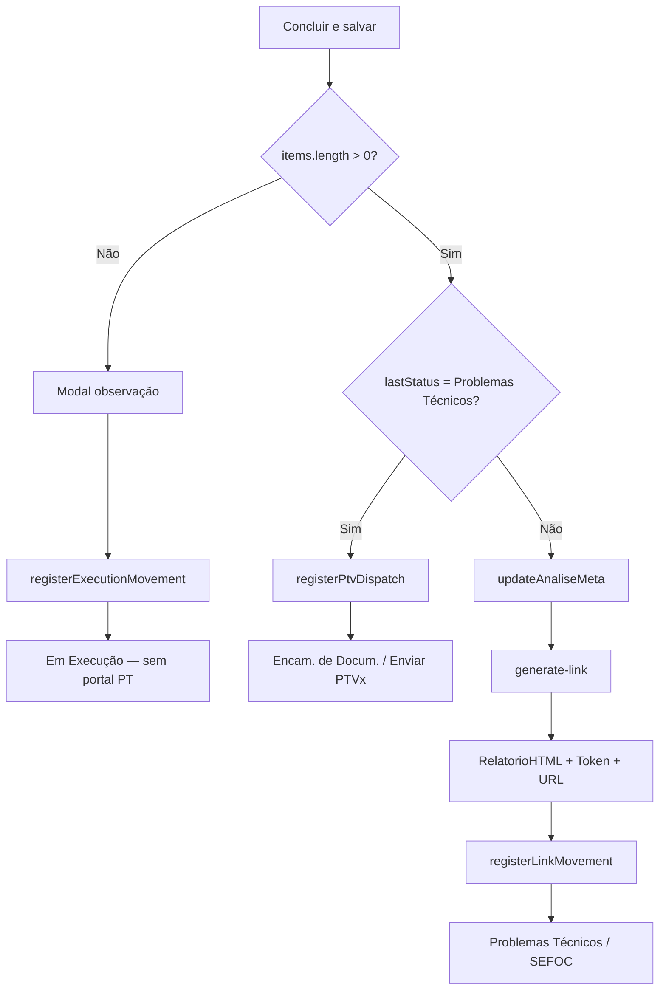
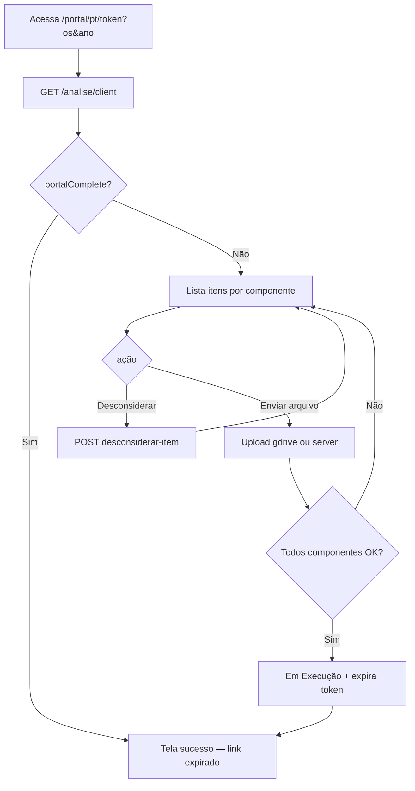

# Portal de Problemas Técnicos (`/portal/pt`) — Relatório Técnico Completo

> Documentação do fluxo que leva o **cliente** a visualizar e tratar problemas técnicos após o técnico clicar em **Concluir e salvar** na tela de Análise do SAGRA Web.  
> Data de referência: junho de 2026.  
> Escopo: botão de conclusão na análise interna, geração de link/token, página pública do portal PT, APIs, backend, integração com o Portal do Cliente (`/cliente`) e envio de e-mail.

---

## Sumário

1. [Visão geral](#1-visão-geral)
2. [Fluxo ponta a ponta](#2-fluxo-ponta-a-ponta)
3. [Tela interna — Análise e botão Concluir e salvar](#3-tela-interna--análise-e-botão-concluir-e-salvar)
4. [Backend — geração de link e persistência](#4-backend--geração-de-link-e-persistência)
5. [Roteamento e página pública do portal PT](#5-roteamento-e-página-pública-do-portal-pt)
6. [Layout e interações do portal PT](#6-layout-e-interações-do-portal-pt)
7. [APIs do portal (cliente externo)](#7-apis-do-portal-cliente-externo)
8. [Integração com o Portal do Cliente (`/cliente`)](#8-integração-com-o-portal-do-cliente-cliente)
9. [Envio de e-mail de problemas técnicos](#9-envio-de-e-mail-de-problemas-técnicos)
10. [Banco de dados](#10-banco-de-dados)
11. [Segurança e autenticação](#11-segurança-e-autenticação)
12. [Diagramas de fluxo](#12-diagramas-de-fluxo)
13. [Arquivos de referência](#13-arquivos-de-referência)
14. [Observações e endpoints legados](#14-observações-e-endpoints-legados)

---

## 1. Visão geral

Quando o técnico finaliza uma análise com **problemas técnicos identificados**, o sistema:

1. Consolida o relatório HTML dos itens da análise.
2. Gera (ou reutiliza) um **token** em `tabClientTokens`.
3. Monta a URL pública `{base}/portal/pt/{token}?os={nr_os}&ano={ano}`.
4. Registra andamento **Problemas Técnicos** no setor SEFOC.
5. Disponibiliza essa URL ao cliente — por **e-mail** (módulo E-mail, passo separado) e/ou pelo **Portal do Cliente** (`/cliente`), na seção de pendências.

A página `/portal/pt/{token}` é um **portal público**: não exige login com senha do Portal do Cliente. O acesso é controlado exclusivamente pelo **token** na URL (e pelos parâmetros `os` e `ano`).

| Aspecto | Detalhe |
|---------|---------|
| Rota SPA | `/portal/pt/$token` |
| Autenticação | Token em `tabClientTokens` (sem cookie de sessão) |
| Público-alvo | Gabinete/cliente que recebeu o link |
| Origem dos dados | `tabAnalises`, `tabAnaliseItens`, `tabProblemasPadrao` |
| Ações do cliente | Visualizar problemas, desconsiderar itens opcionais, enviar arquivos corrigidos por componente |

---

## 2. Fluxo ponta a ponta

```
Técnico (SAGRA interno)
  └─ Tela Análise (/analise?id=&ano=)
       └─ Monta itens na biblioteca de problemas
       └─ Clica "Concluir e salvar"
            ├─ [Sem itens] → Modal observação → OS "Em Execução" (sem portal PT)
            ├─ [OS já em "Problemas Técnicos"] → Reenvio PTV → "Encam. de Docum."
            └─ [Com itens — fluxo principal]
                 ├─ POST /analise/{ano}/{os}/generate-link
                 │    ├─ Gera RelatorioHTML + RelatorioEmail
                 │    ├─ Cria/reusa token → tabClientTokens
                 │    └─ URL /portal/pt/{token}?os=&ano=
                 └─ POST /analise/client/register-link-movement
                      └─ Andamento "Problemas Técnicos" / SEFOC

Cliente
  ├─ Recebe link por e-mail (POST /email/send-pt — passo manual do técnico)
  └─ Ou acessa via Portal do Cliente (/cliente) → botão pendência PT
       └─ Abre /portal/pt/{token}?os=&ano=
            ├─ GET /analise/client/{ano}/{os}?token= → lista itens
            ├─ Desconsiderar item → POST /client/desconsiderar-item
            └─ Enviar arquivo corrigido → POST /client/upload-files (ou Drive)
                 └─ Quando todos componentes pendentes recebem arquivo:
                      ├─ Andamento "Em Execução"
                      └─ Token expirado (DataExpiracao = NOW())
```

---

## 3. Tela interna — Análise e botão Concluir e salvar

### 3.1 Localização

| Item | Valor |
|------|-------|
| Componente | `AnalisePage` |
| Arquivo | `apps/web/src/features/analise/components/AnalisePage.tsx` |
| Rota | `/analise` com query `?id={os}&ano={ano}` |
| Botão | **Concluir e salvar** (ícone Save, fundo verde `primary-green`) |

O botão fica na toolbar superior da análise, à direita, junto ao seletor de versão e componente. Fica desabilitado em **modo visualização** (`readOnlyMode`) ou enquanto `finishing === true`.

### 3.2 Handler `handleFinish`

Ao clicar, a função `handleFinish` executa três caminhos distintos:

#### Caminho A — Análise sem itens (`items.length === 0`)

Abre modal de observação (`showObsModal`). Ao confirmar, chama `registerExecutionMovement` → andamento **Em Execução** em SEFOC. **Não gera portal PT** nem link.

#### Caminho B — OS já estava em "Problemas Técnicos"

Detectado via `lastAnalysisStatus === "Problemas Técnicos"` (último andamento carregado no bootstrap com `fetchUltimoAndamento`).

Chama `registerPtvDispatch` com observação `Enviar PTV{x}` e situação **Encam. de Docum.** — fluxo de **reenvio/atualização** de PTV, sem chamar `generateAnaliseLink`.

#### Caminho C — Fluxo principal (com itens, primeira conclusão com PT)

1. `updateAnaliseMeta(ano, osId, { versao, componente })` — persiste versão analisada e componente em `tabAnalises`.
2. `generateAnaliseLink(ano, osId, versionLabel, ponto)` — gera relatório, token e URL do portal.
3. `registerLinkMovement({ os_id, ano, usuario, link, versao })` — registra andamento **Problemas Técnicos**.

Em todos os caminhos bem-sucedidos: alerta "Análise concluída." e navegação para `/` (Início).

### 3.3 Pré-requisitos de edição

Antes de concluir, o técnico precisa estar em modo de edição (não visualização). O bootstrap da página valida o último andamento:

- **Em Execução** com observação contendo "analisar" → pode editar se for o mesmo ponto.
- **Recebido** → pode editar se for o responsável atual.
- Caso contrário → modo visualização bloqueado.

### 3.4 APIs chamadas pelo frontend (análise)

| Função (`apps/web/src/api/analise.ts`) | Endpoint | Quando |
|----------------------------------------|----------|--------|
| `updateAnaliseMeta` | `PATCH /analise/{ano}/{os}/meta` | Sempre no caminho B/C |
| `generateAnaliseLink` | `POST /analise/{ano}/{os}/generate-link` | Caminho C |
| `registerLinkMovement` | `POST /analise/client/register-link-movement` | Caminho C |
| `registerPtvDispatch` | `POST /analise/register-ptv-dispatch` | Caminho B |
| `registerExecutionMovement` | `POST /analise/register-execution-movement` | Caminho A |

---

## 4. Backend — geração de link e persistência

### 4.1 `POST /analise/{ano}/{os_id}/generate-link`

**Arquivo:** `app/backend/routers/analise_routes.py` — função `generate_client_link`.

**Entrada:** `{ versao, usuario? }`

**Etapas:**

1. **Valida análise** em `tabAnalises` (404 se inexistente).
2. **Persiste versão** em `tabAnalises` via `_persist_analise_meta`.
3. **Gera relatório HTML consolidado** (`RelatorioHTML`):
   - Cabeçalho formal com OS, produto, título e versão (ex.: `PROBLEMAS TÉCNICOS - ARQUIVO V2`).
   - Itens filtrados por versão (`_filter_items_for_analise_version`), não desconsiderados.
   - Agrupamento **Capa** e **Miolo / Conteúdo Interno** com numeração hierárquica (ex.: 1.1, 1.2, 2.1).
   - Cada item inclui o `HTML_Snapshot` do problema (evidência visual montada na análise).
4. **Gera `RelatorioEmail`** — mesmo conteúdo envolvido por template (`wrap_report_html`) para envio EWS.
5. **Atualiza `tabAnalises`** com `RelatorioHTML` e `RelatorioEmail`.
6. **Token em `tabClientTokens`:**
   - Reutiliza token existente para a mesma análise/OS/ano, ou
   - Insere novo com `secrets.token_urlsafe(48)`.
7. **Monta URL:** `{resolve_link_web_base()}/portal/pt/{token}?os={os_id}&ano={ano}`.
8. **Auditoria:** `log_link_generated_db` com `link_type="problemas_tecnicos"`, `origem="ANALISE"`.
9. **E-mail de protocolo (rascunho):** grava `email_pt_html`, `email_pt_versao`, `email_pt_data` em `tabProtocolos` usando template `pt_protocol_link` (variável `{{link}}`).

**Resposta:** `{ "url": "https://.../portal/pt/{token}?os=...&ano=..." }`

### 4.2 `POST /analise/client/register-link-movement`

Registra andamento após conclusão com itens:

| Campo | Valor |
|-------|-------|
| `SituacaoLink` | `Problemas Técnicos` |
| `SetorLink` | `SEFOC` |
| `Observação` | `Problemas técnicos na PTV{x} registrados` (x derivado da versão) |

### 4.3 `POST /analise/register-ptv-dispatch`

Usado quando a OS **já** estava em Problemas Técnicos:

| Campo | Valor |
|-------|-------|
| `SituacaoLink` | `Encam. de Docum.` |
| `SetorLink` | `SEFOC` |
| `Observação` | `Enviar PTV{x}` |

### 4.4 `GET /analise/client/{ano}/{os_id}?token=`

Endpoint principal consumido pela página do portal PT. Valida token, retorna:

| Campo | Descrição |
|-------|-----------|
| `items[]` | Problemas com `uniqueId`, `titulo`, `obs`, `html`, `componenteOrigem`, flags `desconsiderado`, `resolver`, `resolucaoObrigatoria` |
| `osTitulo`, `osProduto` | De `tabDetalhesServico` |
| `versao`, `versaoLabel` | Versão analisada formatada |
| `relatorioHtml`, `relatorioEmail` | Relatório consolidado (disponível na API; a UI atual exibe itens individuais) |
| `componentesEnviados` | Componentes que já receberam upload do cliente |
| `portalComplete` | `true` quando todos os uploads pendentes foram concluídos |

URLs de imagens de indicação no HTML são reescritas para acesso autenticado por token (`_rewrite_indication_urls_for_client`).

---

## 5. Roteamento e página pública do portal PT

### 5.1 Rota TanStack Router

| URL | Arquivo | Componente |
|-----|---------|------------|
| `/portal/pt/$token` | `apps/web/src/routes/portal/pt.$token.tsx` | `PortalPtPage` |

**Search params obrigatórios:** `?os={number}&ano={number}`

```tsx
// apps/web/src/routes/portal/pt.$token.tsx
validateSearch: (search) => ({
  os: Number(search.os) || 0,
  ano: Number(search.ano) || 0,
}),
```

### 5.2 URL em produção

Com `basepath` `/sagra`:

```
https://{host}/sagra/portal/pt/{token}?os={nr_os}&ano={ano}
```

`{host}` vem de `resolve_link_web_base()` no backend (configuração do ambiente).

### 5.3 Redirecionamento legado

`GET /client_pt.html?os=&ano=&token=` no backend redireciona 302 para a rota SPA moderna (`app/backend/routers/api.py`).

---

## 6. Layout e interações do portal PT

**Componente:** `PortalPtPage` — `apps/web/src/features/portal/PortalPtPage.tsx`

### 6.1 Estados da página

| Estado | Comportamento |
|--------|---------------|
| Parâmetros inválidos | Mensagem "Link inválido" |
| Carregando | Spinner "Carregando problemas técnicos…" |
| Erro de API | Mensagem de erro (token inválido/expirado, etc.) |
| `portalComplete === true` | Tela de sucesso `PortalUploadComplete` |
| Normal | Painel de itens + visualização do problema selecionado |

### 6.2 Cabeçalho (identificação do cliente)

Barra fixa com:

- **OS** `{osId}/{ano}` e título da publicação (somente leitura).
- **Versão analisada** (somente leitura).
- **Seu nome** e **Ponto** — obrigatórios antes de qualquer ação (desconsiderar ou upload). Modal de destaque se vazios.

### 6.3 Painel esquerdo — Itens da análise

- Itens agrupados por **componente** (Capa, Miolo, etc.) via `groupByComponente`.
- Cada item exibe: título, status (`Pendente` / `Desconsiderado` / `Resolvido`), badge **Obrigatória** (cadeado) se `resolucaoObrigatoria`.
- Botão **Desconsiderar** — apenas itens pendentes não obrigatórios (`canDisregardItem`).
- Botão **Enviar arquivo ({componente})** — por grupo com itens pendentes e sem upload ainda (`groupNeedsFileUpload`).
- Aceita `.pdf`, `.jpg`, `.jpeg`, `.png` (múltiplos arquivos).

### 6.4 Painel direito — Visualização do problema

- Título "SIMULAÇÃO ({componente}) — {status}".
- **`AnaliseHtmlViewer`** renderiza o `HTML_Snapshot` do item (evidência montada pelo técnico na análise).
- Bloco **Observação técnica** com texto do campo `obs`.

### 6.5 Ações do cliente e efeitos no sistema

#### Desconsiderar item

`POST /client/desconsiderar-item` com `id_item`, `nome_cliente`, `ponto`, `os_id`, `ano`.

- Marca `Desconsiderado = 1` em `tabAnaliseItens`.
- Se **todos** os itens forem desconsiderados → andamento **Em Execução** com obs "Todos os itens técnicos foram desconsiderados pelo cliente."

#### Enviar arquivo corrigido

Fluxo inteligente (`clientUploadFilesSmart`):

1. Consulta `GET /client/upload-mode` → `gdrive` ou `server`.
2. **Drive:** `POST /client/upload-session` → upload direto ao Google → `POST /client/upload-complete`.
3. **Servidor:** `POST /client/upload-files` (multipart).

Arquivos vão para pasta **Original** da OS na rede (subpasta da versão do portal).

Quando **todos os componentes** com itens pendentes recebem arquivo:

- Andamento **Em Execução** (observação detalhada do manifest de upload).
- `tabClientTokens.DataExpiracao = NOW()` — link deixa de funcionar.
- UI exibe tela de conclusão verde.

#### Bloqueios durante upload

Overlay modal impede interação; itens do componente em envio ficam com opacidade reduzida.

### 6.6 Utilitários de status

**Arquivo:** `apps/web/src/features/portal/portal-item-utils.ts`

| Função | Regra |
|--------|-------|
| `isItemPending` | Não desconsiderado e não resolvido |
| `isItemLocked` | `resolucaoObrigatoria === true` |
| `canDisregardItem` | Pendente e não obrigatório |
| `isItemBlockedByFileUpload` | Pendente mas componente já recebeu arquivo |

---

## 7. APIs do portal (cliente externo)

Todas em `app/backend/routers/analise_routes.py`. O frontend usa `clientApiFetch` em `apps/web/src/api/client-portal.ts` — **sem cookie de sessão interna**.

| Método | Endpoint | Função |
|--------|----------|--------|
| `GET` | `/analise/client/{ano}/{os_id}?token=` | Carregar análise e itens |
| `GET` | `/client/report/{ano}/{os_id}?token=` | PDF do relatório (FPDF2) |
| `GET` | `/client/upload-mode` | Modo de upload (gdrive/server) |
| `POST` | `/client/desconsiderar-item` | Desconsiderar problema |
| `POST` | `/client/upload-files` | Upload multipart para servidor |
| `POST` | `/client/upload-session` | Sessão resumável Google Drive |
| `POST` | `/client/upload-complete` | Finalizar upload Drive |
| `POST` | `/client/resolver-item` | Marcar item resolvido (uso interno/limitado) |

**Query key React Query:** `queryKeys.portal.pt(token, osId, ano)`

---

## 8. Integração com o Portal do Cliente (`/cliente`)

O dashboard `/cliente` **não embute** o portal PT. Ele lista OSs com pendência e oferece um botão externo.

### 8.1 Classificação de pendência PT

**Arquivo:** `app/backend/routers/cliente_gabinete_routes.py` — `_classify_pendencia`:

| Condição no último andamento | `pendencia_tipo` |
|------------------------------|------------------|
| Situação `Problemas Técnicos` | `problema_tecnico` |
| Situação `Pendência Usuário` + "ptv" na observação | `problema_tecnico` |

A segunda linha cobre o caso em que o e-mail PT foi enviado (`PTVx enviado` → situação Pendência Usuário).

### 8.2 Montagem da URL

```python
def _build_pt_portal_url(os_id, ano, token):
    base = resolve_link_web_base()
    return f"{base}/portal/pt/{token}?os={os_id}&ano={ano}"
```

Token obtido de `tabClientTokens` (`_fetch_pt_token`), respeitando `DataExpiracao`.

### 8.3 UI no dashboard cliente

- Seção **Pendências — Problemas técnicos** (`ClienteWorkBoard`).
- Botão via `ClientePendingAction`: label **"Ver pendência — Problemas Técnicos"**, abre em nova aba.
- Se token ausente/expirado, `pendencia_url` pode ser `null` (OS ainda listada, sem botão).

Documentação correlata: `docs/PAGINA_CLIENTE.md` (seções 7.2 e 11).

---

## 9. Envio de e-mail de problemas técnicos

A conclusão na análise **não envia e-mail automaticamente**. O envio é um passo **separado** no módulo **E-mail** do SAGRA interno.

### 9.1 Endpoint

`POST /email/send-pt` — `app/backend/routers/email_routes.py`

### 9.2 Pré-requisito

Exige `RelatorioEmail` ou `RelatorioHTML` em `tabAnalises` — gerados no `generate-link`. Se ausente:

> "HTML do e-mail não encontrado. Por favor, conclua a análise primeiro."

### 9.3 Conteúdo e andamento pós-envio

- Assunto: template `pt_send_subject` com variáveis OS, ano, versão, produto, título.
- Corpo: `RelatorioEmail` (prioridade) ou `RelatorioHTML`.
- Envio via **EWS** (Exchange), pasta de saída "Saida de Prob. Tec.".
- Novo andamento: situação **Pendência Usuário**, observação `PTV{x} enviado`.

Isso faz a OS aparecer no Portal do Cliente como pendência PT (regra "ptv" na observação).

### 9.4 Template de link no protocolo

Ao gerar o link, também se grava em `tabProtocolos.email_pt_html` o HTML do modelo `pt_protocol_link` (com `{{link}}` substituído). Esse HTML pode ser usado em fluxos de protocolo/e-mail distintos do `RelatorioEmail` principal.

---

## 10. Banco de dados

| Tabela / coluna | Papel no fluxo PT |
|-----------------|-------------------|
| `tabAnalises` | Cabeçalho da análise; `Versao`, `Componente`, `RelatorioHTML`, `RelatorioEmail` |
| `tabAnaliseItens` | Itens com `HTML_Snapshot`, `Obs`, `Componente`, `Desconsiderado`, `Resolver`, `ResolucaoObrigatoria`, `Versao` |
| `tabProblemasPadrao` | Título do problema (`TituloPT`) |
| `tabClientTokens` | `Token`, `ID_Analise`, `NroProtocolo`, `AnoProtocolo`, `DataExpiracao` |
| `tabProtocolos` | `email_pt_html`, `email_pt_versao`, `email_pt_data` |
| `tabAndamento` | Situações: Problemas Técnicos, Pendência Usuário, Encam. de Docum., Em Execução |
| `tabDetalhesServico` | Título e tipo de publicação exibidos no portal |

---

## 11. Segurança e autenticação

### 11.1 Portal PT (público com token)

- **Sem** cookie `sagra_session` nem `sagra_cliente_session`.
- Validação: `_validate_client_token_row(os_id, ano, token)`.
- Erros: 403 token inválido; 403 link expirado (`DataExpiracao` preenchida após upload completo).
- Imagens de indicação: URLs reescritas para endpoints que aceitam o mesmo token.

### 11.2 Portal do Cliente (`/cliente`)

Autenticação própria (cookie `sagra_cliente_session`). O botão de pendência apenas **abre** o link PT já gerado — não substitui a validação por token na página pública.

### 11.3 Análise interna

Rotas `/analise/*` de geração de link e andamento exigem sessão interna (`require_session` onde aplicável). O técnico precisa estar autenticado no SAGRA Web.

---

## 12. Diagramas de fluxo

### 12.1 Conclusão pelo técnico



### 12.2 Experiência do cliente no portal PT



---

## 13. Arquivos de referência

### Frontend

| Arquivo | Responsabilidade |
|---------|------------------|
| `apps/web/src/features/analise/components/AnalisePage.tsx` | Botão Concluir e salvar, `handleFinish` |
| `apps/web/src/api/analise.ts` | `generateAnaliseLink`, `registerLinkMovement`, `registerPtvDispatch` |
| `apps/web/src/routes/portal/pt.$token.tsx` | Rota do portal |
| `apps/web/src/features/portal/PortalPtPage.tsx` | UI completa do portal PT |
| `apps/web/src/features/portal/portal-item-utils.ts` | Regras de status e agrupamento |
| `apps/web/src/api/client-portal.ts` | APIs públicas do portal |
| `apps/web/src/features/analise/components/AnaliseHtmlViewer.tsx` | Renderização do HTML do problema |
| `apps/web/src/features/cliente/components/ClientePendingAction.tsx` | Botão pendência no `/cliente` |
| `apps/web/src/features/email/components/EmailPage.tsx` | Envio de e-mail PT |

### Backend

| Arquivo | Responsabilidade |
|---------|------------------|
| `app/backend/routers/analise_routes.py` | generate-link, validate client, upload, desconsiderar, andamentos |
| `app/backend/routers/cliente_gabinete_routes.py` | Pendências PT no dashboard cliente |
| `app/backend/routers/email_routes.py` | `POST /email/send-pt` |
| `app/backend/services/email_template_service.py` | Templates `pt_protocol_link`, `pt_send_subject` |
| `app/backend/routers/api.py` | Redirect `client_pt.html` → SPA |

---

## 14. Observações e endpoints legados

### 14.1 `POST /analise/finalize/{ano}/{os_id}`

Endpoint legado que gera HTML simplificado dos problemas e grava em `tabProtocolos.email_pt_html`. O frontend atual **não chama** este endpoint no fluxo "Concluir e salvar"; o caminho ativo é `generate-link`, que também atualiza `tabAnalises` e `tabProtocolos`.

### 14.2 Relatório consolidado vs. UI do portal

A API retorna `relatorioHtml` e `relatorioEmail`, mas `PortalPtPage` exibe **itens individuais** com `AnaliseHtmlViewer`, não o relatório consolidado de uma só vez. O PDF consolidado está disponível via `GET /client/report/{ano}/{os_id}?token=` (usado no portal de prova; no PT a função `clientReportPdfUrl` existe mas não está ligada à UI atual do `PortalPtPage`).

### 14.3 Versão dos itens

Itens podem ter coluna `Versao` em `tabAnaliseItens`. O backend filtra itens pela versão da análise ao montar o portal e o relatório, evitando exibir problemas de versões anteriores do arquivo.

### 14.4 Migração SAT

Problemas importados do SAT legado podem ter título via `tabMigracaoSatRegistroPT`. PDFs legados: `GET /analise/legacy-pt/{sat_codigo}/pdf?token=&os=&ano=`.

---

## Resumo executivo

| Pergunta | Resposta |
|----------|----------|
| O que o botão **Concluir e salvar** faz com PT? | Gera link do portal, relatório HTML/e-mail e andamento "Problemas Técnicos" |
| Qual URL o cliente abre? | `/portal/pt/{token}?os={nr}&ano={ano}` |
| Precisa login no Portal do Cliente? | Não — só o token na URL |
| O que o cliente vê? | Lista de problemas por componente + simulação HTML + observação técnica |
| O que o cliente pode fazer? | Desconsiderar (se permitido), enviar arquivos corrigidos por componente |
| Quando o link expira? | Após envio de todos os arquivos pendentes (`DataExpiracao`) |
| Como o `/cliente` se conecta? | Lista pendências PT e abre a mesma URL em nova aba |
| O e-mail sai automaticamente? | Não — técnico envia depois via módulo E-mail (`/email/send-pt`) |
