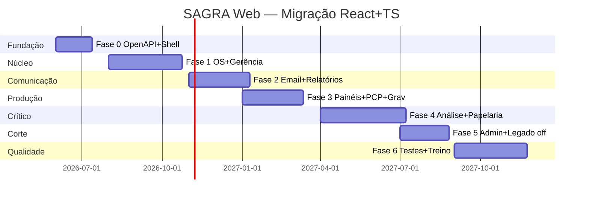

# Plano de migração completa — SAGRA Web → React + TypeScript

**Versão:** 1.0  
**Data:** maio/2026  
**Escopo:** substituir 100% da UI legada (`app/frontend` HTML/JS/Vue CDN) por SPA moderna, **mantendo FastAPI + MySQL** como backend e **paridade funcional** com o sistema atual.  
**Referências:** `contexto_executivo.md` (§5), inventário em `app/frontend` e `app/backend/routers/`.

---

## 1. Objetivos e princípios

| Objetivo | Critério de sucesso |
|----------|---------------------|
| **Paridade funcional** | Cada fluxo da matriz §8 aprovado em UAT com checklist assinado |
| **Segurança** | Auth na API (não só ocultar menu); sem fail-open; XSS eliminado no render |
| **Manutenibilidade** | Tipagem ponta a ponta (OpenAPI → cliente TS); testes E2E nos fluxos críticos |
| **Operação** | Deploy compatível com Windows + Nginx atual; rollback para HTML legado por fase |
| **Performance** | TTFB/TTI aceitável em rede interna; listas grandes virtualizadas |

**Princípios (não negociáveis):**

1. **Big-bang proibido** — convivência HTML ↔ React por rota até corte final.
2. **Backend primeiro** — OpenAPI, auth, contratos estáveis antes de reescrever telas complexas.
3. **FastAPI permanece** — não introduzir Node como API principal (duplicaria EWS, MDB, Corel, sync).
4. **Integrações Windows isoladas** — EWS, pyodbc, win32com permanecem em serviços Python; UI só consome REST/WS.
5. **MySQL como verdade** — Access/sync fora do caminho crítico da nova UI (já alinhado a `MYSQL_ONLY`).

---

## 2. Stack alvo (estado da arte — 2025/2026)

### 2.1 Frontend (novo)

| Camada | Tecnologia | Motivo |
|--------|------------|--------|
| UI | **React 19** + **TypeScript 5.7+** | Ecossistema, contratação, componentes |
| Build | **Vite 6** | Dev rápido, HMR, bundle otimizado |
| Roteamento | **TanStack Router** | Rotas tipadas, loaders, code-splitting por módulo |
| Server state | **TanStack Query v5** | Cache, retry, invalidação, optimistic updates (PCP reorder) |
| Client state | **Zustand** | Sessão leve (ponto, permissões, UI prefs) |
| Forms | **React Hook Form** + **Zod** | Validação alinhada a Pydantic |
| UI kit | **shadcn/ui** + **Tailwind CSS v4** + **Radix** | Acessível, tema DEAPA, sem lock-in pesado |
| Tabelas | **TanStack Table** + virtualização | `index` / relatórios com milhares de OS |
| Gráficos | **Chart.js 4** (via `react-chartjs-2`) | Paridade `dashboard_global` |
| Drag-and-drop | **@dnd-kit** | Paridade `pcp` (substitui SortableJS) |
| PDF | **pdf.js** (wrapper React) | Paridade `analise` |
| Canvas markup | **Fabric.js 6** | Paridade `analise` (anotações em prova) |
| Barcode | **jsbarcode** | Paridade `requisicao` |
| Selects ricos | **React Select** ou **Combobox shadcn** | Substituir jQuery Select2 |
| i18n | **pt-BR fixo** (sem i18n framework na v1) | Escopo interno |
| Testes unit | **Vitest** + **Testing Library** | Componentes e hooks |
| Testes E2E | **Playwright** | Fluxos OS, análise, admin |
| API client | **Orval** ou **openapi-typescript** + **fetch** | Gerado a partir do OpenAPI do FastAPI |
| Realtime | **nativo WebSocket** + hook `useWebSocket` | `/ws`, `/api/ws/jobs` |
| Monorepo | **pnpm workspaces** | `apps/web` + `packages/api-types` + `packages/ui` |

**Por que não Next.js neste projeto:** app intranet atrás de Nginx, sem necessidade de SSR/SEO; deploy = arquivos estáticos em `app/frontend/dist` servidos pelo mesmo Uvicorn/`SafeStaticFiles` ou Nginx. Next só se no futuro o portal cliente público exigir SSR (fase opcional 2).

### 2.2 Backend (evolução, não substituição)

| Camada | Tecnologia | Evolução |
|--------|------------|----------|
| API | **FastAPI** + **Pydantic v2** | Manter; schemas rigorosos em todos os routers |
| Documentação | **OpenAPI 3.1** export estável | `GET /openapi.json` versionado |
| Auth | **Session cookie HttpOnly** + **JWT opcional** para portal cliente | Substituir progressivamente IP-only |
| IP RBAC | **`ip_permissions`** mantido | Camada extra até AD/LDAP |
| DB | **MySQL 8** + pool configurável | Migrar pool para env |
| Realtime | **Redis pub/sub** (fase 2) | Multi-instância Uvicorn |
| Workers | **Processos separados** | sync, monitor, EWS — já em `app/services/` |
| Observabilidade | **structlog** + métricas | Logs JSON em `logs/api/` |

### 2.3 DevOps e qualidade

| Item | Ferramenta |
|------|------------|
| CI | GitHub Actions / Azure DevOps (lint, typecheck, vitest, playwright smoke) |
| Preview | Build estático + API dev `127.0.0.1:8001` |
| Versão | SemVer por release (`web@2.0.0`) |
| Feature flags | Env `SAGRA_UI=v2` + Nginx route `/app/*` → React |

---

## 3. Arquitetura alvo

```
┌─────────────────────────────────────────────────────────────────┐
│ Browser                                                          │
│  React SPA (Vite) ── TanStack Query ── OpenAPI client (TS)       │
│       │                    │                                     │
│       └──── WebSocket (/ws, /api/ws/jobs)                       │
└───────────────────────────┬─────────────────────────────────────┘
                            │ HTTPS (Nginx :80/443)
                            ▼
┌─────────────────────────────────────────────────────────────────┐
│ Nginx                                                            │
│  /sagra/          → React static (dist)                          │
│  /sagra/api/      → Uvicorn :8001 (FastAPI)                      │
│  /sagra/ws        → proxy WebSocket                              │
└───────────────────────────┬─────────────────────────────────────┘
                            ▼
┌─────────────────────────────────────────────────────────────────┐
│ FastAPI (app/backend)                                            │
│  Routers │ Auth middleware │ OpenAPI │ StaticFiles (fallback)    │
└──────┬──────────────────────────────┬───────────────────────────┘
       │                              │
       ▼                              ▼
   MySQL 8                      Windows services
   (sagrafulldb)                EWS, MDB*, Corel*, sync*
                               * opcionais / legado
```

**Estrutura de repositório proposta:**

```
Sagra Web/
├── app/
│   ├── backend/              # FastAPI (inalterado em espírito)
│   └── frontend/             # LEGADO — congelado após corte por módulo
├── apps/
│   └── web/                  # NOVO — React + Vite + TS
│       ├── src/
│       │   ├── routes/       # TanStack Router file-based
│       │   ├── features/     # os, email, analise, ...
│       │   ├── components/   # layout, ui
│       │   ├── api/          # hooks gerados
│       │   └── lib/
│       └── e2e/              # Playwright
├── packages/
│   ├── api-types/            # tipos OpenAPI gerados
│   └── eslint-config/
├── docs/
│   └── PLANO_MIGRACAO_REACT_TYPESCRIPT.md
└── deploy/
    └── nginx/                # rotas /sagra → dist
```

---

## 4. Inventário funcional — mapa HTML → React

| # | Legado | Rota React | Complexidade | Dependências especiais |
|---|--------|------------|--------------|------------------------|
| 1 | `index.html` | `/` | **Alta** | Busca OS, histórico, vínculos, notificações, context menu |
| 2 | `gerencia.html` | `/os/nova`, `/os/:ano/:id` | **Alta** | Form grande, aux APIs, save, duplicate |
| 3 | `email.html` | `/email` | **Alta** | EWS, anexos, send-pt, pendências |
| 4 | `analise.html` | `/analise/:ano/:id` | **Muito alta** | pdf.js, fabric, upload cliente, links públicos |
| 5 | `papelaria.html` | `/papelaria` | **Média** | Preview server-side (Corel) |
| 6 | `settings.html` | `/configuracoes` | **Baixa** | Filtros salvos |
| 7 | `relatorio.html` | `/relatorios` | **Média** | Export XLSX |
| 8 | `dashboard_setor.html` | `/painel/setor` | **Média** | Vue→React, polling/search |
| 9 | `dashboard_global.html` | `/painel/global` | **Média** | Chart.js |
| 10 | `pcp.html` | `/pcp` | **Média** | DnD reorder API |
| 11 | `gravacao.html` | `/gravacao` | **Alta** | WebSocket jobs, status Xpose |
| 12 | `usuarios.html` | `/usuarios` | **Baixa** | Online + notify |
| 13 | `admin_ips.html` | `/admin/ips` | **Média** | CRUD permissões matriz |
| 14 | `active_computers.html` | `/admin/ativos` | **Baixa** | WS admin |
| 15 | `requisicao.html` | `/impressao/requisicao/:ano/:id` | **Baixa** | JsBarcode, print CSS |
| 16 | `client_pt.html` | `/portal/pt/:token` | **Média** | Rotas públicas `/api/client/*` |
| 17 | `client_proof.html` | `/portal/prova/:token` | **Média** | Público |
| 18 | `controls/sync_control.html` | `/admin/sync` | **Baixa** | Condicional `SYNC_ENABLED` |
| 19 | Login overlay | `/login` + guard global | **Média** | Ponto + permissões |

**Fora do escopo v1 (arquivar):** `emailfinal*.html`, `dashboard_setor copy.html`.

---

## 5. Contrato API e tipagem

### 5.1 OpenAPI como fonte da verdade

1. Auditar todos os routers (~90+ rotas) e unificar duplicatas (`/api/aux/setores` em `os_routes` e `auxiliar_routes`).
2. Garantir **response_model** Pydantic em cada endpoint.
3. Publicar `openapi.json` em build CI; gerar cliente:

```bash
pnpm --filter api-types run generate   # orval → packages/api-types
```

4. Versionar API: header `X-Sagra-Api-Version: 2` durante transição.

### 5.2 Autenticação (migração paralela à UI)

| Fase | Comportamento |
|------|----------------|
| A (atual) | IP em `ip_permissions` + `GET /api/permissions` |
| B | `POST /api/auth/session` — ponto + validação futura AD; cookie HttpOnly |
| C | Portal cliente: JWT curto por link (`/api/client/*`) |
| D | Opcional LDAP/AD para identificar ponto |

React: interceptor adiciona credenciais; `usePermissions()` substitui `permissions.js`; **nunca** fail-open (erro = tela bloqueada).

### 5.3 Config runtime

Substituir `config_client.js` por:

- `GET /api/config/public` → `{ apiBase, mysqlOnly, syncEnabled, env }`
- Injetado no `index.html` do Vite via env em build **ou** fetch no bootstrap

---

## 6. Fases do projeto (18 meses — 2 devs + 1 QA part-time)

Estimativa para **paridade total** com testes e UAT por setor (DEAPA).

### Fase 0 — Fundação (semanas 1–6)

| Entrega | Detalhe |
|---------|---------|
| Monorepo `apps/web` | Vite + React 19 + TS strict |
| Design system | Tokens DEAPA (verde/azul do `styles.css`), layout AppShell |
| OpenAPI v1 | Coverage ≥ 80% rotas CRUD |
| Auth fase B | Session + compat IP |
| CI | lint, typecheck, build |
| Nginx | `/sagra/` → `dist`, API inalterada |
| Feature flag | `?ui=v2` ou subpath |

**Gate:** login + shell + `GET /api/permissions` funcionando.

### Fase 1 — Núcleo operacional (semanas 7–18)

| Módulo | Rotas React | Paridade |
|--------|-------------|----------|
| Login + Layout | Global | Sidebar, header, logout |
| Início (index) | `/` | Busca, tabela, filtros, histórico |
| Gerência OS | `/os/*` | Create/edit/duplicate, aux |
| Configurações | `/configuracoes` | Filtros salvos |
| Notificações | integrado | Badge + lista |

**Gate UAT:** operador DEAPA consegue dia inteiro só na v2 para listagem + OS.

### Fase 2 — Comunicação e relatórios (semanas 19–28)

| Módulo | Notas |
|--------|-------|
| Email | Inbox EWS, anexos, mark-read, send-pt |
| Relatórios | Custom + XLSX download |
| Requisição A5 | Rota print-friendly + JsBarcode |
| Usuários online | `/usuarios` + WS presence |

### Fase 3 — Painéis e produção (semanas 29–38)

| Módulo | Notas |
|--------|-------|
| Dashboard setor | Migrar lógica Vue CDN |
| Dashboard global | Charts + filtros |
| PCP | Fila + dnd-kit + reorder API |
| Gravação | WS `/api/ws/jobs`, status, job ticket |

### Fase 4 — Análise e papelaria (semanas 39–52) — **maior risco**

| Módulo | Estratégia |
|--------|------------|
| Papelaria | Preview iframe ou API HTML até Corel ir para serviço |
| Análise | Sub-fases: lista itens → PDF viewer → Fabric markup → links cliente |
| Portal cliente | `client_pt` + `client_proof` rotas públicas isoladas (layout sem sidebar) |

**Gate:** comparar PDF/anotações pixel-a-pixel com legado em amostra de 20 OS.

### Fase 5 — Admin e corte (semanas 53–60)

| Módulo | Notas |
|--------|-------|
| Admin IPs | Matriz permissões |
| Active computers | Admin WS |
| Sync control | Se `SYNC_ENABLED` |
| Redirect 301 | Nginx: `.html` → rotas React |
| Remover legado | Mover `app/frontend` → `legacy_or_unused/frontend_v1` |

### Fase 6 — Endurecimento (semanas 61–72)

| Item | Detalhe |
|------|---------|
| Playwright suite | 15–20 jornadas críticas |
| Performance | Virtualização, lazy routes, bundle < 500KB gzip inicial |
| Segurança | Pentest interno, CSP, sanitização HTML |
| Docs | Manual operador + runbook deploy |
| Treinamento | 2 sessões por setor |

**Acelerado (3 devs sênior):** 12–14 meses. **Conservador (1 dev):** 24+ meses.

---

## 7. Estratégia de convivência (strangler fig)

```
Nginx
  /sagra/              → React (novo)
  /sagra/legacy/       → HTML antigo (fallback temporário)
  /sagra/api/          → FastAPI
```

1. **Rota por rota:** cada link da sidebar aponta para React quando `featureFlags.osList === true`.
2. **iframe de escape:** apenas para Papelaria/Análise na fase 4 se atrasar (máx. 4 semanas).
3. **Rollback:** manter build HTML congelado em tag git `legacy-ui-2026-q2`.

---

## 8. Matriz de paridade (checklist UAT — resumo)

Cada linha exige **≥ 1 teste E2E Playwright** + sign-off usuário-chave.

### 8.1 OS e gerência
- [ ] Busca com todos os filtros de `settings`
- [ ] Abrir detalhes, histórico CRUD, replicar andamento
- [ ] Vínculos e exceções
- [ ] Nova OS / próximo ID / duplicar
- [ ] Salvar OS (MySQL; MDB se reativado)
- [ ] Abrir pasta rede (link folder-opener)
- [ ] Context menu (permissões `ctx_*`)

### 8.2 Email
- [ ] Inbox não lidos (EWS)
- [ ] Download anexo
- [ ] Marcar lido + categoria
- [ ] Enviar PT + andamento
- [ ] Pendências SEFOC

### 8.3 Análise
- [ ] Carregar versões OS
- [ ] Itens problema, resolução, preview
- [ ] PDF serve + anotações Fabric
- [ ] Gerar link cliente + movimentos
- [ ] Upload cliente (portal)

### 8.4 Painéis / PCP / Gravação
- [ ] Dashboard setor/global filtros
- [ ] PCP reorder persiste
- [ ] Gravação WS atualiza status

### 8.5 Admin
- [ ] CRUD IP + matriz `sb_*` / `ctx_*`
- [ ] Solicitações de acesso
- [ ] Usuários online / desconectar

### 8.6 Portal e impressão
- [ ] Client PT / proof com token
- [ ] Requisição A5 impressão

---

## 9. Módulos críticos — táticas técnicas

### 9.1 `index` / busca OS
- TanStack Table com server-side pagination (estender API se hoje retorna tudo).
- Debounce 300ms na busca; staleTime 30s no Query.
- Context menu: Radix Context Menu + permissões do hook `usePermissions`.

### 9.2 `analise` (Fabric + PDF)
- Extrair lógica de coordenadas para hook `useFabricCanvas`.
- Sanitizar HTML no **backend** (já existe bleach); React usa `dangerouslySetInnerHTML` só com DOMPurify se inevitável.
- Testes visuais: snapshot de JSON de anotações, não pixels.

### 9.3 `email` (EWS)
- UI não muda integração: mesmos endpoints `/api/email/*`.
- Estados: loading skeleton, erro EWS amigável, retry.

### 9.4 `papelaria` (Corel COM)
- **Opção A (rápida):** POST preview retorna HTML → render em iframe sandbox.
- **Opção B (ideal):** microserviço Windows `papelaria-preview` desacoplado.

### 9.5 Realtime
- Hook `useSagraWebSocket` com reconnect exponencial.
- Fase 2 backend: Redis para broadcast multi-instância.

### 9.6 Permissões
- Rota guard: `<PermissionGate perm="sb_gerencia">`.
- Mapa único `SCREEN_PERMISSIONS` em TS espelhando `api.py`.

---

## 10. Testes e qualidade

| Nível | Meta |
|-------|------|
| Unit (Vitest) | ≥ 70% em `features/*/utils` e hooks |
| Component | Formulários gerência, tabela index |
| E2E (Playwright) | 20 jornadas críticas (§8) |
| Contrato API | Schemathesis ou Dredd contra OpenAPI |
| Acessibilidade | axe-core em CI (warnings não bloqueiam v1) |

**Ambientes:**

| Env | UI | API | DB |
|-----|----|-----|-----|
| dev | Vite :5173 + proxy | :8001 | dev |
| staging | `dist` | staging | cópia anonimizada |
| prod | Nginx | NSSM/Uvicorn | produção |

---

## 11. Segurança na migração

| Risco legado | Mitigação React |
|--------------|-----------------|
| XSS `innerHTML` | React default escape + DOMPurify onde HTML rico |
| Permissões só no cliente | Route guards + API 403 |
| Fail-open `permissions.js` | Error boundary → tela “sem permissão” |
| CDN offline | Self-host fonts/icons (Font Awesome npm) |
| Tokens cliente em URL | Rotas dedicadas, curta expiração, CSP restrita |

---

## 12. Deploy e rollback

1. Build: `pnpm --filter web build` → `apps/web/dist`.
2. Copiar para `app/frontend/dist` ou `deploy/nginx/html/sagra/`.
3. Nginx:

```nginx
location /sagra/ {
    try_files $uri $uri/ /sagra/index.html;
}
location /sagra/api/ {
    proxy_pass http://127.0.0.1:8001/api/;
}
```

4. **Rollback:** restaurar symlink para `legacy_or_unused/frontend_v1` + flag `SAGRA_UI=v1`.

---

## 13. Equipe e papéis

| Papel | Responsabilidade |
|-------|------------------|
| Tech lead | Arquitetura, OpenAPI, auth, code review |
| Frontend ×2 | Features por fase, design system |
| Backend ×1 (parcial) | Pydantic, performance busca, Redis WS |
| QA | UAT checklist §8, Playwright |
| PO / usuário DEAPA | Priorização e sign-off por fase |

---

## 14. Riscos e mitigação

| Risco | Impacto | Mitigação |
|-------|---------|-----------|
| Análise/Fabric regressão | Alto | Fase dedicada, UAT amostra grande |
| EWS indisponível em dev | Médio | Mock MSW + staging Windows |
| Prazo estoura | Alto | Cortar iframe legado só para admin/sync |
| Resistência usuários | Médio | Treinamento por fase, v1 legado paralelo |
| Dual-write MDB reativado | Médio | UI agnóstica; documentar flag |
| Corel só Windows | Médio | Serviço dedicado, não bloquear SPA Linux build |

---

## 15. O que não migrar / não reescrever

- **FastAPI → Node:** não recomendado.
- **sync_andamentos_v2.py:** permanece worker; UI só painel admin.
- **Access MDB:** fora do frontend; descomissionar em projeto separado.
- **PyInstaller worker:** mantém `api_server_worker.exe` até Docker aprovado.
- **web-orchestrator:** projeto React separado; integrar só se produto exigir.

---

## 16. Cronograma visual



---

## 17. Primeiros passos (próximas 2 semanas)

1. Aprovar este plano e equipe.
2. Criar `apps/web` com Vite + React + TS strict + TanStack Router/Query.
3. Endpoint `GET /api/config/public` + OpenAPI export limpo.
4. Implementar **AppShell** + login + permissões (paridade `permissions.js` sem fail-open).
5. POC: página `/` com busca OS mínima (1 filtro + tabela).
6. Configurar Playwright com 1 teste: login → busca → abrir detalhe.

---

## 18. Referência rápida — endpoints por domínio

| Domínio | Prefixo API | Páginas React |
|---------|-------------|---------------|
| OS | `/api/os/*`, `/api/aux/*` | `/`, `/os/*` |
| Análise | `/api/analise/*`, `/api/files/*`, `/api/client/*` | `/analise/*`, `/portal/*` |
| Email | `/api/email/*` | `/email` |
| Papelaria | `/api/papelaria/*` | `/papelaria` |
| Settings | `/api/settings/*` | `/configuracoes` |
| Relatórios | `/api/reports/*` | `/relatorios`, `/impressao/*` |
| PCP | `/api/pcp/*` | `/pcp` |
| Gravação | `/api/gravacao/*`, WS jobs | `/gravacao` |
| Admin | `/api/admin/*`, `/api/permissions` | `/admin/*` |
| Users | `/api/users/*`, `/api/realtime/*` | `/usuarios` |
| Sync | `/api/sync/*` | `/admin/sync` |

---

**Documento vivo:** atualizar a cada fase concluída com datas reais, % paridade UAT e desvios de escopo.
