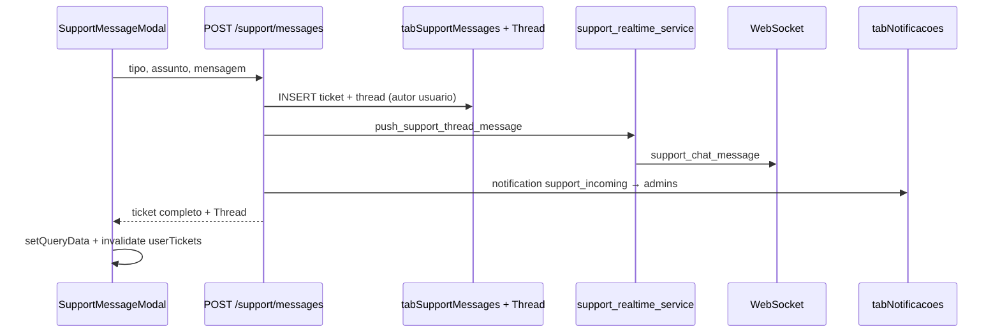
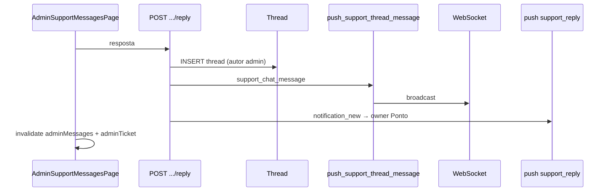

# Relatório de Auditoria — Chat de Suporte

**Data:** 09/06/2026  
**Escopo:** auditoria read-only do chat de suporte (usuário interno, admin e portal cliente)  
**Restrições respeitadas:** nenhuma alteração de código, banco, endpoints, WebSocket ou produção.

---

## 1. Resumo executivo

### Como funciona hoje

O chat de suporte do SAGRA Web é implementado como **tickets com thread de mensagens** (modelo ticket + histórico), não como chat puro desacoplado.

| Papel | Entrada UI | API principal | Tempo real |
|-------|------------|---------------|------------|
| Usuário interno | Menu **Ajuda → Mensagem ao suporte** (`SupportHelpMenu`) abre `SupportMessageModal` | `POST /api/support/messages`, `GET /api/support/tickets/{id}`, `POST .../reply` | Hook `useSupportChatRealtime` quando o modal está na view **thread** |
| Administrador | Página `/admin/mensagens` (`AdminSupportMessagesPage`) | `GET /api/admin/system/support-messages`, `POST .../reply`, `POST .../resolve` | `useSupportChatRealtime` **+** listener separado de `notification_new` / `support_incoming` |
| Cliente (portal) | FAB/modal em Problemas Técnicos (`ClienteSupportModal`) | `/api/cliente/support/*` | `useClienteSupportChatRealtime` |

Fluxo de dados:

1. Ticket criado em `tabSupportMessages`; primeira mensagem inserida em `tabSupportThreadMessages`.
2. Respostas subsequentes vão para a thread; campos legados `Resposta` / `RespondidoPor` são atualizados na resposta admin.
3. Backend emite **`support_chat_message`** via WebSocket (`support_realtime_service.push_support_thread_message`).
4. Paralelamente, notificações persistidas em `tabNotificacoes` + push **`notification_new`** (`support_incoming` para admin, `support_reply` para usuário).

### Por que o admin atualiza e o modal do usuário não

O admin possui **duas camadas de atualização em tempo real**, enquanto o usuário depende essencialmente de **uma única camada frágil**:

| Mecanismo | Admin | Modal usuário |
|-----------|-------|---------------|
| `useSupportChatRealtime` → `setQueryData` na thread | Sim | Sim (código presente) |
| `notification_new` → `invalidateQueries` do ticket | Sim (`support_incoming`) | **Não** (`support_reply` só invalida notificações) |
| Conexão WebSocket dedicada ao chat | Sim (3ª conexão quando conversa aberta) | Sim (3ª conexão quando thread aberta) |
| Polling / `refetchInterval` com modal aberto | Não | Não |

**Conclusão:** o código do modal do usuário **já chama** `useSupportChatRealtime`, mas a arquitetura atual torna a atualização **assimétrica e dependente de uma conexão WebSocket efêmera** (criada/destruída conforme `enabled`). Se essa conexão não processar o evento, **não há fallback** equivalente ao do admin. Fechar e reabrir o modal funciona porque dispara novo `GET /api/support/tickets/{id}` via TanStack Query com `enabled` condicionado à abertura.

---

## 2. Arquitetura atual

### 2.1 Front-end usuário (interno)

| Peça | Arquivo | Função |
|------|---------|--------|
| Botão / menu | `apps/web/src/features/support/components/SupportHelpMenu.tsx` | Menu Ajuda; abre modal via `useSupportUiStore.openModal()` |
| Modal principal | `apps/web/src/features/support/components/SupportMessageModal.tsx` | Views: menu → nova / lista / thread |
| Thread visual | `apps/web/src/features/support/components/SupportThreadView.tsx` | Bolhas, auto-scroll, formulário de resposta |
| Store UI | `apps/web/src/features/support/supportUiStore.ts` | `modalOpen`, `initialTicketId`, `viewingTickets` (supressão de notificação) |
| Hook realtime | `apps/web/src/features/support/hooks/useSupportChatRealtime.ts` | WS, subscribe, typing, `setQueryData` |
| API client | `apps/web/src/api/support.ts` | Tipos e fetch/mutations |
| Montagem | `apps/web/src/components/layout/AppShell.tsx` | `<SupportMessageModal />` sempre montado |

**Queries TanStack Query no modal:**

```text
["support", "userTickets", "aberto"]     → lista (enabled: open && view list|thread)
["support", "userTicket", ticketId]      → detalhe + thread (enabled: open && view thread && id)
```

**Hook de envio:** `useMutation` → `submitSupportMessage` / `replyUserSupportTicket`; em sucesso faz `setQueryData` + `invalidateQueries(["support", "userTickets"])`.

**Estado local:** `view`, `selectedTicketId`, campos de formulário, `feedback`.

**Tempo real:** `useSupportChatRealtime` com:

```text
enabled = open && view === "thread" && selectedTicketId != null && status !== "resolvido"
```

**Não usa polling.** Não invalida `userTicket` ao receber `notification_new` / `support_reply`.

**Modal desmonta conteúdo, não o componente:** quando `open === false`, retorna `null` após executar hooks; queries e WS de chat ficam desabilitados.

### 2.2 Front-end admin

| Peça | Arquivo |
|------|---------|
| Página | `apps/web/src/features/support/components/AdminSupportMessagesPage.tsx` |
| Rota | `apps/web/src/routes/_authenticated/admin/mensagens.tsx` (`?ticket=` opcional) |

**Queries:**

```text
["support", "adminMessages", status]
["support", "adminTicket", id]
["support", "adminSettings"]
```

**Tempo real — camada 1 (chat):** `useSupportChatRealtime` com `role: "admin"`.

**Tempo real — camada 2 (notificação):** `useSagraWebSocket` dedicado escutando:

```typescript
data.type === "notification_new" && data.action === "support_incoming"
→ invalidateQueries(["support", "adminMessages"])
→ invalidateQueries(["support", "adminTicket", selectedId])
```

**Filtros:** aberto / resolvido / todas. **Sem busca textual.**

### 2.3 Front-end cliente (portal)

| Peça | Arquivo |
|------|---------|
| Modal | `apps/web/src/features/cliente/components/ClienteSupportModal.tsx` |
| Realtime | `apps/web/src/features/cliente/hooks/useClienteSupportChatRealtime.ts` |
| FAB | `apps/web/src/features/cliente/components/ClientePtSupportFab.tsx` |

Mesmo padrão do usuário interno: WS dedicado ao chat, sem fallback por notificação no ticket.

### 2.4 Backend / API

**Router:** `app/backend/routers/support_routes.py`  
**Serviço:** `app/backend/services/support_message_service.py`  
**Realtime:** `app/backend/services/support_realtime_service.py`  
**Config:** `app/backend/services/support_settings.py` (`config/support_settings.json`)

| Endpoint | Método | Auth | Descrição |
|----------|--------|------|-----------|
| `/api/support/settings` | GET | sessão | Flag `usuario_chat_enabled` |
| `/api/support/messages` | POST | sessão | Cria ticket + 1ª mensagem thread |
| `/api/support/tickets` | GET | sessão | Lista tickets do `Ponto` da sessão |
| `/api/support/tickets/{id}` | GET | sessão | Detalhe + thread (404 se outro ponto) |
| `/api/support/tickets/{id}/reply` | POST | sessão | Resposta do usuário na thread |
| `/api/admin/system/support-messages` | GET | `require_admin_config_access` | Lista todos (filtro status) |
| `/api/admin/system/support-messages/{id}` | GET | admin | Detalhe + thread |
| `/api/admin/system/support-messages/{id}/reply` | POST | admin | Resposta admin |
| `/api/admin/system/support-messages/{id}/resolve` | POST | admin | Encerra ticket |
| `/api/admin/system/support-settings` | GET/PUT | admin | Liga/desliga chat usuário e cliente |
| `/api/cliente/support/*` | vários | sessão cliente | Chat vinculado a OS / analista PT |
| `/api/support/assigned-tickets/*` | vários | sessão | Tickets cliente roteados ao analista |

**Validações de payload (Pydantic):**

- Assunto: 3–255 chars
- Mensagem/resposta: 3–8000 chars (criação inicial usuário: min 10)
- Tipo: `problema` | `sugestao`

**Permissões:**

- Usuário: CRUD apenas do próprio `Ponto` (checagem em `get_user_support_ticket` e `add_user_reply`).
- Admin: `require_admin_config_access` (permissão `sb_admin_ips`).
- Cliente: `ClienteId` + OS pertencente ao gabinete.
- Assigned: `AssignedPonto` + `Source = 'cliente'`.

**Não existe endpoint de “marcar mensagem como lida”** no chat; leitura é indireta via `tabNotificacoes` + `markNotificationRead`.

### 2.5 Banco de dados

#### `tabSupportMessages` (ticket / conversa)

| Coluna | Tipo | Uso |
|--------|------|-----|
| Id | int PK | ticket_id |
| Ponto | varchar(32) | dono (usuário interno) ou `cliente:{id}` |
| NomeUsuario | varchar(128) | nome exibido |
| Tipo | varchar(16) | `problema` / `sugestao` |
| Assunto | varchar(255) | título |
| Mensagem | text | corpo inicial (legado; espelhado na thread) |
| Status | varchar(16) | `aberto` / `resolvido` |
| Resposta | text | última resposta admin (legado) |
| RespondidoPor | varchar(64) | |
| DataCriacao | datetime | |
| DataResposta | datetime | |
| DataResolucao | datetime | |
| ResolvidoPor | varchar(64) | |
| AssignedPonto | varchar(32) | analista PT (chat cliente) |
| OsAno, OsNro | int | OS vinculada |
| ClienteId | int | portal cliente |
| VersaoPt | varchar(64) | versão PT para roteamento |
| Source | varchar(16) | `interno` / `cliente` |

Índices: status, ponto, data.

#### `tabSupportThreadMessages` (mensagens)

| Coluna | Tipo |
|--------|------|
| Id | int PK |
| TicketId | int FK lógica |
| AutorTipo | `usuario` / `admin` / `cliente` |
| AutorPonto | varchar(32) nullable |
| AutorNome | varchar(128) nullable |
| Mensagem | text |
| DataCriacao | datetime |

**Ausentes:** lido/não lido por mensagem, anexos, prioridade, categoria além de Tipo, `updated_at` no ticket.

#### Notificações (paralelo)

`tabNotificacoes`: Ponto, Mensagem, DetalhesJson (JSON com `type`, `ticket_id`, etc.).

### 2.6 WebSocket

**Hook cliente:** `apps/web/src/hooks/useSagraWebSocket.ts` — uma instância = **uma conexão**; reconexão exponencial; ping 25s.

**URL:** `resolveWebSocketUrl` → dev `/ws`, produção `{apiPrefix}/ws/`.

**Backend:** `app/backend/routers/realtime.py` — `ConnectionManager` com escopos `authenticated`, `cliente`, `painel`.

**Inscrição por ticket:** cliente envia `{ type: "support_subscribe", ticket_id }`; servidor mantém `support_tickets: Set[int]` por conexão.

**Entrega de mensagens de suporte (`_should_deliver`):**

1. Ticket inscrito via `support_subscribe`, **ou**
2. `owner_ponto` (dígitos) == `ponto` da conexão, **ou**
3. `assigned_ponto` == ponto da conexão, **ou**
4. Escopo `cliente` + `cliente_id` coincidente.

**Deduplicação global:** broadcasts idênticos em < 1s são descartados para **todos** os clientes (`_BROADCAST_DEDUPE_SEC`).

**Conexões simultâneas por usuário logado (típico):**

1. `NotificationCenter` — sempre ativo  
2. `OsNotificationHandler` (`__root.tsx`) — sempre ativo  
3. `useSupportChatRealtime` — só com modal na thread  

As conexões 1 e 2 **recebem** eventos mas **ignoram** `support_chat_message`; só a conexão 3 processa o chat.

---

## 3. Fluxo atual de mensagens

### 3.1 Usuário envia



### 3.2 Admin recebe

1. WS `notification_new` / `support_incoming` → invalida lista + ticket selecionado.  
2. WS `support_chat_message` (via subscribe + `useSupportChatRealtime`) → append no cache.  
3. Notificação persistida no sino (`NotificationCenter`).

### 3.3 Admin responde



### 3.4 Usuário deveria receber (estado atual)

**Caminho esperado:**

1. Conexão WS do `useSupportChatRealtime` recebe `support_chat_message`.  
2. `appendThreadMessage` faz `setQueryData` em `["support", "userTicket", id]`.  
3. `SupportThreadView` re-renderiza com `thread.length` maior → auto-scroll.

**Caminho alternativo (parcialmente implementado, insuficiente):**

1. `notification_new` / `action: support_reply` chega nas conexões 1 ou 2.  
2. `OsNotificationHandler` invalida **apenas** `queryKeys.notifications(ponto)`.  
3. **`userTicket` não é invalidado** → thread no modal permanece stale.  
4. `shouldSuppressSupportNotification` marca notificação como lida se `viewingTickets.usuario === ticketId`, mas **não atualiza a thread**.

---

## 4. Causa provável do bug

### Diagnóstico objetivo

O bug **não é ausência total de código realtime** no modal — `SupportMessageModal` já integra `useSupportChatRealtime`. A falha está na **combinação de fatores**:

| # | Fator | Impacto |
|---|--------|---------|
| 1 | **WebSocket fragmentado** | Até 3 conexões por usuário; só a 3ª trata `support_chat_message`. Conexão efêmera (`enabled` ligado/desligado ao navegar views). |
| 2 | **Fallback assimétrico** | Admin invalida ticket ao receber `support_incoming`; usuário **não** invalida `userTicket` ao receber `support_reply`. |
| 3 | **Dependência de cache pré-populado** | `appendThreadMessage` ignora payload se `old` cache é `undefined`; confia em `invalidateQueries`, mas notificações não disparam essa invalidação. |
| 4 | **Sem polling de segurança** | `ticketQuery` não define `refetchInterval` com modal aberto; `staleTime` global = 30s; `refetchOnWindowFocus` = false. |
| 5 | **Sintoma bate com stale cache** | Reabrir modal → `enabled: true` → refetch HTTP → mensagens aparecem. |

**Respostas diretas às perguntas do escopo:**

| Pergunta | Resposta |
|----------|----------|
| Falta escutar WebSocket? | Não totalmente — hook existe, mas só em conexão separada e condicional. |
| Falta invalidar query? | **Sim, para fallback** — `support_reply` não invalida `userTicket`. |
| Evento chega mas é ignorado? | **Provável** — conexões permanentes recebem `notification_new` e ignoram chat; conexão de chat pode falhar/reconectar. |
| Estado local congelado? | Não — usa TanStack Query; problema é cache não atualizado. |
| Query só roda ao abrir? | Detalhe do ticket: sim (`enabled` condicionado). Lista idem. |
| Admin tem implementação própria? | **Sim** — listener extra de notificação além do hook compartilhado. |

---

## 5. Eventos WebSocket existentes

| Evento | Origem | Destino (servidor) | Payload principal | Quem escuta (front) | Quem NÃO escuta / ignora |
|--------|--------|-------------------|-------------------|---------------------|---------------------------|
| `support_chat_message` | API após insert thread | Conexões subscribed **ou** owner/assigned/cliente_id | `ticket_id`, `owner_ponto`, `message` (objeto thread), `ticket_status?`, `assigned_ponto?`, `cliente_id?` | `useSupportChatRealtime`, `useClienteSupportChatRealtime` | `NotificationCenter`, `OsNotificationHandler` |
| `support_chat_typing` | Cliente WS → relay | Mesma regra de entrega | `ticket_id`, `author_role`, `author_label`, `typing` | Hooks de chat | Demais listeners |
| `support_chat_resolved` | API resolve ticket | Idem | `ticket_id`, `owner_ponto`, … | Hooks de chat | Demais |
| `support_subscribe` | Cliente → servidor | — | `ticket_id` | Servidor registra inscrição | — |
| `support_unsubscribe` | Cliente → servidor | — | `ticket_id` | Servidor remove inscrição | — |
| `support_typing` / `support_typing_stop` | Cliente → servidor | Relay como `support_chat_typing` | `ticket_id`, `author_role`, `author_label` | Servidor | — |
| `notification_new` | `push_user_notification` | Todas conexões `authenticated` | `action`, `target_ponto`, `mensagem`, `notification_id?` | `NotificationCenter`, `OsNotificationHandler`, **AdminSupportMessagesPage** (só `support_incoming`) | Modal usuário (não invalida ticket) |
| `ping` / `pong` | Cliente / servidor | Conexão local | — | `useSagraWebSocket` | — |

**Canal por usuário:** não há room nomeado; filtragem por `ponto` / subscribe / `cliente_id`.

**Risco cross-user:** baixo se WS autenticado — entrega exige match de ponto ou subscribe explícito ao ticket. Admin recebe tickets de outros via **subscribe** na conversa aberta, não por vazamento de owner.

**Reutilização do WS geral:** possível e recomendada — hoje **não** há singleton; cada hook instancia conexão própria.

---

## 6. Query keys / cache

### Keys do chat

| Key | Uso | staleTime explícito |
|-----|-----|---------------------|
| `["support", "userTickets", status]` | Lista usuário | default 30s |
| `["support", "userTicket", id]` | Thread usuário | default 30s |
| `["support", "adminMessages", status]` | Lista admin | default 30s |
| `["support", "adminTicket", id]` | Thread admin | default 30s |
| `["support", "assignedTickets", status]` | Analista PT | default 30s |
| `["support", "assignedTicket", id]` | Thread assigned | default 30s |
| `["support", "clienteTicket", id]` | Portal cliente | default 30s |
| `["support", "clienteOpenTicket", ano, nrOs]` | Ticket aberto OS | 30s no FAB |
| `["support", "settings"]` | Flag chat usuário | 60s (`SupportHelpMenu`) |
| `["support", "adminSettings"]` | Flags admin | default |
| `["notifications", ponto]` | Sino | 0 (`NotificationCenter`) |

### Pontos de invalidação

| Origem | Keys invalidadas |
|--------|------------------|
| `useSupportChatRealtime` (mensagem/resolvido) | `["support", "adminMessages"]`, `["support", "userTickets"]` — **não** invalida ticket detail |
| Admin reply/resolve mutation | `adminMessages`, `adminTicket(selected)` |
| Admin WS `support_incoming` | idem |
| User reply mutation | `userTickets`, `setQueryData userTicket` |
| `OsNotificationHandler` `support_reply` | **somente** `notifications(ponto)` |
| `NotificationCenter` sync | `notifications(ponto)` |

**Observação:** `gcTime` global 5 min — não impede updates; impede refetch automático se query inactive.

---

## 7. Segurança e permissões

### Implementado

| Controle | Status |
|----------|--------|
| Usuário vê só tickets do próprio `Ponto` | OK (`get_user_support_ticket`, `add_user_reply`) |
| Admin vê todos via rota admin | OK (`require_admin_config_access`) |
| Cliente isolado por `ClienteId` + OS | OK |
| Assigned isolado por `AssignedPonto` | OK (match com dígitos) |
| Validação tamanho mensagem | OK (3–8000 / assunto 255) |
| XSS na UI | Mitigado — React escapa texto; `whitespace-pre-wrap` sem `dangerouslySetInnerHTML` |
| WS sem sessão → escopo `painel` | Não recebe tipos de suporte |

### Riscos / lacunas

| Risco | Severidade | Detalhe |
|-------|------------|---------|
| Admin subscribe recebe ticket alheio enquanto conversa aberta | Baixa (esperado) | Comportamento necessário para admin; depende de subscribe consciente |
| `notification_new` entregue a todos autenticados | Baixa | Cliente filtra por `target_ponto`; payload pode conter preview da mensagem |
| Sem rate limit no reply | Média | Possível spam de thread |
| Sem sanitização server-side HTML | Baixa | Texto puro; risco se futuro renderizar HTML |
| Chat desabilitável sem revogar WS | Info | Flag `usuario_chat_enabled` bloqueia POST, não leitura |
| Dedupe global WS | Baixa | Pode suprimir eventos legítimos em rajada |

**Não há endpoint “marcar conversa como lida”** — unread inferido só por notificações.

---

## 8. Gargalos / performance

| Item | Situação | Risco |
|------|----------|-------|
| Paginação thread | **Inexistente** — `_get_thread_messages` retorna tudo `ORDER BY DataCriacao` | Threads longas degradam HTTP + render |
| Paginação lista admin | **Inexistente** | Muitos tickets → payload grande |
| Múltiplas conexões WS / usuário | 2–3 permanentes + 1 condicional | Memória servidor/cliente, complexidade nginx |
| Refetch excessivo admin | Invalidação dupla (chat + notification) | Refetch HTTP redundante mas aceitável |
| Polling | Não usado no chat | OK para carga; ruim para confiabilidade |
| Atualização incremental | **Já prevista** via `setQueryData` no hook | Caminho correto; falta fallback |
| `staleTime` 30s | Pode atrasar percepção se só invalidação parcial | Mitigado se `setQueryData` funcionar |

---

## 9. Plano de implementação recomendado

### Fase 1 — Corrigir tempo real no modal do usuário (prioridade máxima)

1. **Fallback simétrico ao admin:** em listener global (`NotificationCenter` ou handler único), ao receber `notification_new` com `action: support_reply` e ticket visível, `invalidateQueries` ou `setQueryData` em `userTicket(id)`.
2. **Consolidar WebSocket:** extrair **uma conexão singleton** por sessão (context/provider) e multiplexar handlers (`notification`, `support_chat`, `system_update`) — elimina conexão efêmera do chat.
3. **Garantir subscribe:** reenviar `support_subscribe` após reconexão; log DEV se `send` falhar.
4. **Robustecer `appendThreadMessage`:** se `!old`, invalidar ticket **e** opcionalmente merge optimista com `message` do payload.
5. **Polling leve opcional:** `refetchInterval: 15_000` em `ticketQuery` enquanto `modalOpen && view === thread` (fallback se WS cair).
6. **Testes manuais guiados** (seção 11).

### Fase 2 — UX profissional

- Indicadores: enviando / enviado / erro (mutation state).
- Contador unread por ticket (derivar de notificações ou nova coluna).
- Auto-scroll inteligente (não roubar scroll se usuário leu acima).
- Separadores por data na thread.
- Som / toast opcional para resposta admin com modal fechado.
- Status lido por mensagem (schema + UI) — se necessário.
- UI tipo chat (avatars, alinhamento, timestamps relativos).
- Responsividade mobile do modal.

### Fase 3 — Recursos avançados

- Categorias: Problema, Sugestão, Dúvida, Urgente + prioridade.
- Busca e filtros avançados no admin.
- Typing indicator (já parcialmente implementado).
- Online/offline (já existe `/api/users/online` — integrar).
- Anexos/imagens (upload seguro, antivírus, limite tamanho).
- Reabrir ticket resolvido.
- Fila offline / retry de envio.
- Paginação / infinite scroll na thread.
- Testes E2E automatizados.

---

## 10. Arquivos que precisarão ser alterados

| Arquivo | Motivo |
|---------|--------|
| `apps/web/src/features/support/hooks/useSupportChatRealtime.ts` | Fallback, merge cache, possível migração para WS compartilhado |
| `apps/web/src/hooks/useSagraWebSocket.ts` | Singleton / multiplexação / métricas conexão |
| **Novo:** `apps/web/src/features/realtime/SagraWebSocketProvider.tsx` (sugerido) | Conexão única por sessão |
| `apps/web/src/features/support/components/SupportMessageModal.tsx` | `refetchInterval`, invalidação cruzada, estados de envio |
| `apps/web/src/features/support/components/NotificationCenter.tsx` | Invalidar `userTicket` em `support_reply` |
| `apps/web/src/features/os/components/OsNotificationHandler.tsx` | Idem fallback ticket |
| `apps/web/src/features/support/components/AdminSupportMessagesPage.tsx` | Adotar WS compartilhado; reduzir duplicação |
| `apps/web/src/features/support/components/SupportThreadView.tsx` | UX: datas, status envio, scroll inteligente |
| `apps/web/src/features/cliente/hooks/useClienteSupportChatRealtime.ts` | Paridade com correções do usuário interno |
| `apps/web/src/features/cliente/components/ClienteSupportModal.tsx` | Polling fallback, estados envio |
| `apps/web/src/api/query-keys.ts` | Keys auxiliares se unread/paginação |
| `app/backend/services/support_message_service.py` | Paginação, categorias, read receipts (fases 2–3) |
| `app/backend/routers/support_routes.py` | Novos query params / endpoints paginação |
| `app/backend/routers/realtime.py` | Opcional: métricas, limites conexão |
| `deploy/sql/*.sql` | Novas colunas se read/prioridade/anexos |

**Arquivos analisados mas sem mudança na Fase 1:** `support_routes.py`, `realtime.py` (a menos que bug esteja no subscribe server-side — improvável).

---

## 11. Testes necessários

### Manuais (Fase 1)

| # | Cenário | Resultado esperado |
|---|---------|-------------------|
| 1 | Usuário abre thread; admin responde com modal **aberto** | Mensagem aparece em < 2s sem refresh |
| 2 | Idem com **typing** | Indicador “Suporte está digitando” |
| 3 | Admin resolve ticket com modal usuário aberto | Status muda para resolvido + form desabilitado |
| 4 | WS desconectado (offline devtools) + polling fallback | Mensagem aparece em até 15s |
| 5 | Usuário na view **lista** (modal aberto, não thread) | Lista atualiza ou badge/notificação |
| 6 | Múltiplas respostas rápidas admin | Sem duplicata na thread |
| 7 | Reconexão WS (reload rede) | Resubscribe + histórico íntegro |
| 8 | Admin em `/admin/mensagens` | Sem regressão (continua realtime) |
| 9 | Portal cliente modal | Paridade com usuário interno |
| 10 | Usuário A não vê ticket de usuário B | 404 / WS não entrega |

### Automatizados (recomendados)

| Tipo | Alvo |
|------|------|
| Unit | `appendThreadMessage` (cache hit/miss/duplicate) |
| Unit | `shouldSuppressSupportNotification` |
| Backend | `_should_deliver` para owner/subscribe/cliente (`test_websocket.py` estender) |
| Integration | `add_admin_reply` emite payload WS correto |
| E2E (Playwright) | Fluxo usuário abre modal → admin responde → assert DOM |

---

## 12. Perguntas pendentes

1. **Ambiente do bug:** produção está com bundle recente (`support_subscribe` presente em `apps/web/dist`)? Confirmar data do deploy vs código auditado.
2. **Reprodução exata:** usuário permanece na view **thread** ou apenas com modal aberto no menu/lista?
3. **Typing indicator funciona** para o usuário? Se sim, WS chat conecta mas `support_chat_message` falha — se não, conexão 3 nem estabelece.
4. **Quantidade de mensagens** na thread com problema — threads grandes exacerbam falta de paginação?
5. **Notificação no sino** chega quando admin responde? Se sim, fallback por `support_reply` é suficiente para Fase 1.
6. **Nginx / limite de conexões WS** por IP — múltiplas conexões causam drop da 3ª?
7. **Deseja paridade** imediata para portal cliente (`ClienteSupportModal`)?
8. **Reabertura de ticket resolvido** é requisito de negócio?
9. **Categorias Dúvida/Urgente** — substituem ou complementam Problema/Sugestão?
10. **Anexos** — necessários na Fase 2 ou explicitamente fora de escopo?

---

## Apêndice A — UX atual (avaliação)

| Critério | Estado |
|----------|--------|
| Visual moderno | Parcial — bolhas alinhadas estilo chat básico; modal funcional, não “messenger premium” |
| Status envio | Não — só spinner no botão durante mutation |
| Mensagens agrupadas | Não — uma bolha por mensagem |
| Lido/não lido | Não no chat (só notificações globais) |
| Data/hora | Sim — `toLocaleString("pt-BR")` por mensagem |
| Separação usuário/admin | Sim — admin esquerda, usuário direita (`AutorTipo`) |
| Auto-scroll última mensagem | Sim — `scrollIntoView` em `SupportThreadView` |
| Histórico | Sim — thread completa no GET ticket |
| Anexos | Não |
| Categorias | Parcial — Problema/Sugestão na criação; sem Dúvida/Urgente |
| Contador mensagens novas | Sino global; suprimido se conversa aberta (`viewingTickets`) |
| Online/offline | Endpoint existe; **não** integrado ao chat |
| Typing indicator | Sim — `SupportTypingIndicator` |
| Fechar/reabrir chamado | Admin resolve; usuário vê “encerrada”; **sem reabrir** |

---

## Apêndice B — Mapa de componentes (referência rápida)

```text
AppShell
├── SupportHelpMenu → openModal()
├── SupportMessageModal
│   ├── useQuery userTickets / userTicket
│   ├── useMutation create / reply
│   └── useSupportChatRealtime (thread aberta)
└── Header → NotificationCenter (WS notificações)

__root
└── OsNotificationHandler (WS notificações)

/admin/mensagens
└── AdminSupportMessagesPage
    ├── useSagraWebSocket (support_incoming)
    ├── useSupportChatRealtime
    └── useQuery adminMessages / adminTicket
```

---

*Fim do relatório — etapa de auditoria concluída. Nenhum código foi alterado.*
