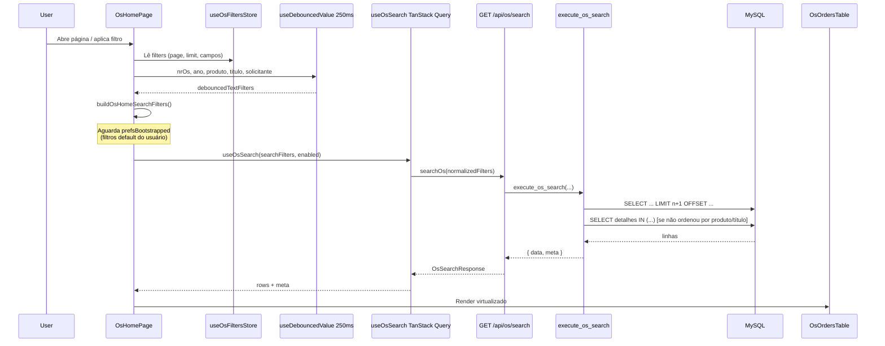
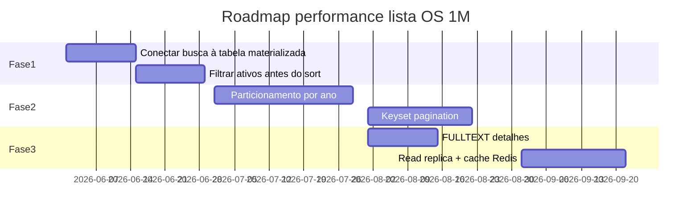

# Relatório de Auditoria — Lista de OSs, Filtros e Paginação

**Data:** 2026-06-11  
**Escopo:** auditoria somente leitura — nenhuma alteração de código, migration ou comportamento.  
**Base analisada:** `C:\dev\SagraWeb` (backend FastAPI + front React/TanStack Query).

**Documentos relacionados:**

- [`RELATORIO_PERFORMANCE_LISTA_OS.md`](RELATORIO_PERFORMANCE_LISTA_OS.md) — diagnóstico pré-otimização (jun/2026)
- [`RELATORIO_OTIMIZACAO_LISTA_OS_IMPLEMENTACAO.md`](RELATORIO_OTIMIZACAO_LISTA_OS_IMPLEMENTACAO.md) — registro de implementação parcial

---

## 1. Resumo executivo

A lista inicial de OSs na página home é alimentada por **uma única API server-side**: `GET /api/os/search`. O front-end monta filtros em um store Zustand, aplica debounce apenas em campos de texto, e exibe **20 linhas por página** com paginação e ordenação no servidor.

O backend classifica cada OS com base em:

1. **Tipo** — OS (`NroProtocolo < 5000`) vs SP (`≥ 5000`)
2. **Status operacional** — último andamento com `UltimoStatus = 1` em `tabAndamento`, excluindo espelhos de Sub OS
3. **Situação ativa/encerrada** — por padrão exclui Entregue/Cancelada/Cancelado
4. **Prioridade de fila** — Prometido → Solicitado → demais, depois data de entrega
5. **Sub OS** — a OS principal permanece na lista; filtros de setor/situação podem “encontrar” a OS via status de componente

**Gargalo estrutural para escala (1M registros):** a busca ainda materializa o último andamento operacional via `ROW_NUMBER()` sobre `tabAndamento` **a cada request**, embora exista a tabela auxiliar `tab_os_ultimo_andamento_operacional` (mantida incrementalmente, mas **não usada** em `/os/search` no código atual). Com 1 milhão de protocolos e centenas de milhares de andamentos, o plano atual tende a **full scan + sort global + OFFSET**, inviável sem mudanças arquiteturais.

**Otimizações já aplicadas (parciais):**

| Otimização | Status no código |
|------------|------------------|
| JOIN global de `tabDetalhesServico` removido | ✅ Filtro via `EXISTS`; exibição via batch `IN (...)` pós-página |
| `COUNT DISTINCT` adiado com `simple_pagination=true` | ✅ Front envia `simple_pagination=true`; backend não conta |
| `has_sub_os` / `sub_os_count` via agregado | ✅ `LEFT JOIN` em `tab_os_sub_os` |
| Atalho `exact_os_lookup` (Nr OS) | ✅ Ignora filtros de escolha |
| Tabela materializada na busca | ❌ Existe e sincroniza, mas **não entra na query de search** |
| Debounce setor/situação/prioridade no front | ❌ Removido (`isChoiceFilterPending = false`) |

---

## 2. Arquitetura end-to-end

### 2.1 Fluxo de carregamento



### 2.2 Arquivos principais

| Camada | Arquivo | Responsabilidade |
|--------|---------|------------------|
| Página | `apps/web/src/features/os/components/OsHomePage.tsx` | Orquestra filtros, busca, realtime, tabela |
| Painel filtros | `apps/web/src/features/os/components/OsFiltersPanel.tsx` | UI de filtros e toggles |
| Tabela | `apps/web/src/features/os/components/OsOrdersTable.tsx` | Virtualização, paginação UI, Sub OS lazy |
| Store filtros | `apps/web/src/features/os/osFiltersStore.ts` | Estado + persistência parcial (toggles) |
| Utilitários | `apps/web/src/features/os/osSearchUtils.ts` | Merge debounce, `exactOsLookup`, normalização |
| Hook API | `apps/web/src/api/hooks/useOsSearch.ts` | TanStack Query |
| Client HTTP | `apps/web/src/api/os.ts` | `buildOsSearchQueryString`, `searchOs` |
| Rota | `app/backend/routers/os_routes.py` → `search_os()` | Parâmetros HTTP, headers no-cache |
| Serviço | `app/backend/services/os_search_service.py` | SQL, filtros, ordenação, paginação |
| Sub OS | `app/backend/services/os_sub_os_queries.py` | Filtro OR principal/Sub OS, `matched_via_sub_os` |
| Andamento | `app/backend/services/andamento_operacional.py` | `MIRROR_EXCLUDE_CLAUSE`, recalc `UltimoStatus` |
| Materializada | `app/backend/services/os_ultimo_andamento_service.py` | Backfill/sync (auxiliar, fora do search) |
| Índices | `app/backend/os_search_indexes_schema.py` | Índices idempotentes no startup |

---

## 3. Classificação das informações

### 3.1 Dimensões de classificação

O sistema não usa um “status único” pré-computado na listagem. Cada linha é classificada **em tempo de query** combinando colunas de `tabProtocolos`, subquery de andamento e agregado de Sub OS.

| Dimensão | Regra | Origem |
|----------|-------|--------|
| **Identidade** | `(nr_os, ano)` = `(NroProtocolo, AnoProtocolo)` | `tabProtocolos` |
| **OS vs SP** | OS: `NroProtocolo < 5000`; SP: `≥ 5000` | `tabProtocolos`, toggles `include_os` / `include_sp` |
| **Ativa vs encerrada** | Ativa: situação `NULL` ou ∉ {Entregue, Cancelada, Cancelado} | Andamento operacional (`a_op.SituacaoLink`) |
| **Situação exibida** | Texto do último andamento operacional | `tabAndamento` com `UltimoStatus = 1` |
| **Setor exibido** | Setor do mesmo andamento | Idem |
| **Espelho Sub OS** | Andamentos cujo `CodStatus` bate com `cod_status_espelho` são **excluídos** | `MIRROR_EXCLUDE_CLAUSE` |
| **Prioridade (fila)** | 1 = Prometido, 2 = Solicitado, 3 = Normal/outros | `EntregPrazoLink` via `CASE` |
| **Data de ordenação** | `COALESCE(EntregData, DataEntrada)` | `tabProtocolos` |
| **Desempate** | `AnoProtocolo DESC`, `NroProtocolo DESC` | `tabProtocolos` |
| **Tem Sub OS** | `sub_os_count > 0` | `tab_os_sub_os` agregado (`ativo = 1`) |
| **Match via Sub OS** | Filtro setor/situação bateu no componente, não na OS principal | Pós-processamento Python |

### 3.2 Seleção do último andamento operacional

Regra em `_andamento_join_sql()` (`os_search_service.py`):

```sql
-- Para cada (NroProtocoloLink, AnoProtocoloLink):
-- 1. Considera apenas tabAndamento com UltimoStatus = 1
-- 2. Exclui espelhos Sub OS (NOT EXISTS em tab_os_sub_os_andamento.cod_status_espelho)
-- 3. Entre os restantes, escolhe ROW_NUMBER = 1 ORDER BY Data DESC, CodStatus DESC
```

**Observação importante:** `UltimoStatus = 1` já restringe a um subconjunto, mas a window function ainda percorre **todas** as linhas com `UltimoStatus = 1` na base antes do JOIN com protocolos. Em bases grandes, isso é o principal custo.

### 3.3 Tabela materializada (existe, não usada na listagem)

`tab_os_ultimo_andamento_operacional`:

- Criada em `os_ultimo_andamento_schema.py` com PK `(nro_protocolo, ano_protocolo)` e índices em `situacao`, `setor`, `(setor, situacao)`, `data`.
- Atualizada em `refresh_os_ultimo_andamento_operacional()` após recalc de andamento (`andamento_operacional.py`, `os_operacional_notify_service.py`).
- Backfill offline: `scripts/rebuild_os_ultimo_andamento.py`.
- Comentário explícito no serviço: *"cache auxiliar (não usado em GET /os/search)"*.
- Testes (`test_os_ultimo_andamento_search.py`) **exigem** que a SQL de search **não** referencie essa tabela.

### 3.4 Ordenação

**Default** (sem `sort_by`):

1. Rank de prioridade ASC (Prometido → Solicitado → demais)
2. `COALESCE(EntregData, DataEntrada)` ASC
3. `AnoProtocolo DESC`, `NroProtocolo DESC`

**Por coluna** (`sort_by` + `sort_dir`): mapeamento em `OS_SEARCH_SORT_COLUMNS_BASE` + `situacao`/`setor` do andamento. Colunas `produto`/`titulo` exigem JOIN em `tabDetalhesServico` na query principal.

**PCP** (`pcp_order=true`): prefixo com `tab_pcp_fila.ordem` (OS sem entrada na fila vão ao final).

### 3.5 Sub OS na listagem

- Sub OS **não** aparece como linha independente na busca principal.
- Filtros de setor/situação usam lógica **OR**: status da OS principal **ou** status de Sub OS ativa com andamento manual (`build_main_or_sub_os_filter_sql`).
- Quando o match veio da Sub OS, `annotate_search_sub_os_matches` marca `matched_via_sub_os=true`; o front auto-expande e busca `GET /os/{ano}/{id}/sub-os`.

---

## 4. Sistema de filtros

### 4.1 Estado no front-end

**Defaults** (`defaultOsFilters` em `osFiltersStore.ts`):

| Campo | Valor inicial |
|-------|---------------|
| `nrOs`, `ano` | `undefined` (todos os anos) |
| `produto`, `titulo`, `solicitante` | `""` |
| `situacao`, `setor`, `prioridade` | `[]` |
| `includeFinished` | `false` |
| `includeOs` / `includeSp` | `true` / `true` |
| `page` | `1` |
| `limit` | `20` (`DEFAULT_PAGE_SIZE`) |

**Persistência local (localStorage `sagra-os-filter-toggles`):** apenas `includeFinished`, `includeOs`, `includeSp`.

**Bootstrap de preferências:** antes da primeira busca, `OsHomePage` aguarda `GET` de filtros default do usuário (`useUserFiltersDefault`). Se houver setores/situações salvos, aplica e só então habilita `useOsSearch` (`prefsBootstrapped=true`). Isso evita uma busca “genérica” antes dos filtros do usuário, mas **não reduz** o custo SQL se os filtros ainda forem amplos.

### 4.2 Debounce e timing de requests

| Tipo de filtro | Debounce | Efeito |
|----------------|----------|--------|
| Nr OS, Ano, Produto, Título, Solicitante | **250 ms** | `useDebouncedValue` em `OsHomePage` |
| Situação, Setor, Prioridade | **Nenhum** | Refetch imediato ao alterar MultiSelect |
| Toggles OS/SP/Entregues | **Nenhum** | Refetch imediato |
| Paginação (`page`) | **Nenhum** | Refetch imediato |
| Ordenação por coluna | **Nenhum** | Reseta `page=1` e refetch |

`isChoiceFilterPending` está fixo em `false` — não há indicador de “filtro de escolha pendente”.

### 4.3 Mapeamento front → query string

`buildOsSearchQueryString` (`api/os.ts`) sempre envia:

- `simple_pagination=true`
- `include_finished`, `include_os`, `include_sp`
- `page`, `limit`
- `exact_os_lookup=true` quando `buildOsHomeSearchFilters` detecta Nr OS preenchido

### 4.4 Regras de filtro no backend

Implementação: `execute_os_search()` em `os_search_service.py`.

| Filtro | SQL / comportamento |
|--------|---------------------|
| **Ativas (default)** | `(situacao IS NULL OR situacao NOT IN ('Entregue','Cancelada','Cancelado'))` |
| **OS / SP** | `NroProtocolo < 5000` ou `>= 5000` conforme toggles |
| **Nr OS** | `p.NroProtocolo = %(nr_os)s` |
| **Ano** | `p.AnoProtocolo = %(ano)s` |
| **Produto** | `EXISTS` em `tabDetalhesServico` com `TipoPublicacaoLink LIKE %term%` |
| **Título** | Idem com `Titulo LIKE %term%` |
| **Solicitante** | `p.NomeUsuario LIKE %term%` |
| **Situação + Setor** | `(main IN (...)) OR EXISTS(Sub OS...)` via `build_main_or_sub_os_filter_sql` |
| **Prioridade** | `p.EntregPrazoLink IN (...)` |
| **Texto mínimo** | Termos com menos de **3 caracteres** são ignorados, **exceto** se `nr_os` ou `ano` estiver preenchido (`OS_SEARCH_MIN_LIKE_CHARS = 3`) |

### 4.5 Atalho `exact_os_lookup`

Quando o usuário preenche **Nr OS**, o front define `exactOsLookup=true` e força `page=1`.

No backend, com `exact_os_lookup=true` e `nr_os` presente (`skip_choice_filters`):

- **Ignora** filtros de situação, setor, prioridade
- **Ignora** toggles OS/SP
- Mantém filtro de ano, texto (produto/título/solicitante) e `include_finished`

Objetivo: localizar uma OS específica com query indexável por PK de protocolo.

### 4.6 Indicadores de filtro na UI

`filterStatus.ts`:

- **Filtro salvo:** exibe nome do filtro persistido do usuário
- **Filtro personalizado:** lista campos preenchidos via `getActiveFilterLabels`
- **Hints implícitos:** `getImplicitFilterHints` — exclui entregues, restrição de ano, OS/SP, aviso de `exactOsLookup`

---

## 5. Paginação

### 5.1 Modelo server-side

| Parâmetro | Default | Limite |
|-----------|---------|--------|
| `page` | 1 | ≥ 1 |
| `limit` | 20 | máx. **100** (`OS_SEARCH_MAX_LIMIT`) |

**Offset:** `offset = (page - 1) * limit`

### 5.2 Paginação simples (`simple_pagination=true`)

Modo usado pelo front por padrão:

1. Backend executa `LIMIT limit + 1 OFFSET offset`
2. Se retornar mais de `limit` linhas → `has_next = true`; descarta a linha extra
3. **Não executa** `COUNT(DISTINCT ...)` (`include_total=False` quando `simple_pagination=True`)
4. Meta retornada: `{ page, limit, has_next, simple_pagination: true }` — sem `total_records` / `total_pages`

**Modo legado** (`simple_pagination=false`): executa COUNT e preenche `total_records`, `total_pages`.

### 5.3 UI de paginação (`OsOrdersTable`)

- **Anterior:** habilitado se `page > 1`
- **Próxima:** habilitado se `total_pages` existir e `page < total_pages`, senão usa `meta.has_next`
- **Rótulo:**
  - Com total: `Exibindo de X a Y de Z OPs`
  - Sem total: `Exibindo de X a Y OPs (página N)` ou sem menção à próxima página
- **Reset de página:** qualquer alteração de filtro via `patchFilters` define `page: 1` (exceto `setPage` explícito)

### 5.4 Deduplicação

Backend (`_dedupe_os_search_rows`) e front (`dedupeOsSearchResponse`) garantem uma linha por `(nr_os, ano)` — proteção contra duplicatas acidentais no JOIN.

### 5.5 Limitações de escala da paginação OFFSET

Com 1M registros:

- **Página 1:** ainda precisa **ordenar o conjunto filtrado inteiro** antes do `LIMIT` (gargalo principal)
- **Página alta (ex.: 5000):** `OFFSET 99980` força o engine a **descartar** quase 100k linhas já ordenadas — custo linear com o offset
- Sem `total_records`, o usuário navega “cegamente” com `has_next` — aceitável para UX, mas não resolve custo SQL

---

## 6. Cache, realtime e refetch

### 6.1 TanStack Query (`useOsSearch`)

| Configuração | Valor atual | Implicação |
|--------------|-------------|------------|
| `staleTime` | **0** (`OS_SEARCH_STALE_MS`) | Dados sempre “stale”; refetch frequente |
| `gcTime` | 5 min | Cache em memória após desmontar |
| `refetchOnMount` | `"always"` | Nova montagem sempre busca de novo |
| `refetchOnWindowFocus` | `false` | Sem refetch ao focar aba |
| `refetchOnReconnect` | `true` | Refetch ao reconectar rede |
| `refetchInterval` | **60 s** (aba visível) | Polling de segurança |
| `structuralSharing` | `false` | Substituição completa do objeto de resposta |
| `placeholderData` / `keepPreviousData` | **Ausente** | Troca de página pode “piscar” sem dados anteriores |

### 6.2 HTTP

Backend envia `Cache-Control: no-store, no-cache, must-revalidate` — **sem cache de proxy/browser**.

### 6.3 WebSocket (`useOsRealtimeSync`)

| Evento | Ação |
|--------|------|
| `system_update` | Patch incremental via histórico ou `silentRefreshOsSearch` (debounce 300 ms) |
| `pcp_queue_update`, `force_refresh` | Refresh da lista (300 ms) |
| Reconexão WS | Refresh imediato |
| WS desconectado | Polling backoff 5 s → 30 s enquanto aba visível |

Lock cross-tab (`osSearchRefreshLock`, TTL ~2,5 s) evita refresh simultâneo em múltiplas abas.

### 6.4 Pós-busca: enriquecimento e Sub OS

1. Se não ordenou por produto/título: **2ª query** batch `SELECT ... FROM tabDetalhesServico WHERE (nro, ano) IN (...)` — custo O(página), ~20 pares
2. Expansão manual de Sub OS: `fetchSubOsList` por OS
3. `matched_via_sub_os`: auto-expand + N requests `fetchSubOsList`
4. Após refetch WS: re-busca Sub OS expandidas com delay **900 ms**

---

## 7. Índices existentes

### 7.1 Startup (`os_search_indexes_schema.py`)

| Índice | Tabela | Colunas |
|--------|--------|---------|
| `idx_andamento_os_operacional` | `tabAndamento` | `(NroProtocoloLink, AnoProtocoloLink, UltimoStatus, Data, CodStatus)` |
| `idx_protocolos_search_sort` | `tabProtocolos` | `(EntregData, AnoProtocolo, NroProtocolo)` |
| `idx_detalhes_os_link` | `tabDetalhesServico` | `(AnoProtocoloLinkDet, NroProtocoloLinkDet)` |
| `idx_protocolos_solicitante` | `tabProtocolos` | `(NomeUsuario(64))` |

### 7.2 SQL adicional (`deploy/sql/create_os_search_indexes.sql`)

Índices extras documentados para deploy manual: filtros em andamento, prioridade, detalhes produto/título.

### 7.3 Tabela materializada

Índices em `(situacao)`, `(setor)`, `(setor, situacao)`, `(data)`, `(ano_protocolo, nro_protocolo)` — **úteis apenas se a busca passar a usar essa tabela**.

---

## 8. Análise de performance — cenário 1M registros

### 8.1 Projeção de cardinalidade

Assumindo crescimento linear a partir do ambiente atual (~84k protocolos, ~198k andamentos):

| Tabela | ~84k OSs hoje | Projeção 1M OSs |
|--------|---------------|-----------------|
| `tabProtocolos` | ~84k | **~1.000.000** |
| `tabAndamento` | ~198k | **~2.400.000+** (média ~2,4 andamentos/OS) |
| `tabDetalhesServico` | ~86k | **~1.000.000** |
| OSs “ativas” (não entregues) | ~217 | Proporcional — se 0,25% ativas → **~2.500** |

O problema não é exibir 20 linhas; é **encontrar e ordenar** o conjunto candidato.

### 8.2 Gargalos classificados (1M registros)

| # | Gargalo | Severidade | Motivo |
|---|---------|------------|--------|
| 1 | `ROW_NUMBER()` / derived table em `tabAndamento` | **Crítico** | Varre todas as linhas `UltimoStatus=1` por request |
| 2 | Sort global em `tabProtocolos` antes de `LIMIT` | **Crítico** | Ordenação default não usa índice covering completo |
| 3 | `OFFSET` em páginas altas | **Alto** | Custo O(offset) |
| 4 | `LIKE '%termo%'` (produto, título, solicitante) | **Alto** | Não usa índice B-tree; full scan |
| 5 | `EXISTS` duplo Sub OS no filtro setor/situação | **Médio–Alto** | Por linha candidata no plano sem semi-join otimizado |
| 6 | Agregado `tab_os_sub_os` sem filtro | **Médio** | `GROUP BY` em toda tabela Sub OS |
| 7 | `staleTime=0` + poll 60s + WS refresh | **Médio** | Multiplica carga com muitos usuários |
| 8 | Renderização front (20 linhas virtualizadas) | **Baixo** | Não escala com total de registros |

### 8.3 Estimativa qualitativa de tempo (sem medição em 1M)

| Cenário | Comportamento esperado hoje |
|---------|----------------------------|
| Abertura default (ativas, sem filtro texto) | **Segundos a dezenas de segundos** — sort em ~1M protocolos após JOIN andamento |
| `nr_os` + `ano` (exact lookup) | **Dezenas de ms** — PK/range indexável |
| Filtro `ano=2026` | **Melhor** — reduz protocolos, mas JOIN andamento global persiste |
| `titulo LIKE '%x%'` | **Muito lento** — scan em detalhes |
| Página 100+ | **Piora linearmente** com OFFSET |

---

## 9. Sugestões de otimização para 1M registros

Priorizadas por impacto × viabilidade. **Nenhuma implementada neste relatório.**

### 9.1 Prioridade 1 — Estrutural (obrigatório para 1M)

#### A. Usar `tab_os_ultimo_andamento_operacional` na busca

A infraestrutura **já existe** (tabela, backfill, sync incremental). Falta alterar `_resolve_andamento_join()` para:

```sql
LEFT JOIN tab_os_ultimo_andamento_operacional a_op
  ON a_op.nro_protocolo = p.NroProtocolo AND a_op.ano_protocolo = p.AnoProtocolo
```

Com fallback para JOIN live se tabela vazia (padrão descrito em `RELATORIO_OTIMIZACAO_LISTA_OS_IMPLEMENTACAO.md`).

**Ganho:** elimina window function global por request.  
**Risco:** dessincronização — mitigado pelos hooks de write já existentes + job de rebuild noturno.

#### B. Inverter o plano da query — filtrar antes de ordenar

Para abertura default (sem texto):

1. Partir de `tab_os_ultimo_andamento_operacional` com `situacao NOT IN (encerradas)` — índice `(situacao, setor)`
2. JOIN em `tabProtocolos` só nos IDs candidatos
3. Ordenar subconjunto (~milhares, não milhões)
4. `LIMIT/OFFSET`

**Ganho:** de O(N protocolos) para O(N ativos).

#### C. Particionamento / arquivo por `AnoProtocolo`

- Partições MySQL por ano em `tabProtocolos`, `tabAndamento`, `tabDetalhesServico`
- OU tabelas de arquivo para anos fechados (ex.: &lt; 2020 só leitura)
- Filtro default opcional “ano corrente” no front

**Ganho:** reduz base quente de 1M para dezenas de milhares.

### 9.2 Prioridade 2 — Paginação e ordenação

#### D. Keyset (cursor) pagination em vez de OFFSET

Substituir `OFFSET` por condição do tipo:

```sql
WHERE (priority_rank, sort_date, ano, nro) > (:last_rank, :last_date, :last_ano, :last_nro)
ORDER BY ... LIMIT 21
```

**Ganho:** páginas profundas deixam de ser O(offset).  
**Custo:** UI perde “ir para página 47” direto; precisa navegação sequencial ou busca.

#### E. Índice covering para ordenação default

Índice composto em `tabProtocolos`:

```sql
(EntregPrazoLink(32), EntregData, DataEntrada, AnoProtocolo, NroProtocolo)
```

Ou, preferencialmente, colunas computadas/materializadas `priority_rank` + `sort_date` na tabela materializada.

### 9.3 Prioridade 3 — Filtros textuais

#### F. FULLTEXT em `tabDetalhesServico`

```sql
FULLTEXT INDEX ft_detalhes_busca (Titulo, TipoPublicacaoLink)
-- MATCH(...) AGAINST(...) em vez de LIKE '%...%'
```

**Ganho:** busca textual em 1M detalhes passa de minutos para ms–s.

#### G. Busca de solicitante

- FULLTEXT em `NomeUsuario`, ou
- Tabela de trigrama / Elasticsearch para autocomplete

### 9.4 Prioridade 4 — Sub OS e agregados

#### H. Materializar `sub_os_count` / flag `has_sub_os`

Evitar `GROUP BY` global em `tab_os_sub_os` a cada search — coluna na materializada ou tabela satélite atualizada nos writes.

#### I. Índice para filtro Sub OS

```sql
idx_sub_os_andamento_filtro (ultimo_status, setor, situacao, sub_os_id)
```

Em `tab_os_sub_os_andamento` — acelera `EXISTS` quando volume de Sub OS crescer.

### 9.5 Prioridade 5 — Infraestrutura e cache

| Ação | Quando usar |
|------|-------------|
| **Read replica** dedicada a `/os/search` | Muitos usuários simultâneos na lista |
| **Redis** cache keyed por `hash(filtros+page+limit)`, TTL 15–30 s | Picos previsíveis; invalidar via WS |
| **Snapshot de fila ativa** (view/tabela com ~2,5k OSs ativas, refresh 30 s) | Abertura instantânea; filtros raros |
| **Connection pooling** + limitação de concurrency search | Proteção do primário |

### 9.6 Prioridade 6 — Front-end (complementar)

| Ação | Benefício |
|------|-----------|
| Restaurar `placeholderData: keepPreviousData` | UX entre páginas sem piscar |
| `staleTime` 30–60 s + invalidação WS | Menos requests redundantes |
| Debounce 200 ms em setor/situação/prioridade | Menos requests durante multi-select |
| Exigir ano ou filtro mínimo na abertura sem prefs | Reduz cardinalidade default (decisão de produto) |

---

## 10. Roadmap sugerido (1M registros)



| Fase | Meta de latência (p95) | Entregáveis |
|------|------------------------|-------------|
| **1** | Abertura &lt; 500 ms | JOIN materializada + query invertida + índices covering |
| **2** | Páginas 2–N &lt; 300 ms | Keyset + partição/arquivo por ano |
| **3** | Busca textual &lt; 1 s | FULLTEXT + replica + cache |

---

## 11. Garantias de negócio a preservar

| Regra | Onde está | Não alterar sem testes |
|-------|-----------|------------------------|
| Exclusão de espelhos Sub OS do andamento operacional | `MIRROR_EXCLUDE_CLAUSE` | Sim |
| `UltimoStatus` em `tabAndamento` (fonte de verdade MDB) | `andamento_operacional.py` | Sim |
| Filtro OR principal/Sub OS | `os_sub_os_queries.py` | Sim |
| Sub OS não vira linha na lista principal | Design front+back | Sim |
| `exact_os_lookup` para Nr OS | `osSearchUtils` + backend | Sim |
| WebSocket reflete mudanças | `osRealtimeSync` | Sim |

---

## 12. Divergências documentação vs código

| Documento / expectativa | Código atual (2026-06-11) |
|-------------------------|---------------------------|
| `RELATORIO_OTIMIZACAO` — busca usa tabela materializada | Search usa `ROW_NUMBER()` live em `tabAndamento` |
| `RELATORIO_PERFORMANCE` — `staleTime` 30 s, `keepPreviousData` | `staleTime=0`, sem `keepPreviousData` |
| `RELATORIO_OTIMIZACAO` — debounce setor/situação 200 ms | `isChoiceFilterPending = false` |
| `api/os.ts` comentário “total via COUNT otimizado” | COUNT só com `simple_pagination=false` |
| Testes exigem materializada **fora** do search | Consistente com código — materializada é auxiliar |

---

## 13. Perguntas para decisão de produto

1. Qual latência p95 aceitável na abertura com 1M registros? (&lt; 500 ms? &lt; 1 s?)
2. `total_records` na paginação é obrigatório ou `has_next` basta?
3. Abertura sem filtros deve restringir ao **ano corrente** por default?
4. Anos históricos podem ir para **arquivo** (somente leitura, busca separada)?
5. Quantos usuários simultâneos na lista no pico? (dimensiona replica/cache)
6. Volume esperado de Sub OS por OS nos próximos anos?
7. Busca textual (título/produto) é caso de uso frequente ou exceção?

---

## Apêndice A — Query resumida atual

```sql
SELECT p.*, a_op.situacao, a_op.setor, a_op.data AS last_update, ...
       COALESCE(sub_agg.sub_os_count, 0), ...
FROM tabProtocolos p
LEFT JOIN (
    -- ROW_NUMBER() OVER (PARTITION BY nro, ano ORDER BY Data DESC, CodStatus DESC)
    -- em tabAndamento WHERE UltimoStatus=1 AND NOT espelho Sub OS
) AS a_op ON ...
LEFT JOIN (
    SELECT nro_protocolo, ano_protocolo, COUNT(*) ...
    FROM tab_os_sub_os WHERE ativo=1 GROUP BY ...
) AS sub_agg ON ...
-- [LEFT JOIN tabDetalhesServico d — só se sort_by produto/título]
WHERE 1=1
  AND (a_op.SituacaoLink IS NULL OR NOT IN encerradas)  -- se include_finished=false
  AND [filtros nr/ano/OS/SP/texto/setor/situação/prioridade]
ORDER BY [prioridade + data + desempate | coluna escolhida]
LIMIT :limit+1 OFFSET :offset

-- Pós-página (Python):
-- SELECT detalhes WHERE (nro,ano) IN (...)  -- se não JOINou detalhes
-- annotate_search_sub_os_matches()
```

---

## Apêndice B — Contrato API `GET /api/os/search`

**Resposta:**

```json
{
  "data": [ { "nr_os", "ano", "titulo", "solicitante", "situacao", "setor",
             "prioridade", "produto", "formato", "data_entrega", "last_update",
             "has_sub_os", "sub_os_count", "matched_via_sub_os" } ],
  "meta": { "page": 1, "limit": 20, "has_next": true, "simple_pagination": true }
}
```

---

*Relatório gerado por auditoria estática do código-fonte. Nenhuma migration, alteração de comportamento ou benchmark em base de 1M registros foi executado nesta sessão.*
